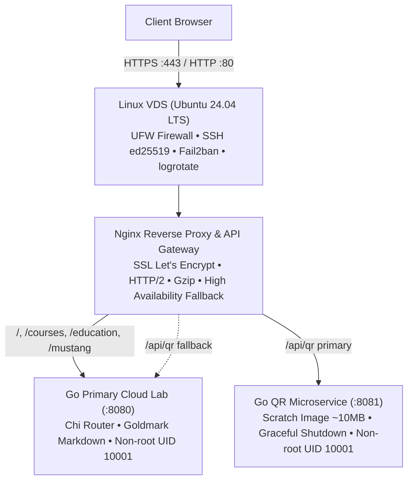
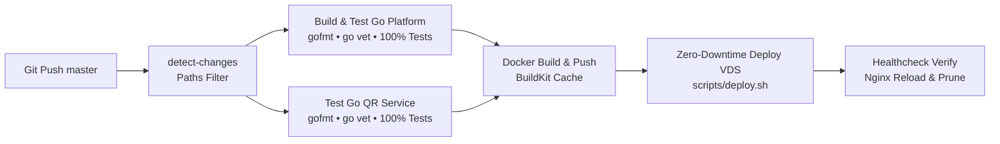
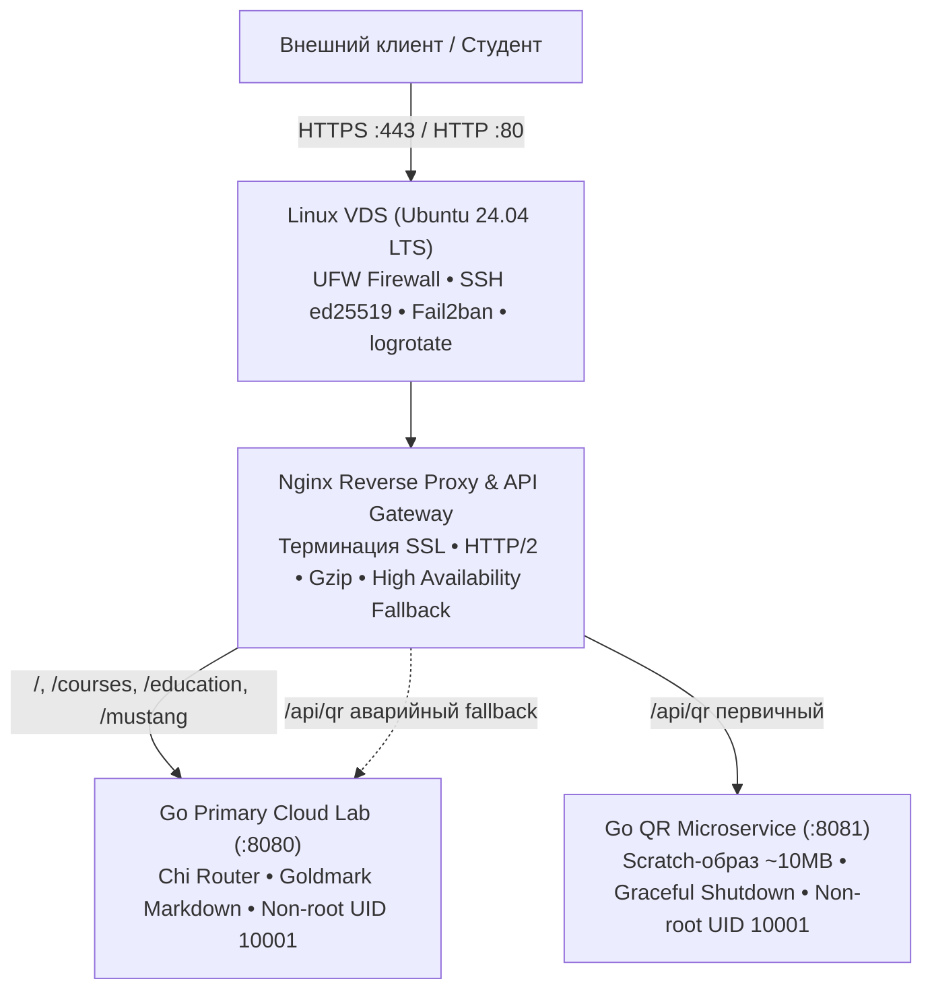
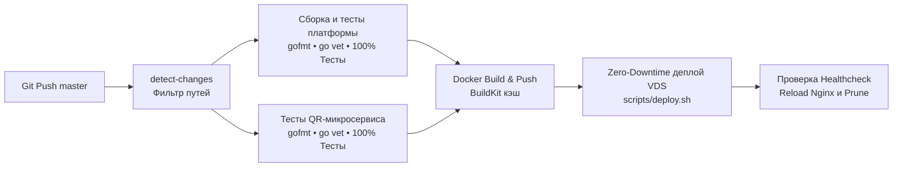

<div align="center">

# Primary Cloud Lab

<p><b>Interactive DevOps & Linux Education Platform • <a href="https://vorobevaqa.ru">vorobevaqa.ru</a></b></p>

<p>
  <a href="https://ubuntu.com/"></a>
  <a href="https://hub.docker.com/r/andreyvorobevaqa/portfolio-service"></a>
  <a href="https://galaxy.ansible.com/ui/standalone/namespaces/24255/"></a>
  <a href="https://github.com/AndreyJVM/portfolio-service/actions"></a>
  <a href="https://github.com/AndreyJVM/portfolio-service/security/dependabot"></a>
  <a href="https://nginx.org/"></a>
  <a href="https://go.dev/"></a>
</p>

<p>
  <b><a href="#english">English</a></b> • <b><a href="#русский">Русский</a></b>
</p>

</div>

---

<a name="english"></a>
## English

**Primary Cloud Lab** is an open-source engineering platform and comprehensive **Docker Bible: From Zero to Production** (`Библия по Docker: с нуля до профи`).

The platform provides a deep, production-grade knowledge base focused on containerization, Linux kernel isolation, high-performance image builds, networking, orchestration, hardening, and automated CI/CD delivery. Built with **Go (Golang 1.26.8)**, it features non-root container security (UID 10001), instant full-text in-memory search, client-side progress tracking, declarative JSON content architecture with frontmatter parsing, automated integrity test coverage, and zero-downtime Blue-Green deployments.

**Production:** [https://vorobevaqa.ru](https://vorobevaqa.ru) · **Docker Hub:** [`andreyvorobevaqa`](https://hub.docker.com/repositories/andreyvorobevaqa) · **Ansible Galaxy:** [Author Roles](https://galaxy.ansible.com/ui/standalone/namespaces/24255/)

### Table of Contents
- [Architecture & Infrastructure](#architecture--infrastructure)
- [Docker Bible: 10 Comprehensive Modules](#docker-bible-10-comprehensive-modules)
- [Declarative Content Engine & CLI Scaffolding](#declarative-content-engine--cli-scaffolding)
- [Interactive Learning & Instant Search](#interactive-learning--instant-search)
- [CI/CD & Zero-Downtime Blue-Green Deployment](#cicd--zero-downtime-blue-green-deployment)
- [Local Development & Testing](#local-development--testing)
- [Repository Structure](#repository-structure)

---

### Architecture & Infrastructure



| Layer | Technologies & Solutions |
|---|---|
| **Host & Operating System** | Linux (Ubuntu 24.04 LTS), Bash automation scripts, systemd, cron, logrotate |
| **Network & Security** | UFW firewall, Fail2ban brute-force protection, SSH authentication via ed25519 keys |
| **Gateway & Reverse Proxy** | Nginx (SSL termination, Certbot auto-renewal, HTTP/2, Gzip, HA fallback routing, custom error pages) |
| **Containerization** | Docker, Docker Compose v2, Docker Hub Registry, Alpine 3.21 runtime, scratch container, cgroups v2 limits, non-root (UID 10001) |
| **Backend Services** | Go 1.26.8 (`go-chi/chi/v5`, `yuin/goldmark`, `skip2/go-qrcode`), static compilation with stripped symbols (`-w -s`) |
| **Content Engine** | Declarative JSON manifest (`content/courses.json`), YAML-style Markdown frontmatter, automated content integrity test suite |
| **IaC & Orchestration** | Ansible (idempotent playbooks and roles in Ansible Galaxy), Blue-Green zero-downtime deployment script |
| **CI/CD** | GitHub Actions (matrix/paths-filter triggers, BuildKit gha cache, `gofmt` & `go vet` quality gates, automated rollback) |
| **Dependency Auditing** | Dependabot (weekly security and version monitoring for Go, Docker base images, and GitHub Actions) |

---

### Docker Bible: 10 Comprehensive Modules

The curriculum covers a structured engineering pathway from kernel namespaces to advanced production operations (26+ lessons):

1. 🐳 **Architecture & Fundamentals** (`/courses/docker`):
   - Linux process isolation (PID, MNT, NET, IPC, UTS, USER, CGROUP namespaces);
   - OCI specs, `dockerd` → `containerd` → `runc` runtime stack; container lifecycle and init process.
2. 🔨 **Image Building & Dockerfile Mastery** (`/courses/docker-dockerfile`):
   - Layer anatomy, cache optimization, BuildKit execution engine;
   - Multi-stage builds, Distroless/Scratch minimal images, RUN mount secrets and cache mounts.
3. 💾 **Volumes & Persistent Storage** (`/courses/docker-storage`):
   - Storage drivers (`overlay2` CoW mechanics, `d_type` check);
   - Named Volumes vs Bind Mounts vs tmpfs, solving UID/GID ownership and permission collisions.
4. 🌐 **Networking Stack & DNS Discovery** (`/courses/docker-networking`):
   - Network drivers (`bridge`, `host`, `macvlan`, `none`), embedded DNS resolution (`127.0.0.11`);
   - Port forwarding mechanics, iptables interaction, and preventing UFW firewall bypass.
5. 📦 **Multi-Container Stacks (Compose v2)** (`/courses/docker-compose`):
   - Compose v2 specification, variable interpolation hierarchy and `.env` handling;
   - Healthcheck probes and orchestration order via `depends_on condition: service_healthy`.
6. 🛡️ **Container Security & Production Hardening** (`/courses/docker-security`):
   - Non-root UID execution, dropping Linux capabilities (`cap_drop: [ALL]`), read-only rootfs;
   - Seccomp BPF syscall filters, AppArmor profiles, and automated vulnerability scanning with Trivy.
7. ⚡ **Kernel Isolation & Resources (Cgroups v2)** (`/courses/docker-resources`):
   - CPU quotas (`cpus`, `cpu_shares`), CFS scheduler throttles, memory hard and soft limits;
   - OOM Killer diagnostics, kernel dmesg inspection, Exit Code 137 resolution, swap management.
8. 🔧 **Daemon Tuning & Production Operations** (`/courses/docker-production`):
   - Configuration tuning in `/etc/docker/daemon.json` (`live-restore`, `log-driver`, `default-ulimits`);
   - Container monitoring via cAdvisor/Prometheus, disk cleanup strategies, and exit code reference.
9. 🚀 **Multi-Arch Builds & CI/CD Pipelines** (`/courses/docker-cicd`):
   - Multi-architecture images (`linux/amd64`, `linux/arm64`) using Docker Buildx and QEMU;
   - GitHub Actions pipelines with Registry cache export, automated testing, and Zero-Downtime Blue-Green deployments.
10. 📚 **Cookbook: Cheatsheet & Production Templates** (`/courses/docker-cookbook`):
    - Comprehensive CLI cheatsheet (run, exec, logs, inspect, prune);
    - Battle-tested production Dockerfile templates for Go, Node.js, Python, Rust, and Nginx.

---

### Declarative Content Engine & CLI Scaffolding

- **Declarative JSON Manifest (`content/courses.json`):**
  Modules, titles, descriptions, icons, colors, tags, and levels are configured in a single declarative file. Adding or updating modules requires zero Go code changes.
- **YAML-Style Frontmatter in Markdown:**
  Lessons support metadata headers (`title`, `description`, `duration`, `level`, `order`, `tags`) parsed cleanly before rendering HTML, enabling rich filtering and instant index updates.
- **Automated Content Integrity Tests (`internal/service/content_integrity_test.go`):**
  Continuous validation ensures all Markdown lessons exist, have valid non-empty headers, correct frontmatter, and render cleanly through Goldmark without syntax errors.
- **One-Command Scaffolding Script (`scripts/create-lesson.sh`):**
  ```bash
  ./scripts/create-lesson.sh <module-slug> <lesson-slug> "<Title>" [duration] [level] [tags]
  # Example:
  ./scripts/create-lesson.sh docker-storage 03-permissions-uid-gid "Права доступа UID и GID в томах" "15 мин" "Middle" "Storage,Permissions"
  ```

---

### Interactive Learning & Instant Search

- **Full-Text In-Memory Search:**
  - Real-time client-side search across all course descriptions and lesson materials via `/api/search`;
  - Modal overlay accessible anywhere on the platform via keyboard shortcuts (`Ctrl+K` or `/`);
  - Dynamic result highlighting with category badges (Linux, Docker, Podman, LXC, Ansible, CI/CD).
- **Client-Side Progress Tracking:**
  - Completed lessons are instantly persisted in browser `LocalStorage`;
  - Progress percentages are dynamically calculated and rendered in course dashboards and navigation.
- **Hands-on Terminal Practice:**
  - Deep technical guides, production-grade configurations, and real terminal troubleshooting scenarios.
- **Responsive Navigation with Course Subnav:**
  - Desktop ($\ge 992\text{px}$): fixed sidebar with quick-access subitems for each course topic;
  - Mobile & tablet ($< 992\text{px}$): compact top bar and smooth offcanvas navigation drawer.

---

### CI/CD & Zero-Downtime Blue-Green Deployment



1. **Path-Based Triggering:** Builds and tests execute conditionally only for components with detected changes.
2. **Code Quality Gates:** Automated enforcement of `gofmt` canonical formatting and `go vet` static analysis on every push and pull request.
3. **Concurrency Control:** Production deployments use concurrency locking (`group: production-deploy`) to prevent release race conditions.
4. **Seamless Blue-Green Update:** `scripts/deploy.sh` spins up an updated container instance (`scale app=2`), verifies its healthcheck endpoint, reloads Nginx gracefully, and decommissions the old instance with automated rollback on failure.
5. **Dependabot Updates:** Weekly scheduled audits for Go modules (`go.mod` / `vendor`), Dockerfiles, and GitHub Actions workflows.

---

### Local Development & Testing

```bash
# 1. Run unit tests with race detection
go test -v -race ./...

# 2. Verify Go formatting and static analysis
test -z "$(gofmt -l cmd/ internal/)" && go vet ./...

# 3. Run the web platform locally
go run cmd/server/main.go

# 4. Build and run Docker containers locally
docker compose up -d --build
```

---

### Repository Structure

```
portfolio/
├── cmd/server/main.go       # Go web server entrypoint (Chi router, graceful shutdown)
├── content/
│   ├── courses.json         # Declarative course catalog and metadata manifest
│   └── courses/             # Docker Bible modules in Markdown (10 structured tracks)
├── internal/
│   ├── config/              # Environment configuration loader
│   ├── handler/             # HTTP page handlers, REST API endpoints, search, and unit tests
│   ├── model/               # Data structures (Courses, Lessons, SearchItem, Integrations)
│   └── service/             # Catalog service, frontmatter parser, and integrity tests
├── web/
│   ├── static/              # CSS (themes, navbar, animations), JS (search, progress), images
│   └── templates/           # Go HTML templates (layout, index, courses, course_detail, lesson)
├── nginx/
│   ├── nginx.conf           # Reverse Proxy, SSL Let's Encrypt configuration, and HA routing
│   └── 50x.html             # Custom error pages
├── scripts/
│   ├── create-lesson.sh     # CLI generator for scaffolded lessons with frontmatter
│   └── deploy.sh            # Zero-Downtime Blue-Green deployment with automated rollback
├── docker-compose.yml       # Production microservice stack configuration
├── Dockerfile               # Multi-stage static Go binary build on Alpine 3.21 (non-root UID 10001)
├── go.mod / go.sum          # Go 1.26.8 platform module definition and vendor tree
├── .editorconfig            # Code style configuration (Go tabs width 4)
├── .github/
│   ├── dependabot.yml       # Dependabot configuration (Go, Docker, GitHub Actions)
│   └── workflows/           # CI/CD pipelines (production deployment and PR test suites)
```

---

<a name="русский"></a>
## Русский

**Primary Cloud Lab** — открытая инженерная база знаний и фундаментальная **Библия по Docker: От нуля до Production** (`Библия по Docker: с нуля до профи`).

Платформа представляет собой сквозное прикладное руководство по контейнеризации: от низкоуровневой изоляции процессов ядра Linux и сборки минимальных образов до сетей, Compose v2, безопасности, Cgroups v2, тюнинга демона и автоматизированного CI/CD развертывания. Серверная часть разработана на **Go (Golang 1.26.8)** с запуском сервисов от непривилегированного пользователя (non-root UID 10001), встроенным полнотекстовым поиском в памяти, сохранением прогресса в браузере, декларативным JSON-манифестом курсов с парсингом frontmatter-метаданных и бесперебойным Blue-Green обновлением.

**Боевой сервер:** [https://vorobevaqa.ru](https://vorobevaqa.ru) · **Docker Hub:** [`andreyvorobevaqa`](https://hub.docker.com/repositories/andreyvorobevaqa) · **Ansible Galaxy:** [роли автора](https://galaxy.ansible.com/ui/standalone/namespaces/24255/)

### Содержание
- [Инфраструктура и Архитектура](#инфраструктура-и-архитектура-1)
- [Библия Docker: 10 тематических модулей](#библия-docker-10-тематических-модулей)
- [Декларативное наполнение базы и CLI-генератор](#декларативное-наполнение-базы-и-cli-генератор)
- [Интерактивная система обучения и поиск](#интерактивная-система-обучения-и-поиск)
- [CI/CD & Бесперебойный Blue-Green деплой](#cicd--бесперебойный-blue-green-деплой-1)
- [Тестирование и локальный запуск](#тестирование-и-локальный-запуск-1)
- [Структура репозитория](#структура-репозитория-1)

---

### Инфраструктура и Архитектура



| Уровень | Технологии & Решения |
|---|---|
| **Хост и ОС** | Linux (Ubuntu 24.04 LTS), Bash-скрипты автоматизации, systemd, cron, ротация logrotate |
| **Сетевая безопасность** | UFW firewall, Fail2ban от брутфорса, SSH-аутентификация по ключам ed25519 |
| **Шлюз и Прокси** | Nginx (Reverse Proxy, API Gateway, SSL Let's Encrypt / Certbot, HTTP/2, Gzip, HA fallback для QR, кастомные 50x) |
| **Контейнеризация** | Docker, Docker Compose v2, Docker Hub Registry, Alpine 3.21 runtime, scratch container, cgroups v2 лимиты, non-root (UID 10001) |
| **Бэкенд платформы** | Go 1.26.8 (`go-chi/chi/v5`, `yuin/goldmark`, `skip2/go-qrcode`), статическая сборка со стриппингом символов (`-w -s`) |
| **Движок контента** | Декларативный JSON-манифест (`content/courses.json`), поддержка frontmatter в Markdown, автоматические тесты целостности |
| **IaC & Оркестрация** | Ansible (идемпотентные плейбуки и роли в Ansible Galaxy), Blue-Green деплой скриптом `deploy.sh` |
| **CI/CD** | GitHub Actions (параллельная сборка, BuildKit gha-кэш, проверки `gofmt` и `go vet`, Zero-Downtime деплой с авто-откатом) |
| **Управление уязвимостями** | Dependabot (еженедельный аудит Go-модулей, Dockerfile и GitHub Actions) |

---

### Библия Docker: 10 тематических модулей

Программа охватывает последовательный инженерный путь от фундаментальных пространств имен Linux до боевого продакшна (26+ уроков):

1. 🐳 **Архитектура и фундаментальные основы** (`/courses/docker`):
   - Процессная изоляция в ядре Linux (7 пространств имен: PID, MNT, NET, IPC, UTS, USER, CGROUP);
   - Стек OCI: `dockerd` → `containerd` → `runc`, жизненный цикл контейнера и процесс init (PID 1).
2. 🔨 **Сборка образов и искусство Dockerfile** (`/courses/docker-dockerfile`):
   - Анатомия инструкций слоев, кэширование BuildKit, ARG vs ENV;
   - Многоэтапные сборки (Multi-stage), базовые образы Scratch и Distroless, секреты сборки (`--mount=type=secret`).
3. 💾 **Тома, хранилище и постоянство данных** (`/courses/docker-storage`):
   - Драйвер хранения `overlay2` (CoW, lowerdir, upperdir, merged), проверка `d_type`;
   - Named Volumes, Bind Mounts, tmpfs и устранение ошибок прав доступа Permission Denied (UID/GID).
4. 🌐 **Сетевой стек и DNS Discovery** (`/courses/docker-networking`):
   - Драйверы сетей (`bridge`, `host`, `macvlan`, `none`), встроенный DNS-резолвер демона (`127.0.0.11`);
   - Механизм проброса портов, взаимодействие с цепочками `iptables` и защита от обхода фаервола UFW.
5. 📦 **Мультиконтейнерные стеки (Compose v2)** (`/courses/docker-compose`):
   - Спецификация Compose v2, приоритет интерполяции переменных `.env` и секреты;
   - Healthcheck-пробы и запуск сервисов по готовности (`depends_on condition: service_healthy`).
6. 🛡️ **Безопасность и Production-харденинг** (`/courses/docker-security`):
   - Запуск от Non-Root пользователя, сброс привилегий ядра (`cap_drop: [ALL]`), `read_only: true`;
   - Фильтрация сисколлов Seccomp BPF, профили AppArmor и сканирование образов сканером Trivy.
7. ⚡ **Изоляция ядра и ресурсы (Cgroups v2)** (`/courses/docker-resources`):
   - Квоты CPU (`cpus`, `cpu_shares`), троттлинг планировщика CFS, жесткие и мягкие лимиты памяти;
   - Диагностика OOM Killer, чтение системных логов `dmesg`, устранение Exit Code 137, управление свопом.
8. 🔧 **Тюнинг демона, логи и траблшутинг** (`/courses/docker-production`):
   - Конфигурация `/etc/docker/daemon.json` (`live-restore`, ротация логов `json-file`/`local`, `default-ulimits`);
   - Мониторинг контейнеров cAdvisor/Prometheus, чистка диска и полный справочник кодов завершения.
9. 🚀 **Multi-arch сборки и CI/CD** (`/courses/docker-cicd`):
   - Сборка образов под платформы `linux/amd64` и `linux/arm64` с Docker Buildx и QEMU;
   - Пайплайны GitHub Actions с экспортом кэша в Registry, тестирование и бесперебойный Blue-Green деплой.
10. 📚 **Практический справочник и рецепты** (`/courses/docker-cookbook`):
    - Шпаргалка консольных команд CLI (run, exec, logs, inspect, prune);
    - Готовые проверенные шаблоны Dockerfile для Go, Node.js, Python, Rust и Nginx.

---

### Декларативное наполнение базы и CLI-генератор

- **Декларативный манифест (`content/courses.json`):**
  Каталог модулей, названия, описания, иконки, цвета, теги и уровни сложности описаны в JSON-файле. Добавление новых курсов и модулей не требует правок в Go-коде.
- **Поддержка YAML-frontmatter в Markdown:**
  Каждый урок может содержать метаданные (`title`, `description`, `duration`, `level`, `order`, `tags`), которые парсятся бэкендом до рендеринга HTML.
- **Автоматические тесты целостности (`internal/service/content_integrity_test.go`):**
  Тесты непрерывно проверяют, что все файлы уроков существуют, имеют непустые заголовки, корректный frontmatter и рендерятся движком Goldmark без ошибок.
- **Генератор уроков в одну команду (`scripts/create-lesson.sh`):**
  ```bash
  ./scripts/create-lesson.sh <module-slug> <lesson-slug> "<Заголовок>" [длительность] [уровень] [теги]
  # Пример:
  ./scripts/create-lesson.sh docker-storage 03-permissions-uid-gid "Права доступа UID и GID в томах" "15 мин" "Middle" "Storage,Permissions"
  ```

---

### Интерактивная система обучения и поиск

- **Полнотекстовый поиск по материалам:**
  - Быстрый поиск в реальном времени по всем курсам и урокам через эндпоинт `/api/search`;
  - Модальное окно поиска доступно из любой точки платформы по горячим клавишам `Ctrl+K` или `/`;
  - Динамическая подсветка совпадений и группировка по технологическим категориям.
- **Сохранение прогресса в LocalStorage:**
  - Каждый пройденный урок мгновенно фиксируется в браузере студента;
  - В каталоге и на странице модулей динамически рассчитывается процент завершения курса.
- **Практические терминальные сценарии:**
  - Глубокие руководства с боевыми конфигурациями, архитектурными тонкостями и решением проблем в терминале.
- **Адаптивная навигация с подпунктами тем:**
  - Десктоп ($\ge 992\text{px}$): фиксированная панель слева с прямым быстрым переходом к каждой из 7 тем курсов;
  - Планшеты и смартфоны ($< 992\text{px}$): компактный верхний бар и адаптивное выдвижное меню (Bootstrap 5.3 Offcanvas).

---

### CI/CD & Бесперебойный Blue-Green деплой



1. **Path-based trigger:** Сборка запускается только для изменившихся компонентов (Go платформа, QR-сервис, конфигурация деплоя).
2. **Контроль качества кода:** Автоматическая проверка канонического форматирования `gofmt` и статический анализ `go vet` для каждого коммита и PR.
3. **Concurrency lock:** Группа `production-deploy` блокирует одновременные гонки релизов.
4. **Бесперебойное обновление:** `scripts/deploy.sh` запускает новый инстанс параллельно (`scale app=2`), ожидает статус `healthy`, перезагружает Nginx и гасит старый инстанс. В случае сбоя срабатывает мгновенный автоматический откат (`rollback`).
5. **Автоматический мониторинг зависимостей (Dependabot):** Еженедельный аудит безопасности внешних модулей Go, базовых образов Dockerfile и действий GitHub Actions.

---

### Тестирование и локальный запуск

```bash
# 1. Запуск unit-тестов платформы с детектором гонок
go test -v -race ./...

# 2. Проверка форматирования и статический анализ
test -z "$(gofmt -l cmd/ internal/)" && go vet ./...

# 3. Локальный запуск платформы
go run cmd/server/main.go

# 4. Локальная сборка и запуск в Docker Compose
docker compose up -d --build
```

---

### Структура репозитория

```
portfolio/
├── cmd/server/main.go       # Точка входа веб-сервера Go (Chi роутер, Graceful shutdown)
├── content/
│   ├── courses.json         # Декларативный манифест курсов и метаданных модулей
│   └── courses/             # Модули Библии Docker в Markdown (10 структурированных треков)
├── internal/
│   ├── config/              # Конфигурация окружения
│   ├── handler/             # HTTP-обработчики страниц, REST API, полнотекстовый поиск и unit-тесты
│   ├── model/               # Модели данных (Courses, Lessons, SearchItem, Integrations)
│   └── service/             # Сервисный слой каталога, frontmatter-парсер и тесты целостности
├── web/
│   ├── static/              # CSS (темы, сайдбар, анимации), JS (поиск, прогресс), изображения
│   └── templates/           # HTML-шаблоны Go (layout, index, courses, course_detail, lesson)
├── nginx/
│   ├── nginx.conf           # Конфигурация Reverse Proxy, SSL Let's Encrypt и HA роутинга
│   └── 50x.html             # Кастомная страница аварийных ошибок
├── scripts/
│   ├── create-lesson.sh     # CLI-генератор шаблонов уроков с frontmatter
│   └── deploy.sh            # Blue-Green развертывание с авто-откатом (Rollback)
├── docker-compose.yml       # Конфигурация продакшн-стека микросервисов
├── Dockerfile               # Multi-stage сборка статического бинарника Go на Alpine 3.21 (non-root UID 10001)
├── go.mod / go.sum          # Модули Go 1.26.8 платформы и вендорированные зависимости
├── .editorconfig            # Стандарты форматирования кода (Go tabs ширина 4)
├── .github/
│   ├── dependabot.yml       # Конфигурация Dependabot (Go, Docker, GitHub Actions)
│   └── workflows/           # Пайплайны CI/CD (деплой в прод и тестирование PR)
```
