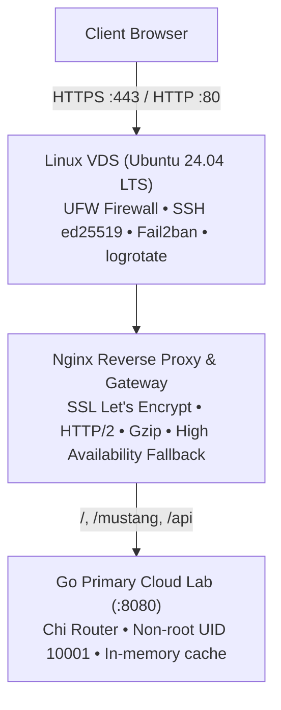
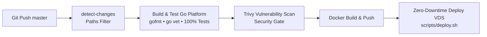
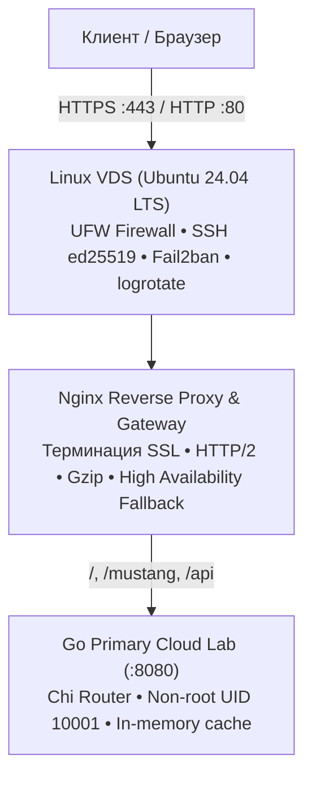

<div align="center">

# Primary Cloud Lab

<p><b>DevOps & Linux Engineering Platform • <a href="https://vorobevaqa.ru">vorobevaqa.ru</a></b></p>

<p>
  <a href="https://ubuntu.com/"></a>
  <a href="https://github.com/AndreyJVM/portfolio-service/pkgs/container/portfolio-service"></a>
  <a href="https://galaxy.ansible.com/ui/standalone/namespaces/24255/"></a>
  <a href="https://github.com/AndreyJVM/portfolio-service/actions"></a>
  <a href="https://github.com/AndreyJVM/portfolio-service/security/dependabot"></a>
  <a href="https://nginx.org/"></a>
  <a href="https://go.dev/"></a>
</p>

<p>
  <b><a href="#english">English</a></b> • <b><a href="#русский">Русский</a></b>
</p>

</div>

---

<a name="english"></a>
## English

**Primary Cloud Lab** is an open-source engineering platform and personal portfolio of **Andrey Vorobev** — DevOps & Linux Engineer.

The platform showcases Linux system administration, containerization, Ansible automation roles, open-source repositories, and zero-downtime Blue-Green deployment architecture. Built with **Go (Golang 1.26.8)**, it features non-root container security (UID 10001), in-memory caching, responsive dark theme design, and 100% automated test coverage.

**Production:** [https://vorobevaqa.ru](https://vorobevaqa.ru) · **GitHub:** [`AndreyJVM`](https://github.com/AndreyJVM) · **Ansible Galaxy:** [Author Roles](https://galaxy.ansible.com/ui/standalone/namespaces/24255/)

### Table of Contents
- [Architecture & Infrastructure](#architecture--infrastructure)
- [Pages & Structure](#pages--structure)
- [CI/CD & Zero-Downtime Blue-Green Deployment](#cicd--zero-downtime-blue-green-deployment)
- [Local Development & Testing](#local-development--testing)
- [Repository Structure](#repository-structure)

---

### Architecture & Infrastructure



| Layer | Technologies & Solutions |
|---|---|
| **Host & Operating System** | Linux (Ubuntu 24.04 LTS), Bash automation scripts, systemd, cron, logrotate |
| **Network & Security** | UFW firewall, Fail2ban brute-force protection, SSH authentication via ed25519 keys |
| **Gateway & Reverse Proxy** | Nginx (SSL termination, Certbot auto-renewal, HTTP/2, Gzip, custom error pages) |
| **Containerization** | Docker, Docker Compose v2, GitHub Container Registry (ghcr.io), Alpine 3.21 runtime, cgroups v2 limits, non-root (UID 10001) |
| **Backend Service** | Go 1.26.8 (`go-chi/chi/v5`), static compilation with stripped symbols (`-w -s`) |
| **IaC & Orchestration** | Ansible (idempotent playbooks and roles in Ansible Galaxy), Blue-Green zero-downtime deployment |
| **CI/CD** | GitHub Actions (`gofmt` & `go vet` quality gates, automated testing, Trivy security gate) |
| **Dependency Auditing** | Dependabot (weekly security and version monitoring for Go, Docker base images, and Actions) |

---

### Pages & Structure

1. 👤 **About the Author (`/`):**
   - Professional profile, skills matrix, Slurm Linux administration certifications, academic degrees;
   - Open-source projects dynamically integrated from GitHub, Docker Hub, and Ansible Galaxy;
   - PDF Resume generation and download (`/api/pdf/resume`).
2. 🏎️ **Dream Goal (`/mustang`):**
   - Crowdfunding campaign for Ford Mustang Shelby GT500 with interactive Web Audio V8 synthesizer and telemetry panel.

---

### CI/CD & Zero-Downtime Blue-Green Deployment



1. **GitHub Actions Pipeline:**
   - Runs `gofmt -l` and `go vet ./...` style and static analysis checks;
   - Runs unit and integration test suite with `-race` detection;
   - Performs Trivy vulnerability scan on container layers;
   - Builds and tags production container images.
2. **Zero-Downtime Deploy (`scripts/deploy.sh`):**
   - Deploys new container instance alongside the existing one (`--scale app=2`);
   - Verifies HTTP `/health` probe before traffic cutover;
   - Gracefully terminates old container instance with automatic rollback on failure.

---

### Local Development & Testing

```bash
# Clone the repository
git clone https://github.com/AndreyJVM/portfolio-service.git
cd portfolio-service

# Run all tests with race detector
go test -count=1 -race ./...

# Run locally
go run ./cmd/server/
```

---

### Repository Structure

```text
├── cmd/server/main.go       # Application entry point with graceful shutdown
├── config/                  # Configuration defaults and validation
├── content/pages.json       # Page metadata and SEO declarations
├── internal/
│   ├── config/              # Central configuration package
│   ├── handler/             # HTTP handlers, router, security headers, and PDF endpoints
│   ├── model/               # Core data transfer objects (GitHub, Docker Hub, Ansible)
│   └── service/             # IntegrationsService, PageService
├── nginx/                   # Nginx reverse proxy configurations
├── scripts/
│   ├── deploy.sh            # Zero-Downtime Blue-Green deployment script
│   ├── init-ssl.sh          # SSL initialization with Let's Encrypt / Certbot
│   └── scan-container.sh    # Trivy container security scanning script
├── web/
│   ├── static/              # CSS styles, JS scripts, images, certificates, resume PDF
│   └── templates/           # HTML templates: layout, about, mustang, 404
├── docker-compose.yml       # Production stack definition
└── Dockerfile               # Multi-stage Go build on Alpine (non-root UID 10001)
```

---

<a name="русский"></a>
## Русский

**Primary Cloud Lab** — открытая инженерная платформа и персональный сайт **Андрея Воробьева** — DevOps & Linux инженера.

Платформа представляет инженерный профиль, системное администрирование Linux, роли автоматизации Ansible, open-source репозитории и архитектуру бесперебойного (Zero-Downtime) деплоя. Серверная часть разработана на **Go (Golang 1.26.8)** с запуском сервисов от непривилегированного пользователя (non-root UID 10001), кэшированием в оперативной памяти, постоянной темной темой и 100% покрытием тестами.

**Боевой сервер:** [https://vorobevaqa.ru](https://vorobevaqa.ru) · **GitHub:** [`AndreyJVM`](https://github.com/AndreyJVM) · **Ansible Galaxy:** [роли автора](https://galaxy.ansible.com/ui/standalone/namespaces/24255/)

### Содержание
- [Инфраструктура и Архитектура](#инфраструктура-и-архитектура-1)
- [Разделы платформы](#разделы-платформы)
- [CI/CD & Бесперебойный Blue-Green деплой](#cicd--бесперебойный-blue-green-деплой-1)
- [Тестирование и локальный запуск](#тестирование-и-локальный-запуск-1)
- [Структура репозитория](#структура-репозитория-1)

---

### Инфраструктура и Архитектура



| Уровень | Технологии & Решения |
|---|---|
| **Хост и ОС** | Linux (Ubuntu 24.04 LTS), Bash-скрипты автоматизации, systemd, cron, ротация logrotate |
| **Сетевая безопасность** | UFW firewall, Fail2ban от брутфорса, SSH-аутентификация по ключам ed25519 |
| **Шлюз и Прокси** | Nginx (Reverse Proxy, API Gateway, SSL Let's Encrypt / Certbot, HTTP/2, Gzip, кастомные 50x) |
| **Контейнеризация** | Docker, Docker Compose v2, GitHub Container Registry (ghcr.io), Alpine 3.21 runtime, cgroups v2 лимиты, non-root (UID 10001) |
| **Бэкенд платформы** | Go 1.26.8 (`go-chi/chi/v5`), статическая сборка со стриппингом символов (`-w -s`) |
| **IaC & Оркестрация** | Ansible (идемпотентные плейбуки и роли в Ansible Galaxy), Blue-Green деплой скриптом `deploy.sh` |
| **CI/CD** | GitHub Actions (проверки `gofmt` и `go vet`, тесты, сканирование безопасности Trivy) |
| **Управление уязвимостями** | Dependabot (еженедельный аудит Go-модулей, Dockerfile и GitHub Actions) |

---

### Разделы платформы

1. 👤 **Об авторе (`/`):**
   - Инженерный опыт, матрица компетенций, профессиональные сертификаты Слёрм (Linux администрирование), дипломы;
   - Open-source проекты и репозитории из GitHub, Docker Hub и Ansible Galaxy;
   - Скачивание резюме в формате PDF (`/api/pdf/resume`).
2. 🏎️ **На мечту (`/mustang`):**
   - Краудфандинг на мечту — Ford Mustang Shelby GT500 с интерактивным синтезатором звука V8 на Web Audio API и телеметрией.

---

### CI/CD & Бесперебойный Blue-Green деплой

1. **GitHub Actions Pipeline:**
   - Автоматическая проверка форматирования `gofmt` и статический анализ `go vet`;
   - Запуск полного набора юнит- и интеграционных тестов с флагом `-race`;
   - Сканирование уязвимостей базового образа и библиотек сканером Trivy;
   - Сборка и отправка проверенного контейнерного образа.
2. **Zero-Downtime Deploy (`scripts/deploy.sh`):**
   - Запуск нового контейнера рядом со старым (`--scale app=2`);
   - Проверка успешности HTTP-пробы готовности (`/health`);
   - Плавное отключение старого контейнера с автоматическим откатом при сбое.

---

### Тестирование и локальный запуск

```bash
# Клонирование репозитория
git clone https://github.com/AndreyJVM/portfolio-service.git
cd portfolio-service

# Запуск тестов с проверкой гонок (race detector)
go test -count=1 -race ./...

# Локальный запуск сервера
go run ./cmd/server/
```

---

<div align="center">
  <p>© 2026 Андрей Воробьев • Primary Cloud Lab</p>
</div>
