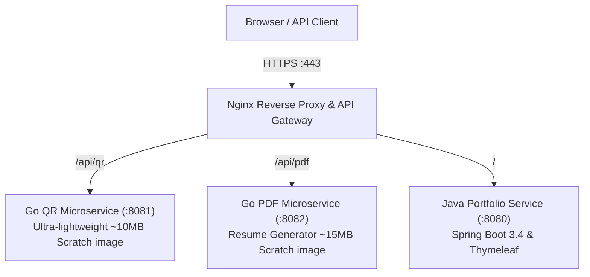
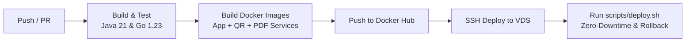

# Portfolio & Multi-Microservices Platform

[](https://openjdk.org/projects/jdk/21/)
[](https://go.dev/)\
[](https://spring.io/projects/spring-boot)
[](https://google.github.io/styleguide/javaguide.html)
[](LICENSE)
[](https://hub.docker.com/r/andreyvorobevaqa/portfolio-service)
[](https://github.com/AndreyJVM)
[](https://qameta.io/)
[](https://jmeter.apache.org/)

Production-ready microservices architecture combining a personal portfolio, an ultra-fast QR code generator microservice, and a dynamic vector PDF resume generator written in Go. Containerized with Docker and deployed via a fully automated CI/CD pipeline.

**Live demo:** [vorobevaqa.ru](https://vorobevaqa.ru) · **Docker Hub:** [`andreyvorobevaqa/portfolio-service`](https://hub.docker.com/r/andreyvorobevaqa/portfolio-service)


## Table of Contents

- [Architecture & Tech Stack](#architecture--tech-stack)
- [Key Features](#key-features)
- [Quick Start](#quick-start)
- [DevOps & Container Hardening](#devops--container-hardening)
- [QA Automation & Test Infrastructure](#qa-automation--test-infrastructure)
- [Performance & Load Testing (JMeter)](#performance--load-testing-jmeter)
- [Code Quality & Standards](#code-quality--standards)
- [API Reference](#api-reference)
- [CI/CD Pipeline](#cicd-pipeline)
- [Project Structure](#project-structure)
- [Author](#author)
- [License](#license)


## Architecture & Tech Stack



| Layer | Technologies |
|---|---|
| **Backend (Web & Portfolio)** | Java 21 (Virtual Threads), Spring Boot 3.4, Spring MVC, Thymeleaf, Caffeine Cache |
| **Microservice (QR Engine)** | Go 1.23, `skip2/go-qrcode`, Scratch base image (~10MB, <15ms latency) |
| **Microservice (PDF Engine)** | Go 1.23, `signintech/gopdf`, embedded DejaVu typography (~15MB, <20ms latency) |
| **QA Automation** | Selenide 7, REST Assured, JUnit 5, Allure Report 2 (Page Object Model) |
| **Performance Testing** | Apache JMeter 5.5, `jmeter-maven-plugin`, HTML Dashboard Reports |
| **Frontend** | Bootstrap 5.3, Font Awesome 6, Vanilla JS (ES6 modules, theme management) |
| **Build & Tools** | Maven, Lombok, Spotless (Google Java Format), Checkstyle |
| **Infrastructure** | Docker, Docker Compose, Nginx (reverse proxy, SSL, Gzip), Ubuntu VDS |
| **CI/CD** | GitHub Actions (multi-service build, test, Docker Hub push, zero-downtime SSH deploy via `scripts/deploy.sh`) |

## Key Features

- **Multi-Microservices Architecture** — QR-генератор и генератор PDF-резюме вынесены в независимые изолированные Go-микросервисы, Nginx выступает API Gateway.
- **Ultra-efficient Resources** — Go микросервисы упакованы в `scratch` (образы всего ~10–15 МБ, потребляют ~10 МБ RAM).
- **Dynamic PDF Resume** — векторная генерация официального резюме «на лету» в один клик со встроенным QR-кодом и контактами.
- **Personal Portfolio** — responsive showcase with dedicated sections for completed engineering projects, skills matrix, and certifications.
- **Dark / Light Theme** — native toggle synchronized with Bootstrap 5.3 color modes (`data-bs-theme`), no flicker on load.
- **Client Features** — one-click PNG download, Web Share API integration, instant clipboard copy.
- **AQA Framework** — E2E UI тесты на Selenide (Page Object Model), REST Assured API тесты и Allure отчеты (140 автоматизированных тестов).
- **Performance Testing** — сценарии нагрузочного тестирования Apache JMeter с автоматической генерацией аналитических HTML-дашбордов.
- **Production-Tuned & DevOps Hardening** — Nginx reverse proxy с HTTP/2, Let's Encrypt SSL и Gzip-сжатием. Встроенные in-binary CLI healthchecks в Go scratch-контейнерах (`/app/*-service healthcheck`) без внешних зависимостей, строгая ротация логов `json-file` (`max-size: 10m`), жесткие квоты CPU/RAM (`limits` и `reservations`), изоляция `no-new-privileges:true` и координация запуска `condition: service_healthy` в Nginx Gateway.

## Quick Start

### Prerequisites
- JDK 21+
- Maven 3.9+
- Docker & Docker Compose (optional for containerized run)

### Local Run

```bash
# Clone the repository
git clone https://github.com/AndreyJVM/portfolio-service.git
cd portfolio-service

# Run with Maven
mvn spring-boot:run
```

The application will be accessible at `http://localhost:8080`.

### Run via Docker Compose (Multi-service stack)

```bash
docker compose up -d --build
```

---

## DevOps & Container Hardening

Стек микросервисов развертывается через `docker-compose.yml` в соответствии со строгими production-стандартами Linux & DevOps:

1. **In-Binary Healthchecks в Scratch-контейнерах:**
   В минималистичных Docker-образах `scratch` отсутствуют командные оболочки (`/bin/sh`, `/bin/bash`), утилиты `curl` и `wget`. Проверка работоспособности реализована непосредственно внутри Go-бинарников:
   ```yaml
   healthcheck:
     test: [ "CMD", "/app/qr-service", "healthcheck" ]
     interval: 5s
     timeout: 2s
     retries: 3
     start_period: 2s
   ```
   Флаг `healthcheck` запускает внутренний легковесный HTTP-клиент к эндпоинту `/health` с таймаутом 2 сек и завершается с exit code `0` при HTTP 200 или `1` при ошибке.

2. **Защита дискового пространства от переполнения (Log Rotation):**
   Все 4 сервиса защищены политикой ротации логов драйвером `json-file`:
   ```yaml
   logging:
     driver: "json-file"
     options:
       max-size: "10m"
       max-file: "3" # 5 для Nginx
   ```

3. **Лимиты ресурсов ядра (cgroups v2 limits & reservations):**
   Для предотвращения OOM killer и CPU starvation заданы точные ограничения и резервирования:
   - **`app` (Spring Boot 3.4 JVM):** limits: `1.0 CPU / 512M RAM`, reservations: `0.2 CPU / 256M RAM`
   - **`qr-service` (Go):** limits: `0.5 CPU / 64M RAM`, reservations: `0.05 CPU / 16M RAM`
   - **`pdf-service` (Go):** limits: `0.5 CPU / 64M RAM`, reservations: `0.05 CPU / 16M RAM`
   - **`nginx` (Gateway):** limits: `0.5 CPU / 128M RAM`, reservations: `0.05 CPU / 32M RAM`

4. **Безопасность контейнеров и координация запуска:**
   - Директива ядра `security_opt: [no-new-privileges:true]` блокирует эскалацию привилегий внутри контейнеров.
   - Nginx API Gateway запускается строго после подтверждения здоровья всех бэкендов (`condition: service_healthy` для `app`, `qr-service` и `pdf-service`).

5. **Отказоустойчивый Zero-Downtime деплой с авто-откатом (`scripts/deploy.sh`):**
   Логика развертывания вынесена из CI/CD YAML в отдельный shell-скрипт с `set -euo pipefail`. Скрипт осуществляет прогрев нового контейнера Java (`scale app=2`), валидацию healthcheck в течение 60 секунд, мягкий reload Nginx и остановку старой версии. В случае непрохождения проверки скрипт автоматически удаляет сбойный контейнер, сохраняет рабочий инстанс и завершается с кодом `1`.

---

## QA Automation & Test Infrastructure

В проект интегрирован фреймворк автоматизации тестирования на стеке **Java 21 + JUnit 5 + Selenide + REST Assured + Allure Report** (140 тестов).

### Архитектура тестов:
- **UI E2E тесты (Selenide):** реализованы с использованием паттерна Page Object Model (`BasePage`, `HomePage`, `ProjectsPage`, `EducationPage`, `QrPlaygroundPage`). Покрывают главную страницу, навигацию, каталог решений, дипломы и сертификаты, интерактивный QR Playground, скачивание PDF-резюме, переключение тем и кастомную 404 страницу.
- **API тесты (REST Assured):** валидация контрактов `/api/qr` и `/api/pdf/*`, позитивные и негативные сценарии, проверка структуры ошибок, граничных значений и HTTP статус-кодов (200, 400, 405, 415), валидация бинарных потоков и сигнатур файлов (`%PDF-`), мониторинг Spring Boot Actuator (`/actuator/health`, `/actuator/info`).
- **WebMvc & Service Unit Tests:** изолированное модульное тестирование бизнес-логики интеграций с GitHub API, Docker Hub API, Ansible Galaxy API и контроллеров `PageController`, `QrRestController`, `PdfRestController`.
- **Go Unit Tests:** модульные тесты хендлеров `/health`, `/api/qr` и генератора `/api/pdf/resume` в микросервисах `qr-service/` и `pdf-service/`.
- **Allure Reporting 2:** автоматическое логирование HTTP запросов/ответов через `AllureRestAssured`, скриншоты и Page Source при падениях через `AllureSelenide`, группировка по Epics/Features/Stories.

### Переменные конфигурации тестов (`.env` или `-D` параметры):

```properties
SELENIUM_BROWSER=chrome                           # Браузер (chrome, firefox)
SELENIUM_HEADLESS=true                            # Headless режим (true/false)
TEST_BASE_URL=http://localhost:8080               # Тестируемый хост (локальный или прод)
```

### Команды запуска тестов и генерации отчетов:

```bash
# Запуск всех Java тестов (Unit + API + E2E UI)
mvn clean test

# Запуск тестов Go микросервисов
cd qr-service && go test -v ./... && cd ..
cd pdf-service && go test -v ./... && cd ..

# Генерация и локальный запуск интерактивного Allure Report в браузере
mvn allure:serve

# Генерация статического HTML отчета Allure (target/site/allure-maven-plugin)
mvn allure:report
```

---

## Performance & Load Testing (JMeter)

В проект встроен сценарий нагрузочного тестирования на базе **Apache JMeter 5.5** (`src/test/jmeter/qr-service-load-test.jmx`), изолированный в Maven-профиле `load-test` с помощью `jmeter-maven-plugin`.

### Архитектура нагрузочного сценария:
- **TG-01: Web Page Visitors (Browsing Navigation)** — эмуляция поведения пользователей при переходе по ключевым маршрутам приложения (`/`, `/projects`, `/education`, `/qr`), проверка HTTP 200 и валидация разметки.
- **TG-02: High-Load QR Generator API** — высокоинтенсивный поток POST-запросов `/api/qr` с генерацией уникальных URL (`${__time()}`) и ассертами на JSON-структуру и Base64-строку.

### Команды запуска нагрузочного тестирования:

```bash
# Запуск со стандартными параметрами (localhost:8080, 15 потоков)
mvn verify -Pload-test

# Запуск с переопределением целевого хоста, нагрузки и длительности
mvn verify -Pload-test \
  -Dloadtest.host=localhost \
  -Dloadtest.port=8080 \
  -Dloadtest.users.web=10 \
  -Dloadtest.users.api=25 \
  -Dloadtest.rampup=5 \
  -Dloadtest.duration=30
```

---

## Code Quality & Standards

В проекте настроен автоматический контроль качества исходного кода:
- **Google Java Style** через `spotless-maven-plugin`
- **Checkstyle** для статического анализа Java-кода
- **Go Fmt & Vet** для Go-микросервисов

```bash
# Проверка соответствия стилю кода
mvn spotless:check

# Автоматическое форматирование кода
mvn spotless:apply
```

---

## API Reference

### Generate QR Code

| | |
|---|---|
| **Endpoint** | `POST /api/qr` |
| **Service** | `qr-service` (Go) |
| **Content-Type** | `application/json` |

#### Request Body

```json
{
  "url": "https://vorobevaqa.ru"
}
```

#### Response `200 OK`

```json
{
  "url": "https://vorobevaqa.ru",
  "qrCode": "iVBORw0KGgoAAAANSUhEUgAA..."
}
```

#### Response `400 Bad Request`

```json
{
  "error": "URL must start with http:// or https://"
}
```

### Download Resume PDF

| | |
|---|---|
| **Endpoint** | `GET /api/pdf/resume` |
| **Service** | `pdf-service` (Go) |
| **Query Params** | `download=true` (optional, attachment trigger) |
| **Content-Type** | `application/pdf` |
| **Headers** | `Content-Disposition: inline; filename="Andrey_Vorobev_QA_DevOps_Resume.pdf"`, `Cache-Control: public, max-age=3600` |

### PDF Service Health

| | |
|---|---|
| **Endpoint** | `GET /api/pdf/health` |
| **Service** | `pdf-service` (Go) |
| **Content-Type** | `application/json` |

---

## CI/CD Pipeline

1. **Build & Test** — параллельное тестирование Java приложения (Maven) и Go микросервисов (`qr-service`, `pdf-service`).
2. **Containerization** — сборка и пуш в Docker Hub образов `andreyvorobevaqa/portfolio-service`, `andreyvorobevaqa/qr-service` и `andreyvorobevaqa/pdf-service`.
3. **Automated Deployment** — доставка конфигураций через `scp-action` и запуск отказоустойчивого деплоя через `ssh-action` запуском скрипта `scripts/deploy.sh` с автоматическим rollback.



## Project Structure

```
portfolio/
├── qr-service/              # Go QR Microservice (:8081)
│   ├── main.go              # HTTP API Server
│   ├── main_test.go         # Go Unit Tests
│   ├── go.mod & go.sum      # Go dependencies (skip2/go-qrcode)
│   └── Dockerfile           # Minimal ~10MB Scratch image
├── pdf-service/             # Go PDF Resume Generator Microservice (:8082)
│   ├── fonts/               # Embedded DejaVu Unicode TTF fonts
│   ├── main.go              # PDF vector rendering & HTTP API
│   ├── main_test.go         # Go Unit Tests
│   ├── go.mod & go.sum      # Go dependencies (signintech/gopdf)
│   └── Dockerfile           # Minimal ~15MB Scratch image
├── src/
│   ├── main/
│   │   ├── java/            # Portfolio Web source code (Spring Boot 3.4)
│   │   └── resources/       # Templates, static assets, config
│   └── test/
│       ├── java/
│       │   └── ru/vorobevaqa/
│       │       ├── controller/  # Controller WebMvc tests
│       │       ├── service/     # Service unit tests
│       │       └── qa/          # AQA Framework: UI (Selenide), API (REST Assured), Pages
│       ├── jmeter/          # Apache JMeter load & performance test plans (.jmx)
│       └── resources/       # Test properties & Allure configuration
├── nginx/
│   └── nginx.conf           # API Gateway: /api/qr -> qr-service, /api/pdf -> pdf-service, / -> app
├── scripts/
│   └── deploy.sh            # Production Zero-downtime Blue-Green deploy script with auto-rollback
├── .editorconfig            # Universal editor configuration (2-space indent)
├── Dockerfile               # Java App multi-stage build
├── docker-compose.yml       # Production stack (App + QR Microservice + PDF Microservice + Nginx)
├── LICENSE                  # Apache License 2.0
├── pom.xml                  # Maven configuration with Spotless, Checkstyle & Allure
└── .github/workflows/       # CI/CD pipeline definitions
```

## Author

**Andrey Vorobev**
- **Role:** QA Automation / Backend Developer / DevOps
- **Website:** [vorobevaqa.ru](https://vorobevaqa.ru)
- **GitHub:** [@AndreyJVM](https://github.com/AndreyJVM)
- **Telegram:** [@AndreyAQA](https://t.me/AndreyAQA)

## License

This project is licensed under the terms of the **Apache License 2.0**. See the [LICENSE](LICENSE) file for details.
