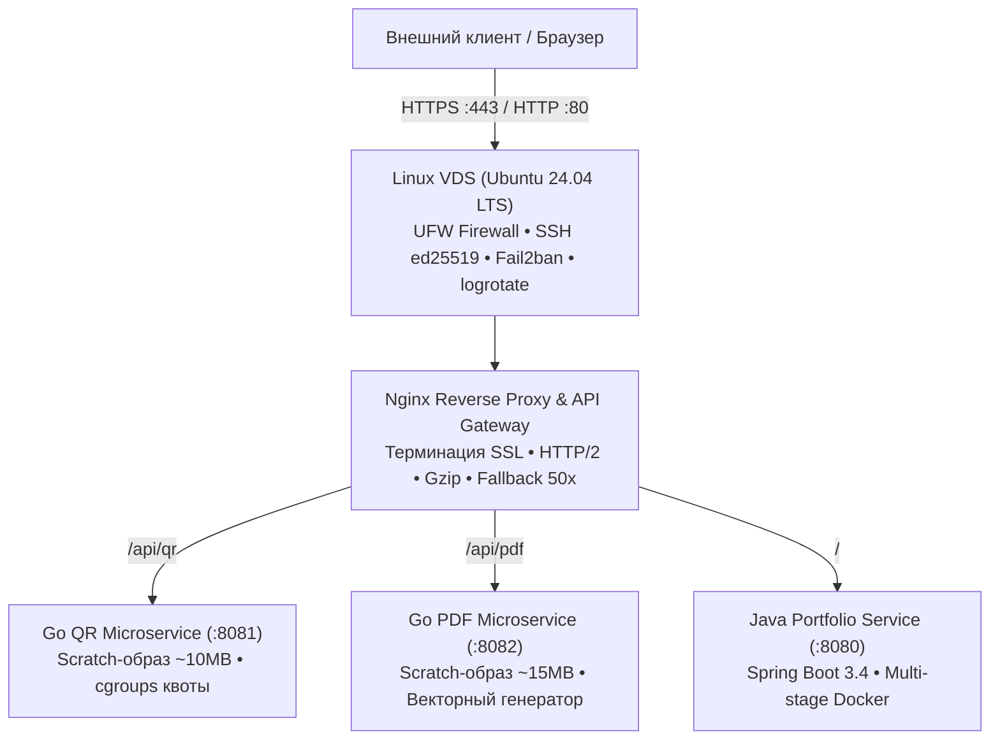
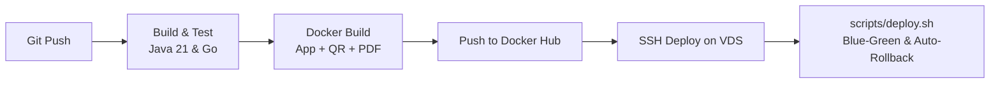

<p align="center">
  <a href="https://ubuntu.com/"></a>
  <a href="https://hub.docker.com/r/andreyvorobevaqa/portfolio-service"></a>
  <a href="https://galaxy.ansible.com/ui/standalone/namespaces/24255/"></a>
  <a href="https://github.com/AndreyJVM"></a>
  <a href="https://nginx.org/"></a>
  <a href="https://openjdk.org/projects/jdk/21/"></a>
  <a href="https://go.dev/"></a>
  <a href="LICENSE"></a>
</p>

Продакшн-платформа личного портфолио и сопутствующих сервисов с фокусом на **системное администрирование Linux, контейнеризацию в Docker, автоматизацию через Ansible и надежные CI/CD пайплайны**.

**Продакшн-сайт:** [vorobevaqa.ru](https://vorobevaqa.ru) · **Docker Hub:** [`andreyvorobevaqa`](https://hub.docker.com/repositories/andreyvorobevaqa) · **Ansible Galaxy:** [роли автоматизации](https://galaxy.ansible.com/ui/standalone/namespaces/24255/)


## Содержание

- [Инфраструктура и Архитектура](#инфраструктура-и-архитектура)
- [Ключевые компетенции и решения](#ключевые-компетенции-и-решения)
- [DevOps & Hardening контейнеров](#devops--hardening-контейнеров)
- [CI/CD & Автоматизация деплоя](#cicd--автоматизация-деплоя)
- [Тестирование и Надежность](#тестирование-и-надежность)
- [Структура проекта](#структура-проекта)
- [Автор и Контакты](#автор-и-контакты)
- [Лицензия](#лицензия)


## Инфраструктура и Архитектура



| Уровень | Технологии & Решения |
|---|---|
| **Хост и ОС** | Linux (Ubuntu 24.04 LTS), Bash-скрипты автоматизации, systemd, cron, ротация logrotate |
| **Сетевая безопасность** | UFW firewall (ограничение SSH, 80/443), Fail2ban от брутфорса, SSH-аутентификация по ключам |
| **Шлюз и Прокси** | Nginx (Reverse Proxy, API Gateway, SSL Let's Encrypt / Certbot, HTTP/2, Gzip, кастомные 50x fallback) |
| **Контейнеризация** | Docker, Docker Compose, Docker Swarm (в процессе внедрения), Docker Hub Registry |
| **IaC & Оркестрация** | Ansible (идемпотентные плейбуки и роли в Ansible Galaxy), Blue-Green деплой скриптом `deploy.sh` |
| **CI/CD** | GitHub Actions, GitLab CI (мультисервисная сборка, тесты, сборка образов, SSH деплой с авто-откатом) |
| **Бэкенд приложения** | Java 21, Spring Boot 3.4, Spring MVC, Thymeleaf, REST API, Caffeine Cache |
| **Микросервисы утилит** | Go 1.23 (`skip2/go-qrcode`, `signintech/gopdf`), минималистичные scratch-образы (~10–15 МБ, <15мс) |
| **Контроль качества & QA** | Allure 2, Selenide 7, REST Assured, JMeter 5.5, Spotless (Google Java Style), Checkstyle |


## Ключевые компетенции и решения

- **Безопасность и системный тюнинг хоста:** Настроенный файрвол UFW, изоляция портов (контейнеры общаются только во внутренней `app-network` без экспонирования лишних портов наружу).
- **Hardening контейнеров:** Флаг `security_opt: [no-new-privileges:true]`, запуск без привилегий, in-binary healthchecks без сторонних утилит (`curl`/`wget`) в scratch-контейнерах, жесткие квоты памяти `cgroups` (`limits: 64M`, `reservations: 16M`).
- **Защита от переполнения диска:** Строгая политика ротации логов `json-file` (`max-size: 10m`, `max-file: 3-5`) на всех контейнерах.
- **Отказоустойчивый Blue-Green деплой:** Скрипт `scripts/deploy.sh` в строгом режиме `set -euo pipefail` с параллельным подъемом контейнера на временном порту, прогревом healthcheck и автоматическим `rollback` к предыдущей рабочей версии в случае ошибки.
- **Инфраструктурный код (IaC):** Публичные роли в Ansible Galaxy для автоматической настройки хостов и окружения.


## DevOps & Hardening контейнеров

Стек развертывается через `docker-compose.yml` в соответствии с production-стандартами:

1. **In-Binary Healthchecks в Scratch-образах:**
   В минимальных scratch-образах нет shell (`/bin/sh`), утилит `curl` или `wget`. Проверка здоровья встроена напрямую в бинарники Go:
   ```yaml
   healthcheck:
     test: [ "CMD", "/app/qr-service", "healthcheck" ]
     interval: 5s
     timeout: 2s
     retries: 3
     start_period: 2s
   ```
2. **Лимиты ресурсов (cgroups):**
   ```yaml
   deploy:
     resources:
       limits:
         cpus: "0.5"
         memory: 64M
       reservations:
         cpus: "0.05"
         memory: 16M
   ```
3. **Ротация логов (Log Rotation):**
   ```yaml
   logging:
     driver: "json-file"
     options:
       max-size: "10m"
       max-file: "3"
   ```


## CI/CD & Автоматизация деплоя



1. **Сборка и валидация:** Проверка стилей Spotless/Checkstyle, прогон 135+ тестов (Unit, REST API, UI).
2. **Публикация артефактов:** Сборка и пуш версионированных образов в реестр Docker Hub.
3. **Бесперебойное обновление:** Доставка на VDS и запуск Blue-Green ротации с контролем `condition: service_healthy`.


## Тестирование и Надежность

```bash
# Запуск полного сьюта Java тестов (Unit + API + E2E UI)
mvn clean test

# Запуск тестов Go микросервисов
cd qr-service && go test -v ./... && cd ..
cd pdf-service && go test -v ./... && cd ..

# Проверка стиля кода
mvn spotless:check
```


## Структура проекта

```
portfolio/
├── qr-service/              # Go QR Microservice (:8081, Scratch ~10MB)
├── pdf-service/             # Go PDF Resume Microservice (:8082, Scratch ~15MB)
├── src/
│   ├── main/
│   │   ├── java/            # Исходный код Java приложения (Spring Boot 3.4)
│   │   └── resources/       # Шаблоны Thymeleaf, статика, конфигурации
│   └── test/                # 135+ автоматизированных тестов (Unit, API, E2E Selenide, Allure)
├── nginx/
│   ├── nginx.conf           # Конфигурация API Gateway, SSL и роутинга
│   └── 50x.html             # Кастомная страница аварийных ошибок
├── scripts/
│   └── deploy.sh            # Blue-Green развертывание с авто-откатом (Rollback)
├── docker-compose.yml       # Конфигурация продакшн-стека микросервисов
├── Dockerfile               # Multi-stage сборка Java-приложения
├── pom.xml                  # Конфигурация Maven
└── .github/workflows/       # Пайплайн GitHub Actions
```


## Автор и Контакты

**Андрей Воробьев**
- **Специализация:** DevOps & Linux Infrastructure Engineer
- **Веб-сайт:** [vorobevaqa.ru](https://vorobevaqa.ru)
- **GitHub:** [@AndreyJVM](https://github.com/AndreyJVM)
- **Docker Hub:** [andreyvorobevaqa](https://hub.docker.com/repositories/andreyvorobevaqa)
- **Ansible Galaxy:** [Профиль автора](https://galaxy.ansible.com/ui/standalone/namespaces/24255/)
- **Telegram:** [@AndreyAQA](https://t.me/AndreyAQA)


## Лицензия

Проект распространяется под лицензией **Apache License 2.0**. Подробности в файле [LICENSE](LICENSE).
