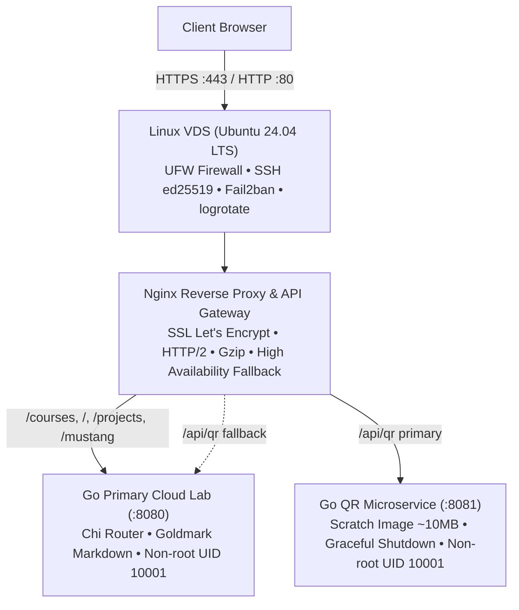
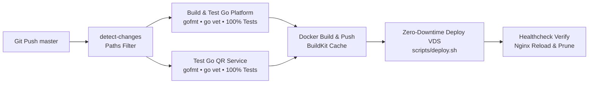
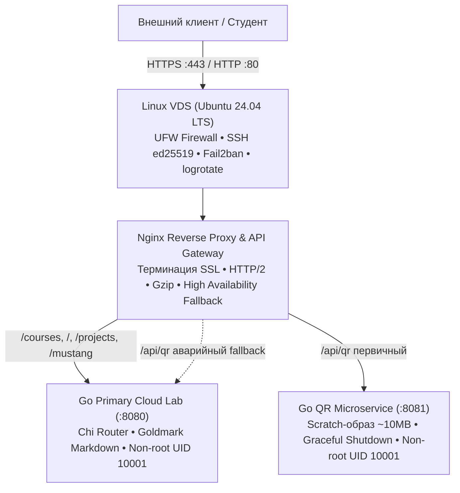
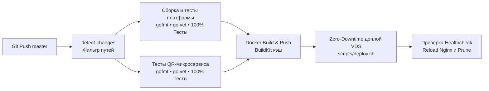

<div align="center">

# Primary Cloud Lab

<p><b>Interactive DevOps & Linux Education Platform • <a href="https://vorobevaqa.ru">vorobevaqa.ru</a></b></p>

<p>
  <a href="https://ubuntu.com/"></a>
  <a href="https://hub.docker.com/r/andreyvorobevaqa/portfolio-service"></a>
  <a href="https://galaxy.ansible.com/ui/standalone/namespaces/24255/"></a>
  <a href="https://github.com/AndreyJVM/portfolio-service/actions"></a>
  <a href="https://github.com/AndreyJVM/portfolio-service/security/dependabot"></a>
  <a href="https://nginx.org/"></a>
  <a href="https://go.dev/"></a>
</p>

<p>
  <b><a href="#english">English</a></b> • <b><a href="#русский">Русский</a></b>
</p>

</div>

---

<a name="english"></a>
## English

**Primary Cloud Lab** is an open-source interactive education platform focused on **DevOps engineering, Linux system administration, Docker containerization, Ansible automation, and resilient CI/CD pipelines**.

The platform is designed around a lightweight micro-service architecture in **Go (Golang 1.26.8)**, featuring non-root container security (UID 10001), instant full-text search, interactive quizzes with local progress persistence, and zero-downtime Blue-Green deployments.

**Production:** [https://vorobevaqa.ru](https://vorobevaqa.ru) · **Docker Hub:** [`andreyvorobevaqa`](https://hub.docker.com/repositories/andreyvorobevaqa) · **Ansible Galaxy:** [Author Roles](https://galaxy.ansible.com/ui/standalone/namespaces/24255/)

### Table of Contents
- [Architecture & Infrastructure](#architecture--infrastructure)
- [Educational Tracks & Labs](#educational-tracks--labs)
- [Interactive Learning & Instant Search](#interactive-learning--instant-search)
- [CI/CD & Zero-Downtime Blue-Green Deployment](#cicd--zero-downtime-blue-green-deployment)
- [Local Development & Testing](#local-development--testing)
- [Repository Structure](#repository-structure)

---

### Architecture & Infrastructure



| Layer | Technologies & Solutions |
|---|---|
| **Host & Operating System** | Linux (Ubuntu 24.04 LTS), Bash automation scripts, systemd, cron, logrotate |
| **Network & Security** | UFW firewall, Fail2ban brute-force protection, SSH authentication via ed25519 keys |
| **Gateway & Reverse Proxy** | Nginx (SSL termination, Certbot auto-renewal, HTTP/2, Gzip, HA fallback routing, custom error pages) |
| **Containerization** | Docker, Docker Compose, Docker Hub Registry, Alpine 3.21 runtime, scratch container, cgroups v2 limits, non-root (UID 10001) |
| **Backend Services** | Go 1.26.8 (`go-chi/chi/v5`, `yuin/goldmark`, `skip2/go-qrcode`), static compilation with stripped symbols (`-w -s`) |
| **IaC & Orchestration** | Ansible (idempotent playbooks and roles in Ansible Galaxy), Blue-Green zero-downtime deployment script |
| **CI/CD** | GitHub Actions (matrix/paths-filter triggers, BuildKit gha cache, `gofmt` & `go vet` quality gates, automated rollback) |
| **Dependency Auditing** | Dependabot (weekly security and version monitoring for Go, Docker base images, and GitHub Actions) |

---

### Educational Tracks & Labs

The platform hosts comprehensive, production-ready modules:

1. 🐧 **Linux System Administration** (`/courses/linux`):
   - DAC permission model (POSIX, SUID, SGID, Sticky bit), systemd services, timers, and unit lifecycle;
   - Linux networking stack (`iproute2`, `ss`, `iptables`, `ufw`), socket debugging, and routing table analysis.
2. 🐳 **Containerization & Docker** (`/courses/docker`):
   - Multi-stage builds, Linux cgroups v2 resource quotas, and kernel namespaces (PID/NET/MNT);
   - Docker Compose v2 architecture, bridge networks, and internal DNS service discovery.
3. ⚙️ **Ansible & Infrastructure as Code (IaC)** (`/courses/ansible`):
   - Agentless architecture, inventory management, and idempotent playbook design;
   - Modular roles, secret encryption with Ansible Vault, and publishing to Ansible Galaxy.
4. 🔄 **CI/CD: GitHub Actions & GitLab** (`/courses/cicd`):
   - Production pipeline design, BuildKit layer caching (`type=gha`), artifact handling;
   - Blue-Green zero-downtime deployment strategy via Docker Compose scaling and automatic rollbacks.

---

### Interactive Learning & Instant Search

- **Full-Text In-Memory Search:**
  - Real-time client-side search across all course descriptions and lesson materials via `/api/search`;
  - Modal overlay accessible anywhere on the platform via keyboard shortcuts (`Ctrl+K` or `/`);
  - Dynamic result highlighting with category badges (Linux, Docker, Ansible, CI/CD).
- **Client-Side Progress Tracking:**
  - Completed lessons are instantly persisted in browser `LocalStorage`;
  - Progress percentages are dynamically calculated and rendered in course dashboards and navigation.
- **Self-Check Quizzes:**
  - Interactive knowledge-check quizzes embedded at the end of every lesson;
  - Immediate answer feedback with detailed architectural explanations and auto-completion checkmarks.
- **Responsive Clean Navigation:**
  - Desktop ($\ge 992\text{px}$): fixed sidebar with concise, icon-free links;
  - Mobile & tablet ($< 992\text{px}$): compact top bar and smooth offcanvas navigation drawer.

---

### CI/CD & Zero-Downtime Blue-Green Deployment



1. **Path-Based Triggering:** Builds and tests execute conditionally only for components with detected changes.
2. **Code Quality Gates:** Automated enforcement of `gofmt` canonical formatting and `go vet` static analysis on every push and pull request.
3. **Concurrency Control:** Production deployments use concurrency locking (`group: production-deploy`) to prevent release race conditions.
4. **Seamless Blue-Green Update:** `scripts/deploy.sh` spins up an updated container instance (`scale app=2`), verifies its healthcheck endpoint, reloads Nginx gracefully, and decommissions the old instance with automated rollback on failure.
5. **Dependabot Updates:** Weekly scheduled audits for Go modules (`go.mod` / `vendor`), Dockerfiles, and GitHub Actions workflows.

---

### Local Development & Testing

```bash
# 1. Run unit tests with race detection for main platform
go test -v -race ./...

# 2. Run unit tests with race detection for QR microservice
cd qr-service && go test -v -race ./...

# 3. Verify Go formatting and static analysis
test -z "$(gofmt -l cmd/ internal/ qr-service/*.go)" && go vet ./...

# 4. Run the web platform locally
go run cmd/server/main.go

# 5. Build and run Docker containers locally
docker compose up -d --build
```

---

### Repository Structure

```
portfolio/
├── cmd/server/main.go       # Go web server entrypoint (Chi router, graceful shutdown)
├── content/courses/         # Knowledge base in Markdown (Linux, Docker, Ansible, CI/CD)
├── internal/
│   ├── config/              # Environment configuration loader
│   ├── handler/             # HTTP page handlers, REST API endpoints, search, and unit tests
│   ├── model/               # Data structures (Courses, Lessons, SearchItem, Integrations)
│   └── service/             # Catalog service and external integrations (GitHub, Docker Hub)
├── web/
│   ├── static/              # CSS (themes, navbar, animations), JS (search, progress, quizzes), images
│   └── templates/           # Go HTML templates (layout, index, courses, course_detail, lesson, qr)
├── qr-service/              # Standalone Go microservice for QR-code generation (scratch image)
├── nginx/
│   ├── nginx.conf           # Reverse Proxy, SSL Let's Encrypt configuration, and HA routing
│   └── 50x.html             # Custom error pages
├── scripts/
│   └── deploy.sh            # Zero-Downtime Blue-Green deployment with automated rollback
├── docker-compose.yml       # Production microservice stack configuration
├── Dockerfile               # Multi-stage static Go binary build on Alpine 3.21 (non-root UID 10001)
├── go.mod / go.sum          # Go 1.26.8 platform module definition and vendor tree
├── .editorconfig            # Code style configuration (Go tabs width 4)
├── .github/
│   ├── dependabot.yml       # Dependabot configuration (Go, Docker, GitHub Actions)
│   └── workflows/           # CI/CD pipelines (production deployment and PR test suites)
```

---

<a name="русский"></a>
## Русский

**Primary Cloud Lab** — открытая интерактивная образовательная веб-платформа по **DevOps, системному администрированию Linux, контейнеризации в Docker, автоматизации на Ansible и надежным CI/CD пайплайнам**.

Архитектура проекта построена на легковесном микростеке на **Go (Golang 1.26.8)** с запуском всех сервисов от непривилегированного пользователя (non-root UID 10001), встроенным быстрым поиском, интерактивными квизами с сохранением прогресса и бесперебойным Blue-Green развертыванием без даунтайма.

**Боевой сервер:** [https://vorobevaqa.ru](https://vorobevaqa.ru) · **Docker Hub:** [`andreyvorobevaqa`](https://hub.docker.com/repositories/andreyvorobevaqa) · **Ansible Galaxy:** [роли автора](https://galaxy.ansible.com/ui/standalone/namespaces/24255/)

### Содержание
- [Инфраструктура и Архитектура](#инфраструктура-и-архитектура-1)
- [Образовательные треки и Лабораторные](#образовательные-треки-и-лабораторные-1)
- [Интерактивная система обучения и поиск](#интерактивная-система-обучения-и-поиск)
- [CI/CD & Бесперебойный Blue-Green деплой](#cicd--бесперебойный-blue-green-деплой-1)
- [Тестирование и локальный запуск](#тестирование-и-локальный-запуск-1)
- [Структура репозитория](#структура-репозитория-1)

---

### Инфраструктура и Архитектура



| Уровень | Технологии & Решения |
|---|---|
| **Хост и ОС** | Linux (Ubuntu 24.04 LTS), Bash-скрипты автоматизации, systemd, cron, ротация logrotate |
| **Сетевая безопасность** | UFW firewall, Fail2ban от брутфорса, SSH-аутентификация по ключам ed25519 |
| **Шлюз и Прокси** | Nginx (Reverse Proxy, API Gateway, SSL Let's Encrypt / Certbot, HTTP/2, Gzip, HA fallback для QR, кастомные 50x) |
| **Контейнеризация** | Docker, Docker Compose, Docker Hub Registry, Alpine 3.21 runtime, scratch container, cgroups v2 лимиты, non-root (UID 10001) |
| **Бэкенд платформы** | Go 1.26.8 (`go-chi/chi/v5`, `yuin/goldmark`, `skip2/go-qrcode`), статическая сборка со стриппингом символов (`-w -s`) |
| **IaC & Оркестрация** | Ansible (идемпотентные плейбуки и роли в Ansible Galaxy), Blue-Green деплой скриптом `deploy.sh` |
| **CI/CD** | GitHub Actions (параллельная сборка, BuildKit gha-кэш, проверки `gofmt` и `go vet`, Zero-Downtime деплой с авто-откатом) |
| **Управление уязвимостями** | Dependabot (еженедельный аудит Go-модулей, Dockerfile и GitHub Actions) |

---

### Образовательные треки и Лабораторные

Каталог платформы включает структурированные практические курсы:

1. 🐧 **Системное администрирование Linux** (`/courses/linux`):
   - Модель прав доступа DAC (POSIX, SUID, SGID, Sticky bit), управление юнитами и таймерами systemd;
   - Сетевой стек Linux (`iproute2`, `ss`, `iptables`, `ufw`), анализ трафика и сокетов.
2. 🐳 **Контейнеризация и Docker** (`/courses/docker`):
   - Многоэтапные сборки (Multi-stage), Linux cgroups v2 квоты, неймспейсы (PID/NET/MNT);
   - Docker Compose v2, внутренняя DNS-маршрутизация и изоляция bridge-сетей.
3. ⚙️ **Ansible & Инфраструктура как код (IaC)** (`/courses/ansible`):
   - Архитектура Agentless, инвентарь, написание идемпотентных плейбуков;
   - Модульные роли, шифрование секретов с Ansible Vault и публикация в Ansible Galaxy.
4. 🔄 **CI/CD: GitHub Actions & GitLab** (`/courses/cicd`):
   - Проектирование production-пайплайнов, кэширование слоев сборки Docker (BuildKit `type=gha`);
   - Стратегия Zero-Downtime деплоя Blue-Green с Docker Compose scale и мгновенным авто-откатом (Rollback).

---

### Интерактивная система обучения и поиск

- **Полнотекстовый поиск по материалам:**
  - Быстрый поиск в реальном времени по всем курсам и урокам через эндпоинт `/api/search`;
  - Модальное окно поиска доступно из любой точки платформы по горячим клавишам `Ctrl+K` или `/`;
  - Динамическая подсветка совпадений и группировка по технологическим категориям.
- **Сохранение прогресса в LocalStorage:**
  - Каждый пройденный урок мгновенно фиксируется в браузере студента;
  - В каталоге и на странице модулей динамически рассчитывается процент завершения курса.
- **Проверочные мини-квизы:**
  - В конце уроков встроен интерактивный блок самопроверки с мгновенной валидацией ответов и подробным объяснением архитектуры;
  - При успешном решении всех вопросов квиза урок автоматически отмечается как пройденный.
- **Адаптивная навигация (Sidebar):**
  - Десктоп ($\ge 992\text{px}$): фиксированная панель слева со строгим текстовым меню;
  - Планшеты и смартфоны ($< 992\text{px}$): компактный верхний бар и адаптивное выдвижное меню (Bootstrap 5.3 Offcanvas).

---

### CI/CD & Бесперебойный Blue-Green деплой



1. **Path-based trigger:** Сборка запускается только для изменившихся компонентов (Go платформа, QR-сервис, конфигурация деплоя).
2. **Контроль качества кода:** Автоматическая проверка канонического форматирования `gofmt` и статический анализ `go vet` для каждого коммита и PR.
3. **Concurrency lock:** Группа `production-deploy` блокирует одновременные гонки релизов.
4. **Бесперебойное обновление:** `scripts/deploy.sh` запускает новый инстанс параллельно (`scale app=2`), ожидает статус `healthy`, перезагружает Nginx и гасит старый инстанс. В случае сбоя срабатывает мгновенный автоматический откат (`rollback`).
5. **Автоматический мониторинг зависимостей (Dependabot):** Еженедельный аудит безопасности внешних модулей Go, базовых образов Dockerfile и действий GitHub Actions.

---

### Тестирование и локальный запуск

```bash
# 1. Запуск unit-тестов платформы с детектором гонок
go test -v -race ./...

# 2. Запуск unit-тестов QR-сервиса с детектором гонок
cd qr-service && go test -v -race ./...

# 3. Проверка форматирования и статический анализ
test -z "$(gofmt -l cmd/ internal/ qr-service/*.go)" && go vet ./...

# 4. Локальный запуск платформы
go run cmd/server/main.go

# 5. Локальная сборка и запуск в Docker Compose
docker compose up -d --build
```

---

### Структура репозитория

```
portfolio/
├── cmd/server/main.go       # Точка входа веб-сервера Go (Chi роутер, Graceful shutdown)
├── content/courses/         # База знаний в Markdown (Linux, Docker, Ansible, CI/CD)
├── internal/
│   ├── config/              # Конфигурация окружения
│   ├── handler/             # HTTP-обработчики страниц, REST API, полнотекстовый поиск и unit-тесты
│   ├── model/               # Модели данных (Courses, Lessons, SearchItem, Integrations)
│   └── service/             # Сервисный слой каталога и интеграций (GitHub, Docker Hub)
├── web/
│   ├── static/              # CSS (темы, сайдбар, анимации), JS (поиск, прогресс, квизы), сертификаты
│   └── templates/           # HTML-шаблоны Go (layout, index, courses, course_detail, lesson, qr)
├── qr-service/              # Независимый Go микросервис генерации QR-кодов (scratch образ)
├── nginx/
│   ├── nginx.conf           # Конфигурация Reverse Proxy, SSL Let's Encrypt и HA роутинга
│   └── 50x.html             # Кастомная страница аварийных ошибок
├── scripts/
│   └── deploy.sh            # Blue-Green развертывание с авто-откатом (Rollback)
├── docker-compose.yml       # Конфигурация продакшн-стека микросервисов
├── Dockerfile               # Multi-stage сборка статического бинарника Go на Alpine 3.21 (non-root UID 10001)
├── go.mod / go.sum          # Модули Go 1.26.8 платформы и вендорированные зависимости
├── .editorconfig            # Стандарты форматирования кода (Go tabs ширина 4)
├── .github/
│   ├── dependabot.yml       # Конфигурация Dependabot (Go, Docker, GitHub Actions)
│   └── workflows/           # Пайплайны CI/CD (деплой в прод и тестирование PR)
```
