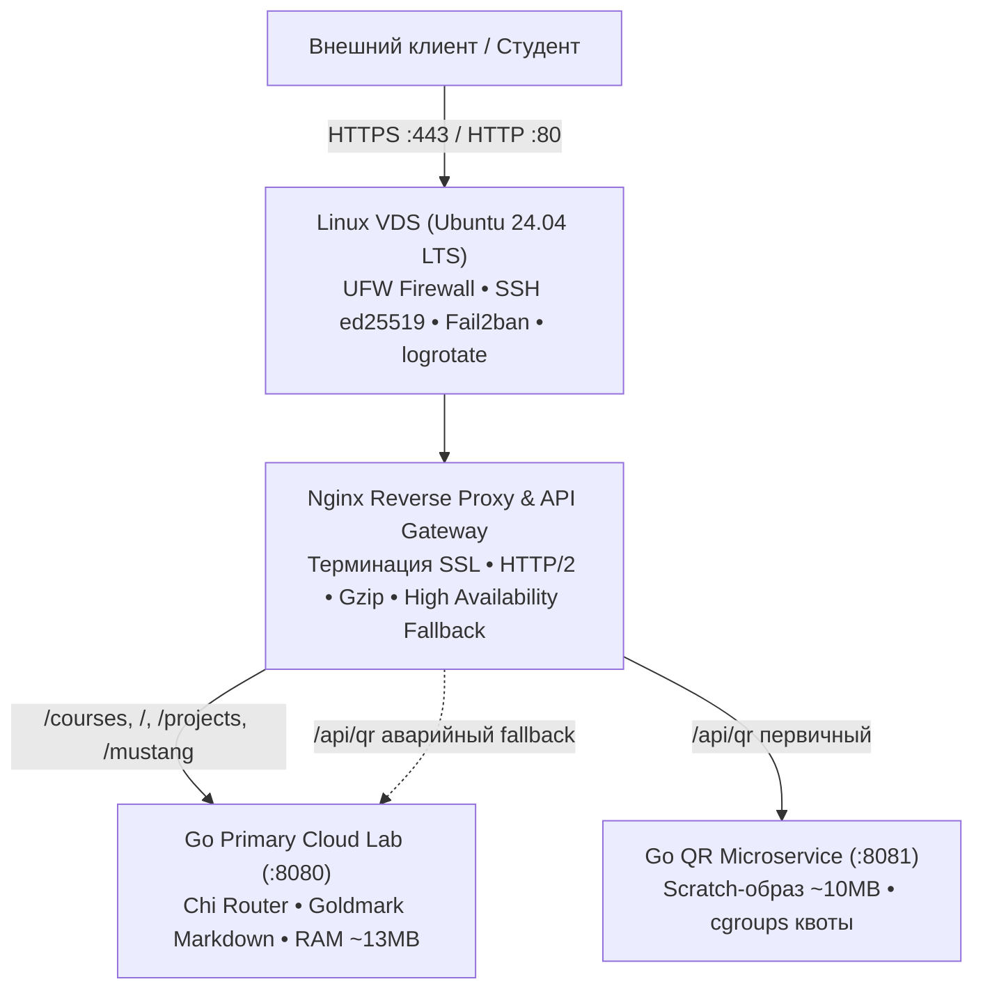
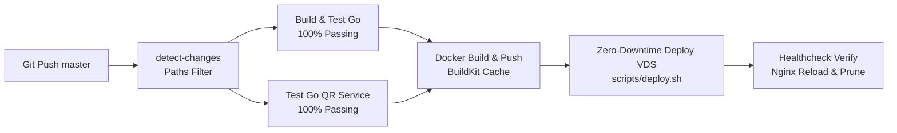

<p align="center">
  <a href="https://ubuntu.com/"></a>
  <a href="https://hub.docker.com/r/andreyvorobevaqa/portfolio-service"></a>
  <a href="https://galaxy.ansible.com/ui/standalone/namespaces/24255/"></a>
  <a href="https://github.com/AndreyJVM/portfolio-service/actions"></a>
  <a href="https://nginx.org/"></a>
  <a href="https://go.dev/"></a>
  <a href="LICENSE"></a>
</p>

# Primary Cloud Lab • vorobevaqa.ru

Открытая интерактивная образовательная платформа по **DevOps, системному администрированию Linux, контейнеризации в Docker, автоматизации на Ansible и надежным CI/CD пайплайнам**.

Архитектура проекта полностью переведена с монолита на Java/Spring Boot на производительный, легковесный микростек на **Go (Golang)**.

### Ключевые показатели миграции на Go:
- 🚀 **Потребление оперативной памяти (RAM):** сократилось с ~450 МБ до **~13 МБ** (экономия >95% ресурсов хоста);
- ⚡ **Время холодного старта:** снизилось с ~15 секунд до **<5 миллисекунд**;
- 📦 **Размер финального Docker-образа:** уменьшился с ~550 МБ до **~33 МБ**;
- 📚 **Контент как код (Courses as Code):** уроки хранятся в Git в Markdown-формате и компилируются в HTML на лету без внешних СУБД;
- 🎯 **Интерактивное обучение:** встроенные проверочные квизы и учет прогресса прохождения курсов в LocalStorage.

**Боевой сервер:** [vorobevaqa.ru](https://vorobevaqa.ru) · **Docker Hub:** [`andreyvorobevaqa`](https://hub.docker.com/repositories/andreyvorobevaqa) · **Ansible Galaxy:** [роли автора](https://galaxy.ansible.com/ui/standalone/namespaces/24255/)


## Содержание

- [Инфраструктура и Архитектура](#инфраструктура-и-архитектура)
- [Образовательные треки и Лабораторные](#образовательные-треки-и-лабораторные)
- [Интерактивная система обучения](#интерактивная-система-обучения)
- [DevOps & Hardening контейнеров](#devops--hardening-контейнеров)
- [CI/CD & Бесперебойный Blue-Green деплой](#cicd--бесперебойный-blue-green-деплой)
- [Тестирование и локальный запуск](#тестирование-и-локальный-запуск)
- [Структура репозитория](#структура-репозитория)
- [Автор и Контакты](#автор-и-контакты)
- [Лицензия](#лицензия)


## Инфраструктура и Архитектура



| Уровень | Технологии & Решения |
|---|---|
| **Хост и ОС** | Linux (Ubuntu 24.04 LTS), Bash-скрипты автоматизации, systemd, cron, ротация logrotate |
| **Сетевая безопасность** | UFW firewall (ограничение SSH, 80/443), Fail2ban от брутфорса, SSH-аутентификация по ключам ed25519 |
| **Шлюз и Прокси** | Nginx (Reverse Proxy, API Gateway, SSL Let's Encrypt / Certbot, HTTP/2, Gzip, HA fallback для QR, кастомные 50x) |
| **Контейнеризация** | Docker, Docker Compose, Docker Hub Registry, Alpine Linux runtime, cgroups v2 лимиты |
| **Бэкенд платформы** | Go 1.26 (`go-chi/chi/v5`, `yuin/goldmark`, `skip2/go-qrcode`), статическая сборка со стриппингом символов |
| **IaC & Оркестрация** | Ansible (идемпотентные плейбуки и роли в Ansible Galaxy), Blue-Green деплой скриптом `deploy.sh` |
| **CI/CD** | GitHub Actions (параллельная сборка, BuildKit gha-кэш, Zero-Downtime деплой с авто-откатом) |


## Образовательные треки и Лабораторные

Каталог платформы включает структурированные практические курсы:

1. 🐧 **Системное администрирование Linux** (`/courses/linux`):
   - Модель прав доступа DAC (POSIX, SUID, SGID, Sticky bit), управление юнитами и таймерами systemd;
   - Сетевой стек Linux (iproute2, ss, iptables, ufw), анализ трафика и сокетов.
2. 🐳 **Контейнеризация и Docker** (`/courses/docker`):
   - Многоэтапные сборки (Multi-stage), Linux cgroups v2, неймспейсы (PID/NET/MNT);
   - Docker Compose v2, внутренняя DNS-маршрутизация и изоляция bridge-сетей.
3. ⚙️ **Ansible & Инфраструктура как код (IaC)** (`/courses/ansible`):
   - Архитектура Agentless, инвентарь, написание идемпотентных плейбуков;
   - Модульные роли, шифрование secrets с Ansible Vault и публикация в Ansible Galaxy.
4. 🔄 **CI/CD: GitHub Actions & GitLab** (`/courses/cicd`):
   - Проектирование production-пайплайнов, кэширование слоев сборки Docker (BuildKit `type=gha`);
   - Стратегия Zero-Downtime деплоя Blue-Green с Docker Compose scale и мгновенным авто-откатом (Rollback).


## Интерактивная система обучения

- **Левая боковая навигация (Sidebar):**
  - Десктоп ($\ge 992\text{px}$): фиксированная панель слева шириной `260px` со строгим текстовым меню без лишних значков;
  - Планшеты и смартфоны ($< 992\text{px}$): компактный верхний бар и адаптивное выдвижное меню (Bootstrap 5.3 Offcanvas).
- **Сохранение прогресса в LocalStorage:**
  - Каждый пройденный урок мгновенно фиксируется в браузере;
  - В каталоге и на странице модулей динамически рассчитывается процент завершения курса.
- **Проверочные мини-квизы:**
  - В конце уроков встроен интерактивный блок самопроверки с мгновенной валидацией ответов и подробным объяснением архитектуры;
  - При успешном решении всех вопросов квиза урок автоматически отмечается как пройденный.


## DevOps & Hardening контейнеров

Стек развертывается через `docker-compose.yml` в соответствии с production-стандартами:

1. **Минимальные права и non-root пользователь:**
   Контейнер работает от непривилегированного пользователя `appuser:appgroup` с `security_opt: [no-new-privileges:true]`.
2. **Встроенный Healthcheck:**
   ```yaml
   healthcheck:
     test: [ "CMD-SHELL", "curl -f http://localhost:8080/health || exit 1" ]
     interval: 5s
     timeout: 3s
     retries: 4
     start_period: 3s
   ```
3. **Лимиты ресурсов (cgroups):**
   ```yaml
   deploy:
     resources:
       limits:
         cpus: "0.5"
         memory: 128M
       reservations:
         cpus: "0.05"
         memory: 32M
   ```
4. **Ротация логов (Log Rotation):**
   ```yaml
   logging:
     driver: "json-file"
     options:
       max-size: "10m"
       max-file: "3"
   ```


## CI/CD & Бесперебойный Blue-Green деплой



1. **Path-based trigger:** Сборка запускается только для изменившихся компонентов (Go платформа, QR-сервис, конфигурация деплоя).
2. **Concurrency lock:** Группа `production-deploy` блокирует одновременные гонки релизов.
3. **Бесперебойное обновление:** `scripts/deploy.sh` запускает новый инстанс параллельно (`scale app=2`), ждет `healthy`, перезагружает Nginx и гасит старый инстанс. В случае сбоя срабатывает мгновенный автоматический откат (`rollback`).


## Тестирование и локальный запуск

```bash
# 1. Запуск unit-тестов платформы на Go
go test -v ./...

# 2. Запуск unit-тестов QR-сервиса
cd qr-service && go test -v ./...

# 3. Локальный запуск платформы
go run cmd/server/main.go

# 4. Локальная сборка и тестирование Docker-образа
docker build -t andreyvorobevaqa/portfolio-service:test .
docker run -p 8080:8080 andreyvorobevaqa/portfolio-service:test
```


## Структура репозитория

```
portfolio/
├── cmd/server/main.go       # Точка входа веб-сервера Go (Chi роутер, Graceful shutdown)
├── content/courses/         # База знаний в Markdown (Linux, Docker, Ansible, CI/CD)
├── internal/
│   ├── config/              # Конфигурация окружения
│   ├── handler/             # HTTP-обработчики страниц, REST API и unit-тесты
│   ├── model/               # Модели данных (Courses, Lessons, Integrations)
│   └── service/             # Сервисный слой каталога и интеграций (GitHub, DockerHub)
├── web/
│   ├── static/              # CSS (темы, сайдбар, анимации), JS (прогресс, квизы), сертификаты
│   └── templates/           # HTML-шаблоны Go (layout, index, courses, course_detail, lesson)
├── qr-service/              # Независимый Go микросервис генерации QR-кодов
├── nginx/
│   ├── nginx.conf           # Конфигурация Reverse Proxy, SSL Let's Encrypt и HA роутинга
│   └── 50x.html             # Кастомная страница аварийных ошибок
├── scripts/
│   └── deploy.sh            # Blue-Green развертывание с авто-откатом (Rollback)
├── docker-compose.yml       # Конфигурация продакшн-стека микросервисов
├── Dockerfile               # Multi-stage сборка статического бинарника Go на Alpine
├── go.mod / go.sum          # Модули Go 1.26
└── .github/workflows/       # Пайплайн GitHub Actions
```


## Автор и Контакты

**Андрей Воробьев**
- **Специализация:** DevOps & Linux Infrastructure Engineer
- **Веб-сайт:** [vorobevaqa.ru](https://vorobevaqa.ru)
- **GitHub:** [@AndreyJVM](https://github.com/AndreyJVM)
- **Docker Hub:** [andreyvorobevaqa](https://hub.docker.com/repositories/andreyvorobevaqa)
- **Ansible Galaxy:** [Профиль автора](https://galaxy.ansible.com/ui/standalone/namespaces/24255/)
- **Telegram:** [@AndreyAQA](https://t.me/AndreyAQA)

---

## Лицензия

Проект распространяется под свободной лицензией [Apache License 2.0](LICENSE).
