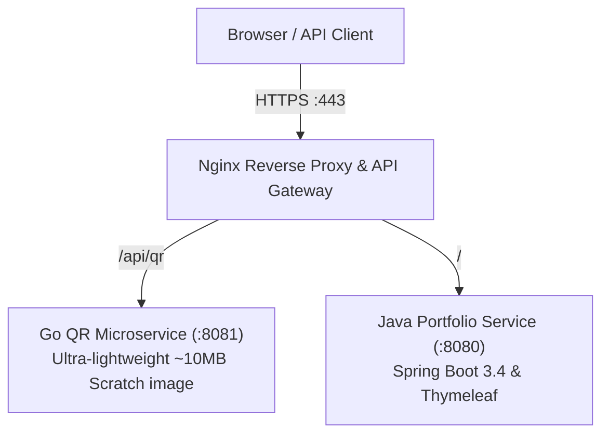
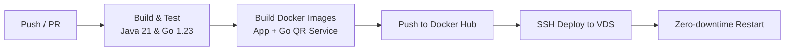

# Portfolio & QR Code Generator Microservices

[](https://openjdk.org/projects/jdk/21/)
[](https://go.dev/)\
[](https://spring.io/projects/spring-boot)
[](https://google.github.io/styleguide/javaguide.html)
[](LICENSE)
[](https://hub.docker.com/r/andreyvorobevaqa/portfolio-service)
[](https://github.com/AndreyJVM)
[](https://qameta.io/)
[](https://jmeter.apache.org/)

Production-ready microservices architecture combining a personal portfolio and an ultra-fast QR code generator microservice written in Go. Containerized with Docker and deployed via a fully automated CI/CD pipeline.

**Live demo:** [vorobevaqa.ru](https://vorobevaqa.ru) · **Docker Hub:** [`andreyvorobevaqa/portfolio-service`](https://hub.docker.com/r/andreyvorobevaqa/portfolio-service)


## Table of Contents

- [Architecture & Tech Stack](#architecture--tech-stack)
- [Key Features](#key-features)
- [Quick Start](#quick-start)
- [QA Automation & Test Infrastructure](#qa-automation--test-infrastructure)
- [Performance & Load Testing (JMeter)](#performance--load-testing-jmeter)
- [Code Quality & Standards](#code-quality--standards)
- [API Reference](#api-reference)
- [CI/CD Pipeline](#cicd-pipeline)
- [Project Structure](#project-structure)
- [Author](#author)
- [License](#license)


## Architecture & Tech Stack



| Layer | Technologies |
|---|---|
| **Backend (Web & Portfolio)** | Java 21 (Virtual Threads), Spring Boot 3.4, Spring MVC, Thymeleaf, Caffeine Cache |
| **Microservice (QR Engine)** | Go 1.23, `skip2/go-qrcode`, Scratch base image (~10MB, <15ms latency) |
| **QA Automation** | Selenide 7, REST Assured, JUnit 5, Allure Report 2 (Page Object Model) |
| **Performance Testing** | Apache JMeter 5.5, `jmeter-maven-plugin`, HTML Dashboard Reports |
| **Frontend** | Bootstrap 5.3, Font Awesome 6, Vanilla JS (ES6 modules, theme management) |
| **Build & Tools** | Maven, Lombok, Spotless (Google Java Format), Checkstyle |
| **Infrastructure** | Docker, Docker Compose, Nginx (reverse proxy, SSL, Gzip), Ubuntu VDS |
| **CI/CD** | GitHub Actions (multi-service build, test, Docker Hub push, zero-downtime SSH deploy) |

## Key Features

- **Microservice Architecture** — QR-генератор вынесен в независимый легковесный сервис на Go, Nginx выступает API Gateway.
- **Ultra-efficient Resources** — Go микросервис упакован в `scratch` (образ всего ~10 МБ, потребляет ~10 МБ RAM).
- **Personal Portfolio** — responsive showcase with dedicated sections for completed engineering projects, skills matrix, and certifications.
- **Dark / Light Theme** — native toggle synchronized with Bootstrap 5.3 color modes (`data-bs-theme`), no flicker on load.
- **Client Features** — one-click PNG download, Web Share API integration, instant clipboard copy.
- **AQA Framework** — E2E UI тесты на Selenide (Page Object Model), REST Assured API тесты и Allure отчеты (63 автоматизированных теста).
- **Performance Testing** — сценарии нагрузочного тестирования Apache JMeter с автоматической генерацией аналитических HTML-дашбордов.
- **Production-Tuned** — Nginx reverse proxy with HTTP/2, Let's Encrypt SSL, and Gzip compression; JVM container limits configured via `JAVA_OPTS`. Actuator metrics enabled.

## Quick Start

### Prerequisites
- JDK 21+
- Maven 3.9+
- Docker & Docker Compose (optional for containerized run)

### Local Run

```bash
# Clone the repository
git clone https://github.com/AndreyJVM/portfolio-service.git
cd portfolio-service

# Run with Maven
mvn spring-boot:run
```

The application will be accessible at `http://localhost:8080`.

### Run via Docker Compose (Multi-service stack)

```bash
docker compose up -d --build
```

---

## QA Automation & Test Infrastructure

В проект интегрирован фреймворк автоматизации тестирования на стеке **Java 21 + JUnit 5 + Selenide + REST Assured + Allure Report** (63 теста).

### Архитектура тестов:
- **UI E2E тесты (Selenide):** реализованы с использованием паттерна Page Object Model (`BasePage`, `HomePage`, `ProjectsPage`, `EducationPage`, `QrPlaygroundPage`). Покрывают главную страницу, навигацию, каталог решений, дипломы и сертификаты, интерактивный QR Playground, переключение тем и кастомную 404 страницу.
- **API тесты (REST Assured):** валидация контрактов `/api/qr`, позитивные и негативные сценарии, проверка структуры ошибок, граничных значений и HTTP статус-кодов (200, 400, 405, 415), мониторинг Spring Boot Actuator (`/actuator/health`, `/actuator/info`).
- **WebMvc & Service Unit Tests:** изолированное модульное тестирование бизнес-логики интеграций с GitHub API, Docker Hub API, Ansible Galaxy API и контроллеров `PageController`, `QrRestController`.
- **Go Unit Tests:** модульные тесты хендлеров `/health` и `/api/qr` в директории `qr-service/`.
- **Allure Reporting 2:** автоматическое логирование HTTP запросов/ответов через `AllureRestAssured`, скриншоты и Page Source при падениях через `AllureSelenide`, группировка по Epics/Features/Stories.

### Переменные конфигурации тестов (`.env` или `-D` параметры):

```properties
SELENIUM_BROWSER=chrome                           # Браузер (chrome, firefox)
SELENIUM_HEADLESS=true                            # Headless режим (true/false)
TEST_BASE_URL=http://localhost:8080               # Тестируемый хост (локальный или прод)
```

### Команды запуска тестов и генерации отчетов:

```bash
# Запуск всех Java тестов (Unit + API + E2E UI)
mvn clean test

# Запуск тестов микросервиса на Go
cd qr-service && go test -v ./... && cd ..

# Генерация и локальный запуск интерактивного Allure Report в браузере
mvn allure:serve

# Генерация статического HTML отчета Allure (target/site/allure-maven-plugin)
mvn allure:report
```

---

## Performance & Load Testing (JMeter)

В проект встроен сценарий нагрузочного тестирования на базе **Apache JMeter 5.5** (`src/test/jmeter/qr-service-load-test.jmx`), изолированный в Maven-профиле `load-test` с помощью `jmeter-maven-plugin`.

### Архитектура нагрузочного сценария:
- **TG-01: Web Page Visitors (Browsing Navigation)** — эмуляция поведения пользователей при переходе по ключевым маршрутам приложения (`/`, `/projects`, `/education`, `/qr`), проверка HTTP 200 и валидация разметки.
- **TG-02: High-Load QR Generator API** — высокоинтенсивный поток POST-запросов `/api/qr` с генерацией уникальных URL (`${__time()}`) и ассертами на JSON-структуру и Base64-строку.

### Команды запуска нагрузочного тестирования:

```bash
# Запуск со стандартными параметрами (localhost:8080, 15 потоков)
mvn verify -Pload-test

# Запуск с переопределением целевого хоста, нагрузки и длительности
mvn verify -Pload-test \
  -Dloadtest.host=localhost \
  -Dloadtest.port=8080 \
  -Dloadtest.users.web=10 \
  -Dloadtest.users.api=25 \
  -Dloadtest.rampup=5 \
  -Dloadtest.duration=30
```

После завершения прогона генерируется интерактивный HTML-дашборд с графиками Response Times (p90, p95, p99), Throughput (RPS) и Error Rate в каталоге:
`target/jmeter/reports/index.html`.

---

## Code Quality & Standards

The project strictly follows the **[Google Java Style Guide](https://google.github.io/styleguide/javaguide.html)** (2-space indentation) and enforces consistent formatting and license compliance across all source files.

### Tools
- **Spotless Maven Plugin** (`com.diffplug.spotless:spotless-maven-plugin`) with `google-java-format` engine.
- **Checkstyle Plugin** (`maven-checkstyle-plugin`) configured with standard `google_checks.xml`.
- **SPDX Headers** — all Java source files contain Apache-2.0 SPDX copyright and license headers.
- **EditorConfig** — `.editorconfig` maintains universal formatting rules across IDEs and editors.

### Commands

```bash
# Check source code compliance with Google Java Style and SPDX license headers
mvn spotless:check

# Automatically format all Java source files according to Google Java Style
mvn spotless:apply

# Run Google Style static analysis checks
mvn checkstyle:check
```

## API Reference

### Generate QR Code

| | |
|---|---|
| **Endpoint** | `POST /api/qr` |
| **Service** | `qr-service` (Go) |
| **Content-Type** | `application/json` |

#### Request Body

```json
{
  \"url\": \"https://vorobevaqa.ru\"
}
```

#### Response `200 OK`

```json
{
  \"url\": \"https://vorobevaqa.ru\",
  \"qrCode\": \"iVBORw0KGgoAAAANSUhEUgAA...\"
}
```

#### Response `400 Bad Request`

```json
{
  \"error\": \"URL must start with http:// or https://\"
}
```

## CI/CD Pipeline

1. **Build & Test** — параллельное тестирование Java приложения (Maven) и Go микросервиса (`go test`).
2. **Containerization** — сборка и пуш в Docker Hub образов `andreyvorobevaqa/portfolio-service` и `andreyvorobevaqa/qr-service`.
3. **Automated Deployment** — деплой обновленных образов на VDS через SSH с обновленной конфигурацией Nginx API Gateway и `docker compose up -d`.



## Project Structure

```
portfolio/
├── qr-service/              # Go QR Microservice
│   ├── main.go              # HTTP API Server (:8081)
│   ├── main_test.go         # Go Unit Tests
│   ├── go.mod & go.sum      # Go dependencies (skip2/go-qrcode)
│   └── Dockerfile           # Minimal ~10MB Scratch image
├── src/
│   ├── main/
│   │   ├── java/            # Portfolio Web source code (Spring Boot 3.4)
│   │   └── resources/       # Templates, static assets, config
│   └── test/
│       ├── java/
│       │   └── ru/vorobevaqa/
│       │       ├── controller/  # Controller WebMvc tests
│       │       ├── service/     # Service unit tests
│       │       └── qa/          # AQA Framework: UI (Selenide), API (REST Assured), Pages
│       ├── jmeter/          # Apache JMeter load & performance test plans (.jmx)
│       └── resources/       # Test properties & Allure configuration
├── nginx/
│   └── nginx.conf           # API Gateway routing: /api/qr -> qr-service, / -> app
├── .editorconfig            # Universal editor configuration (2-space indent)
├── Dockerfile               # Java App multi-stage build
├── docker-compose.yml       # Production stack (App + QR Microservice + Nginx)
├── LICENSE                  # Apache License 2.0
├── pom.xml                  # Maven configuration with Spotless, Checkstyle & Allure
└── .github/workflows/       # CI/CD pipeline definitions
```

## Author

**Andrey Vorobev**
- **Role:** QA Automation / Backend Developer / DevOps
- **Website:** [vorobevaqa.ru](https://vorobevaqa.ru)
- **GitHub:** [@AndreyJVM](https://github.com/AndreyJVM)
- **Telegram:** [@AndreyAQA](https://t.me/AndreyAQA)

## License

This project is licensed under the terms of the **Apache License 2.0**. See the [LICENSE](LICENSE) file for details.
