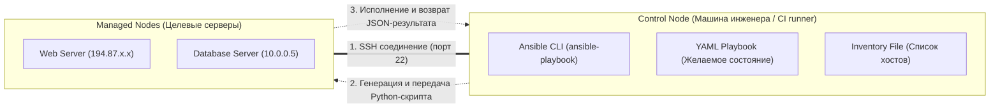

# Основы Ansible: Архитектура, Inventory и первый Playbook

Ansible — индустриальный стандарт управления конфигурациями (Configuration Management) и оркестрации инфраструктуры. Главное преимущество Ansible перед другими инструментами (Puppet, Chef) — концепция **Agentless**: на целевые серверы не нужно устанавливать фоновые демоны или агенты. Все команды передаются по защищенному протоколу SSH с использованием Python на стороне сервера.

В этом уроке мы разберем архитектуру Ansible, принципы описания инфраструктуры через Inventory, концепцию идемпотентности и напишем первый готовый к эксплуатации Playbook.

---

## 1. Архитектура и принципы работы Ansible



### Ключевые термины:
- **Control Node:** Рабочая станция инженера или раннер CI/CD с установленным пакетом `ansible` или `ansible-core`. Поддерживаются Linux и macOS.
- **Managed Nodes:** Управляемые серверы (VDS, виртуальные машины, bare-metal). На них требуется только SSH-сервер и Python 3.
- **Идемпотентность (Idempotency):** Фундаментальное свойство Ansible. Повторный запуск плейбука производит изменения **только в том случае, если текущее состояние системы отличается от декларированного**. Если сервис уже установлен и запущен, статус задачи будет `ok`, а не `changed`.

---

## 2. Описание инфраструктуры: Inventory

Файл Inventory определяет список серверов, группировку и переменные подключения:

### Пример `inventory.ini`:
```ini
[webservers]
vds-web-01 ansible_host=194.87.142.10 ansible_user=deploy ansible_ssh_private_key_file=~/.ssh/id_ed25519

[databases]
db-prod-01 ansible_host=10.0.0.5 ansible_user=deploy ansible_ssh_private_key_file=~/.ssh/id_ed25519

[production:children]
webservers
databases
```

> [!TIP]
> **Рекомендация по безопасности:**
> Никогда не используйте `ansible_user=root` в продакшене. Подключайтесь под непривилегированным пользователем (например, `deploy`) и запрашивайте повышение прав через `become: true` (sudo).

### Проверка связи через Ad-Hoc команду ping:
```bash
ansible -i inventory.ini all -m ping
```
*Результат:* каждый доступный хост вернет JSON с ответом `"ping": "pong"`.

---

## 3. Первый идемпотентный Playbook

Playbook — это декларативный документ в формате YAML, описывающий желаемое состояние системы.

Создадим `setup-webserver.yml`:

```yaml
---
- name: Базовая настройка веб-сервера и Nginx
  hosts: webservers
  become: true # Выполнять команды с правами sudo
  vars:
    server_domain: "vorobevaqa.ru"
    app_port: 8080

  tasks:
    - name: 1. Обновление apt-кэша и установка базовых системных утилит
      ansible.builtin.apt:
        name:
          - curl
          - ca-certificates
          - htop
          - ufw
        state: present
        update_cache: true
        cache_valid_time: 3600

    - name: 2. Установка веб-сервера Nginx
      ansible.builtin.apt:
        name: nginx
        state: present

    - name: 3. Размещение шаблона конфигурации Nginx
      ansible.builtin.template:
        src: templates/nginx-site.conf.j2
        dest: /etc/nginx/sites-available/{{ server_domain }}.conf
        mode: '0644'
      notify: Reload Nginx # Вызовет handler только если файл изменился!

    - name: 4. Активация виртуального хоста через символическую ссылку
      ansible.builtin.file:
        src: /etc/nginx/sites-available/{{ server_domain }}.conf
        dest: /etc/nginx/sites-enabled/{{ server_domain }}.conf
        state: link
      notify: Reload Nginx

    - name: 5. Обеспечение автозапуска и работы службы Nginx
      ansible.builtin.service:
        name: nginx
        state: started
        enabled: true

  handlers:
    - name: Reload Nginx
      ansible.builtin.service:
        name: nginx
        state: reloaded
```

---

## 4. Запуск, проверка синтаксиса и Dry-Run

Перед выполнением изменений на боевых серверах всегда запускайте валидацию:

```bash
# 1. Проверка синтаксиса YAML и модулей:
ansible-playbook -i inventory.ini setup-webserver.yml --syntax-check

# 2. Dry-Run режим (--check): симуляция без внесения реальных изменений на сервере
ansible-playbook -i inventory.ini setup-webserver.yml --check --diff

# 3. Боевое применение плейбука:
ansible-playbook -i inventory.ini setup-webserver.yml
```

> [!NOTE]
> Для организации сложных плейбуков в переиспользуемые модули с шаблонами и дефолтными переменными используйте [Урок 2: Модульные роли и публикация в Ansible Galaxy](/courses/ansible/02-roles-and-galaxy).
