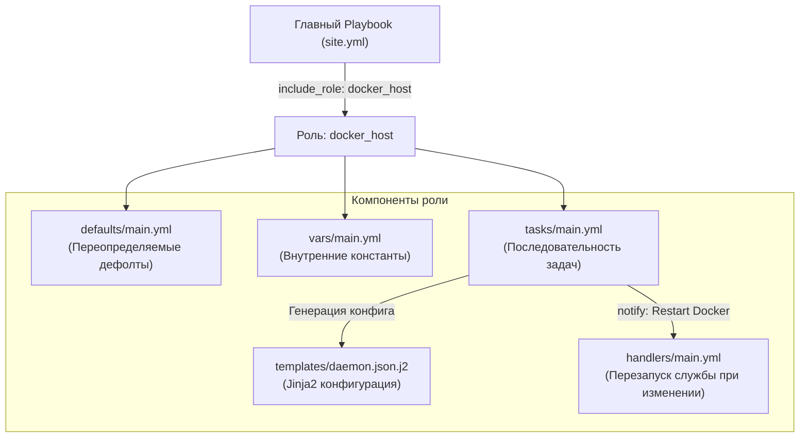

# Модульные роли и публикация в Ansible Galaxy

По мере роста инфраструктуры монолитные плейбуки на тысячи строк превращаются в спагетти-код: дублируются задачи установки Docker и Nginx, переменные окружения замусоривают логику, а повторное использование кода между разными проектами становится невозможным.

Решение этой проблемы в Ansible — **Роли (Roles)**: строго структурированные каталоги, инкапсулирующие задачи (tasks), шаблоны (templates), переменные (vars / defaults), файлы (files) и обработчики событий (handlers).

В этом уроке мы разберем:
* Стандартную анатомию каталогов Ansible Role.
* Жизненный цикл выполнения роли и правильное использование событий `notify` / `handlers`.
* Разработку готовой к продакшену роли для установки и безопасной настройки Docker Daemon.
* Защиту учетных данных и паролей через **Ansible Vault** (AES-256).
* Публикацию и импорт готовых ролей из репозитория **Ansible Galaxy** через `requirements.yml`.

---

## 1. Архитектура и жизненный цикл роли

Роль группирует все аспекты настройки сервиса в единую независимую сущность:



### Приоритет переменных: `defaults/` против `vars/`
* **`defaults/main.yml`**: Значения по умолчанию с самым **низким** приоритетом в Ansible. Их легко переопределить в `group_vars`, `host_vars` или параметрах вызова роли.
* **`vars/main.yml`**: Внутренние константы с очень **высоким** приоритетом. Используются для неизменяемых платформо-зависимых путей (например, `/etc/docker` в Debian vs `/etc/sysconfig/docker` в RHEL).

---

## 2. Инициализация и структура каталогов роли

Создание каркаса роли выполняется утилитой `ansible-galaxy`:

```bash
ansible-galaxy role init roles/docker_host
```

Дерево файлов стандартной роли:
```text
roles/docker_host/
├── defaults/
│   └── main.yml        # Дефолтные переменные (порт, версия, лимиты логов)
├── files/
│   └── docker.asc      # Статические файлы, копируемые без изменений
├── handlers/
│   └── main.yml        # Обработчики (перезапуск демонов по сигналу notify)
├── meta/
│   └── main.yml        # Авторство, лицензия, зависимости роли
├── tasks/
│   └── main.yml        # Точка входа в исполняемые задачи
├── templates/
│   └── daemon.json.j2  # Шаблоны Jinja2 с подстановкой переменных {{ ... }}
└── vars/
    └── main.yml        # Системные константы
```

---

## 3. Практическая реализация: Роль `docker_host`

### Шаг 1: Определение дефолтных переменных (`defaults/main.yml`)
```yaml
---
docker_log_max_size: "10m"
docker_log_max_file: "3"
docker_live_restore: true
docker_no_new_privileges: true
docker_cgroup_driver: "systemd"
```

### Шаг 2: Шаблон конфигурации `templates/daemon.json.j2`
```json
{
  "log-driver": "json-file",
  "log-opts": {
    "max-size": "{{ docker_log_max_size }}",
    "max-file": "{{ docker_log_max_file }}"
  },
  "exec-opts": ["native.cgroupdriver={{ docker_cgroup_driver }}"],
  "live-restore": {{ docker_live_restore | to_json }},
  "no-new-privileges": {{ docker_no_new_privileges | to_json }}
}
```

### Шаг 3: Описание задач (`tasks/main.yml`)
```yaml
---
- name: Установка системных зависимостей для репозитория Docker
  ansible.builtin.apt:
    name:
      - ca-certificates
      - curl
      - gnupg
    state: present
    update_cache: true
  become: true

- name: Создание каталога для системных ключей APT
  ansible.builtin.file:
    path: /etc/apt/keyrings
    state: directory
    mode: '0755'
  become: true

- name: Добавление официального GPG ключа Docker
  ansible.builtin.get_url:
    url: https://download.docker.com/linux/ubuntu/gpg
    dest: /etc/apt/keyrings/docker.asc
    mode: '0644'
  become: true

- name: Развертывание конфигурации /etc/docker/daemon.json
  ansible.builtin.template:
    src: daemon.json.j2
    dest: /etc/docker/daemon.json
    mode: '0644'
  become: true
  notify: Restart Docker Daemon
```

### Шаг 4: Обработчик перезапуска (`handlers/main.yml`)
Обработчик вызывается **ровно один раз в конце выполнения плейбука**, даже если 10 задач вызвали триггер `notify`:
```yaml
---
- name: Restart Docker Daemon
  ansible.builtin.systemd:
    name: docker
    state: restarted
    enabled: true
    daemon_reload: true
  become: true
```

---

## 4. Защита секретов: Ansible Vault (AES-256)

Хранить пароли баз данных, токены API и SSH-ключи в открытом виде в Git строго запрещено. **Ansible Vault** позволяет зашифровать файл целиком или конкретную переменную с использованием алгоритма AES-256.

```bash
# 1. Создание нового зашифрованного файла с секретами:
ansible-vault create group_vars/all/vault.yml

# 2. Редактирование существующего файла секретов:
ansible-vault edit group_vars/all/vault.yml

# 3. Шифрование отдельной строки для вставки в плейбук:
ansible-vault encrypt_string 'MySuperSecretP@ssw0rd' --name 'db_password'
```

### Запуск плейбука с зашифрованными секретами:
```bash
# Запрос пароля от хранилища интерактивно в консоли:
ansible-playbook -i inventory.ini site.yml --ask-vault-pass

# Или передача защищенного файла с паролем (для CI/CD раннеров):
ansible-playbook -i inventory.ini site.yml --vault-password-file ~/.vault_pass
```

---

## 5. Использование и загрузка ролей из Ansible Galaxy

**Ansible Galaxy** — публичный реестр сообщества, содержащий тысячи проверенных ролей для Nginx, PostgreSQL, Kubernetes и системного харденинга.

### Файл манифеста зависимостей `requirements.yml`:
```yaml
---
roles:
  # Роль из публичного реестра Galaxy
  - name: geerlingguy.docker
    version: 7.4.2

  # Роль напрямую из корпоративного Git репозитория
  - name: internal_monitoring
    src: git@github.com:my-org/ansible-role-monitoring.git
    scm: git
    version: v2.1.0
```

### Установка зависимостей одной командой:
```bash
ansible-galaxy install -r requirements.yml -p roles/
```

### Подключение роли в плейбуке `site.yml`:
```yaml
---
- name: Развертывание Docker-хостов
  hosts: docker_nodes
  become: true
  roles:
    - role: docker_host
      docker_log_max_size: "20m"
      docker_log_max_file: "5"
```

---

## 6. Вопросы для самопроверки

<details>
<summary>Вопрос 1: Чем defaults/main.yml отличается от vars/main.yml в структуре роли?</summary>
<div class="mt-2 text-body">
В <code>defaults/main.yml</code> объявляются дефолтные параметры роли с <b>наименьшим приоритетом</b> в системе разрешения переменных Ansible. Пользователь роли может легко переопределить их в <code>host_vars</code>, <code>group_vars</code> или при вызове роли.<br>
В <code>vars/main.yml</code> помещаются переменные с <b>очень высоким приоритетом</b>, которые считаются внутренней частью роли и не должны переопределяться снаружи (например, внутренние пути ОС или названия пакетов).
</div>
</details>

<details>
<summary>Вопрос 2: Сколько раз выполнится handler (обработчик), если в процессе плейбука 5 разных задач вызвали notify: Restart Docker?</summary>
<div class="mt-2 text-body">
Обработчик (Handler) выполнится <b>ровно один раз</b> в самом конце выполнения play (после завершения всех задач). Если ни одна из задач не изменила состояние системы (все задачи вернули <code>ok</code>, а не <code>changed</code>), обработчик не будет вызван вовсе. Это ключевое свойство идемпотентности Ansible.
</div>
</details>

<details>
<summary>Вопрос 3: Как безопасно передать пароль от Ansible Vault в автоматизированном CI/CD пайплайне?</summary>
<div class="mt-2 text-body">
В CI/CD (например, GitHub Actions или GitLab CI) пароль от хранилища передается через зашифрованные переменные репозитория (Secret Variables). Скрипт пайплайна сохраняет этот секрет во временный файл и передает аргумент <code>--vault-password-file &lt;путь_к_файлу&gt;</code> или использует переменную окружения <code>ANSIBLE_VAULT_PASSWORD_FILE</code>.
</div>
</details>

---

## 7. Дополнительные материалы и следующие шаги

* [Модуль 1: Архитектура Ansible, Inventory и первый Playbook](/courses/ansible/01-ansible-basics-and-playbooks)
* [Основы CI/CD: Пайплайны в GitHub Actions](/courses/cicd/01-github-actions-pipeline)
* [Zero-Downtime деплой и авто-откат в продакшене](/courses/cicd/02-zero-downtime-and-blue-green)
