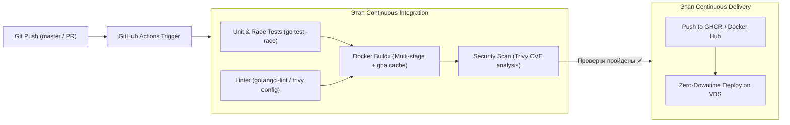

# Проектирование CI/CD в GitHub Actions с кэшированием BuildKit и сканированием безопасности

Автоматизация тестирования, сборки и доставки приложений (Continuous Integration & Continuous Delivery) — краеугольный камень современной разработки. Неоптимизированный пайплайн приводит к тому, что разработчики ждут сборки по 15–20 минут на каждый коммит, а отсутствие статического анализа и сканирования уязвимостей пропускает опасные CVE в продакшн.

В этом уроке мы разберем проектирование production-grade пайплайна в **GitHub Actions**: от параллельного тестирования и матричных сборок до удаленного кэширования слоев BuildKit (`type=gha`) и аудита безопасности контейнеров.

---

## 1. Архитектура современного CI/CD конвейера



### Ключевые компоненты:
1. **Triggers:** События `push`, `pull_request`, запуск по расписанию `schedule` или ручной запуск `workflow_dispatch`.
2. **Jobs:** Изолированные виртуальные машины (runners), выполняющиеся параллельно по умолчанию. Зависимости между джобами задаются через `needs: [job_name]`.
3. **Кэширование:** Использование встроенного кэша GitHub Actions API (`actions/cache` и `cache-from=type=gha`), предотвращающее повторное скачивание библиотек и слоев образов.

---

## 2. Эталонный production-пайплайн `.github/workflows/ci-cd.yml`

```yaml
name: CI/CD Pipeline

on:
  push:
    branches: [ master ]
  pull_request:
    branches: [ master ]

env:
  REGISTRY: ghcr.io
  IMAGE_NAME: ${{ github.repository }}

jobs:
  # -------------------------------------------------------------
  # 1. Тестирование и линтинг кода
  # -------------------------------------------------------------
  test:
    name: Run Unit Tests & Lint
    runs-on: ubuntu-latest
    steps:
      - name: Checkout Code
        uses: actions/checkout@v4

      - name: Set up Go
        uses: actions/setup-go@v5
        with:
          go-version: '1.26'
          cache: true
          cache-dependency-path: go.sum

      - name: Run Unit Tests with Race Detector
        run: go test -v -count=1 -race ./...

  # -------------------------------------------------------------
  # 2. Сборка Docker-образа с BuildKit кэшем
  # -------------------------------------------------------------
  build-and-scan:
    name: Build & Security Audit
    needs: test
    runs-on: ubuntu-latest
    permissions:
      contents: read
      packages: write
      security-events: write

    steps:
      - name: Checkout Code
        uses: actions/checkout@v4

      - name: Set up Docker Buildx
        uses: docker/setup-buildx-action@v3

      - name: Log in to GitHub Container Registry
        uses: docker/login-action@v3
        with:
          registry: ${{ env.REGISTRY }}
          username: ${{ github.actor }}
          password: ${{ secrets.GITHUB_TOKEN }}

      # Сборка локального образа для сканирования Trivy
      - name: Build Local Image
        uses: docker/build-push-action@v6
        with:
          context: .
          load: true
          tags: ${{ env.REGISTRY }}/${{ env.IMAGE_NAME }}:local-test
          cache-from: type=gha
          cache-to: type=gha,mode=max

      # Сканирование безопасности контейнера
      - name: Run Trivy vulnerability scanner
        uses: aquasecurity/trivy-action@master
        with:
          image-ref: ${{ env.REGISTRY }}/${{ env.IMAGE_NAME }}:local-test
          format: 'table'
          exit-code: '1' # Прерывать сборку при наличии критических CVE
          ignore-unfixed: true
          vuln-type: 'os,library'
          severity: 'CRITICAL'

      # Публикация готового образа при успешном мердже в master
      - name: Push Production Image
        if: github.event_name == 'push' && github.ref == 'refs/heads/master'
        uses: docker/build-push-action@v6
        with:
          context: .
          push: true
          tags: |
            ${{ env.REGISTRY }}/${{ env.IMAGE_NAME }}:latest
            ${{ env.REGISTRY }}/${{ env.IMAGE_NAME }}:${{ github.sha }}
          cache-from: type=gha
          cache-to: type=gha,mode=max
```

---

## 3. Магическое ускорение: Удаленный кэш BuildKit (`type=gha`)

В стандартном `docker build` каждый новый запуск в GitHub Actions выполняется на «чистой» виртуальной машине. Все слои компилируются с нуля (сборка занимает 5–10 минут).

Директивы:
```yaml
cache-from: type=gha
cache-to: type=gha,mode=max
```
сохраняют промежуточные снимки слоев в кэш-хранилище GitHub Actions Cache API (объемом до 10 ГБ на репозиторий). Повторные сборки подтягивают готовые слои за секунды, сокращая время выполнения CI в 10–20 раз!

---

## 4. Следующие шаги автоматизации

> [!TIP]
> **Углубленные практики доставки контейнеров:**
> - [Модуль 9: Multi-arch сборки и CI/CD](/courses/docker-cicd/01-multiarch-buildx-and-cicd) — кросс-компиляция под amd64 и arm64 (AWS Graviton, Apple Silicon).
> - [Модуль 9.2: Zero-Downtime деплой и авто-откат](/courses/docker-cicd/02-zero-downtime-and-blue-green) — реализация бесшовного переключения версий.
> - [Модуль 9.3: Удаленный деплой по SSH через Docker Contexts](/courses/docker-cicd/03-remote-deployment-and-gitops) — управление VDS без открытых портов демона.
