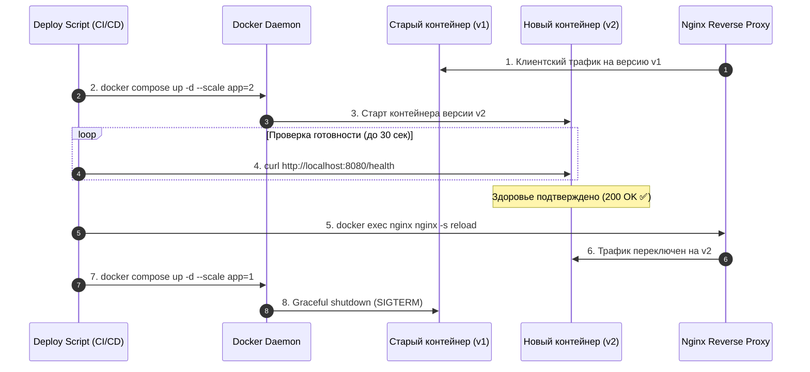

# Zero-Downtime деплой и авто-откат (Rollback)

В продакшн-окружении недопустимо прерывание обслуживания пользователей во время обновления приложений.

---

### 1. Стратегия Blue-Green с Docker Compose

Классический подход с `docker compose down && docker compose up` приводит к простою сервиса от 5 до 30 секунд (пока поднимается контейнер).

**Алгоритм бесперебойного обновления без простоя:**
1. Подтянуть новый образ (`docker pull`).
2. Запустить новую версию параллельно со старой через горизонтальное масштабирование (`docker compose up -d --scale app=2 --no-recreate`).
3. Дождаться прохождения встроенного `healthcheck` нового контейнера.
4. Выполнить бесшовный reload конфигурации Reverse Proxy (Nginx) с помощью сигнала `SIGHUP`.
5. Остановить и удалить старый инстанс (`docker compose up -d --scale app=1`).



---

### 2. Реализация production-скрипта `deploy.sh`

```bash
#!/usr/bin/env bash
set -Eeuo pipefail

APP_NAME="portfolio-service"
HEALTH_URL="http://localhost:8080/health"
MAX_ATTEMPTS=15
SLEEP_TIME=2

echo "==> [1/4] Подтягивание свежего образа из Docker Hub..."
docker compose pull app

echo "==> [2/4] Запуск нового инстанса..."
docker compose up -d --scale app=2 --no-recreate app

echo "==> [3/4] Проверка статуса здоровья (Healthcheck)..."
SUCCESS=0
for ((i=1; i<=MAX_ATTEMPTS; i++)); do
    if curl -s -f "$HEALTH_URL" > /dev/null; then
        echo "Контейнер успешно прошел проверку здоровья на попытке $i!"
        SUCCESS=1
        break
    fi
    echo "Ожидание готовности (попытка $i/$MAX_ATTEMPTS)..."
    sleep $SLEEP_TIME
done

if [ $SUCCESS -ne 1 ]; then
    echo "ОШИБКА: Новый контейнер не прошел healthcheck. Инициализация отката!"
    docker compose up -d --scale app=1
    exit 1
fi

echo "==> [4/4] Завершение ротации и очистка старых контейнеров..."
docker compose up -d --scale app=1
docker system prune -f

echo "Деплой успешно завершен без простоя!"
```

---

### 3. Автоматический откат (Automatic Rollback)

Если бинарник упал при старте (panic, ошибка подключения к базе, невалидный конфиг), цикл ожидания завершается с ошибкой, и скрипт выполняет мгновенный откат, не переключая Nginx и оставляя старый стабильный контейнер в работе.

> [!TIP]
> **Специализированный модуль CI/CD для контейнеров:**
> Полная реализация пайплайна непрерывной доставки с матричной сборкой Buildx, удаленным кэшем `type=gha`, сканированием Trivy и деплоем на VDS представлена в [Модуле 9: Multi-arch сборки и CI/CD](/courses/docker-cicd/01-multiarch-buildx-and-cicd) и [Модуле 9.2: Zero-Downtime деплой и авто-откат](/courses/docker-cicd/02-zero-downtime-and-blue-green).
