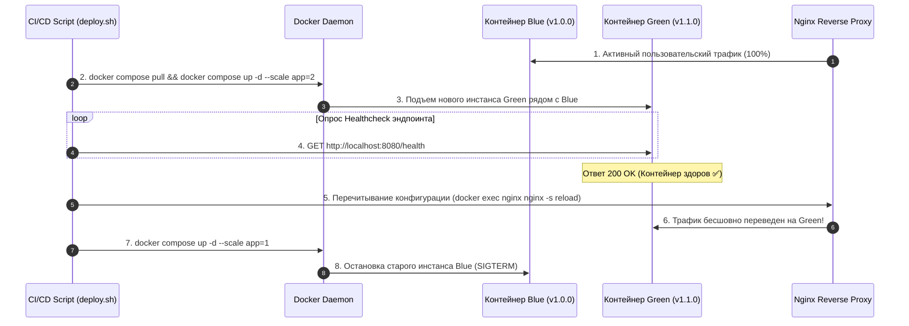

# Бесшовный Blue-Green деплой и авто-откат в Docker Compose

В производственной среде даже 10 секунд недоступности сервиса («Downtime») при выполнении `docker compose down && docker compose up` приводят к потере клиентских сессий, прерыванию платежных транзакций и ошибкам 502 Bad Gateway в веб-браузерах пользователей.

В этом уроке мы разберем стратегию **Zero-Downtime Blue-Green деплоя** с использованием Docker Compose и Nginx, а также напишем надежный bash-скрипт с автоматическим откатом (Auto-Rollback) при сбое.

---

## 1. Архитектура Blue-Green в Docker

Стратегия Blue-Green предполагает одновременное существование двух независимых инстансов приложения:
* **Blue (Синий):** текущая стабильная версия, обслуживающая 100% пользовательского трафика.
* **Green (Зеленый):** новая версия, которая разворачивается рядом, проходит проверку здоровья и только после этого принимает трафик.



---

## 2. Конфигурация Nginx Upstream и Compose

Для реализации бесшовного переключения Nginx настраивается на внутреннее DNS-имя Compose-сервиса:

```nginx
# /etc/nginx/conf.d/upstream.conf
upstream backend_app {
    # Движок встроенного DNS Docker (127.0.0.11) автоматически балансирует
    # запросы между всеми запущенными репликами сервиса app
    server app:8080 max_fails=2 fail_timeout=5s;
}

server {
    listen 80;
    server_name example.com;

    location / {
        proxy_pass http://backend_app;
        proxy_set_header Host $host;
        proxy_set_header X-Real-IP $remote_addr;
        proxy_set_header X-Forwarded-For $proxy_add_x_forwarded_for;
        proxy_connect_timeout 2s;
        proxy_read_timeout 10s;
    }
}
```

---

## 3. Эталонный скрипт автоматизации `deploy.sh`

```bash
#!/usr/bin/env bash
set -Eeuo pipefail

APP_SERVICE="app"
HEALTH_URL="http://localhost:8080/health"
MAX_ATTEMPTS=20
SLEEP_INTERVAL=2

echo "==> [1/4] Подтягивание свежего образа из реестра..."
docker compose pull "${APP_SERVICE}"

echo "==> [2/4] Запуск новой реплики сервиса (scale=2)..."
# Флаг --no-recreate гарантирует, что работающий контейнер не будет перезапущен!
docker compose up -d --scale "${APP_SERVICE}=2" --no-recreate "${APP_SERVICE}"

echo "==> [3/4] Проверка готовности нового инстанса..."
SUCCESS=0
for ((i=1; i<=MAX_ATTEMPTS; i++)); do
    if curl -s -f --max-time 2 "${HEALTH_URL}" > /dev/null; then
        echo "✅ Контейнер успешно прошел проверку здоровья на попытке ${i}!"
        SUCCESS=1
        break
    fi
    echo "⏳ Ожидание готовности (попытка ${i}/${MAX_ATTEMPTS})..."
    sleep "${SLEEP_INTERVAL}"
done

# Обработка аварии и авто-откат
if [ "${SUCCESS}" -ne 1 ]; then
    echo "❌ ОШИБКА: Новый контейнер не ответил на healthcheck!"
    echo "🔄 Инициализация аварийного отката: масштабирование обратно в 1..."
    docker compose up -d --scale "${APP_SERVICE}=1"
    echo "Старый стабильный инстанс продолжает работу. Деплой прерван с ошибкой."
    exit 1
fi

echo "==> [4/4] Завершение ротации: остановка старого инстанса и очистка..."
# Мягкое перечитывание конфигурации Nginx без обрыва соединений
docker compose exec -T nginx nginx -s reload || true

# Оставляем ровно один (новый) контейнер
docker compose up -d --scale "${APP_SERVICE}=1"

# Удаление старых безымянных образов
docker image prune -f

echo "🎉 Zero-Downtime деплой успешно завершен без прерывания обслуживания!"
```

---

## 4. Что дальше?

> [!TIP]
> Для организации удаленного деплоя этого скрипта через защищенные контексты SSH прямо из раннера GitHub Actions изучите [Модуль 9.3: Удаленный деплой по SSH через Docker Contexts](/courses/docker-cicd/03-remote-deployment-and-gitops).
