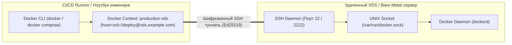

# Удаленный деплой по SSH через Docker Contexts и безопасный GitOps

Исторически для деплоя контейнеров на удаленные сервера инженеры нередко открывали TCP-порт Docker Daemon (`2375` или `2376` с TLS) наружу либо ставили тяжелые агенты. Открытие незащищенного сокета `dockerd` в интернет приводит к тому, что сканеры ботнетов находят открытый порт в течение 10–15 минут и запускают майнеры криптовалют с правами root хоста.

В современном DevOps стандартом удаленного деплоя является использование **Docker Contexts поверх защищенного протокола SSH** в сочетании с декларативным управлением секретами.

В этом уроке мы разберем:
1. Архитектуру **Docker Contexts** через SSH без открытия дополнительных портов.
2. Безопасную настройку выделенного SSH-пользователя `deploy` для CI/CD систем (GitHub Actions, GitLab CI).
3. Безопасную работу с секретами через **Docker Compose Secrets** вместо уязвимых `.env` файлов.
4. GitOps-паттерны непрерывной доставки: Push-модель (CI/CD SSH) против Pull-модели (Watchtower / Webhook).
5. Регулярную автоматическую чистку устаревших артефактов без риска удалить работающий сервис.

---

## 1. Архитектура Docker Contexts через SSH

Утилита Docker CLI на машине разработчика или в раннере GitHub Actions умеет перенаправлять все команды (`docker ps`, `docker compose up`, `docker logs`) на удаленный сервер через стандартный SSH-туннель:



### Преимущества подхода:
- **0 открытых портов наружу:** в фаерволе сервера открыт только стандартный порт SSH (22).
- **Встроенное шифрование и аутентификация:** используются ключи SSH (Ed25519), известные системы ротации ключей и `fail2ban`.
- **Локальный синтаксис:** вы выполняете обычные команды `docker compose up -d`, а контейнеры стартуют на удаленном сервере!

---

## 2. Пошаговая настройка Docker Context

### Шаг 1: Создание выделенного пользователя `deploy` на VDS
Никогда не используйте root-пользователя хоста для CI/CD!
```bash
# На удаленном сервере:
sudo adduser --disabled-password --gecos "" deploy
sudo usermod -aG docker deploy

# Настройка SSH-доступа по ключу:
sudo mkdir -p /home/deploy/.ssh
sudo chmod 700 /home/deploy/.ssh
echo "ssh-ed25519 AAAAC3NzaC1lZDI1NTE5AAAAI... ci-cd-key" | sudo tee /home/deploy/.ssh/authorized_keys
sudo chmod 600 /home/deploy/.ssh/authorized_keys
sudo chown -R deploy:deploy /home/deploy/.ssh
```

### Шаг 2: Создание контекста на локальной машине или в CI
```bash
# Создание контекста:
docker context create vds-prod \
  --docker "host=ssh://deploy@vds.example.com" \
  --description "Production VDS via SSH"

# Просмотр списка контекстов:
docker context ls

# Переключение на удаленный контекст:
docker context use vds-prod

# Теперь все команды выполняются на удаленном сервере!
docker ps
docker compose -f docker-compose.prod.yml up -d
```

### Переключение контекста на лету в скриптах:
Вместо глобального переключения можно использовать флаг `--context`:
```bash
docker --context vds-prod ps
docker --context vds-prod compose -f docker-compose.prod.yml pull
docker --context vds-prod compose -f docker-compose.prod.yml up -d
```

---

## 3. GitHub Actions пайплайн с Docker Context

```yaml
name: Production Remote Deploy

on:
  push:
    branches: [master]

jobs:
  deploy:
    runs-on: ubuntu-latest
    steps:
      - name: Checkout repository
        uses: actions/checkout@v4

      - name: Set up SSH key
        run: |
          mkdir -p ~/.ssh
          echo "${{ secrets.SSH_PRIVATE_KEY }}" > ~/.ssh/id_ed25519
          chmod 600 ~/.ssh/id_ed25519
          ssh-keyscan -H -p ${{ secrets.SSH_PORT || 22 }} ${{ secrets.SSH_HOST }} >> ~/.ssh/known_hosts

      - name: Create Docker Context
        run: |
          docker context create remote-host \
            --docker "host=ssh://${{ secrets.SSH_USER }}@${{ secrets.SSH_HOST }}:${{ secrets.SSH_PORT || 22 }}"
          docker context use remote-host

      - name: Deploy application stack
        run: |
          docker compose -f docker-compose.yml pull
          docker compose -f docker-compose.yml up -d --remove-orphans
```

---

## 4. Безопасное управление секретами: Docker Compose Secrets

Традиционная передача паролей баз данных и API-токенов через `.env` файлы и директиву `environment:` небезопасна:
* Секреты видны в открытом виде в выводе `docker inspect <container>`.
* Переменные окружения наследуются всеми дочерними процессами внутри контейнера.
* При сбое приложения (crash dump) переменные окружения могут утечь в логи трассировки стека.

Стандарт Compose v2 — использование встроенных **Secrets**:

```yaml
services:
  db:
    image: postgres:16-alpine
    environment:
      POSTGRES_DB: appdb
      POSTGRES_USER: appuser
      POSTGRES_PASSWORD_FILE: /run/secrets/db_password # Читает пароль из файла в памяти
    secrets:
      - db_password

  api:
    image: my-company/api:v1
    environment:
      DATABASE_PASSWORD_FILE: /run/secrets/db_password
      API_TOKEN_FILE: /run/secrets/api_token
    secrets:
      - db_password
      - api_token

secrets:
  db_password:
    file: ./secrets/db_password.txt # На хосте файл защищен правами chmod 600
  api_token:
    environment: PRODUCTION_API_TOKEN # Передается через переменную окружения раннера
```

Внутри контейнера Docker монтирует секреты в виртуальную файловую систему в оперативной памяти (`/run/secrets/<secret_name>`, `tmpfs`), полностью скрывая их от `docker inspect` и исключая запись на физический диск.

---

## 5. Автоматизированная чистка устаревших релизов

В процессе постоянного деплоя на сервере накапливаются неиспользуемые промежуточные слои и старые теги образов.

### Скрипт безопасной чистки без удаления активных данных:
```bash
# 1. Удаление безымянных dangling-образов (<none>)
docker image prune -f

# 2. Удаление старых образов, не использовавшихся более 7 дней (168 часов)
docker image prune -a --force --filter "until=168h"

# 3. Удаление остановленных контейнеров
docker container prune -f --filter "until=24h"

# 4. Проверка освобожденного места на диске
docker system df
```
> [!IMPORTANT]
> Никогда не используйте команду `docker system prune --volumes -f` на продакшн-сервере! Флаг `--volumes` удалит не привязанные в данный момент тома, что может привести к уничтожению резервных копий или остановленных баз данных.
