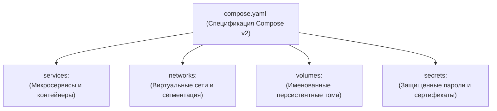

# Спецификация Compose v2: Декларативная архитектура мультиконтейнерных стеков

Утилита **Docker Compose** трансформировалась из вспомогательного Python-скрипта в официальный промышленный стандарт **Compose Specification**, встроенный прямо в Docker CLI (`docker compose`).

Современный файл `compose.yaml` (или `docker-compose.yml`) позволяет декларативно описать весь жизненный цикл сложной распределенной системы: микросервисы приложения, базы данных, кэш, очереди задач, сетевую изоляцию и постоянные хранилища.

---

## 1. Отказ от устаревшего синтаксиса: Больше никакого `version: '3.8'`

В старом `docker-compose` (Compose v1) первой строкой всегда требовалось указывать директиву `version: '3.8'` или `version: '2.4'`. Это вызывало путаницу, так как ветки 2.x и 3.x развивались параллельно, а многие полезные опции (например, лимиты ресурсов `mem_limit`) в версии 3 были заблокированы без Swarm.

> [!IMPORTANT]
> В стандарте **Compose v2 Specification** директива `version` является **устаревшей (deprecated)** и больше не требуется. Демон Compose автоматически применяет новейшую спецификацию. 
> Также стандартизированы канонические имена файлов: `compose.yaml` (рекомендуется) или `docker-compose.yaml`.

---

## 2. Анатомия файла спецификации Compose v2

Качественный production-стек разделяется на 4 фундаментальных блока верхнего уровня:



### Эталонный шаблон спецификации Compose v2:

```yaml
# Имя проекта (по умолчанию берется из названия папки)
name: primary-platform

services:
  # 1. Обратный прокси (входная точка)
  proxy:
    image: nginx:alpine
    restart: unless-stopped
    ports:
      - "80:80"
      - "443:443"
    volumes:
      - ./nginx.conf:/etc/nginx/nginx.conf:ro
      - certs:/etc/ssl/certs:ro
    networks:
      - frontend
    depends_on:
      app:
        condition: service_healthy

  # 2. Основной бэкенд на Go
  app:
    build:
      context: .
      dockerfile: Dockerfile
    restart: unless-stopped
    environment:
      - APP_ENV=production
      - DB_HOST=postgres
      - DB_PORT=5432
    secrets:
      - db_password
    networks:
      - frontend
      - backend
    depends_on:
      postgres:
        condition: service_healthy

  # 3. База данных PostgreSQL (скрыта в закрытой сети backend)
  postgres:
    image: postgres:16-alpine
    restart: unless-stopped
    environment:
      POSTGRES_DB: appdb
      POSTGRES_USER: appuser
      POSTGRES_PASSWORD_FILE: /run/secrets/db_password
    secrets:
      - db_password
    volumes:
      - pgdata:/var/lib/postgresql/data
    networks:
      - backend
    healthcheck:
      test: ["CMD-SHELL", "pg_isready -U appuser -d appdb"]
      interval: 5s
      timeout: 3s
      retries: 5
      start_period: 10s

# Сегментация сетей
networks:
  frontend:
    driver: bridge
  backend:
    driver: bridge
    internal: true # Изолированная сеть: контейнеры в ней не имеют доступа в публичный интернет!

# Именованные тома для данных
volumes:
  pgdata:
    driver: local
  certs:

# Секреты (монтируются в память /run/secrets/)
secrets:
  db_password:
    file: ./secrets/db_password.txt
```

---

## 3. Сегментация сети: Директива `internal: true`

Обратите внимание на блок сетей в шаблоне:
* Сеть `frontend` объединяет обратный прокси `proxy` и `app`.
* Сеть `backend` объединяет `app` и `postgres`.
* База данных `postgres` физически **не имеет сетевого интерфейса в сети `frontend`** и не имеет проброшенных портов `ports:`. Прямой доступ к СУБД извне невозможен!
* Флаг `internal: true` полностью отключает шлюз во внешнюю сеть для СУБД, гарантируя, что даже при компрометации база данных не сможет подключиться к внешним командным центрам злоумышленника.

> [!NOTE]
> Подробное устройство сетевых драйверов Docker (Bridge, Host, Macvlan, None) и встроенного DNS-сервера (127.0.0.11) описано в **[Модуле 4: Сетевой стек и DNS Discovery](/courses/docker-networking/01-network-drivers-and-dns)**.
> Защита портов и взаимодействие с Netfilter/iptables подробно разобраны в уроке **[Модуль 4: Защита портов и сетевая безопасность iptables](/courses/docker-networking/02-ports-and-iptables-security)**.

---

## 4. Связанные темы и углубленные уроки

Для эффективной работы со стеками Compose изучите специализированные руководства платформы:

* **Иерархия переменных окружения и Healthchecks**: детальный разбор интерполяции `.env`, параметров `interval`, `timeout`, `start_period` и условий `condition: service_healthy` разобран в следующем уроке — **[Модуль 5: Переменные окружения, Healthcheck и depends_on](/courses/docker-compose/02-environments-and-healthchecks)**.
* **Мгновенный Hot-Reload без перезапуска**: отслеживание файлов на лету через `develop.watch` описано в уроке — **[Модуль 5: Docker Compose Watch и локальный DX](/courses/docker-compose/03-compose-watch-and-development-workflow)**.
* **Лимиты оперативной памяти и CPU**: настройка блока `deploy.resources.limits` и защита от Out-Of-Memory Killer подробно вынесены в — **[Модуль 7: Изоляция ядра и ресурсы (Cgroups v2)](/courses/docker-resources/01-cgroups-v2-memory-and-cpu-limits)**.

---

## 5. Лабораторная самопроверка

<details>
<summary>Вопрос 1: Почему в современных файлах compose.yaml не нужно писать version: '3.8'?</summary>
<div class="mt-2 text-body">
<p><strong>Ответ:</strong> Проект перешел на открытую спецификацию <em>Compose Specification</em>, объединившую лучшие черты версий 2.x и 3.x. Движок Compose v2 автоматически поддерживает все актуальные директивы (включая лимиты ресурсов и расширенные healthchecks) без необходимости искусственного ограничения версией.</p>
</div>
</details>

<details>
<summary>Вопрос 2: В чем преимущество secrets по сравнению с переменными окружения environment?</summary>
<div class="mt-2 text-body">
<p><strong>Ответ:</strong> Переменные окружения (<code>environment</code>) видны в выводе команд <code>docker inspect</code>, отображаются в отчетах об ошибках и наследуются дочерними процессами. Секреты (<code>secrets</code>) монтируются ядром Linux в виртуальную файловую систему в оперативной памяти (<code>/run/secrets/</code>, <code>tmpfs</code>), не сохраняются на диске и недоступны через метаданные контейнера.</p>
</div>
</details>
