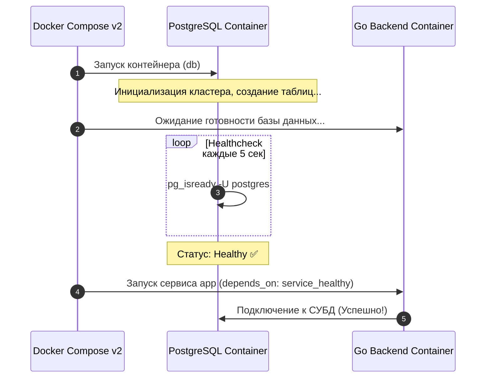

# Docker Compose: Переменные окружения, Healthcheck и depends_on

В распределенных микросервисных системах одна из самых распространенных аварий при развертывании — это гонка при старте (Race Condition): бэкенд пытается подключиться к базе данных до того, как СУБД успела проинициализировать сетевой сокет, падает с ошибкой `Connection Refused` и уходит в бесконечный цикл перезапуска `CrashLoopBackOff`.

В этом уроке мы разберем стандарты правильной оркестрации в **Docker Compose v2**.



---

## 1. Иерархия и приоритеты переменных окружения

В Docker Compose существует 6 уровней определения переменных. При конфликте значений побеждает источник с **наивысшим приоритетом**:

1. **Флаги командной строки** (`docker compose run -e VAR=override`).
2. **Переменные оболочки хоста** (`export VAR=value`).
3. **Файл `.env` в директории проекта** (используется для интерполяции значений внутри самого `compose.yaml`: `${VAR}`).
4. **Блок `environment:`** в `compose.yaml`.
5. **Файлы из директивы `env_file:`** в `compose.yaml`.
6. **Инструкции `ENV` в исходном `Dockerfile`**.

### Золотое правило:
- Секреты и динамические параметры хоста (пароли, домены) передаются через `.env` файл (который добавлен в `.gitignore`).
- Статичные параметры контейнера (названия баз данных, порты приложения) фиксируются в блоке `environment:` файла `compose.yaml`.

---

## 2. Анатомия проверки здоровья (Healthcheck)

Директива `healthcheck` сообщает Docker, как проверить, действительно ли сервис готов принимать клиентские запросы:

```yaml
healthcheck:
  test: ["CMD-SHELL", "pg_isready -U ${POSTGRES_USER:-postgres}"]
  interval: 5s       # Как часто опрашивать контейнер
  timeout: 3s        # Время ожидания ответа на пробу
  retries: 5         # Сколько неудач допустимо перед статусом 'unhealthy'
  start_period: 10s  # Льготный период для тяжелого холодного старта
```

### Примеры healthcheck для популярных сервисов:

- **HTTP Web Service (Go, Node.js, Python, Nginx):**
  ```yaml
  test: ["CMD", "curl", "-f", "http://localhost:8080/health"]
  # или без curl (через встроенный wget в Alpine):
  test: ["CMD-SHELL", "wget -qO- http://localhost:8080/health || exit 1"]
  ```

- **Redis:**
  ```yaml
  test: ["CMD", "redis-cli", "ping"]
  ```

- **PostgreSQL:**
  ```yaml
  test: ["CMD-SHELL", "pg_isready -U $$POSTGRES_USER -d $$POSTGRES_DB"]
  ```

---

## 3. Правильная связка `depends_on` с условием готовности

Обычный `depends_on: [db]` лишь гарантирует, что Docker Compose запустит контейнер `db` на полсекунды раньше, чем `app`. Но он **не ждет**, пока СУБД загрузится!

Чтобы бэкенд стартовал только после реальной готовности СУБД принимать соединения, используйте форму с `condition: service_healthy`:

```yaml
# compose.yaml (Production Standard)
services:
  db:
    image: postgres:16-alpine
    restart: unless-stopped
    environment:
      POSTGRES_USER: ${POSTGRES_USER:-platform_user}
      POSTGRES_PASSWORD: ${POSTGRES_PASSWORD:?Ошибка: укажите POSTGRES_PASSWORD в .env}
      POSTGRES_DB: platform_db
    volumes:
      - postgres_data:/var/lib/postgresql/data
    healthcheck:
      test: ["CMD-SHELL", "pg_isready -U $$POSTGRES_USER -d $$POSTGRES_DB"]
      interval: 5s
      timeout: 3s
      retries: 5
      start_period: 10s

  app:
    image: mycompany/backend:latest
    restart: unless-stopped
    depends_on:
      db:
        condition: service_healthy  # 🌟 Ждет статуса Healthy от базы данных!
    environment:
      DATABASE_URL: "postgres://${POSTGRES_USER:-platform_user}:${POSTGRES_PASSWORD}@db:5432/platform_db?sslmode=disable"
    ports:
      - "127.0.0.1:8080:8080"

volumes:
  postgres_data:
```

---

## 4. Обязательные переменные с синтаксисом `${VAR:?error}`

Если критически важная переменная (например, пароль к базе данных или API-ключ) не задана в `.env`, Docker Compose можно заставить упасть с понятной ошибкой еще до старта контейнеров:

```yaml
environment:
  SECRET_KEY: ${SECRET_KEY:?Переменная SECRET_KEY обязательна в .env файле}
```

Если переменной нет, команда `docker compose up` мгновенно выдаст:
```text
variable SECRET_KEY is not set: Переменная SECRET_KEY обязательна в .env файле
```

---

## 5. Лабораторный вызов: Проверь себя

<details>
<summary><b>Вопрос:</b> Что произойдет, если в контейнере нет установленной утилиты <code>curl</code>, а в healthcheck указано <code>test: ["CMD", "curl", "http://localhost:8080/"]</code>?</summary>

> **Ответ:** Docker попытается исполнить бинарник `curl`, получит ошибку ядра `exec: "curl": executable file not found in $PATH` и вернет статус код `127`. Контейнер через `retries` проверок перейдет в статус `unhealthy`, а зависимые сервисы с `condition: service_healthy` никогда не запустятся. Для минималистичных образов (Distroless / Scratch) проверка здоровья должна реализовываться либо встроенным бинарником самого сервиса (например, `app --health-check`), либо через `wget` в Alpine.
</details>
