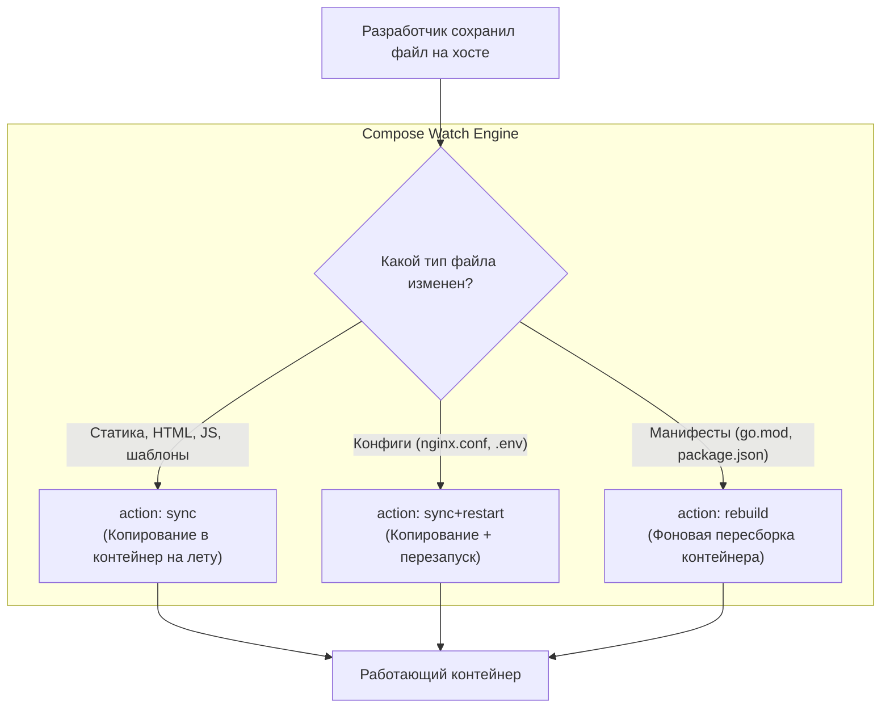

# Docker Compose Watch: Мгновенный Hot-Reload, синхронизация кода и современный локальный DX

На протяжении многих лет стандартной практикой разработки с Docker было монтирование исходного кода хоста внутрь контейнера через обычный `volumes` (Bind Mounts):
```yaml
# Старый классический подход
volumes:
  - .:/app
```
Однако этот подход порождал множество хронических проблем:
1. **Конфликт бинарных модулей**: хостовая ОС (например, macOS на Apple Silicon) перезаписывала папку `node_modules` или `vendor`, ломая Linux-зависимости внутри контейнера.
2. **Падение производительности дискового I/O**: на macOS и Windows монтирование тысяч мелких файлов через виртуализацию (VirtioFS / gRPC-FUSE) приводило к 10-кратным тормозам при компиляции.
3. **Необходимость вручную делать `docker compose restart`** при любом изменении конфигураций или манифестов пакетов.

Для решения этих проблем в спецификации **Docker Compose v2** появился официальный инструмент — **Docker Compose Watch** (`develop.watch`).

---

## 1. Архитектура и принцип работы `develop.watch`

Вместо постоянного разделяемого доступа к хостовой файловой системе Docker Compose запускает легковесный файловый демон-наблюдатель (file watcher). При изменении файлов на хосте Compose выполняет точечное действие:



---

## 2. Действия Compose Watch: `sync`, `rebuild` и `sync+restart`

Спецификация поддерживает три базовых действия:

| Действие | Когда применять | Что происходит |
|---|---|---|
| **`sync`** | Исходный код скриптов, шаблоны, HTML/CSS, React/Vue | Файлы копируются прямо в контейнер без перезапуска. Hot-reload фреймворка (Vite, Next.js, Air) подхватывает изменения мгновенно |
| **`sync+restart`** | Файлы конфигурации (например, `application.yaml`, `nginx.conf`) | Файлы синхронизируются, после чего сервис плавно перезапускается |
| **`rebuild`** | Зависимости (`package.json`, `go.mod`, `pom.xml`, `Dockerfile`) | Compose в фоне пересобирает новый слой образа и обновляет контейнер без потери состояния соседних сервисов |

---

## 3. Практическая конфигурация `docker-compose.yml`

Рассмотрим боевой пример fullstack-приложения (Go backend + Node.js frontend):

```yaml
services:
  # Бэкенд на Go с утилитой Air для live-reload
  backend:
    build:
      context: ./backend
      dockerfile: Dockerfile
    ports:
      - "8080:8080"
    environment:
      - APP_ENV=development
    develop:
      watch:
        # При изменении исходников Go — мгновенно копируем, Air выполнит перезапуск
        - action: sync
          path: ./backend
          target: /app
          ignore:
            - ./backend/tmp/
            - ./backend/.git/
            - ./backend/vendor/

        # При обновлении зависимостей — фоновая пересборка контейнера
        - action: rebuild
          path: ./backend/go.mod

        # При изменении конфига — синхронизация и быстрый рестарт
        - action: sync+restart
          path: ./backend/config.yaml
          target: /app/config.yaml

  # Фронтенд на React / Vite
  frontend:
    build:
      context: ./frontend
    ports:
      - "3000:3000"
    develop:
      watch:
        - action: sync
          path: ./frontend/src
          target: /app/src
        
        - action: rebuild
          path: ./frontend/package.json
```

---

## 4. Как запускать Compose Watch

Чтобы запустить сервис вместе с наблюдателем изменений, выполните:

```bash
# Запуск сервисов и активация отслеживания файлов
docker compose watch
```

Либо запустите контейнеры в фоне и подключите watcher:
```bash
docker compose up -d
docker compose watch
```

> [!TIP]
> При использовании `docker compose watch` контейнеры сохраняют нативную скорость Linux-файловой системы, так как исходники физически находятся внутри слоев контейнера, а не читаются через виртуальные сетевые мосты!

---

## 5. Лабораторная самопроверка

<details>
<summary>Вопрос 1: В чем главное отличие Compose Watch от классического bind mount (volumes)?</summary>
<div class="mt-2 text-body">
<p><strong>Ответ:</strong> При bind mount папка хоста жестко монтируется в контейнер, что приводит к конфликтам зависимостей (например, хостовый <code>node_modules</code> затирает модули контейнера) и медленному вводу-выводу на macOS/Windows. Compose Watch хранит файлы изолированно в контейнере и выполняет одностороннюю умную синхронизацию только тех файлов, которые действительно изменились.</p>
</div>
</details>

<details>
<summary>Вопрос 2: Что произойдет, если изменить файл, подходящий под действие action: rebuild?</summary>
<div class="mt-2 text-body">
<p><strong>Ответ:</strong> Compose выполнит новую сборку образа с использованием кэша слоев (BuildKit) и плавно заменит только данный контейнер, не перезапуская и не затрагивая остальные сервисы стека (базы данных, кэш, очереди).</p>
</div>
</details>

<details>
<summary>Вопрос 3: Зачем обязательно указывать секцию ignore в правиле sync?</summary>
<div class="mt-2 text-body">
<p><strong>Ответ:</strong> Чтобы предотвратить циклические пересборки и лишнюю нагрузку на диск. Без секции <code>ignore</code> временные файлы компилятора, папки сборки (<code>.git</code>, <code>dist/</code>, <code>tmp/</code>) будут бесконечно синхронизироваться туда и обратно.</p>
</div>
</details>
