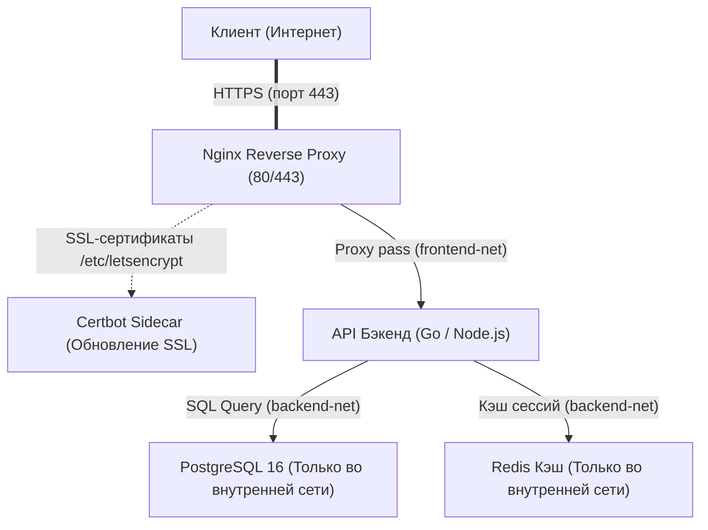

# Готовые production-стеки Docker Compose для реальных проектов

При запуске сервисов в продакшене создание `docker-compose.yml` с нуля требует учета десятков неочевидных нюансов: правильная изоляция сетей (Zero Trust), порядок старта через `healthcheck`, ротация логов, привязка пользователей и выпуск SSL-сертификатов.

В этом уроке собраны три эталонных, полностью готовых к копированию и боевой эксплуатации production-стека Docker Compose.

---

## Стек 1: Web-сервис + PostgreSQL + Redis + Nginx с Let's Encrypt (SSL)

Классический стек для современных веб-приложений (Go, Python FastAPI, Node.js, Ruby on Rails) с автоматическим выпуском и продлением SSL-сертификатов от Let's Encrypt через Certbot:



### Конфигурация `docker-compose.yml`:
```yaml
services:
  nginx:
    image: nginx:alpine
    restart: unless-stopped
    ports:
      - "80:80"
      - "443:443"
    volumes:
      - ./nginx/nginx.conf:/etc/nginx/nginx.conf:ro
      - ./certbot/conf:/etc/letsencrypt:ro
      - ./certbot/www:/var/www/certbot:ro
    depends_on:
      api:
        condition: service_healthy
    networks:
      - frontend-net
    logging:
      driver: "json-file"
      options:
        max-size: "20m"
        max-file: "5"

  certbot:
    image: certbot/certbot:latest
    restart: unless-stopped
    volumes:
      - ./certbot/conf:/etc/letsencrypt
      - ./certbot/www:/var/www/certbot
    entrypoint: "/bin/sh -c 'trap exit TERM; while :; do certbot renew; sleep 12h & wait $${!}; done;'"

  api:
    image: my-company/backend-api:v1.2.0
    restart: unless-stopped
    user: "10001:10001"
    read_only: true
    environment:
      DATABASE_URL: "postgres://appuser:${DB_PASSWORD}@db:5432/appdb?sslmode=disable"
      REDIS_URL: "redis://cache:6379"
    depends_on:
      db:
        condition: service_healthy
      cache:
        condition: service_healthy
    healthcheck:
      test: ["CMD", "/app/server", "--health"]
      interval: 10s
      timeout: 3s
      retries: 3
    networks:
      - frontend-net
      - backend-net
    deploy:
      resources:
        limits:
          cpus: "1.50"
          memory: 512M

  db:
    image: postgres:16-alpine
    restart: unless-stopped
    environment:
      POSTGRES_DB: appdb
      POSTGRES_USER: appuser
      POSTGRES_PASSWORD: ${DB_PASSWORD}
    volumes:
      - pgdata:/var/lib/postgresql/data
    healthcheck:
      test: ["CMD-SHELL", "pg_isready -U appuser -d appdb"]
      interval: 5s
      timeout: 3s
      retries: 5
    networks:
      - backend-net
    deploy:
      resources:
        limits:
          cpus: "2.00"
          memory: 2G

  cache:
    image: redis:7-alpine
    restart: unless-stopped
    command: ["redis-server", "--appendonly", "yes", "--maxmemory", "256mb", "--maxmemory-policy", "allkeys-lru"]
    volumes:
      - redisdata:/data
    healthcheck:
      test: ["CMD", "redis-cli", "ping"]
      interval: 5s
      timeout: 3s
      retries: 3
    networks:
      - backend-net
    deploy:
      resources:
        limits:
          cpus: "0.50"
          memory: 384M

networks:
  frontend-net:
    driver: bridge
  backend-net:
    internal: true # Изолированная сеть Zero Trust (нет выхода в интернет)

volumes:
  pgdata:
  redisdata:
```

---

## Стек 2: Мониторинг инфраструктуры (Prometheus + Grafana + cAdvisor + Node Exporter)

Комплексный стек для сбора метрик со всех контейнеров хоста в реальном времени:

```yaml
services:
  prometheus:
    image: prom/prometheus:v2.51.0
    restart: unless-stopped
    user: "65534:65534"
    volumes:
      - ./prometheus/prometheus.yml:/etc/prometheus/prometheus.yml:ro
      - prometheus_data:/prometheus
    command:
      - '--config.file=/etc/prometheus/prometheus.yml'
      - '--storage.tsdb.path=/prometheus'
      - '--storage.tsdb.retention.time=30d'
    networks:
      - monitoring-net
    deploy:
      resources:
        limits:
          cpus: "1.00"
          memory: 1G

  grafana:
    image: grafana/grafana:10.4.1
    restart: unless-stopped
    user: "472:472"
    ports:
      - "127.0.0.1:3000:3000" # Доступ только локально или через Reverse Proxy
    environment:
      GF_SECURITY_ADMIN_PASSWORD: ${GRAFANA_PASSWORD:-admin}
      GF_USERS_ALLOW_SIGN_UP: "false"
    volumes:
      - grafana_data:/var/lib/grafana
    networks:
      - monitoring-net
    deploy:
      resources:
        limits:
          cpus: "0.50"
          memory: 512M

  cadvisor:
    image: gcr.io/cadvisor/cadvisor:v0.49.1
    restart: unless-stopped
    privileged: false
    volumes:
      - /:/rootfs:ro
      - /var/run:/var/run:ro
      - /sys:/sys:ro
      - /var/lib/docker/:/var/lib/docker:ro
      - /dev/disk/:/dev/disk:ro
    devices:
      - /dev/kmsg
    networks:
      - monitoring-net
    deploy:
      resources:
        limits:
          cpus: "0.50"
          memory: 300M

  node-exporter:
    image: prom/node-exporter:v1.7.0
    restart: unless-stopped
    volumes:
      - /proc:/host/proc:ro
      - /sys:/host/sys:ro
      - /:/rootfs:ro
    command:
      - '--path.procfs=/host/proc'
      - '--path.sysfs=/host/sys'
      - '--path.rootfs=/rootfs'
    networks:
      - monitoring-net

networks:
  monitoring-net:
    driver: bridge

volumes:
  prometheus_data:
  grafana_data:
```

---

## Стек 3: Централизованный сбор логов (Grafana Loki + Promtail)

Легковесная альтернатива тяжелому стеку ELK (Elasticsearch/Logstash/Kibana). Потребляет в 5–10 раз меньше оперативной памяти:

```yaml
services:
  loki:
    image: grafana/loki:2.9.6
    restart: unless-stopped
    ports:
      - "127.0.0.1:3100:3100"
    command: -config.file=/etc/loki/local-config.yaml
    volumes:
      - loki_data:/loki
    networks:
      - logging-net
    deploy:
      resources:
        limits:
          cpus: "1.00"
          memory: 768M

  promtail:
    image: grafana/promtail:2.9.6
    restart: unless-stopped
    volumes:
      - /var/log:/var/log:ro
      - /var/lib/docker/containers:/var/lib/docker/containers:ro
      - ./promtail/promtail-config.yaml:/etc/promtail/config.yml:ro
    command: -config.file=/etc/promtail/config.yml
    networks:
      - logging-net
    deploy:
      resources:
        limits:
          cpus: "0.30"
          memory: 200M

networks:
  logging-net:
    driver: bridge

volumes:
  loki_data:
```

---

## Архитектурный чек-лист готовности любого стека к Production

Перед запуском любого `docker-compose.yml` на боевом сервере проверьте его по 6 пунктам:
1. [x] **Zero Trust сети:** базы данных и внутренние очереди находятся в сети с директивой `internal: true`.
2. [x] **Наружу открыт только Proxy:** директива `ports:` используется **только** для Nginx (80/443). Порты баз данных (5432, 6379, 3306) не торчат наружу.
3. [x] **Надежный порядок запуска:** все сервисы используют `condition: service_healthy` вместо простого `depends_on`.
4. [x] **Ротация логов:** драйвер `json-file` ограничен параметрами `max-size: "20m"` и `max-file: "5"`.
5. [x] **Лимиты Cgroups v2:** у каждого сервиса в блоке `deploy.resources.limits` выставлены ограничения `memory` и `cpus`.
6. [x] **Non-Root права:** рабочие сервисы запускаются с флагом `user: "10001:10001"` и `read_only: true`.
