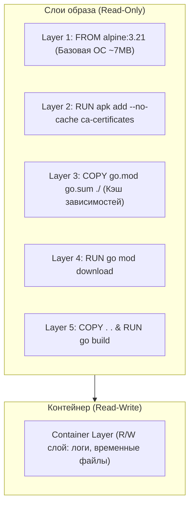

# Анатомия Dockerfile: Инструкции, слои и кэширование

Любой образ Docker — это неизменяемый (read-only) стек слоев файловой системы, собранных по инструкции `Dockerfile`. Понимание того, как каждая инструкция влияет на итоговый образ, критически важно для предотвращения раздувания контейнеров до гигабайтных размеров и для ускорения сборки в CI/CD в 10–20 раз.



---

## 1. Базовые правила кэширования слоев

Каждая команда `RUN`, `COPY`, `ADD` создает **новый неизменяемый слой**. 

### Правило частоты изменений
Инструкции в `Dockerfile` должны располагаться **от наименее изменяемых к наиболее часто изменяемым**:
1. Установка системных пакетов ОС (`apk add`, `apt-get`).
2. Копирование манифестов зависимостей (`package.json`, `go.mod`, `requirements.txt`).
3. Скачивание зависимостей (`go mod download`, `npm ci`, `pip install`).
4. Копирование исходного кода проекта (`COPY . .`).
5. Компиляция проекта (`go build`, `npm run build`).

Если вы скопируете исходный код *до* скачивания зависимостей, любой измененный пробел в `.go` или `.ts` файле **инвалидирует кэш** для всех последующих строк, заставляя Docker каждый раз заново скачивать библиотеки из интернета!

```dockerfile
# ❌ НЕПРАВИЛЬНО: кэш сбрасывается при любом изменении кода
COPY . .
RUN go mod download
RUN go build -o app .

# ✅ ПРАВИЛЬНО: скачивание библиотек кэшируется
COPY go.mod go.sum ./
RUN go mod download
COPY . .
RUN go build -o app .
```

---

## 2. Разница между CMD и ENTRYPOINT

Это одна из самых частых тем на собеседованиях и источник скрытых багов.

| Параметр | `ENTRYPOINT` | `CMD` |
|---|---|---|
| **Назначение** | Основной неизменяемый исполняемый файл контейнера. | Аргументы по умолчанию для `ENTRYPOINT`. |
| **Переопределение** | Требует явного флага `--entrypoint /bin/sh`. | Переопределяется простым аргументом в конце `docker run`. |
| **Формат** | Рекомендуется exec-форма: `["./app"]`. | Рекомендуется exec-форма: `["--port", "8080"]`. |

### Идеальная связка (Production Standard):
```dockerfile
# Запускаемый бинарник
ENTRYPOINT ["/app/server"]

# Дефолтные флаги, которые можно переопределить при запуске
CMD ["--config", "/etc/app.yaml", "--port", "8080"]
```

При запуске:
- `docker run myapp` → исполняется `/app/server --config /etc/app.yaml --port 8080`.
- `docker run myapp --version` → исполняется `/app/server --version` (флаг `--version` заместил `CMD`, но `ENTRYPOINT` остался неизменным).

---

## 3. Объединение команд и очистка кэша пакетов

При установке пакетов через пакетные менеджеры `apt` или `apk` индекс пакетов сохраняется в слое. Если не удалить его в **том же самом слое**, он навсегда останется в образе:

```dockerfile
# ❌ ПЛОХО: apt-get update создает неудаляемый слой на 40 МБ
RUN apt-get update
RUN apt-get install -y --no-install-recommends curl
RUN rm -rf /var/lib/apt/lists/*

# ✅ ХОРОШО: всё выполняется в одной цепочке и очищается до сохранения слоя
RUN apt-get update && apt-get install -y --no-install-recommends \
    curl \
    ca-certificates \
 && rm -rf /var/lib/apt/lists/*
```

Для Alpine Linux используйте флаг `--no-cache`:
```dockerfile
RUN apk add --no-cache ca-certificates tzdata
```

---

## 4. Файл `.dockerignore`: защита от утечек и оптимизация контекста

Когда вы запускаете `docker build .`, клиент Docker упаковывает **всю директорию** в tar-архив и отправляет демону `dockerd` (Build Context). Если не настроить `.dockerignore`, в контекст попадут `.git` (сотни мегабайт), локальные зависимости (`node_modules`), бинарники и файлы секретов (`.env`).

### Образцовый `.dockerignore`:
```text
.git
.github
.gitignore
*.md
.env*
node_modules/
vendor/
dist/
build/
*.log
tmp/
.idea/
.vscode/
Dockerfile*
docker-compose*.yml
```

---

## 5. Лабораторный вызов: Проверь себя

<details>
<summary><b>Вопрос 1:</b> Почему инструкция <code>ADD</code> считается антипаттерном по сравнению с <code>COPY</code>?</summary>

> **Ответ:** `ADD` обладает неявным поведением: она умеет автоматически распаковывать локальные tar-архивы и скачивать файлы по URL (без проверки хэшей и прав). В 99% случаев для копирования локальных файлов и каталогов следует использовать предсказуемую инструкцию `COPY`.
</details>

<details>
<summary><b>Вопрос 2:</b> В чем опасность использования Shell-формы (<code>CMD ./app</code>) вместо Exec-формы (<code>CMD ["./app"]</code>)?</summary>

> **Ответ:** Shell-форма запускает процесс через обертку `/bin/sh -c "./app"`. В результате PID 1 внутри контейнера становится командная оболочка `sh`, а не ваше приложение. Из-за этого процесс не получает сигналы `SIGTERM` и `SIGINT` при вызове `docker stop`, зависает на 10 секунд и принудительно убивается через `SIGKILL` (Exit Code 137) без корректного закрытия соединений и сброса данных на диск.
</details>
