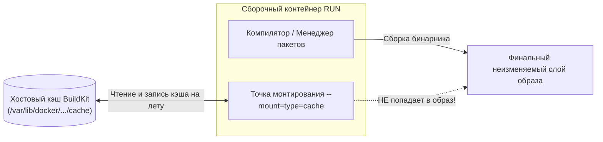

# BuildKit: Ускорение сборки через Cache Mounts, безопасные секреты и SSH Forwarding

Движок сборки **BuildKit** (`DOCKER_BUILDKIT=1`, включен по умолчанию в современных версиях Docker) кардинально изменил подход к созданию контейнеров. Вместо наивной последовательной генерации промежуточных образов BuildKit строит **граф зависимостей (DAG)**, выполняет независимые шаги параллельно и предоставляет специальные типы монтирования (`--mount`).

В этом практическом уроке мы разберем продвинутые возможности BuildKit: сохранение кэша менеджеров пакетов между сборками, безопасное использование секретов без их попадания в историю слоев и клонирование приватных репозиториев через SSH Agent.

---

## 1. Проблема классического кэширования слоев

В классическом `Dockerfile` для кэширования зависимостей разработчики используют паттерн разделения:
```dockerfile
# Старый классический подход
COPY go.mod go.sum ./
RUN go mod download

COPY . .
RUN go build -o /app/server ./cmd/server
```

> [!WARNING]
> Если в проекте меняется хотя бы один символ в `go.mod` (или `package.json`, `requirements.txt`), Docker сбрасывает кэш для **всех последующих инструкций**. В результате компилятор заново скачивает гигабайты зависимостей и компилирует весь исходный код с нуля, замедляя CI/CD пайплайн на 5–15 минут.

---

## 2. Кэширование сборщиков через `--mount=type=cache`

BuildKit решает эту проблему на уровне специальной файловой подсистемы: директива `--mount=type=cache` монтирует долговременный кэш хоста в указанную папку **только на время выполнения команды `RUN`**. 

Данные кэша не записываются в итоговый слой образа и сохраняются даже при инвалидации инструкции `COPY`!



### Рецепты Cache Mounts для различных языков:

#### Для Go:
```dockerfile
# Кэшируем модули (/go/pkg/mod) и скомпилированные объектные файлы компилятора (/root/.cache/go-build)
RUN --mount=type=cache,target=/go/pkg/mod \
    --mount=type=cache,target=/root/.cache/go-build \
    CGO_ENABLED=0 go build -ldflags="-w -s" -o /app/server ./cmd/server
```

#### Для Node.js (npm / yarn / pnpm):
```dockerfile
RUN --mount=type=cache,target=/root/.npm \
    npm ci --prefer-offline
```

#### Для Python (pip):
```dockerfile
RUN --mount=type=cache,target=/root/.cache/pip \
    pip install --no-compile -r requirements.txt
```

#### Для Ubuntu / Debian (apt):
```dockerfile
# Отключаем очистку кэша apt и сохраняем пакеты между сборками
RUN rm -f /etc/apt/apt.conf.d/docker-clean; \
    echo 'Binary::apt::APT::Keep-Downloaded-Packages "true";' > /etc/apt/apt.conf.d/keep-cache
RUN --mount=type=cache,target=/var/cache/apt,sharing=locked \
    --mount=type=cache,target=/var/lib/apt,sharing=locked \
    apt-get update && apt-get install -y --no-install-recommends \
        ca-certificates \
        curl
```

> [!TIP]
> Параметр `sharing=locked` гарантирует, что параллельные сборки не повредят общую базу пакетов `apt` блокировками `dpkg`.

---

## 3. Секреты сборки без утечки: `--mount=type=secret`

Очень частая ошибка начинающих инженеров — передача паролей, ключей API или токенов через `ARG` или `ENV`:
```dockerfile
# ❌ ОПАСНО: Значение токена навсегда останется в метаданных образа!
ARG GITHUB_TOKEN
RUN curl -H "Authorization: token ${GITHUB_TOKEN}" https://api.github.com/packages
```
Любой пользователь, выполнивший `docker history --no-trunc <image>`, мгновенно прочитает секретный токен открытым текстом!

### Безопасный способ с BuildKit Secrets:

1. В `Dockerfile` подключаем секрет как временный файл (монтируется в память `tmpfs`):
```dockerfile
# Секрет доступен ТОЛЬКО во время выполнения этой команды RUN
RUN --mount=type=secret,id=npmrc,target=/root/.npmrc \
    npm publish
```

2. При сборке передаем файл или переменную окружения:
```bash
# Передача из файла:
docker build --secret id=npmrc,src=.npmrc -t my-app .

# Передача из переменной окружения:
NPM_TOKEN="secret-token-123" docker build --secret id=npmrc,env=NPM_TOKEN -t my-app .
```

> [!NOTE]
> Секрет никогда не записывается на диск внутри контейнера, не попадает в слои OverlayFS и отсутствует в истории коммитов образа.

---

## 4. SSH Forwarding: Доступ к приватным репозиториям

Если вам нужно выполнить `go get gitlab.company.com/...` или `npm install git@github.com:...`, никогда не копируйте приватные SSH-ключи внутрь контейнера.

Используйте SSH Forwarding:
```dockerfile
# syntax=docker/dockerfile:1
FROM golang:1.24-alpine AS builder

RUN apk add --no-cache git openssh-client
# Добавляем открытый ключ хоста GitHub/GitLab в known_hosts
RUN mkdir -p -m 0700 ~/.ssh && ssh-keyscan github.com >> ~/.ssh/known_hosts

# Монтируем сокет локального SSH-агента
RUN --mount=type=ssh \
    git clone git@github.com:my-org/private-core-lib.git
```

Команда сборки с передачей SSH-агента:
```bash
# Добавляем ключ в ssh-agent
ssh-add ~/.ssh/id_ed25519

# Передаем сокет в BuildKit
docker build --ssh default -t secure-app .
```

---

## 5. Лабораторная самопроверка

<details>
<summary>Вопрос 1: В чем ключевое отличие ARG от --mount=type=secret?</summary>
<div class="mt-2 text-body">
<p><strong>Ответ:</strong> Значение <code>ARG</code> сохраняется в метаданных манифеста и истории каждого сгенерированного слоя (доступно через <code>docker history</code> и утилиту <code>dive</code>). Секрет через <code>--mount=type=secret</code> монтируется исключительно в виртуальную память (RAM/tmpfs) на время выполнения одной конкретной инструкции <code>RUN</code> и физически не попадает ни в один слой файловой системы.</p>
</div>
</details>

<details>
<summary>Вопрос 2: Увеличивают ли данные в --mount=type=cache размер результирующего Docker-образа?</summary>
<div class="mt-2 text-body">
<p><strong>Ответ:</strong> Нет! BuildKit перехватывает путь монтирования кэша и исключает его содержимое из создания снепшота слоя. В слой попадают только файлы, созданные за пределами каталога <code>target</code> (например, бинарник в <code>/app/server</code>).</p>
</div>
</details>

<details>
<summary>Вопрос 3: Как экспортировать кэш BuildKit в CI/CD (GitHub Actions)?</summary>
<div class="mt-2 text-body">
<p><strong>Ответ:</strong> Используя параметры <code>cache-from: type=gha</code> и <code>cache-to: type=gha,mode=max</code> в экшене <code>docker/build-push-action</code>. Режим <code>mode=max</code> сохраняет кэш всех промежуточных стадий Multi-stage сборки, включая кэш-монтирования.</p>
</div>
</details>
