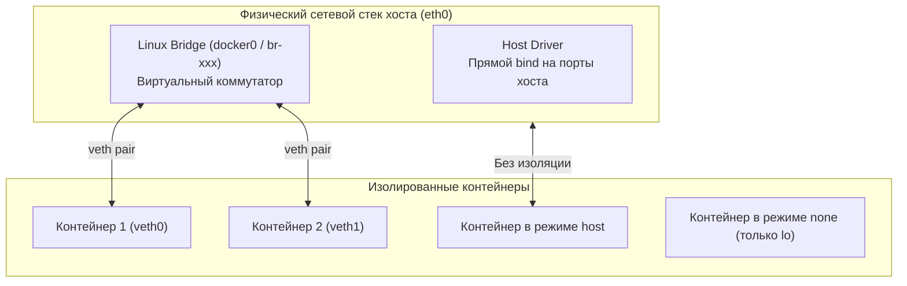
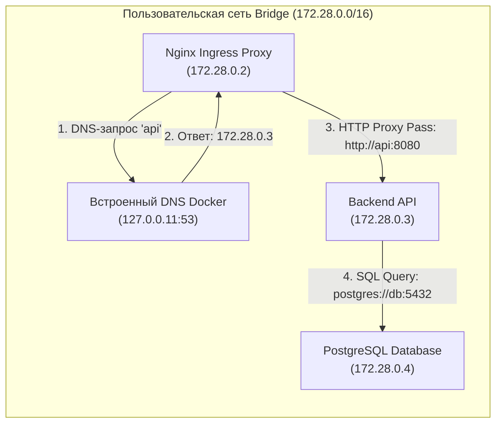
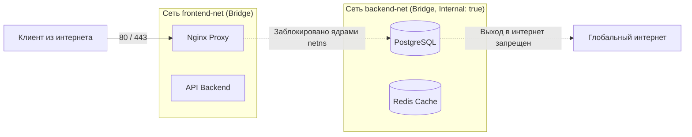
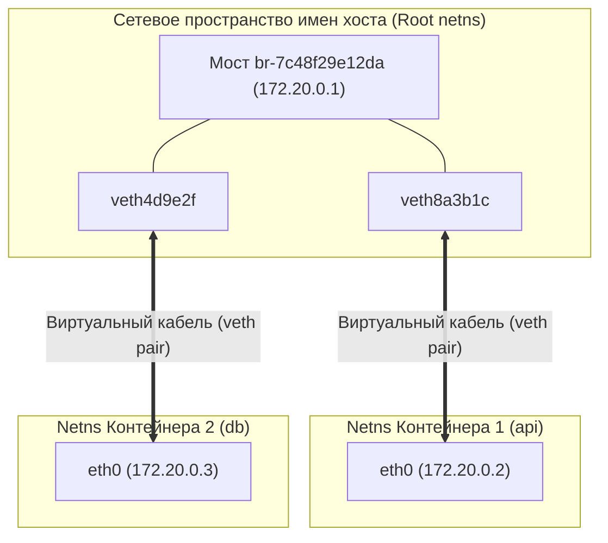

# Сетевые драйверы Docker, встроенный DNS (127.0.0.11) и сетевая сегментация

Запуск отдельных контейнеров через `docker run` подходит для локальных тестов, но в реальном продакшне приложения состоят из десятков связанных компонентов: обратный прокси, API бэкенд, базы данных, очереди сообщений и воркеры.

Для корректной и безопасной связи между ними необходимо понимать работу сетевых драйверов ядра Linux, встроенного DNS-сервера Docker и принципов Zero-Trust сегментации сетей. Без этого сервисы быстро сталкиваются с утечками конфиденциальных данных (порты БД, выставленные наружу), сбоями Service Discovery и задержками при обращении к микросервисам.

---

## 1. Сетевые драйверы Docker: Архитектура и сравнение

Docker изолирует сетевой стек каждого контейнера с помощью пространства имен **Network Namespace (`netns`)**. В зависимости от требований к изоляции и пропускной способности, Docker поддерживает несколько режимов работы:



| Драйвер сети | Изоляция | Скорость I/O | DNS Discovery | Рекомендуемое применение |
| :--- | :--- | :--- | :--- | :--- |
| **Bridge (Пользовательский)** | **Высокая** | Стандартная (через veth) | **Да (127.0.0.11)** | **95% коммерческих веб-приложений и микросервисов** |
| **Host** | **Отсутствует** | Максимальная (без NAT) | Нет (хостовый DNS) | Высоконагруженный стриминг, VoIP, сбор сетевых метрик |
| **None** | **Абсолютная** | Только loopback | Нет | Изолированная криптография, генерация ключей, оффлайн-задачи |
| **Overlay** | **Распределенная** | Накладные расходы VXLAN | Да (Swarm DNS) | Мультихостовые кластеры Docker Swarm без Kubernetes |
| **Macvlan / IPvlan** | **L2 / L3 прямая** | Высокая (без NAT хоста) | Внешний DNS сети | Прямой доступ в корпоративную LAN (собственный IP/MAC) |

> [!WARNING]
> **Ловушка стандартного моста `docker0`:**  
> Если запустить контейнеры без указания флага `--network` (`docker run -d nginx`), они попадают в дефолтный системный мост `docker0`. В нем **отключен встроенный DNS** — контейнеры не могут обращаться друг к другу по именам! В Docker Compose и в production всегда используются изолированные **пользовательские bridge-сети** (`docker network create`).

---

## 2. Service Discovery и встроенный DNS Docker (127.0.0.11)

В каждой пользовательской сети Bridge демон Docker развертывает встроенный DNS-резолвер по адресу `127.0.0.11`.



### Как ядро перехватывает DNS-запросы?
При запуске контейнера в пользовательской сети Docker автоматически генерирует для него файл `/etc/resolv.conf`:
```text
nameserver 127.0.0.11
options ndots:0
```
Когда процесс в контейнере делает системный вызов `getaddrinfo("api")`, пакет UDP/53 перехватывается локальным сокетом `dockerd`, который:
1. Ищет совпадение имени сервиса, имени контейнера или сетевого алиаса (`network alias`) внутри текущей сети.
2. Если имя локальное — возвращает внутренний IP-адрес контейнера.
3. Если запрос адресован во внешний интернет (`google.com`, `github.com`) — прозрачно форвардит его на апстрим DNS-серверы хоста (из хостового `/etc/resolv.conf` или `systemd-resolved`).

---

## 3. Сетевая сегментация (Zero-Trust архитектура в Docker)

Классическая ошибка начинающих инженеров — помещать все сервисы (фронтенд, бэкенд, базу данных, кэш, очередь) в единую сеть `default`. При такой конфигурации взлом веб-сервера через уязвимость RCE дает злоумышленнику прямой сетевой доступ к порту базы данных.

Принцип **сегментации сетей (Zero Trust)** требует изолировать уровни приложения:



### Пример безопасного `compose.yaml`:

```yaml
services:
  # Точка входа в систему (публичный шлюз)
  reverse-proxy:
    image: nginx:alpine
    ports:
      - "80:80"
      - "443:443"
    networks:
      - frontend-net
    restart: unless-stopped

  # Прикладной бэкенд (мост между фронтендом и базой)
  api:
    image: my-backend:v1.2.0
    environment:
      - DB_HOST=postgres
      - DB_PORT=5432
    networks:
      - frontend-net
      - backend-net
    restart: unless-stopped

  # База данных: строго изолирована от интернета и Nginx
  postgres:
    image: postgres:16-alpine
    environment:
      POSTGRES_DB: appdb
      POSTGRES_USER: appuser
      POSTGRES_PASSWORD_FILE: /run/secrets/db_password
    networks:
      - backend-net
    restart: unless-stopped

networks:
  frontend-net:
    driver: bridge
  backend-net:
    driver: bridge
    internal: true   # Ключевой флаг: изоляция от маршрутизации во внешний мир!
```

> [!NOTE]
> **Флаг `internal: true`:**  
> При включении этой опции Docker не создает правила `iptables MASQUERADE` для данной сети. Контейнеры внутри нее физически не могут выйти в публичный интернет (защита от скачивания бэкдоров и эксплойтов при компрометации), а хост не маршрутизирует внешний трафик внутрь этой сети.

---

## 4. Анатомия veth-пар и сетевой мост Linux

Как физически устроена связь между хостом и контейнером?
Для каждого контейнера в режиме `bridge` ядро Linux создает пару виртуальных сетевых интерфейсов (**veth-пара**):
- Один конец (`vethXXXXX`) остается в основном пространстве имен хоста и подключается к виртуальному мосту (например, `br-a1b2c3d4e5f6`).
- Второй конец перемещается в пространство имен контейнера (`netns`) и переименовывается в `eth0`.



Любой сетевой пакет, отправленный процессом в `eth0` внутри контейнера, мгновенно появляется на соответствующем `veth` интерфейсе хоста и коммутируется мостом `bridge` на канальном уровне L2.

---

## 5. Круговой DNS (Round-Robin) и масштабирование сервисов

Если в Docker Compose масштабировать сервис бэкенда (`docker compose up -d --scale api=3`), встроенный DNS Docker автоматически регистрирует все 3 IP-адреса за одним DNS-именем:

```bash
docker compose exec reverse-proxy nslookup api
# Address: 172.28.0.3
# Address: 172.28.0.4
# Address: 172.28.0.5
```

При каждом последующем запросе DNS Docker меняет порядок адресов в ответе (**DNS Round-Robin**), обеспечивая базовую балансировку нагрузки между репликами без внешнего балансировщика.

---

## 6. Лабораторная диагностика и траблшутинг сети

Инструменты и команды, необходимые каждому инженеру для поиска сетевых проблем:

```bash
# 1. Список всех сетей с указанием драйвера и scope
docker network ls

# 2. Детальная инспекция сети: список всех подключенных контейнеров, IP и MAC-адресов
docker network inspect myproject_backend-net

# 3. Узнать IP-адрес конкретного контейнера одной быстрой командой
docker inspect -f '{{range .NetworkSettings.Networks}}{{.IPAddress}}{{end}}' my-app

# 4. Проверка DNS-резолвинга прямо из контейнера без утилит dig/nslookup
docker run --rm --network myproject_frontend-net alpine getent hosts api

# 5. Просмотр реальных правил NAT, созданных Docker для публикации портов
sudo iptables -t nat -L DOCKER -n -v --line-numbers

# 6. Захват сетевого пакета контейнера с хоста без установки tcpdump внутрь контейнера
# Находим PID процесса контейнера:
PID=$(docker inspect -f '{{.State.Pid}}' my-app)
# Запускаем tcpdump в сетевом пространстве имен контейнера:
sudo nsenter -t $PID -n tcpdump -nn -i eth0 port 8080
```

---

## 7. Лабораторный вызов: Проверь себя

<details>
<summary><b>Вопрос 1:</b> Почему база данных PostgreSQL доступна из внешнего интернета, если в UFW закрыт порт 5432?</summary>

> **Ответ:** Docker автоматически конфигурирует правила `iptables` в таблице `nat` (цепочка `PREROUTING`) и перенаправляет трафик в цепочку `FORWARD` таблицы `filter`. Системный фаервол `UFW` по умолчанию фильтрует только цепочку `INPUT`, поэтому проброшенные порты Docker (`-p 5432:5432`) полностью обходят стандартные правила UFW. Решение: привязывать порт строго к `127.0.0.1:5432:5432` или использовать сеть с `internal: true`.
</details>

<details>
<summary><b>Вопрос 2:</b> В чем ключевое отличие дефолтной сети bridge (docker0) от пользовательской bridge-сети?</summary>

> **Ответ:** В дефолтной сети `docker0` отключен встроенный DNS-сервер (`127.0.0.11`). Контейнеры не могут обращаться друг к другу по именам хостов (только по статичным IP или устаревшему ключу `--link`). В пользовательских сетях DNS включен автоматически и поддерживает Service Discovery и масштабирование реплик.
</details>

<details>
<summary><b>Вопрос 3:</b> Что делает флаг internal: true в настройках сети Docker Compose?</summary>

> **Ответ:** Флаг запрещает исходящий и входящий маршрутизируемый трафик между этой сетью и внешним интернетом (не создается правило MASQUERADE). Контейнеры могут общаться только между собой внутри этой изолированной сети.
</details>
