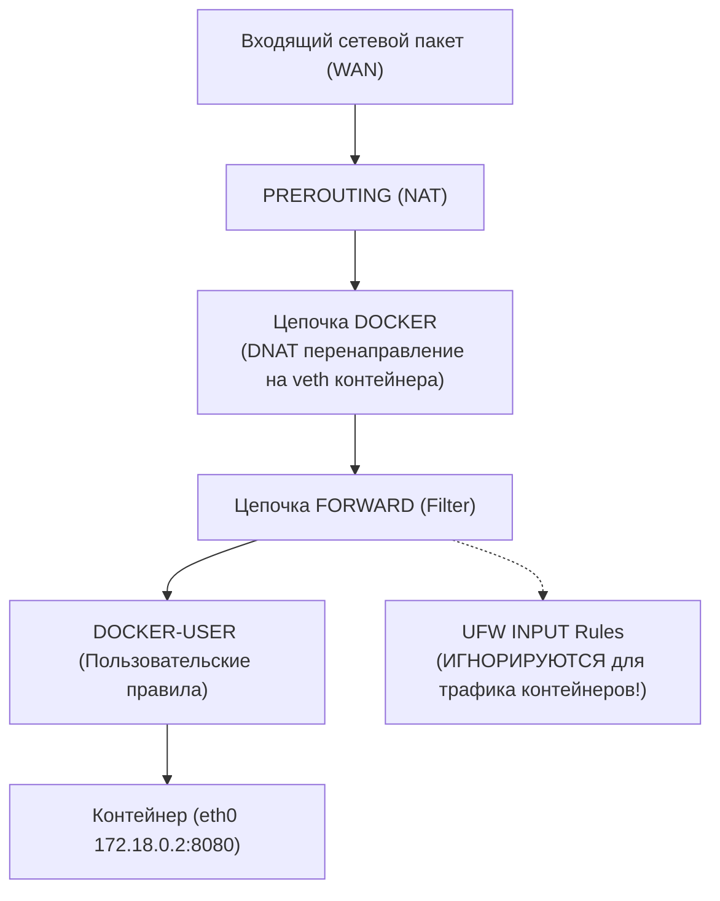

# Docker, iptables и сетевая безопасность: Обход UFW и защита портов

Одна из самых опасных и коварных особенностей Docker на Linux — это его автоматическая интеграция с таблицами маршрутизации ядра `iptables` / `nftables`. По умолчанию Docker вставляет свои правила NAT **до** правил большинства популярных системных фаерволов, включая `UFW` (Uncomplicated Firewall).



---

## 1. Проблема: Почему UFW не защищает порты Docker

Типичный сценарий катастрофы:
1. Системный администратор настраивает фаервол на сервере:
   ```bash
   sudo ufw default deny incoming
   sudo ufw allow 22/tcp
   sudo ufw enable
   ```
2. Разработчик запускает базу данных или Redis:
   ```bash
   docker run -d -p 5432:5432 postgres:16-alpine
   ```
3. **Итог:** База данных PostgreSQL **мгновенно становится открыта всему интернету**, несмотря на то, что в UFW порт 5432 не открывался!

### Причина:
`UFW` по умолчанию фильтрует входящий трафик в цепочке `INPUT` (пакеты, адресованные самому локальному хосту). Docker же использует сетевой мост (bridge) и транслирует входящие пакеты в цепочку `FORWARD` таблицы `filter` через DNAT в таблице `nat`. Пакеты уходят в контейнер в обход цепочки `INPUT`, поэтому правила `ufw deny` просто не применяются к проброшенным портам!

---

## 2. Способ решения №1: Привязка к Localhost (Production Best Practice)

Если ваш контейнер (PostgreSQL, Redis, ClickHouse, RabbitMQ, Go Backend) должен быть доступен только локально или через Nginx / Reverse Proxy на этом же сервере, **никогда не публикуйте порт в виде `-p 8080:8080`**:

```bash
# ❌ ОПАСНО: порт 8080 открыт на 0.0.0.0 (доступен всему миру)
docker run -p 8080:8080 myapp

# ✅ БЕЗОПАСНО: порт слушает только локальный loopback интерфейс
docker run -p 127.0.0.1:8080:8080 myapp
```

В файле `compose.yaml`:
```yaml
services:
  db:
    image: postgres:16-alpine
    ports:
      - "127.0.0.1:5432:5432"  # Доступно только с локалхоста хоста
```

А если база данных нужна только соседним контейнерам в том же `compose.yaml`, порт вообще **не нужно публиковать в `ports`**: внутри внутренней сети Docker Compose контейнеры видят друг друга по DNS-имени сервиса (например, `db:5432`) без проброса наружу!

---

## 3. Способ решения №2: Нативная цепочка DOCKER-USER

Docker резервирует специальную цепочку в таблице фильтрации — **`DOCKER-USER`**. Любые правила, добавленные в эту цепочку, выполняются **до** стандартных правил Docker и никогда не затираются демоном при перезапуске контейнеров.

### Пример: Разрешить доступ к порту только с доверенного офисного IP
Допустим, на порту 8080 запущен контейнер, и доступ к нему нужно разрешить только с IP `203.0.113.50`:

```bash
# 1. Разрешаем трафик с доверенного IP на интерфейс Docker
sudo iptables -I DOCKER-USER -i eth0 -s 203.0.113.50 -p tcp --dport 8080 -j ACCEPT

# 2. Блокируем доступ ко всем портам Docker для всех остальных публичных IP
sudo iptables -A DOCKER-USER -i eth0 -j DROP

# 3. Разрешаем уже установленные соединения
sudo iptables -I DOCKER-USER -m conntrack --ctstate RELATED,ESTABLISHED -j ACCEPT
```

---

## 4. Как проверить реальные правила iptables

Чтобы увидеть, какие правила Docker внедрил в систему в обход вашего фаервола, выполните:

```bash
# Посмотреть таблицу NAT (перенаправления портов)
sudo iptables -t nat -nvL DOCKER

# Посмотреть цепочку фильтрации FORWARD
sudo iptables -nvL FORWARD
```

---

## 5. Лабораторный вызов: Проверь себя

<details>
<summary><b>Вопрос:</b> Можно ли отключить вмешательство Docker в iptables через параметр <code>"iptables": false</code> в <code>/etc/docker/daemon.json</code>?</summary>

> **Ответ:** Технически можно, но это делать **крайне не рекомендуется**. Если вы отключите управление iptables у Docker, встроенные сетевые мосты перестанут создавать NAT-правила для выхода контейнеров в интернет (контейнеры потеряют доступ к внешним сетям), а проброс портов `-p` перестанет работать вообще. Всю маршрутизацию, маскарадинг и DNAT вам придется настраивать вручную через bash-скрипты. Гораздо безопаснее использовать привязку к `127.0.0.1` или цепочку `DOCKER-USER`.
</details>
