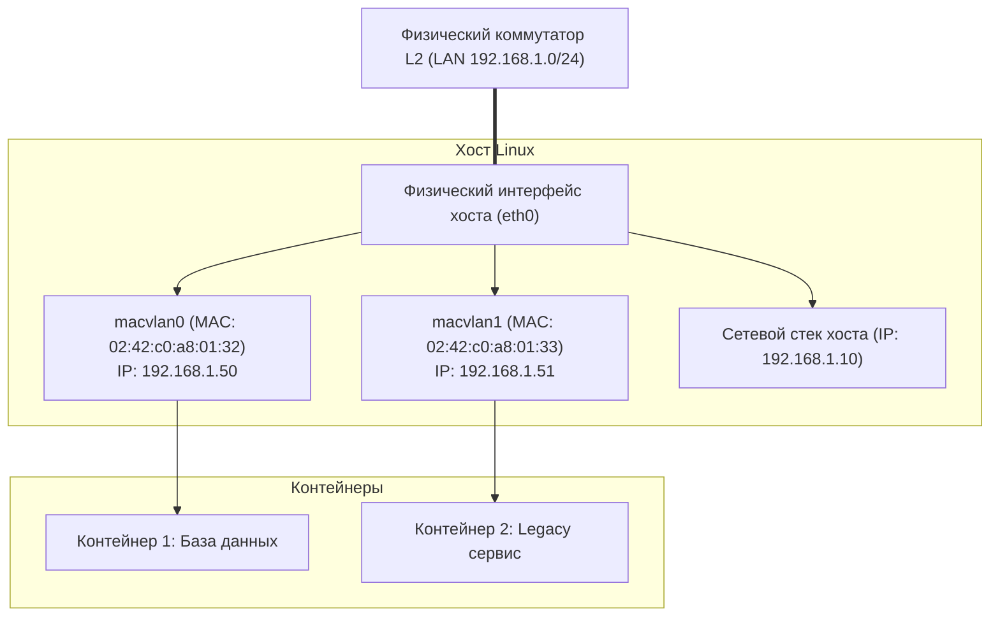

# Продвинутые сети Macvlan/IPvlan и глубокий траблшутинг сетевого стека

В большинстве сценариев стандартного драйвера `bridge` с NAT-маршрутизацией достаточно. Однако в высоконагруженных enterprise-системах, телекоммуникациях, IoT и гибридных облаках возникают задачи:
* Контейнер должен иметь **реальный IP-адрес физической сети предприятия** (быть видимым напрямую без NAT и проброса портов).
* Необходима интеграция с аппаратными коммутаторами через **802.1q VLAN**.
* Накладные расходы ядра на NAT и трансляцию портов (`iptables MASQUERADE`) вызывают задержки (latency) и исчерпание conntrack-таблиц.
* Приложение в контейнере падает с сетевыми таймаутами, и необходимо снять дамп трафика без остановки контейнера и без утилит отладки внутри.

В этом уроке мы разберем драйверы прямого доступа **Macvlan** и **IPvlan**, а также полный инструментарий низкоуровневого сетевого траблшутинга.

---

## 1. Драйвер Macvlan: Собственный MAC-адрес на каждый контейнер

Драйвер **Macvlan** позволяет виртуализировать физический сетевой интерфейс хоста (например, `eth0`), создавая множество виртуальных субинтерфейсов с собственными уникальными MAC-адресами:



### Создание сети Macvlan в режиме Bridge:
```bash
# Создаем сеть Docker, привязанную к физическому интерфейсу eth0
docker network create -d macvlan \
  --subnet=192.168.1.0/24 \
  --gateway=192.168.1.1 \
  --ip-range=192.168.1.128/25 \
  -o parent=eth0 \
  corp-macvlan

# Запуск контейнера с фиксированным IP-адресом локальной сети:
docker run -d --name legacy-app \
  --net=corp-macvlan \
  --ip=192.168.1.130 \
  --mac-address="02:42:c0:a8:01:82" \
  nginx:alpine
```

> [!WARNING]
> **Ограничение ядра Linux по безопасности:**
> По умолчанию ядро Linux запрещает прямое взаимодействие между хостом и macvlan-контейнерами на том же физическом интерфейсе. Контейнер видит всю локальную сеть и маршрутизатор, но **не может пинговать сам хост-сервер** (и наоборот).  
> Для связи хоста с контейнером создается специальный macvlan-интерфейс на хосте (`ip link add macvlan-shim link eth0 type macvlan mode bridge`).

---

## 2. Драйвер IPvlan: Экономия MAC-адресов и облачные ограничения

В виртуализированных средах (VMware ESXi, Hetzner, AWS, OpenStack) коммутаторы часто блокируют трафик, если на одном порту появляется больше одного MAC-адреса (включена защита от MAC-спуфинга / Port Security). В этом случае `macvlan` перестает работать.

Решение — **IPvlan**. Все контейнеры разделяют **один и тот же физический MAC-адрес хоста**, но имеют разные IP-адреса:

| Характеристика | Macvlan | IPvlan L2 | IPvlan L3 |
| :--- | :--- | :--- | :--- |
| **MAC-адреса** | Уникальный для каждого контейнера | Единый MAC-адрес хоста | Единый MAC-адрес хоста |
| **Уровень OSI** | L2 (Канальный) | L2 (Канальный) | L3 (Сетевой) |
| **Broadcast / ARP** | Да (получает все ARP-запросы) | Да | **Нет** (ядро маршрутизирует пакеты) |
| **Совместимость с облаком** | Низкая (блокируется свичами) | Высокая | Максимальная |

### Создание сети IPvlan L2:
```bash
docker network create -d ipvlan \
  --subnet=192.168.1.0/24 \
  --gateway=192.168.1.1 \
  -o ipvlan_mode=l2 \
  -o parent=eth0 \
  corp-ipvlan
```

---

## 3. Анатомия Network Namespace (`netns`) и veth-пар

В стандартных сетях `bridge` изоляция реализуется через пару виртуальных сетевых кабелей — **veth pair (Virtual Ethernet)**:

```
[ Хост: br-XXXX ] ◄── veth1a <==== виртуальный кабель ====> veth1b (eth0) ──► [ Контейнер PID 1234 ]
```

### Просмотр veth-пары и пространств имен на хосте:
```bash
# 1. Находим PID процесса контейнера
PID=$(docker inspect -f '{{.State.Pid}}' my-app)

# 2. Смотрим индекс интерфейса внутри контейнера
docker exec my-app ip link show eth0
# Пример вывода: 32: eth0@if33: ...

# 3. Находим парный интерфейс на хосте (номер 33)
ip link show | grep "^33:"
# Вывод: 33: vethb21c43@if32: ... master br-6b0416954fe3
```

---

## 4. Инструменты глубокой сетевой отладки

### Способ 1: Sidecar-диагностика через швейцарский нож `netshoot`
Если контейнер собран на базе `scratch` или `distroless`, мы можем подключить специализированный диагностический контейнер к его сетевому пространству с помощью флага `--net=container:<name>`:

```bash
docker run -it --rm \
  --net=container:my-app \
  nicolaka/netshoot
```
Внутри `netshoot` доступны сотни сетевых утилит (`tcpdump`, `termshark`, `curl`, `dig`, `iperf3`, `mtr`, `socat`), которые работают **внутри сетевого контекста вашего целевого контейнера**!

### Способ 2: Захват сетевого дампа трафика через `nsenter`
```bash
# Перехват HTTP-трафика на порту 8080 внутри контейнера прямо в файл Wireshark
sudo nsenter -t "$PID" -n tcpdump -nn -i eth0 port 8080 -w /tmp/api_traffic.pcap
```

---

## 5. Проблема `ndots:5` и задержки DNS-резолвинга

Частая проблема в контейнерах: микросервис отправляет HTTP-запросы во внешние API, и каждый запрос занимает на 200–500 мс больше положенного времени.

### В чем причина?
По умолчанию в `/etc/resolv.conf` контейнеров Docker выставляет:
```text
nameserver 127.0.0.11
options ndots:5
```
Если ваше приложение обращается к `api.stripe.com` (содержит 2 точки, что меньше 5):
1. Системный резолвер `glibc` сначала пытается разрешить `api.stripe.com.default.svc.cluster.local.`
2. Затем `api.stripe.com.svc.cluster.local.`
3. Затем `api.stripe.com.cluster.local.`
4. И только после 3 таймаутов отправляет запрос за чистым `api.stripe.com`!

### Решение в `docker-compose.yml`:
```yaml
services:
  api:
    image: my-company/api:v1
    dns_opt:
      - ndots:2 # Уменьшаем лимит точек для быстрого разрешения внешних доменов
      - timeout:2
      - attempts:3
```

---

## 6. Диагностика iptables, NAT и переполнения Conntrack

При обработке десятков тысяч соединений в секунду таблица отслеживания состояний Linux (`conntrack`) может переполниться:
```text
nf_conntrack: table full, dropping packet
```

### Проверка состояния conntrack и правил NAT:
```bash
# 1. Просмотр текущего заполнения таблицы conntrack
sysctl net.netfilter.nf_conntrack_count net.netfilter.nf_conntrack_max

# 2. Поиск счетчиков DROP пакетов в таблице DOCKER
sudo iptables -L DOCKER -v -n

# 3. Инспекция NAT трансляций
sudo iptables -t nat -L DOCKER -v -n --line-numbers
```
