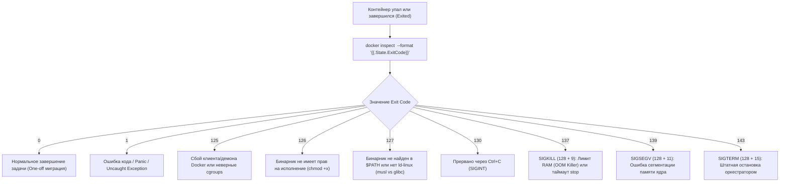
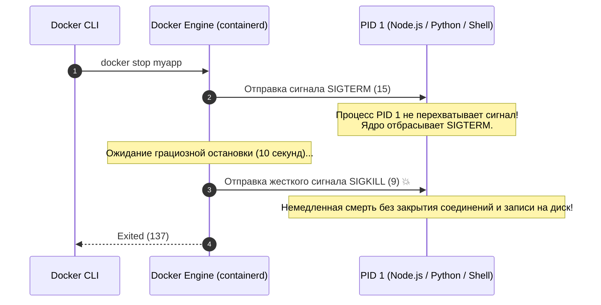

# Справочник Exit кодов Docker и траблшутинг аварий в Production

Когда контейнер неожиданно падает, первой зацепкой для инженера является **Exit Code** (код завершения). Коды завершения в Docker стандартизированы спецификацией POSIX и внутренними соглашениями контейнерного рантайма Linux.

В этом справочнике собрана исчерпывающая расшифровка всех кодов, разбор проблемы зомби-процессов PID 1, зависания остановки контейнеров, а также алгоритмы решения скрытых системных сбоев.



---

## 1. Сводная таблица кодов завершения

| Код | Название / Сигнал | Первопричина аварии | Алгоритм решения |
| :--- | :--- | :--- | :--- |
| **0** | `Success` | Процесс успешно завершил выполнение и вернул код 0. | Норма для разовых задач (миграции БД, генерация статики). Для демонов — проверить зацикленный `restart`. |
| **1** | `Application Error` | Ошибка в коде приложения (uncaught exception, panic, синтаксическая ошибка). | Изучить вывод `docker logs --tail 100 <container>`. |
| **125** | `Docker Daemon Error` | Ошибка самого демона Docker или CLI (неизвестный флаг, сбой cgroups v2 драйвера). | Проверить параметры запуска `docker run` / `daemon.json`. |
| **126** | `Permission Denied` | Файл скрипта `ENTRYPOINT` существует, но не имеет бита исполнения `+x`. | Добавить в Dockerfile: `RUN chmod +x /entrypoint.sh`. |
| **127** | `Command Not Found` | Команда не найдена в `$PATH` или динамический компоновщик `glibc` отсутствует в Alpine. | Проверить пути, заменить `bash` на `sh`, собрать Go без CGO. |
| **130** | `128 + 2 (SIGINT)` | Процесс остановлен оператором нажатием сочетания клавиш `Ctrl + C`. | Ожидаемое поведение при ручной интерактивной отладке. |
| **137** | `128 + 9 (SIGKILL)` | Контейнер принудительно убит ядром Linux: **OOM Killer** или таймаут `docker stop`. | Проверить `OOMKilled: true` в inspect, увеличить memory limit, оптимизировать утечки памяти. |
| **139** | `128 + 11 (SIGSEGV)` | Ошибка сегментации памяти в C/C++/Go cgo/Rust коде (доступ к чужому участку RAM). | Включить coredump, проверить битые зависимости, отладка в gdb / valgrind. |
| **143** | `128 + 15 (SIGTERM)` | Штатный сигнал завершения при вызове `docker stop` или деплое в CI/CD. | Норма при ротации и перезапуске контейнеров. |

---

## 2. Разбор ошибки 127: Ловушка Alpine и glibc

Частый сценарий: вы скомпилировали Go- или C-приложение на Ubuntu (которая использует библиотеку `glibc`), скопировали бинарник в минималистичный образ `FROM alpine:latest` (который использует `musl libc`), запускаете контейнер и получаете загадочную ошибку:

```text
/bin/sh: ./app: not found
Exited (127)
```

При этом вы заходите внутрь контейнера, видите, что файл `./app` на месте и имеет права `755`, но при попытке запустить его система пишет `not found`.

**Причина:** Сообщение `not found` относится не к самому бинарнику, а к **динамическому загрузчику ядра** (`/lib/ld-linux-x86-64.so.2`), которого физически нет в дистрибутиве Alpine!

### Решение:
Для компилируемых языков (Go) всегда собирайте 100% статические бинарники без CGO:
```bash
CGO_ENABLED=0 GOOS=linux go build -ldflags="-w -s" -o app .
```
Либо используйте легковесный образ с glibc (например, `debian:bookworm-slim` или `gcr.io/distroless/base-nossl-debian12`).

---

## 3. Проблема PID 1: Зомби-процессы и игнорирование SIGTERM

В Linux процесс с **PID 1** (в обычной системе это `systemd` или `init`) наделен особыми системными обязанностями:
1. **Сбор зомби-процессов (Zombie Reaping):** когда дочерний процесс завершается, он остается в таблице процессов со статусом `Z (defunct)`, пока родитель не вызовет `wait()`. Если родитель умирает раньше дочернего процесса, осиротевший процесс усыновляется процессом PID 1, который обязан вызывать `waitpid()`.
2. **Обработка системных сигналов:** ядро Linux защищает PID 1 от случайного падения. Если процесс с PID 1 не зарегистрировал явный обработчик для сигналов `SIGTERM` или `SIGINT`, ядро **блокирует эти сигналы по умолчанию**!



### Почему контейнер висит 10 секунд при `docker stop`?
Если приложение запущено через shell-обертку:
```dockerfile
# ❌ ОШИБКА: shell запускает sh как PID 1, а приложение — дочерним процессом без проброса сигналов!
ENTRYPOINT /start.sh
# Или:
CMD npm start
```
`sh` получает `SIGTERM`, но не пересылает его в `npm` или `node`. Через 10 секунд таймаута Docker Daemon отправляет безжалостный `SIGKILL (137)`, что приводит к повреждению транзакций БД и потере файлов.

### Решения проблемы PID 1:

1. **Использовать `exec` в entrypoint-скриптах:**
   Инструкция `exec` заменяет процесс оболочки процессом вашего приложения с сохранением PID 1:
   ```bash
   #!/bin/sh
   # Выполняем предварительные миграции
   ./migrate
   # Заменяем shell процессом приложения:
   exec ./my-server "$@"
   ```

2. **Легковесный супервизор `tini` / `dumb-init`:**
   В Docker Compose:
   ```yaml
   services:
     web:
       image: my-node-app:latest
       init: true   # Автоматически внедряет легковесный init-супервизор tini внутрь контейнера!
   ```
   Либо в `Dockerfile`:
   ```dockerfile
   RUN apk add --no-cache tini
   ENTRYPOINT ["/sbin/tini", "--"]
   CMD ["node", "server.js"]
   ```

---

## 4. Ошибка «No space left on device» при наличии свободных гигабайт (Inodes Exhaustion)

Катастрофа на продакшн-сервере: приложение падает с ошибкой `write /app/logs/app.log: no space left on device`.  
Администратор запускает `df -h` и видит:
```text
Filesystem      Size  Used Avail Use% Mounted on
/dev/sda1       100G   45G   55G  45% /
```
На диске свободно **55 гигабайт**, но запись невозможна!

### В чем причина?
В файловых системах Linux (`ext4`) дисковое пространство делится на два независимых ресурса:
1. **Блоки данных** (объем в байтах/гигабайтах).
2. **Таблицы индексных дескрипторов (Inodes)** — метаданные о файлах и директориях. Количество инод фиксируется при форматировании раздела.

Если контейнеры (или кэши `node_modules`, временные сессии PHP, очереди файлов) генерируют миллионы крошечных файлов по 100 байт, **индексные дескрипторы исчерпываются раньше, чем физическое место на диске**!

### Диагностика и исправление:
```bash
# 1. Проверяем процент занятых Inodes (колонка IFree / IUse%):
df -i

# Вывод покажет:
# Filesystem      Inodes   IUsed   IFree IUse% Mounted on
# /dev/sda1      6553600 6553600       0  100% /   <-- 100% ИНОД ИСЧЕРПАНО!

# 2. Ищем директорию с аномальным количеством файлов в /var/lib/docker:
sudo find /var/lib/docker -xdev -printf '%h\n' | sort | uniq -c | sort -k 1 -n | tail -20

# 3. Безопасная очистка зависших анонимных слоев и кэша сборщика:
docker builder prune -f
docker system prune -f
```

---

## 5. Лабораторная диагностика аварий в реальном времени

```bash
# 1. Живой поток системных событий Docker демона (die, kill, oom, restart):
docker events --filter 'event=die' --filter 'event=oom'

# 2. Проверка, был ли процесс убит OOM Killer:
docker inspect my-app --format 'ExitCode: {{.State.ExitCode}}, OOMKilled: {{.State.OOMKilled}}'

# 3. Поиск записей OOM Killer в кольцевом буфере ядра Linux:
dmesg -T | grep -E -i 'oom|kill|out of memory'

# 4. Просмотр дерева процессов и PID внутри работающего контейнера:
docker top my-app aux

# 5. Инспекция занятого дискового пространства компонентами Docker:
docker system df -v
```

---

## 6. Лабораторный вызов: Проверь себя

<details>
<summary><b>Вопрос 1:</b> Контейнер завершился с Exit Code 137. Как достоверно определить: его убил OOM Killer или docker stop?</summary>

> **Ответ:** Запустите команду `docker inspect <container> --format '{{.State.OOMKilled}}'`. Если возвращается `true`, значит ядро Linux уничтожило процесс по нехватке памяти (cgroup memory limit). Если возвращается `false`, значит контейнер не успел грациозно завершиться за 10 секунд при вызове `docker stop` и демон принудительно послал сигнал SIGKILL (128 + 9 = 137).
</details>

<details>
<summary><b>Вопрос 2:</b> Зачем в ENTRYPOINT shell-скриптах используется ключевое слово exec перед вызовом основного бинарника?</summary>

> **Ответ:** Без `exec` shell запускает приложение как дочерний процесс, оставаясь на PID 1. Большинство shell-интерпретаторов не пересылают сигналы SIGTERM дочерним процессам, из-за чего контейнер зависает при остановке и аварийно завершается по таймауту. Команда `exec` замещает процесс оболочки процессом приложения с сохранением PID 1, гарантируя прямую доставку сигналов ядром.
</details>

<details>
<summary><b>Вопрос 3:</b> При попытке создать файл система выдает «No space left on device», хотя df -h показывает 50 ГБ свободного места. Какая команда покажет причину?</summary>

> **Ответ:** Команда `df -i`. Она отображает использование индексных дескрипторов (inodes). Если процент использования `IUse%` равен 100%, файловая система исчерпала таблицу метаданных из-за колоссального количества мелких файлов, несмотря на наличие свободного объема диска.
</details>
