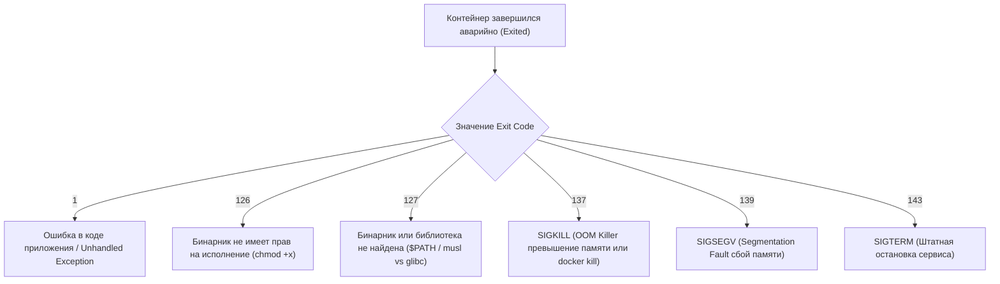

# Справочник Exit кодов Docker и траблшутинг аварий в Production

Когда контейнер неожиданно падает, первой зацепкой для инженера является **Exit Code** (код завершения). Коды завершения в Docker стандартизированы спецификацией POSIX и внутренними соглашениями движка Docker.

В этом справочнике собрана исчерпывающая расшифровка всех возможных кодов и алгоритмы их устранения.



---

## 1. Сводная таблица кодов завершения

| Код | Название / Сигнал | Типичная причина | Что делать |
|---|---|---|---|
| **0** | `Success` | Процесс успешно завершил свою задачу (например, скрипт миграций БД). | Нормальное поведение для одноразовых задач (one-off tasks). |
| **1** | `Application Error` | Ошибка в коде: необработанное исключение (panic, syntax error, uncaught promise). | Смотреть вывод `docker logs <id>`. |
| **125** | `Docker Daemon Error` | Ошибка самого клиента/демона Docker (неверный флаг CLI или сбой cgroups). | Проверить синтаксис команды `docker run`. |
| **126** | `Permission Denied` | Файл `ENTRYPOINT` существует, но не имеет битового флага исполнения. | Добавить в Dockerfile `RUN chmod +x /entrypoint.sh`. |
| **127** | `Command Not Found` | Команда не найдена в `$PATH` или отсутствует интерпретатор (например, `#!/bin/bash` в Alpine). | Заменить `bash` на `sh` или проверить путь к файлу. |
| **137** | `128 + 9 (SIGKILL)` | Контейнер уничтожен ядром Linux из-за Out-Of-Memory (OOM) или убит таймаутом `docker stop`. | Проверить `docker inspect` на `OOMKilled: true` и логи `dmesg`. |
| **139** | `128 + 11 (SIGSEGV)` | Ошибка сегментации памяти в C/C++/Go/Rust коде или поврежденная библиотека. | Трейсинг дампов памяти, отладка через gdb или valgrind. |
| **143** | `128 + 15 (SIGTERM)` | Штатное завершение работы при вызове `docker stop` или оркестраторе. | Нормальное поведение при деплое и перезапуске. |

---

## 2. Разбор ошибки 127: Ловушка Alpine и glibc

Частый сценарий: вы скомпилировали Go- или C-приложение на Ubuntu (которая использует библиотеку `glibc`), скопировали бинарник в минималистичный образ `FROM alpine:latest` (который использует `musl libc`), запускаете контейнер и получаете:

```text
/bin/sh: ./app: not found
Exited (127)
```

Вы заходите внутрь контейнера, видите, что файл `./app` на месте и имеет права `755`, но при попытке запустить его система пишет `not found`.

**Причина:** Сообщение `not found` относится не к самому `./app`, а к **динамическому загрузчику ядра** (`/lib/ld-linux-x86-64.so.2`), которого нет в Alpine!

### Решение:
Для Go всегда компилируйте статические бинарники без CGO:
```bash
CGO_ENABLED=0 GOOS=linux go build -ldflags="-w -s" -o app .
```

---

## 3. Безопасная очистка дискового пространства

На серверах с длительным аптаймом старые образы и неиспользуемые тома быстро забивают 100% диска хоста.

### Инспекция занятого места
```bash
docker system df -v
```

### Безопасная очистка (НЕ трогает работающие контейнеры и базы данных):
```bash
# Удалить все повисшие слои (dangling images), остановленные контейнеры и неиспользуемые сети:
docker system prune -f
```

### ⚠️ Опасная команда:
```bash
# ВНИМАНИЕ: флаг --volumes удалит ВСЕ не примонтированные тома!
# Если вы остановили базу данных и запустили prune с --volumes, данные будут удалены безвозвратно!
docker system prune -a --volumes
```

**Рекомендация для Production:** Никогда не запускайте `--volumes` в автоматических cron-скриптах. Создавайте именованные тома и очищайте их строго точечно через `docker volume rm <имя_тома>`.

---

## 4. Лабораторный вызов: Проверь себя

<details>
<summary><b>Вопрос:</b> Как отследить события контейнеров в реальном времени при спонтанных падениях?</summary>

> **Ответ:** Запустите команду `docker events`. Она подключится к сокету Docker в реальном времени и покажет события `die`, `kill`, `oom`, `restart` с точным временем, ID контейнера и кодом завершения `exitCode`.
</details>
