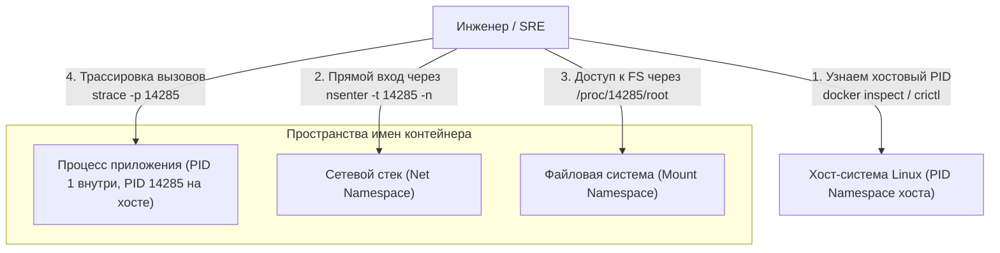

# Аварийная отладка в Production: Восстановление «зависших» контейнеров, nsenter и диагностика ядра

Рано или поздно каждый DevOps и SRE инженер сталкивается с критической аварией в продакшене:
* Сервис завис и перестал отвечать на трафик.
* Команда `docker exec -it <container> sh` зависает или завершается с ошибкой `cannot exec in a stopped container` или `fork/exec: cannot allocate memory`.
* Контейнер собран на базе **Distroless** или **Scratch**, и внутри него физически отсутствуют командный интерпретатор `sh`, утилиты `ps`, `curl`, `netstat` и пакетные менеджеры.
* Перезапуск контейнера сотрет ценные улики (дампы памяти, состояние сетевых очередей и открытых сокетов).

В этом уроке мы разберем продвинутые техники низкоуровневой отладки в production-среде без перезапуска сервисов.

---

## 1. Когда `docker exec` бессилен: Архитектура изоляции через Namespaces

Вспомним фундаментальный принцип: **контейнер — это обычный процесс в ядре Linux**. Docker Daemon (`dockerd`) — лишь высокоуровневый оркестратор.

Если сам Docker демон перегружен или завис, мы можем обойти его и взаимодействовать с контейнером напрямую через системные вызовы ядра с помощью утилиты **`nsenter`** (Namespace Enter):



---

## 2. Прямой вход в пространства имен через `nsenter`

### Шаг 1: Определение реального PID процесса на хосте
```bash
CONTAINER_ID="production-api"
PID=$(docker inspect -f '{{.State.Pid}}' "$CONTAINER_ID")
echo "Реальный PID процесса на хосте: $PID"
```

### Шаг 2: Диагностика сети без утилит внутри контейнера
Подключаемся только к сетевому пространству имен (`-n`):
```bash
# Просмотр сетевых интерфейсов и IP-адресов контейнера хостовыми утилитами:
sudo nsenter -t "$PID" -n ip a

# Просмотр открытых портов и очередей сокетов контейнера:
sudo nsenter -t "$PID" -n ss -tulpn

# Перехват сетевого трафика внутри сетевого пространства контейнера:
sudo nsenter -t "$PID" -n tcpdump -nn -i eth0 port 8080 -w /tmp/traffic.pcap
```

> [!TIP]
> Утилита `tcpdump` выполняется на стороне хоста, но анализирует пакеты внутри виртуального сетевого интерфейса контейнера. Это позволяет перехватывать трафик даже из минималистичных образов Scratch!

### Шаг 3: Исследование файловой системы и дескрипторов через `/proc`
Ядро Linux хранит полную информацию о процессе в псевдофайловой системе `/proc`:
```bash
# 1. Доступ ко всей файловой системе контейнера:
ls -la /proc/$PID/root/

# 2. Просмотр реальных переменных окружения процесса:
cat /proc/$PID/environ | tr '\0' '\n'

# 3. Список всех открытых файлов, сокетов и дескрипторов (file descriptors):
ls -l /proc/$PID/fd/

# 4. Просмотр лимитов ресурсов процесса:
cat /proc/$PID/limits
```

---

## 3. Отладка минималистичных контейнеров через Sidecar Debug

Если контейнер запущен без отладочных инструментов (Distroless / Scratch), лучшая практика — подключить к нему временный сервисный контейнер через флаги разделения пространств имен:

```bash
# Подключаемся к сетевому стеку контейнера production-api:
docker run --rm -it \
  --net=container:production-api \
  nicolaka/netshoot \
  curl -v localhost:8080/health
```

### Совместное использование PID Namespace:
```bash
# Подключаемся к PID-пространству для просмотра процессов и трассировки:
docker run --rm -it \
  --pid=container:production-api \
  --cap-add=SYS_PTRACE \
  alpine sh
```
Внутри этого отладочного контейнера команда `ps aux` покажет все процессы целевого сервиса, а утилита `strace -p 1` позволит в реальном времени наблюдать системные вызовы зависшего процесса!

---

## 4. Проблема Зомби-процессов и PID 1

В Linux процесс с `PID 1` имеет две священные обязанности:
1. **Обработка сигналов завершения**: передача `SIGTERM` дочерним процессам.
2. **Сбор зомби-процессов (Reaping zombies)**: перехват вызовов `wait()` для завершившихся дочерних процессов.

Если ваше приложение (например, на Node.js или Python) запущено как PID 1, оно часто не умеет утилизировать зомби-процессы. Постепенно таблица процессов хоста переполняется, и сервер падает с ошибкой:
```text
fork: Resource temporarily unavailable
```

### Решение: Встроенный Init-процесс Docker (`--init`)
Всегда подключайте микро-инит Tini:
```bash
# В CLI:
docker run -d --init my-app:latest
```

Или в `docker-compose.yml`:
```yaml
services:
  app:
    image: my-app:latest
    init: true # Автоматически внедряет легковесный PID 1 Tini
```

---

## 5. Лабораторная самопроверка

<details>
<summary>Вопрос 1: Почему утилита nsenter работает даже тогда, когда docker exec зависает?</summary>
<div class="mt-2 text-body">
<p><strong>Ответ:</strong> <code>docker exec</code> требует рабочего взаимодействия с демоном Docker (dockerd), рантаймом containerd и вызова <code>containerd-shim</code>. Если сокет демона перегружен или блокирован, вызовы API не проходят. <code>nsenter</code> — это стандартная утилита Linux из пакета <code>util-linux</code>, которая обращается напрямую к ядру через системный вызов <code>setns(2)</code>, минуя Docker полностью.</p>
</div>
</details>

<details>
<summary>Вопрос 2: Как исследовать файловую систему контейнера на базе Scratch, если в нем нет ни ls, ни cat?</summary>
<div class="mt-2 text-body">
<p><strong>Ответ:</strong> На хосте найдите PID процесса через <code>docker inspect -f '{{.State.Pid}}' &lt;id&gt;</code> и откройте каталог <code>/proc/$PID/root/</code>. Через эту виртуальную символическую ссылку хостовая ОС предоставляет полный доступ ко всей корневой файловой системе контейнера с использованием хостовых инструментов.</p>
</div>
</details>

<details>
<summary>Вопрос 3: Зачем нужен параметр init: true в docker-compose.yml?</summary>
<div class="mt-2 text-body">
<p><strong>Ответ:</strong> Он запускает микро-процесс инициализации (Tini) в качестве PID 1. Tini корректно транслирует сигналы остановки (SIGTERM/SIGINT) при вызове <code>docker stop</code> и своевременно удаляет дочерние зомби-процессы, предотвращая утечку дескрипторов в таблице процессов ядра.</p>
</div>
</details>
