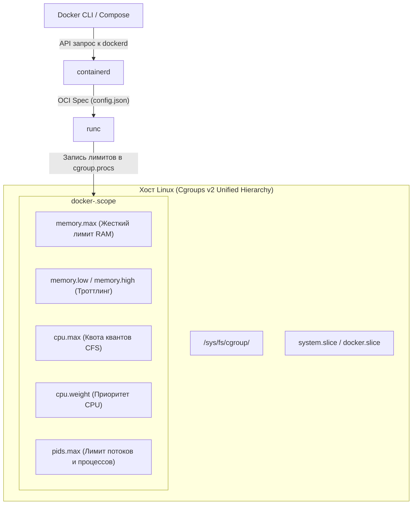
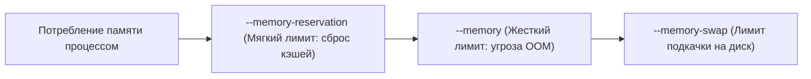

# Cgroups v2 в Docker: Лимиты памяти, квоты CPU и предотвращение деградации хоста

По умолчанию запущенный Docker-контейнер не имеет никаких ограничений на потребление ресурсов хоста. Если в одном из контейнеров произойдет утечка памяти (Memory Leak) или зацикливание кода (100% загрузка CPU), он монополизирует вычислительные мощности сервера. Это приведет к дисковому и процессорному голоданию соседних сервисов, отказу демона Docker и вызову аварийного механизма ядра **OOM Killer**, способного уничтожить базу данных или системные демоны.

В современных дистрибутивах Linux (Ubuntu 22.04+, Debian 11+, RHEL 9+, Fedora) Docker управляет распределением ресурсов через **Control Groups v2 (cgroups-v2)** — унифицированную иерархию ядра Linux.

В этом уроке мы разберем:
* Отличия Cgroups v2 от устаревшего v1 и проверку активности в Docker.
* Тонкую настройку лимитов памяти: жесткий лимит (`--memory`), мягкая граница (`--memory-reservation`) и управление swap (`--memory-swap`).
* Квотирование процессора: планировщик CFS (`--cpus`), веса приоритета (`--cpu-shares`) и лимиты периодов.
* Защиту ядра от fork-бомб через лимиты процессов (`--pids-limit`).
* Декларативное описание ресурсов в `docker-compose.yml` (спецификация Compose v2).
* Прямую инспекцию псевдофайловой системы `/sys/fs/cgroup/` для мониторинга метрик контейнера в реальном времени.

---

## 1. Архитектура Cgroups v2 в стеке Docker

В Cgroups v1 контроллеры памяти, CPU и дискового ввода-вывода находились в раздельных независимых деревьях каталогов, что приводило к рассинхронизации учета ввода-вывода страниц памяти. В **Cgroups v2** реализована единая унифицированная иерархия (Unified Hierarchy), где каждый процесс принадлежит строго одной контрольной группе.



### Проверка версии Cgroups на вашем сервере:

Выполните команду диагностики Docker:
```bash
docker info | grep -i cgroup
```

Ожидаемый результат для современного production-сервера:
```text
 Cgroup Version: 2
 Cgroup Driver: systemd
```

> [!NOTE]
> Использование драйвера `systemd` вместо устаревшего `cgroupfs` является обязательным промышленным стандартом. Это гарантирует согласованное управление ресурсами между службами операционной системы и контейнерами.

---

## 2. Управление оперативной памятью: `--memory`, `--memory-reservation`, `--memory-swap`

Управление памятью в Docker состоит из трех независимых уровней защиты:

| Флаг Docker CLI | Файл в Cgroups v2 | Назначение |
|---|---|---|
| **`--memory <размер>`** | `memory.max` | **Жесткий лимит (Hard Limit).** При попытке превысить этот порог ядро вызывает OOM Killer для процессов внутри контейнера. |
| **`--memory-reservation <размер>`** | `memory.low` / `memory.high` | **Мягкий лимит (Soft Limit).** Ядро не убивает процесс при его достижении, но начинает агрессивный сброс файлового кэша (Page Cache), если на хосте исчерпывается свободная память. |
| **`--memory-swap <размер>`** | `memory.swap.max` | **Общий лимит RAM + Swap.** Позволяет ограничить или полностью отключить использование swap-файла контейнером. |



### Практические сценарии запуска контейнеров:

#### Сценарий А: Контейнер с жестким лимитом без использования Swap
Для сервисов баз данных (PostgreSQL, Redis) попадание страниц памяти в swap катастрофически снижает производительность. Чтобы запретить контейнеру использовать swap, установите значение `--memory-swap` равным значению `--memory`:
```bash
docker run -d --name redis-prod \
  --memory="512m" \
  --memory-swap="512m" \
  redis:7-alpine
```

#### Сценарий Б: Мягкий лимит с эластичным расширением
Приложение обычно потребляет 256 МБ, но при пиковой нагрузке может временно занять до 1 ГБ, если на хосте есть свободная память:
```bash
docker run -d --name api-elastic \
  --memory-reservation="256m" \
  --memory="1024m" \
  my-api-service:latest
```

> [!WARNING]
> Если флаг `--memory-swap` не указан вовсе, по умолчанию Docker разрешает контейнеру использовать swap в объеме, равном двукратному значению `--memory`. Это может привести к незаметной деградации сервиса из-за медленного дискового I/O.

---

## 3. Квотирование процессорного времени (CPU)

Планировщик Linux (CFS — Completely Fair Scheduler) работает с квантами времени. По умолчанию период планировщика составляет **100 000 микросекунд (100 мс)**.

### Флаги управления CPU:

1. **`--cpus="<количество>"` (Квота на период):**
   Жестко задает максимальное количество ядер, доступное контейнеру. 
   - `--cpus="1.5"` означает, что контейнер может использовать не более $150\,000$ мкс процессорного времени каждые $100\,000$ мкс (эквивалент полутора ядер CPU).
   - В Cgroups v2 это записывается в файл `cpu.max` в формате: `150000 100000`.

2. **`--cpu-shares="<вес>"` (Относительный вес приоритета):**
   Определяет приоритет контейнера **только во время высокой конкуренции за процессор**. По умолчанию вес равен `1024`.
   - Если Контейнер А запущен с `--cpu-shares=1024`, а Контейнер Б — с `--cpu-shares=512`, то при 100% нагрузке на процессор Контейнер А получит 66.6% времени CPU, а Контейнер Б — 33.3%.
   - В период простоя одного из них второй сможет утилизировать все 100% CPU. В Cgroups v2 транслируется в файл `cpu.weight`.

```bash
# Выделение строго 2 ядер процессора с высоким приоритетом:
docker run -d --name high-priority-job \
  --cpus="2.0" \
  --cpu-shares="2048" \
  worker:latest
```

---

## 4. Защита от исчерпания дескрипторов процессов: `--pids-limit`

Одна из самых опасных уязвимостей ненадежных контейнеров — атака типа «Fork Bomb» (лавинообразное порождение дочерних процессов). Если процесс запустит бесконечный цикл `() { :|:& };:`, хост исчерпает лимит `kernel.pid_max`, после чего администратор не сможет открыть даже новую SSH-сессию.

Параметр `--pids-limit` ограничивает максимальное количество активных потоков и процессов внутри контейнера (контроллер `pids.max` в cgroups):

```bash
docker run -d --name secure-app \
  --pids-limit=100 \
  node:20-alpine
```

Если вредоносный код или баг в библиотеке попытается создать 101-й поток, системный вызов `fork()` вернет ошибку `EAGAIN (Resource temporarily unavailable)`, хост останется стабилен.

---

## 5. Декларативная настройка ресурсов в `docker-compose.yml`

В спецификации Docker Compose v2 настройки квот ресурсов описываются в блоке `deploy.resources`:

```yaml
services:
  payment-gateway:
    image: payment-service:v2.1
    restart: always
    deploy:
      resources:
        # Жесткие ограничения (Hard Limits)
        limits:
          cpus: "1.50"
          memory: 1024M
          pids: 150
        # Гарантированные ресурсы (Soft Reservations)
        reservations:
          cpus: "0.50"
          memory: 512M
    ports:
      - "8080:8080"
```

> [!TIP]
> В отличие от Compose v1, в современном Docker Compose v2 блок `deploy.resources` применяется автоматически даже при обычном локальном запуске `docker compose up -d` без режима Docker Swarm!

---

## 6. Лабораторная диагностика: Чтение Cgroups v2 в реальном времени

Вы можете исследовать актуальное состояние контрольных групп напрямую через виртуальную файловую систему Linux:

```bash
# 1. Запуск тестового контейнера с лимитом 256MB:
docker run -d --name cgroup-demo --memory="256m" --cpus="0.5" alpine sleep 3600

# 2. Получение полного ID контейнера:
CID=$(docker inspect --format '{{.Id}}' cgroup-demo)

# 3. Инспекция контроллеров cgroups v2 на хосте:
cat /sys/fs/cgroup/system.slice/docker-${CID}.scope/memory.max
# Выведет: 268435456 (256 * 1024 * 1024 байт)

cat /sys/fs/cgroup/system.slice/docker-${CID}.scope/cpu.max
# Выведет: 50000 100000 (квота 50мс на период 100мс = 0.5 CPU)

# 4. Просмотр реального текущего потребления памяти:
cat /sys/fs/cgroup/system.slice/docker-${CID}.scope/memory.current
```

---

## 7. Вопросы для самопроверки

<details>
<summary>Вопрос 1: В чем разница между флагами --memory и --memory-reservation?</summary>
<div class="mt-2 text-body">
<b>--memory</b> задает жесткий лимит (hard limit). При его превышении ядро немедленно вызывает OOM Killer и завершает процесс сигналом SIGKILL (Exit Code 137).<br>
<b>--memory-reservation</b> задает мягкий порог (soft limit). При его превышении процесс продолжает штатную работу. Однако если на хосте в целом исчерпывается свободная память, ядро начинает агрессивно выгружать файловый кэш в первую очередь у тех контейнеров, которые превысили reservation.
</div>
</details>

<details>
<summary>Вопрос 2: Как полностью отключить Swap для критически важного сервиса базы данных в Docker?</summary>
<div class="mt-2 text-body">
Чтобы полностью запретить контейнеру сбрасывать данные в Swap, необходимо установить параметр <code>--memory-swap</code> равным значению <code>--memory</code> (например: <code>--memory=1g --memory-swap=1g</code>). В таком случае лимит подкачки на диск равен 0.
</div>
</details>

<details>
<summary>Вопрос 3: Что произойдет с контейнером при превышении параметра --pids-limit?</summary>
<div class="mt-2 text-body">
Контейнер не будет уничтожен ядром. При попытке приложения вызвать <code>fork()</code>, <code>clone()</code> или запустить новый тред сверх установленного лимита ядро вернет ошибку <code>EAGAIN: Resource temporarily unavailable</code>. Это надежно защищает сервер от падения при атаках типа fork-bomb.
</div>
</details>

---

## 8. Дополнительные материалы и следующие шаги

* [Модуль 7.2: Анатомия Exit Code 137: Диагностика OOM Killer](/courses/docker-resources/02-oom-killer-diagnostics-and-exit-137)
* [Модуль 7.3: CPU Pinning (cpuset), троттлинг диска Block I/O](/courses/docker-resources/03-cpuset-pinning-and-block-io)
* [Ядро Linux: Namespaces, Cgroups v2 и procfs под капотом](/courses/internals/01-namespaces-and-cgroups-v2)
