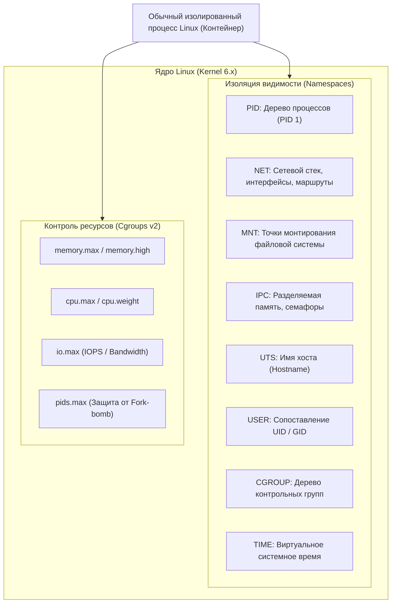

# Урок 1: Анатомия изоляции: Namespaces, Cgroups v2 и procfs под капотом

В ядре Linux **не существует** сущности «контейнер». В исходном коде ядра Linux вы не найдете структуры данных `struct container` или системного вызова `sys_create_container()`.

То, что индустрия называет контейнером, — это иллюзия, создаваемая связкой фундаментальных механизмов ядра Linux:
1. **Namespaces (Пространства имен)**: определяют, **что** процесс может видеть в системе.
2. **Control Groups v2 (cgroups)**: определяют, **сколько** вычислительных ресурсов (CPU, RAM, IO, PIDs) процесс имеет право потребить.
3. **Chroot / Pivot_root**: определяют, **где** находится корень файловой системы процесса.
4. **LSM & Seccomp (SELinux, AppArmor, BPF)**: определяют, **какие** действия и системные вызовы процессу разрешено выполнять.

В этом уроке мы разберем фундамент изоляции:
* Анатомию всех **8 пространств имен** ядра Linux (включая современный `Time Namespace`).
* Исследование изоляции через псевдофайловую систему **`procfs`** (`/proc/<PID>/ns/`).
* Практическое использование утилит **`unshare`**, **`nsenter`** и **`lsns`**.
* Иерархию **Cgroups v2 (Unified Hierarchy)**: принципы работы контроллеров `memory.max`, `cpu.max`, `pids.max` и `io.max`.
* **Ручное создание контейнера** только средствами ядра Linux без Docker и Podman.

---

## 1. Восемь пространств имен ядра Linux

Пространства имен (Namespaces) изолируют глобальные системные ресурсы в абстрактные сущности, так что процессу внутри пространства кажется, будто он владеет собственным изолированным экземпляром операционной системы.



### Сводная таблица пространств имен ядра:

| Пространство имен | Флаг системного вызова | Что изолирует | Назначение в контейнерах |
|---|---|---|---|
| **PID** (Process ID) | `CLONE_NEWPID` | Номера процессов и иерархию дерева | Процесс видит себя как PID 1, не видит процессов хоста |
| **NET** (Network) | `CLONE_NEWNET` | Интерфейсы, IP-адреса, сокеты, iptables | Собственный сетевой стек (eth0, loopback, routing table) |
| **MNT** (Mount) | `CLONE_NEWNS` | Точки монтирования файловых систем | Изолированное дерево каталогов без доступа к диску хоста |
| **IPC** (Inter-Process) | `CLONE_NEWIPC` | Семафоры, очереди сообщений, Shared Memory | Изоляция POSIX/SysV разделяемой памяти между приложениями |
| **UTS** (UNIX Time-Sharing) | `CLONE_NEWUTS` | Имя хоста (`hostname`) и доменное имя | Уникальное имя хоста контейнера (например, `web-01`) |
| **USER** (User ID) | `CLONE_NEWUSER` | Таблицы идентификаторов UID и GID | `root` внутри контейнера является непривилегированным на хосте |
| **CGROUP** | `CLONE_NEWCGROUP` | Виртуальное дерево `/proc/self/cgroup` | Скрывает структуру cgroups хоста от процесса |
| **TIME** (Kernel 5.6+) | `CLONE_NEWTIME` | Часы `CLOCK_MONOTONIC` и `CLOCK_BOOTTIME` | Смещение системного времени при миграции контейнеров |

---

## 2. Диагностика изоляции через `procfs`: директория `/proc/<PID>/ns/`

Ядро Linux экспортирует информацию о пространствах имен каждого работающего процесса в псевдофайловую систему `procfs`:

```bash
# Посмотрим дескрипторы пространств имен текущего shell (PID $$)
ls -la /proc/$$/ns/
```

Пример вывода:
```text
lrwxrwxrwx 1 it it 0 Nov 15 15:30 cgroup -> 'cgroup:[4026531835]'
lrwxrwxrwx 1 it it 0 Nov 15 15:30 ipc -> 'ipc:[4026531839]'
lrwxrwxrwx 1 it it 0 Nov 15 15:30 mnt -> 'mnt:[4026531840]'
lrwxrwxrwx 1 it it 0 Nov 15 15:30 net -> 'net:[4026531992]'
lrwxrwxrwx 1 it it 0 Nov 15 15:30 pid -> 'pid:[4026531836]'
lrwxrwxrwx 1 it it 0 Nov 15 15:30 pid_for_children -> 'pid:[4026531836]'
lrwxrwxrwx 1 it it 0 Nov 15 15:30 time -> 'time:[4026531834]'
lrwxrwxrwx 1 it it 0 Nov 15 15:30 time_for_children -> 'time:[4026531834]'
lrwxrwxrwx 1 it it 0 Nov 15 15:30 user -> 'user:[4026531837]'
lrwxrwxrwx 1 it it 0 Nov 15 15:30 uts -> 'uts:[4026531838]'
```

### Магическое число в квадратных скобках `[4026531992]`
Число в квадратных скобках — это **номер inode** виртуального файла пространства имен в памяти ядра.

> [!IMPORTANT]
> Если у двух процессов на сервере номер inode для определенного namespace совпадает (например, `net:[4026531992]`), это означает со 100% гарантией, что **эти процессы находятся в одном и том же пространстве имен** и разделяют общий ресурс!

### Утилита `lsns`
Чтобы просмотреть все активные пространства имен в системе:
```bash
sudo lsns -t net
```
Команда выведет список всех виртуальных сетей, их ID, количество связанных процессов и PID процесса-создателя.

---

## 3. Практика: Ручное создание изоляции через `unshare`

Инструмент **`unshare`** позволяет запустить любую команду в новых пространствах имен напрямую из терминала, минуя рантаймы контейнеров:

```bash
# Запускаем bash в новом UTS (hostname) и PID namespace с форком процесса
sudo unshare --uts --pid --mount-proc --fork /bin/bash
```

Что произошло:
```bash
# Проверяем имя хоста
hostname
# Вывод: my-server

# Меняем hostname внутри нашего пространства имен:
hostname isolated-box

# Проверяем:
hostname
# Вывод: isolated-box
```
Если открыть параллельный терминал на хосте и выполнить `hostname`, имя хоста сервера осталось прежним (`my-server`). Мы изолировали UTS!

Теперь проверим процессы внутри нашего shell:
```bash
ps -ef
```
Вывод:
```text
UID          PID    PPID  C STIME TTY          TIME CMD
root           1       0  0 15:42 pts/2    00:00:00 /bin/bash
root           7       1  0 15:43 pts/2    00:00:00 ps -ef
```
Наш процесс `bash` стал **PID 1**! Он не видит ни демонов хоста, ни процессов других пользователей.

---

## 4. Подключение к контейнеру через `nsenter`

Если вам нужно выполнить отладку контейнера без вызова `docker exec` или `podman exec` (например, когда демон завис или поврежден):

```bash
# 1. Находим PID основного процесса контейнера на хосте
CONTAINER_PID=$(docker inspect --format '{{.State.Pid}}' my-web-app)

# 2. Подключаемся ко всем пространствам имен контейнера напрямую через ядро:
sudo nsenter --target $CONTAINER_PID --mount --uts --ipc --net --pid /bin/bash
```

Команда **`nsenter`** выполняет системный вызов `setns(2)`, мгновенно переключая контекст текущего потока в целевые пространства имен работающего контейнера.

---

## 5. Control Groups v2 (Cgroups v2): Контроль ресурсов

Если Namespaces отвечают за видимость, то **Cgroups v2** (единая контрольная иерархия, принятая в ядре Linux как современный стандарт) управляет распределением ресурсов.

Все контроллеры Cgroups v2 смонтированы в каталоге:
`/sys/fs/cgroup/`

```bash
ls -F /sys/fs/cgroup/
# Вывод: cgroup.controllers  cgroup.procs  cgroup.subtree_control  memory.max  cpu.max ...
```

### Ключевые файлы контроллеров Cgroups v2:

| Файл контроллера | Назначение | Пример значения |
|---|---|---|
| **`memory.max`** | Жесткий лимит оперативной памяти (Hard Limit). Превышение вызывает OOM Killer | `536870912` (512 МБ) |
| **`memory.high`** | Мягкий лимит памяти (Throttle Limit). При превышении ядро замедляет процесс и сбрасывает кэш страниц | `419430400` (400 МБ) |
| **`memory.current`** | Текущее потребление RAM всеми процессами группы в байтах | `45123904` |
| **`cpu.max`** | Квота планировщика CFS: `<квота_мкс> <период_мкс>` | `50000 100000` (0.5 CPU) |
| **`cpu.weight`** | Пропорциональный приоритет выделения CPU (1–10000, аналог nice) | `100` (дефолт) |
| **`pids.max`** | Максимальное число процессов/потоков (защита от Fork-bomb) | `100` |
| **`io.max`** | Ограничение дискового ввода-вывода (IOPS и байты/сек) по maj:min диска | `8:0 rbps=10485760` |

---

## 6. Практический эксперимент: Ограничение процесса через Cgroups v2 вручную

Создадим собственную группу ресурсов в `/sys/fs/cgroup/` и проверим реакцию ядра:

```bash
# 1. Создаем поддиректорию (ядро Linux автоматически наполнит ее контроллерами!)
sudo mkdir /sys/fs/cgroup/sandbox

# 2. Ограничиваем оперативную память группы до 50 Мегабайт
echo "52428800" | sudo tee /sys/fs/cgroup/sandbox/memory.max

# 3. Ограничиваем процессорное время ровно 20% от одного ядра
# 20 000 мкс из периода 100 000 мкс
echo "20000 100000" | sudo tee /sys/fs/cgroup/sandbox/cpu.max

# 4. Добавляем процесс в контрольную группу
# Записываем PID процесса в cgroup.procs:
echo $$ | sudo tee /sys/fs/cgroup/sandbox/cgroup.procs

# 5. Проверяем текущее потребление памяти
cat /sys/fs/cgroup/sandbox/memory.current
```

Если процесс внутри группы попытается выделить 100 МБ памяти, ядро немедленно применит OOM Killer к процессу этой группы, не затронув остальную операционную систему хоста!

---

## Резюме урока

1. **Контейнер** — это обычный процесс Linux, изолированный с помощью **Namespaces** и ограниченный через **Cgroups v2**.
2. В ядре существуют **8 Namespaces**: PID, NET, MNT, IPC, UTS, USER, CGROUP и TIME.
3. Каждое пространство имен идентифицируется уникальным **номером inode** в директории `/proc/<PID>/ns/`.
4. Утилита **`unshare`** создает новые пространства имен для процесса, а утилита **`nsenter`** позволяет войти в пространства имен любого существующего контейнера.
5. **Cgroups v2** предоставляет единую древовидную модель в `/sys/fs/cgroup/` с прецизионным контролем лимитов памяти (`memory.max`), квот процессора (`cpu.max`) и защиты от fork-бомб (`pids.max`).
