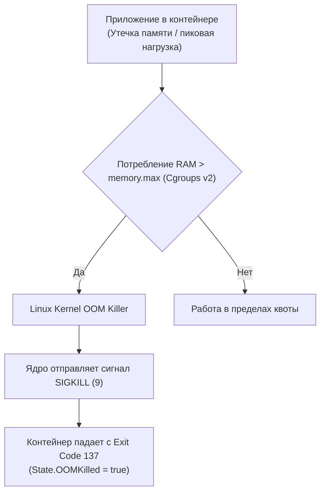

# Анатомия Exit Code 137: Диагностика OOM Killer и лимиты памяти

Каждый инженер, эксплуатирующий микросервисы в продакшене, сталкивался с внезапной гибелью контейнера с загадочным кодом завершения:
```text
Exited (137) 2 minutes ago
```

В Linux код завершения больше 128 означает, что процесс был уничтожен сигналом:
$$\text{Exit Code} = 128 + \text{Signal Number}$$

Для кода 137: $137 - 128 = 9$ — это сигнал **`SIGKILL`** (неперехватываемое немедленное уничтожение процесса ядром Linux).



---

## 1. Две причины Exit Code 137

Контейнер может завершиться с кодом 137 по двум совершенно разным причинам:

| Причина | Что произошло | Поле `OOMKilled` |
|---|---|---|
| **OOM Killer** | Процесс превысил лимит памяти `--memory`, и ядро Linux убило его. | `true` |
| **Таймаут остановки** | Вызван `docker stop`, процесс не успел завершиться за 10 сек (`SIGTERM`), и демон послал `SIGKILL`. | `false` |

---

## 2. Алгоритм диагностики: OOM или таймаут?

### Шаг 1: Инспекция состояния контейнера
Выполните форматированный запрос к Docker API:

```bash
docker inspect <container_id_или_имя> --format '{{.State.ExitCode}} (OOMKilled: {{.State.OOMKilled}})'
```

- Если вывод: `137 (OOMKilled: true)` — это **100% Out-Of-Memory**.
- Если вывод: `137 (OOMKilled: false)` — контейнер просто слишком долго завершал работу при остановке.

### Шаг 2: Чтение логов ядра через dmesg
Ядро Linux всегда оставляет подробную запись при срабатывании OOM Killer:

```bash
sudo dmesg -T | grep -i -E "oom|killed process"
```

Пример реального лога ядра:
```text
[Thu Nov 19 14:15:32 2026] Memory cgroup out of memory: Killed process 34912 (node) total-vm:1845120kB, anon-rss:512400kB, file-rss:1200kB, shmem-rss:0kB, oom_score_adj:0
```
В этой строке видно:
- имя процесса (`node`);
- реальный объем оперативной памяти в момент убийства (`anon-rss: 512400kB` ~ 500 МБ);
- контроллер: `Memory cgroup out of memory`.

---

## 3. Настройка лимитов памяти и Swap

В `docker run` и `compose.yaml` часто допускают ошибку при указании параметров swap:

```bash
# ❌ ЧАСТАЯ ОШИБКА:
docker run -d --memory=512m --memory-swap=512m myapp
```
**Внимание:** Параметр `--memory-swap` указывает **суммарный объем RAM + Swap**. Если вы указали `--memory=512m` и `--memory-swap=512m`, это означает: 512 МБ памяти и **0 МБ Swap**!

### Правильные формулы:
- Чтобы дать контейнеру 1 ГБ RAM и 512 МБ Swap:
  ```bash
  docker run -d --memory=1g --memory-swap=1.5g myapp
  ```
- Чтобы полностью запретить контейнеру сбрасывать память в swap (критично для СУБД и Redis для предотвращения лагов диска):
  ```bash
  docker run -d --memory=1g --memory-swap=1g myapp
  ```

---

## 4. Конфигурация в Docker Compose v2

В спецификации Compose v2 лимиты памяти задаются в блоке `deploy.resources`:

```yaml
services:
  backend:
    image: mycompany/api:v1.2
    restart: unless-stopped
    deploy:
      resources:
        limits:
          cpus: '1.5'
          memory: 512M      # Жесткий потолок: при превышении -> OOM Killer
        reservations:
          cpus: '0.25'
          memory: 128M      # Гарантированный минимум памяти для контейнера
```

---

## 5. Лабораторный вызов: Проверь себя

<details>
<summary><b>Вопрос:</b> Безопасно ли передавать флаг <code>--oom-kill-disable</code>, чтобы запретить ядру убивать контейнер при исчерпании памяти?</summary>

> **Ответ:** **Крайне опасно!** Флаг `--oom-kill-disable` запрещает ядру убивать процессы в этом cgroup. Если в приложении произойдет утечка памяти, а swap будет исчерпан, приложение не будет убито, а **намертво зависнет** в состоянии D (uninterruptible sleep). Более того, если память на хосте закончится полностью, ядро включит системный OOM Killer и убьет любой другой критический процесс на сервере (например, sshd, dockerd или саму операционную систему). Использовать `--oom-kill-disable` можно только при строго настроенном лимите `--memory` и жестком мониторинге.
</details>
