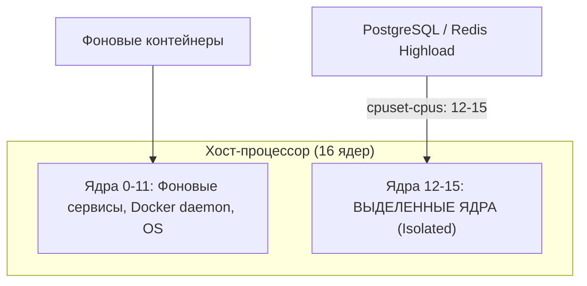
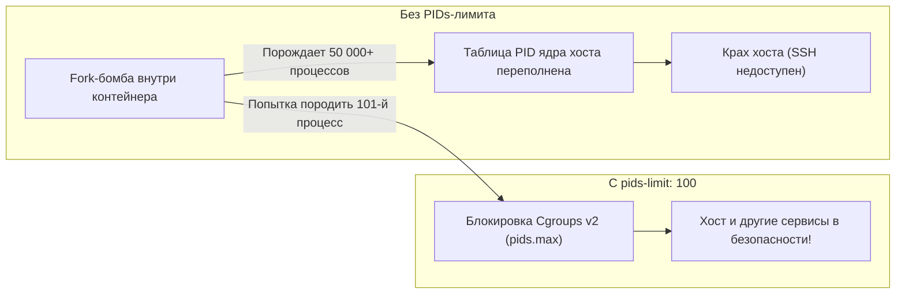

# Привязка ядер CPU (cpuset), троттлинг дискового ввода-вывода (Block I/O) и лимиты PIDs

В высоконагруженных системах (Highload) простого ограничения оперативной памяти (`memory.max`) и процессорных квантов (`cpu.max`) часто оказывается недостаточно:
* Фоновый контейнер сбора аналитики или резервного копирования начинает активно читать диск, вызывая дисковое голодание (I/O Starvation) у критической базы данных.
* Планировщик Linux CFS постоянно перемещает критический процесс с одного процессорного ядра на другое, сбрасывая кэши L1/L2/L3 процессора.
* Ошибка в коде приложения или атака fork-бомбой создает миллионы процессов, забивая глобальную таблицу идентификаторов процессов ядра (`/proc/sys/kernel/pid_max`) и блокируя доступ к серверу даже по SSH.

В этом уроке мы разберем продвинутые контроллеры **Cgroups v2**: изоляцию ядер через **CPU Pinning (`cpuset`)**, регулирование дискового ввода-вывода **Block I/O (`io.max`)** и защиту от исчерпания дескрипторов процессов **`pids.max`**.

---

## 1. CPU Pinning: Привязка к физическим ядрам и NUMA нодам

По умолчанию планировщик Linux (Completely Fair Scheduler, CFS) свободно распределяет потоки контейнера по любым доступным ядрам хоста. При высокой нагрузке перенос потока с одного ядра на другое приводит к **потере кэша процессора (Cache Misses)** и деградации производительности на 15–30%.



### Задание `cpuset` в CLI:
```bash
# Привязать контейнер строго к ядрам 2 и 3, а память — к 0-й NUMA ноде
docker run -d --name highload-db \
  --cpuset-cpus="2,3" \
  --cpuset-mems="0" \
  postgres:16-alpine
```

### Настройка в `docker-compose.yml`:
```yaml
services:
  database:
    image: postgres:16-alpine
    cpuset: "2,3" # Закрепление за конкретными ядрами процессора
    deploy:
      resources:
        limits:
          cpus: "2.00"
          memory: 4G
```

*Результат:* потоки СУБД исполняются исключительно на ядрах 2 и 3. Кэши процессора L1/L2 остаются горячими, а переключения контекста сводятся к минимуму.

---

## 2. Block I/O троттлинг: Защита диска от монополизации

Если сервис генерации отчетов или резервного копирования читает диск со скоростью 500 МБ/с, дисковая подсистема хоста перестает отвечать на мелкие случайные запросы чтения/записи СУБД (I/O Latency подскакивает до секунд).

В **Cgroups v2** контроллер `io` позволяет жестко лимитировать пропускную способность диска (Байт/сек) и количество операций ввода-вывода в секунду (IOPS).

### Определение идентификатора блочного устройства:
```bash
# Определяем major:minor номера целевого диска хоста (например, nvme0n1 или sda)
lsblk
# NAME        MAJ:MIN RM   SIZE RO TYPE MOUNTPOINTS
# nvme0n1     259:0    0 476.9G  0 disk 
# └─nvme0n1p2 259:2    0 475.9G  0 part /
```
Здесь major:minor для корневого накопителя — `259:0` (или `/dev/nvme0n1`).

### Ограничение скорости чтения и записи:
```bash
# Ограничиваем чтение диска до 20 МБ/с, а запись — до 10 МБ/с:
docker run -d --name heavy-worker \
  --device-read-bps /dev/nvme0n1:20mb \
  --device-write-bps /dev/nvme0n1:10mb \
  --device-read-iops /dev/nvme0n1:500 \
  --device-write-iops /dev/nvme0n1:200 \
  heavy-image:v1
```

### Настройка весов ввода-вывода (Relative Weight):
Если вы не хотите задавать жесткие цифры, можно задать относительный приоритет (`blkio-weight` от 10 до 1000, по умолчанию 500):
```bash
# Высокий приоритет для базы данных:
docker run -d --name prod-db --blkio-weight 900 postgres:16-alpine

# Низкий приоритет для фонового архиватора:
docker run -d --name log-archiver --blkio-weight 100 archiver:v1
```
При возникновении конкуренции за диск база данных получит в 9 раз больше полосы пропускания, чем архиватор.

---

## 3. Защита хоста от fork-бомб: Директива `pids-limit`

В Linux глобальное число одновременно существующих процессов ограничено системным лимитом:
```bash
cat /proc/sys/kernel/pid_max # Обычно 32768 или 4194304
```

Если злоумышленник внедряет в контейнер классическую fork-бомбу:
```bash
:(){ :|:& };:
```
Каждый порожденный процесс удваивается. Через несколько секунд таблица PID ядра хоста полностью заполняется. Хост-система перестает выполнять любые команды (`bash: fork: retry: Resource temporarily unavailable`), и даже системный администратор не может зайти на сервер по SSH!



### Установка лимита PIDs:
В `docker run`:
```bash
docker run -d --name web --pids-limit 150 my-app:v1
```

В `docker-compose.yml`:
```yaml
services:
  web:
    image: my-app:v1
    pids_limit: 150 # Запрещает создание более 150 процессов/потоков внутри контейнера
```

---

## 4. Инспекция контроллеров Cgroups v2 под капотом

В Linux с поддержкой **Cgroups v2** вся информация о ресурсах контейнера доступна в виртуальной файловой системе `/sys/fs/cgroup/`:

```bash
# 1. Находим длинный ID контейнера
CONTAINER_ID=$(docker inspect -f '{{.Id}}' prod-db)

# 2. Переходим в cgroup-директорию контейнера
cd "/sys/fs/cgroup/system.slice/docker-${CONTAINER_ID}.scope"

# 3. Проверка текущих лимитов ядра:
cat memory.max    # Жесткий лимит памяти в байтах
cat cpu.max       # Квота CPU (квант времени в микросекундах)
cat cpuset.cpus   # Привязанные ядра (например, 2-3)
cat pids.current  # Текущее количество процессов
cat pids.max      # Максимальный лимит процессов
cat io.stat       # Реальная статистика прочитанных и записанных байтов
```

### Мониторинг в реальном времени через `systemd-cgtop`:
```bash
# Топология контрольных групп с сортировкой по нагрузке на диск или процессор:
systemd-cgtop -b -n 1 -m
```
