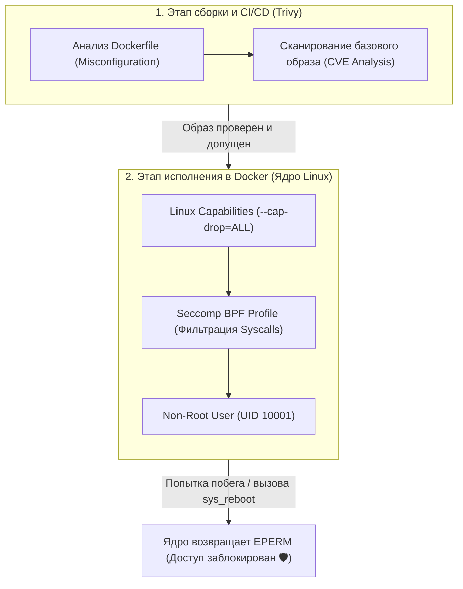
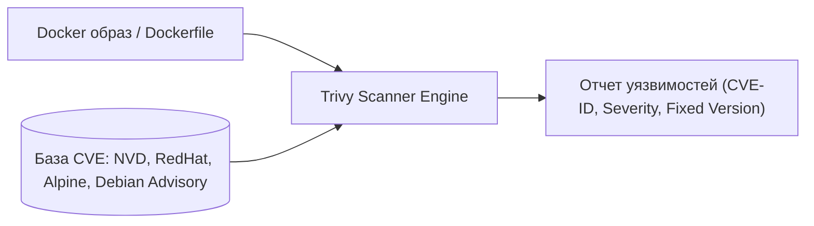

# Харденинг Docker: Seccomp-профили, Capabilities и сканирование уязвимостей Trivy

Даже если контейнер запущен от непривилегированного пользователя (Non-Root) и изолирован пространствами имен (Namespaces), он продолжает делить общее ядро операционной системы с хостом. В ядре Linux доступно свыше **450 системных вызовов (syscalls)**. Если в коде ядра (например, в подсистемах `io_uring`, `bpf` или устаревших драйверах) обнаружится уязвимость нулевого дня (0-day), злоумышленник сможет совершить побег из контейнера (Container Escape) и получить полный контроль над хост-системой.

Для построения глубоко эшелонированной обороны (Defense in Depth) в Docker применяются три взаимодополняющих инструмента:
1. **Linux Capabilities:** декомпозиция суперпользователя `root` на узкие гранулированные полномочия.
2. **Seccomp (Secure Computing Mode):** фильтрация и белый список системных вызовов ядра на базе BPF-программ.
3. **Trivy Vulnerability Scanner:** статический и динамический аудит базовых образов, пакетов ОС и файлов конфигураций на наличие известных CVE.

---

## 1. Эшелонированная архитектура безопасности контейнеров



---

## 2. Linux Capabilities: Принцип наименьших привилегий

В классической модели Unix права суперпользователя монолитны: если процесс имеет `UID 0`, ему разрешено всё. Начиная с ядра 2.2, Linux разделил права суперпользователя примерно на **40 независимых битовых привилегий (Capabilities)**.

### Опасные Capabilities, которые нельзя давать контейнерам:

| Capability | Что позволяет делать | Риск при компрометации сервиса |
|---|---|---|
| **`CAP_SYS_ADMIN`** | Монтирование FS, управление Cgroups, пространствами имен, загрузка BPF | **Критический**: эквивалентен полному контролю над сервером хоста |
| **`CAP_SYS_PTRACE`** | Вызов отладки `ptrace(2)` чужих процессов | Чтение оперативной памяти и инъекция shell-кода в соседние контейнеры |
| **`CAP_NET_ADMIN`** | Настройка IP-адресов, таблиц маршрутизации, правил `iptables` | Подмена и перехват трафика соседних сервисов (Man-In-The-Middle) |
| **`CAP_NET_RAW`** | Создание сырых сокетов (Raw Sockets), отправка произвольных пакетов | ARP-спуфинг, сканирование внутренней сети |

### Production-стандарт: сброс всех прав с точечным добавлением

В продакшене рекомендуется всегда использовать связку `--cap-drop=ALL` и добавлять только те привилегии, которые действительно необходимы для работы приложения:

```bash
# Пример: Запуск веб-сервера с правом слушать привилегированный порт 80 (CAP_NET_BIND_SERVICE)
docker run -d --name secure-nginx \
  --cap-drop=ALL \
  --cap-add=NET_BIND_SERVICE \
  -p 80:80 \
  nginx:alpine
```

### Настройка в `docker-compose.yml`:

```yaml
services:
  web-api:
    image: my-company/api:v1.0
    cap_drop:
      - ALL
    cap_add:
      - NET_BIND_SERVICE
    read_only: true
    user: "10001:10001"
```

> [!NOTE]
> Если сервис слушает порт выше 1024 (например, 8080 или 3000), ему **вообще не требуется** привилегия `NET_BIND_SERVICE` — контейнер может успешно работать с полностью пустым набором `cap_drop: [ALL]`.

---

## 3. Seccomp: Фильтрация системных вызовов ядра

**Seccomp (Secure Computing Mode)** — механизм ядра Linux, позволяющий перехватывать системные вызовы процесса с помощью BPF-фильтра еще до того, как ядро начнет их обрабатывать.

По умолчанию Docker применяет встроенный профиль безопасности (`default.json`), который блокирует примерно **44 системных вызова из 450+** (например, `reboot`, `swapon`, `sysfs`, `clone3`, `bpf`).

### Применение кастомного профиля Seccomp:

Вы можете создать строгий профиль `strict-profile.json`, разрешающий только базовый ввод-вывод (`read`, `write`, `exit`, `futex`, `epoll_wait`):

```bash
docker run -d --name ultra-secure-app \
  --security-opt seccomp=/etc/docker/seccomp-profiles/strict.json \
  app:v1
```

### Структура Seccomp JSON-профиля:

```json
{
  "defaultAction": "SCMP_ACT_ERRNO",
  "architectures": [
    "SCMP_ARCH_X86_64",
    "SCMP_ARCH_AARCH64"
  ],
  "syscalls": [
    {
      "names": [
        "read",
        "write",
        "openat",
        "close",
        "fstat",
        "epoll_pwait",
        "nanosleep",
        "exit_group"
      ],
      "action": "SCMP_ACT_ALLOW"
    }
  ]
}
```

* Поле `defaultAction: SCMP_ACT_ERRNO` указывает ядру отклонять любые системные вызовы, не входящие в белый список, возвращая ошибку `EPERM`.

---

## 4. Trivy: Сканирование образов и Dockerfile на уязвимости

**Trivy** (разработка Aqua Security) — промышленный стандарт сканирования контейнеров, образов, файлов зависимостей и манипуляций инфраструктуры как кода (IaC).



### Быстрая установка Trivy:
```bash
# Для Ubuntu / Debian:
sudo apt-get install wget apt-transport-https gnupg lsb-release
wget -qO - https://aquasecurity.github.io/trivy-repo/deb/public.key | sudo apt-key add -
echo deb https://aquasecurity.github.io/trivy-repo/deb $(lsb_release -sc) main | sudo tee -a /etc/apt/sources.list.d/trivy.list
sudo apt-get update && sudo apt-get install trivy
```

### Команды сканирования в повседневной практике:

#### 1. Сканирование Docker-образа на уязвимости ОС и библиотек:
```bash
trivy image --severity HIGH,CRITICAL nginx:1.25
```

#### 2. Фильтрация только тех CVE, для которых уже выпущен патч (`--ignore-unfixed`):
```bash
trivy image --severity HIGH,CRITICAL --ignore-unfixed python:3.11-slim
```

#### 3. Аудит конфигурации Dockerfile на соответствие лучшим практикам (Misconfiguration):
```bash
trivy config ./Dockerfile
```
Trivy укажет на такие ошибки, как отсутствие директивы `USER`, использование флага `:latest`, небезопасное хранение секретов и использование привилегированных портов.

---

## 5. Встраивание Trivy в CI/CD (GitHub Actions / GitLab CI)

Для того чтобы уязвимый образ не попал в Docker Hub или на продакшн-сервер, проверку включают в Quality Gate пайплайна с параметром `--exit-code 1`:

```yaml
# Пример шага в .github/workflows/security.yml
- name: Аудит безопасности образа через Trivy
  uses: aquasecurity/trivy-action@master
  with:
    image-ref: 'ghcr.io/my-org/my-app:${{ github.sha }}'
    format: 'table'
    exit-code: '1' # Прерывать сборку при наличии критических CVE
    ignore-unfixed: true
    severity: 'CRITICAL,HIGH'
```

Если в образе обнаружен критический эксплойт с готовым исправлением, сборка немедленно завершится с ошибкой, а релиз будет заблокирован.

---

## 6. Вопросы для самопроверки

<details>
<summary>Вопрос 1: Зачем указывать --cap-drop=ALL, если контейнер уже запущен не от root (UID 10001)?</summary>
<div class="mt-2 text-body">
Принцип эшелонированной обороны (Defense in Depth). Если злоумышленник сможет повысить локальные привилегии внутри контейнера (например, через SUID-бинарник или баг ядра), сброшенные Capabilities гарантируют, что даже при получении UID 0 процесс останется без системных прав: он не сможет смонтировать файловую систему (CAP_SYS_ADMIN), модифицировать сетевой стек или отладить чужие процессы.
</div>
</details>

<details>
<summary>Вопрос 2: В чем разница между Seccomp и Linux Capabilities?</summary>
<div class="mt-2 text-body">
<b>Capabilities</b> проверяются ядром при попытке выполнения привилегированных действий в рамках разрешений пользователя (например, биндинг порта 80, сброс квот).<br>
<b>Seccomp</b> работает на более низком уровне: он перехватывает <b>любые системные вызовы (syscalls)</b> на входе в ядро. Seccomp может запретить даже непривилегированные вызовы (например, <code>sys_ptrace</code>, <code>clone3</code> или <code>io_uring_setup</code>), блокируя эксплуатацию уязвимостей нулевого дня ядра.
</div>
</details>

<details>
<summary>Вопрос 3: Зачем в Trivy передавать флаг --ignore-unfixed при проверке в CI/CD?</summary>
<div class="mt-2 text-body">
Без этого флага сборка в CI/CD будет падать из-за уязвимостей, для которых мейнтенеры дистрибутива еще не выпустили обновленный пакет с исправлением (No Fix Available). Флаг <code>--ignore-unfixed</code> оставляет в отчете только те проблемы, которые разработчик реально может и обязан устранить обновлением базового образа или библиотеки.
</div>
</details>

---

## 7. Дополнительные материалы и следующие шаги

* [Модуль 6.1: Non-Root пользователи, Read-Only rootfs и tmpfs](/courses/docker-security/01-container-security-and-hardening)
* [Модуль 6.3: Безопасность цепочки поставок: Trivy SBOM и подпись Cosign](/courses/docker-security/03-trivy-sbom-and-cosign-signing)
* [Низкоуровневая изоляция ядра: Seccomp BPF и eBPF трассировка](/courses/internals/05-seccomp-capabilities-and-ebpf-tracing)
