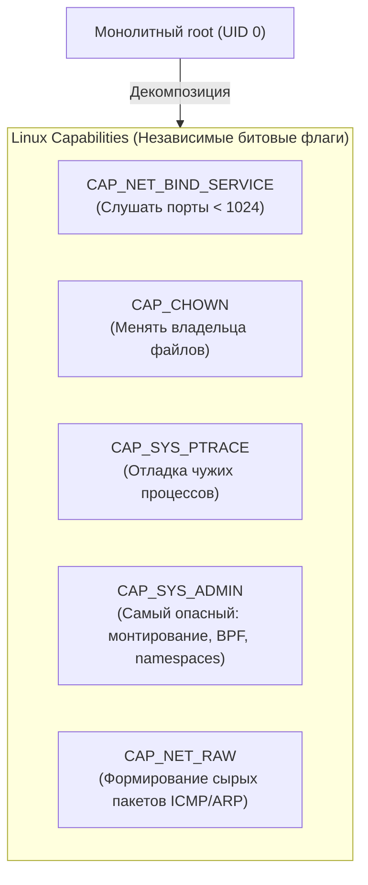
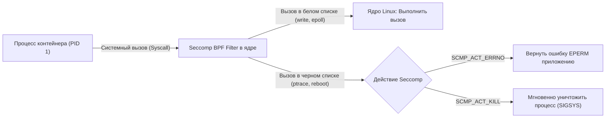
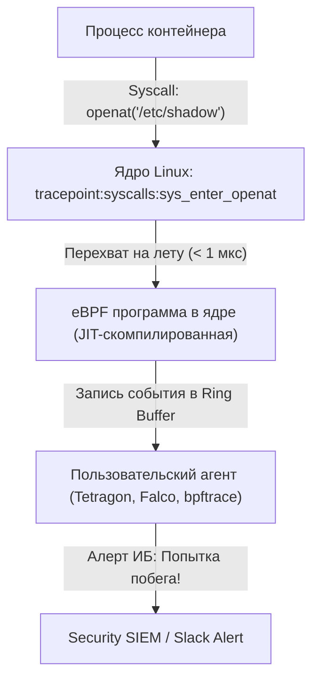

# Харденинг и аудит ядра: Seccomp BPF, Capabilities и трассировка через eBPF

Даже если контейнер запущен в отдельных пространствах имен (Namespaces) и ограничен по ресурсам (Cgroups v2), он продолжает делить единое ядро операционной системы с хостом.

В ядре Linux существует более **450 системных вызовов**. Если злоумышленник сможет эксплуатировать уязвимость в малоиспользуемом системном вызове ядра (например, в подсистеме io_uring, bpf или старых драйверах), он сможет совершить побег на хост.

Чтобы сделать контейнер по-настоящему неуязвимым и уметь расследовать подозрительное поведение в продакшене, применяются три передовые технологии ядра:
1. **Linux Capabilities**: декомпозиция суперпользователя `root` на узкие привилегии.
2. **Seccomp (Secure Computing Mode) с BPF-фильтрами**: жесткий белый список разрешенных системных вызовов.
3. **eBPF (Extended Berkeley Packet Filter)**: трассировка и мониторинг активности процессов в ядре без накладных расходов.

---

## 1. Linux Capabilities: Конец эпохи монолитного Root

Исторически модель безопасности Unix была бинарной:
* **UID > 0**: обычный непривилегированный пользователь (не может ничего системного).
* **UID 0 (`root`)**: всемогущий суперпользователь, способный менять память ядра, настраивать маршруты и стирать диски.

Для устранения этого риска ядро Linux разделило привилегии `root` примерно на **40 атомарных привилегий (Capabilities)**:



### Ключевые Capabilities и их угрозы:

| Capability | Что разрешает | Риск при компрометации |
|---|---|---|
| **`CAP_SYS_ADMIN`** | Монтирование FS, управление cgroups, настройка пространств имен | **Критический**: эквивалентен полному контролю над хостом (почти 30% всех проверок ядра) |
| **`CAP_SYS_PTRACE`** | Вызов `ptrace(2)` к другим процессам | Чтение оперативной памяти и инъекция shell-кода в соседние процессы |
| **`CAP_NET_ADMIN`** | Настройка IP-адресов, таблиц маршрутизации, iptables/nftables | Перехват и подмена трафика других контейнеров |
| **`CAP_NET_RAW`** | Создание сырых сетевых сокетов (Raw Sockets), утилита `ping` | ARP-спуфинг, сканирование сети |
| **`CAP_NET_BIND_SERVICE`** | Привязка сокетов к привилегированным портам (например, 80, 443) | Безопасная привилегия для веб-серверов |

### Production-стандарт: Принцип наименьших привилегий

В продакшене всегда сбрасывайте все привилегии и добавляйте только те, без которых сервис не может работать:

```bash
# Пример запуска Nginx только с правом биндить порт 80:
docker run -d \
  --name web \
  --cap-drop=ALL \
  --cap-add=NET_BIND_SERVICE \
  -p 80:80 \
  nginx:alpine
```
Даже если злоумышленник получит RCE (выполнение удаленного кода) внутри Nginx с правами UID 0, он не сможет выполнить `mount`, изменить владельца файлов или прослушать чужие процессы, так как ядро вернет ошибку `EPERM` на уровне проверки Capabilities!

---

## 2. Seccomp (Secure Computing Mode) BPF: Фильтрация системных вызовов

Если Capabilities проверяют права на уровне высокоуровневых операций ядра, то **Seccomp** работает на самом глубоком рубеже: он перехватывает **каждый системный вызов** процесса на входе в ядро.



### Дефолтный профиль Seccomp
И Docker, и Podman по умолчанию применяют встроенный JSON-профиль Seccomp. Из 450+ системных вызовов ядра они блокируют около 45 потенциально опасных:
* `sys_ptrace` — запрет отладки соседних процессов.
* `sys_reboot` — запрет перезагрузки сервера.
* `sys_kexec_load` — запрет загрузки нового ядра хоста.
* `sys_init_module` / `finit_module` — запрет загрузки kernel modules на хост.

### Практикум: Создание кастомного Seccomp профиля

Создадим профиль `block-mkdir.json`, запрещающий контейнеру создавать директории:

```json
{
  "defaultAction": "SCMP_ACT_ALLOW",
  "syscalls": [
    {
      "names": [ "mkdir", "mkdirat" ],
      "action": "SCMP_ACT_ERRNO",
      "errnoRet": 1
    }
  ]
}
```

Запустим контейнер с этим профилем:
```bash
docker run --rm -it \
  --security-opt seccomp=block-mkdir.json \
  alpine:latest sh
```

Внутри контейнера пробуем создать папку:
```text
/ # mkdir test_dir
mkdir: can't create directory 'test_dir': Operation not permitted
```
Ядро заблокировало системный вызов `mkdirat` мгновенно, вернув код ошибки `1` (EPERM), хотя мы находились под пользователем `root`!

---

## 3. Наблюдаемость и трассировка: `strace` против eBPF

Когда контейнер неожиданно завершается с ошибкой или ведет себя подозрительно, инженеру требуется увидеть, что именно он запрашивает у ядра.

### Исторический инструмент: `strace`
```bash
sudo strace -p <CONTAINER_PID> -f -e trace=openat,connect,clone
```
Проблема `strace`: он использует вызов `ptrace(2)`. На каждый системный вызов ядро вынуждено останавливать выполнение потока контейнера, переключать контекст в процесс `strace` и ждать подтверждения. Производительность приложения **падает на 80–95%**, что делает `strace` категорически неприменимым на высоконагруженном проде!

---

### Современный стандарт: eBPF (Extended Berkeley Packet Filter)

**eBPF** позволяет запускать пользовательские программы безопасности и трассировки прямо внутри ядра Linux без модификации исходного кода ядра и без остановки процессов.

Нагрузка на CPU составляет **менее 1%**, что позволяет мониторить миллионы вызовов в секунду.



### Практикум: Трассировка вызовов контейнера с помощью `bpftrace`

Если на сервере установлена утилита `bpftrace`, мы можем перехватывать системные вызовы конкретного контейнера по его PID:

```bash
# Отслеживаем все новые процессы (execve), запускаемые контейнером с PID 12345
sudo bpftrace -e 'tracepoint:syscalls:sys_enter_execve /pid == 12345/ { printf("EXEC: %s\n", str(args->filename)); }'
```

### Защита уровня Enterprise: Cilium Tetragon и Falco
Современные инструменты Runtime Security (Tetragon от Isovalent, Falco от CNCF) используют eBPF для:
1. Мгновенного обнаружения чтения файлов авторизации (`/etc/shadow`, Kubernetes ServiceAccount tokens).
2. Обнаружения реверс-шеллов (`bash -i >& /dev/tcp/...`).
3. Пресечения побега из контейнера путем принудительного завершения процесса на уровне ядра в наносекунды (In-Kernel Enforcement).

---

## 4. Итоговая матрица безопасности ядра

| Уровень защиты | Технология ядра | За что отвечает | Инструмент настройки |
|---|---|---|---|
| **Видимость** | **Namespaces** | Изоляция дерева процессов, сети, корня | `clone`, `unshare`, `nsenter` |
| **Ресурсы** | **Cgroups v2** | Защита от OOM, CPU Starvation, Fork-bomb | `/sys/fs/cgroup/` (`memory.max`, `pids.max`) |
| **Привилегии** | **Capabilities** | Дробление root на 40 флагов | `--cap-drop=ALL --cap-add=...` |
| **Системные вызовы** | **Seccomp BPF** | Белый список допустимых syscalls | `--security-opt seccomp=...` |
| **Обязательный контроль** | **SELinux / AppArmor** | Политики доступа к файлам и сокетам | `:Z`, `:z`, `--security-opt apparmor=...` |
| **Аудит и детекция** | **eBPF** | Мониторинг ядра в реальном времени | `bpftrace`, Falco, Tetragon |

---

## Резюме трека Container Internals

1. Контейнер — это не отдельный виртуальный компьютер, а обычный процесс Linux, огражденный со всех сторон механизмами ядра.
2. **Namespaces** создают изолированный кругозор, а **Cgroups v2** не позволяют процессу исчерпать ресурсы хоста.
3. Системный вызов **`pivot_root(2)`** обеспечивает герметичную файловую изоляцию, исключая уязвимости побега из `chroot`.
4. Спецификация **OCI** объединяет индустрию, разделяя высокоуровневую оркестрацию и сверхбыстрые низкоуровневые движки вроде **`crun`**.
5. Комбинация **Capabilities Drop**, **Seccomp BPF** и **eBPF трассировки** формирует эталонную эшелонированную безопасность (Defense in Depth) для любого критического продакшена.
