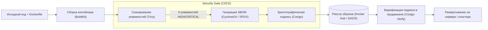

# Безопасность цепочки поставок (Supply Chain): Сканирование Trivy, генерация SBOM и подпись образов Cosign

В современной корпоративной разработке более **85% кодовой базы контейнера составляют сторонние зависимости**: пакеты базовой операционной системы (glibc, openssl, busybox) и библиотеки приложения (npm, pip, go modules, maven).

Даже если в вашем собственном коде нет ни одной уязвимости, уязвимость в транзитивной зависимости (например, Log4Shell или компрометация open-source пакета) дает злоумышленнику прямой доступ к инфраструктуре.

В этом уроке мы разберем стандарты **Supply Chain Security**:
1. Сканирование образов и Dockerfile с помощью **Trivy**.
2. Создание цифрового паспорта безопасности (**SBOM** — Software Bill of Materials).
3. Криптографическую подпись и верификацию образов через **Sigstore Cosign**.

---

## 1. Пайплайн сквозной безопасности контейнеров



---

## 2. Автоматизированное сканирование уязвимостей с Trivy

**Trivy** от компании Aqua Security — золотой стандарт сканирования контейнеров. Он умеет анализировать:
* Пакеты операционной системы (Alpine, Debian, Red Hat, Ubuntu).
* Зависимости языков программирования (Go, Node.js, Python, Java, Rust).
* Ошибки конфигурации Dockerfile и Docker Compose (IaC Misconfigurations).
* Случайно закоммиченные секреты (токены, пароли, приватные ключи).

### Основные команды для локального аудита:

```bash
# 1. Быстрое сканирование локального образа на критические уязвимости:
trivy image --severity HIGH,CRITICAL --ignore-unfixed my-app:latest

# 2. Проверка Dockerfile на ошибки конфигурации (non-root, healthcheck и т.д.):
trivy config Dockerfile

# 3. Сканирование исходного кода на наличие забытых паролей и API-токенов:
trivy fs --scanners secret .
```

> [!TIP]
> Флаг `--ignore-unfixed` скрывает уязвимости, для которых мэйнтейнеры пакетов еще не выпустили патч. Это предотвращает ложные блокировки пайплайнов из-за проблем, которые разработчик физически не может исправить сам.

---

## 3. Генерация SBOM (Software Bill of Materials)

**SBOM (паспорт программного обеспечения)** — это структурированный машиночитаемый список всех компонентов, библиотек, хэш-сумм и лицензий, вошедших в ваш Docker-образ. В государственных и корпоративных стандартах (NIST, ISO 27001, директивы ЕС и США) поставка SBOM является обязательным требованием.

Trivy позволяет генерировать SBOM в международных форматах **CycloneDX** и **SPDX**:

```bash
# Генерация SBOM в формате CycloneDX JSON:
trivy image --format cyclonedx --output sbom.json my-app:latest

# Генерация SBOM в стандарте SPDX:
trivy image --format spdx-json --output sbom-spdx.json my-app:latest
```

Полученный JSON можно передавать в системы аудита зависимостей (Dependency-Track, Snyk) для постоянного фонового мониторинга новых уязвимостей без необходимости пересканировать сам образ.

---

## 4. Криптографическая подпись образов через Sigstore Cosign

Как сервер на продакшене может быть уверен, что скачиваемый образ `my-app:latest` был собран именно вашим доверенным CI/CD пайплайном, а не подменен злоумышленником при атаке Man-in-the-Middle или компрометации учетной записи реестра?

Для этого используется утилита **Cosign**: она подписывает хэш-сумму (digest) манифеста образа закрытым ключом или через OIDC-токен (Keyless-подпись).

### Шаг 1: Генерация пары ключей:
```bash
cosign generate-key-pair
# Создаются два файла: cosign.key (закрытый ключ) и cosign.pub (открытый ключ)
```

### Шаг 2: Подпись образа в CI/CD:
```bash
# Подписываем образ по его неизменяемому digest:
cosign sign --key cosign.key andreyvorobevaqa/portfolio-service@sha256:7862fa37afdf...
```
Сигнатура подписи сохраняется прямо в реестре контейнеров рядом с образом как специальный OCI-артефакт.

### Шаг 3: Верификация перед запуском на VDS:
```bash
cosign verify --key cosign.pub andreyvorobevaqa/portfolio-service:latest
```
Если образ был изменен хотя бы на один байт, проверка завершится с ошибкой, и контейнер не будет запущен.

---

## 5. Интеграция в GitHub Actions (Shift-Left Pipeline)

Ниже приведен готовый боевой шаг для CI/CD:

```yaml
- name: Scan with Trivy (Security Gate)
  uses: aquasecurity/trivy-action@v0.36.0
  with:
    image-ref: 'my-app:local-test'
    format: 'table'
    exit-code: '1'
    ignore-unfixed: true
    severity: 'CRITICAL,HIGH'

- name: Generate CycloneDX SBOM
  uses: aquasecurity/trivy-action@v0.36.0
  with:
    image-ref: 'my-app:local-test'
    format: 'cyclonedx'
    output: 'sbom.json'

- name: Upload SBOM Artifact
  uses: actions/upload-artifact@v4
  with:
    name: container-sbom
    path: sbom.json
```

---

## 6. Лабораторная самопроверка

<details>
<summary>Вопрос 1: Почему сканирование контейнеров необходимо выполнять ДО публикации в Docker Hub?</summary>
<div class="mt-2 text-body">
<p><strong>Ответ:</strong> Это базовый принцип <em>Shift-Left Security</em>. Если образ сначала публикуется, а затем сканируется, скомпрометированный или уязвимый артефакт с тегом <code>:latest</code> мгновенно становится доступен для скачивания на сервера или внешними пользователями. Сканирование должно выступать строгим гейтом (Quality/Security Gate), блокирующим публикацию при нахождении опасных CVE.</p>
</div>
</details>

<details>
<summary>Вопрос 2: В чем ценность файла SBOM для специалистов по безопасности (ИБ)?</summary>
<div class="mt-2 text-body">
<p><strong>Ответ:</strong> Когда в мире обнаруживается уязвимость нулевого дня (0-day), команде ИБ не нужно скачивать и исследовать сотни запущенных контейнеров. Достаточно сделать поиск по базе SBOM-паспортов, чтобы за секунды определить, какие именно сервисы используют уязвимую версию библиотеки.</p>
</div>
</details>

<details>
<summary>Вопрос 3: Защищает ли подпись Cosign от запуска контейнера с измененным кодом?</summary>
<div class="mt-2 text-body">
<p><strong>Ответ:</strong> Да. Cosign подписывает криптографический SHA-256 дайджест манифеста всех слоев образа. Если злоумышленник внедрит вредоносный код или перезапишет тег образа в реестре, дайджест изменится, и команда <code>cosign verify</code> вернет ошибку проверки цифровой подписи.</p>
</div>
</details>
