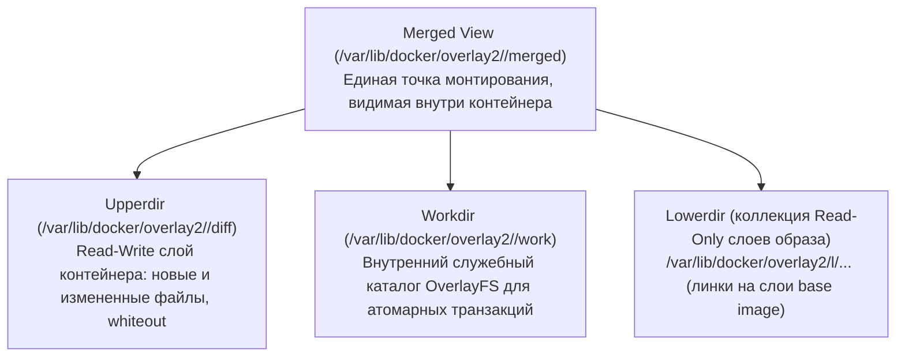

# Урок 8: Драйверы хранилища (Storage Drivers) и Copy-on-Write: Overlay2, d_type и устройство /var/lib/docker

Понимание работы файловых систем и механизмов Copy-on-Write (CoW) — критический навык для инженера при траблшутинге переполнения дисков, деградации производительности дискового I/O базы данных и утечек слоев в highload production.

---

### 1. Концептуальные основы и теория (Core Architecture & Theory)

В отличие от виртуальных машин, где каждый инстанс держит виртуальный диск фиксированного размера (`.qcow2`, `.vmdk`), контейнеры Docker разделяют слои базового образа в режиме **Read-Only**, накладывая поверх тонкий рабочий слой контейнера (**Read-Write Container Layer**).

#### Принцип Copy-on-Write (CoW):
* **Чтение (Read)**: если файл не модифицировался контейнером, он читается напрямую из нижнего неизменяемого слоя образа (`lowerdir`). Затраты оперативной памяти и задержки чтения стремятся к нулю благодаря кэшу страниц ядра (Page Cache).
* **Модификация (Write / Modify)**: когда процесс внутри контейнера впервые пытается изменить файл из образа, драйвер хранилища копирует этот файл целиком из `lowerdir` в верхний слой контейнера (`upperdir`). Эта операция называется **Copy-up**. Только после завершения копирования вносятся изменения.
* **Удаление (Delete)**: если файл из `lowerdir` удаляется в контейнере, физически файл из образа не стирается (образ Read-Only). Вместо этого в `upperdir` создается специальный файл-заглушка типа **whiteout** (символьное устройство с мажором и минором 0/0), который скрывает файл при монтировании.



#### Сравнение драйверов хранилища в Linux:
| Драйвер | Базовая ФС | Плюсы | Минусы | Production-статус |
|:---|:---|:---|:---|:---|
| **`overlay2`** | `ext4` / `xfs` (с `ftype=1`) | Высокая скорость, низкое потребление RAM (shared Page Cache), поддержка ядром Linux | Задержки при copy-up огромных файлов (напр. 50GB DB dump) | **Стандарт де-факто (Recommended)** |
| **`btrfs` / `zfs`** | Нативные пулы Btrfs/ZFS | Моментальные subvolume snapshots, CoW на уровне блоков диска, квоты | Высокое потребление памяти ARC/RAM, фрагментация | Специализированные окружения |
| **`vfs`** | Любая ФС | Максимальная надежность, отсутствие требований к ФС | Нет CoW (полное копирование каждого слоя на диск), катастрофический расход диска | Только для отладки и testing |

#### Роль `d_type` (Directory Entry Type) в XFS:
Драйвер `overlay2` требует, чтобы базовая файловая система поддерживала `d_type` (хранение типа файла прямо в метаданных директории). Если базовая ОС развернута на `XFS` без флага `ftype=1` (стандартное поведение старых CentOS/RHEL 7), демон Docker аварийно завершит работу:
```
overlay2: the backing xfs filesystem is formatted without d_type support.
```

---

### 2. Конфигурация и анатомия файлов (Configuration & File Anatomy)

Конфигурация параметров подсистемы хранения Docker задается в `/etc/docker/daemon.json`.

#### Пример production-конфигурации `/etc/docker/daemon.json`:
```json
{
  "storage-driver": "overlay2",
  "storage-opts": [
    "overlay2.override_kernel_check=true",
    "overlay2.size=20G"
  ],
  "data-root": "/var/lib/docker",
  "log-driver": "json-file",
  "log-opts": {
    "max-size": "10m",
    "max-file": "3"
  }
}
```

#### Разбор параметров хранилища:
* `"storage-driver": "overlay2"` — принудительная фиксация драйвера `overlay2` (предотвращает случайный откат на `vfs` при системных сбоях ядра).
* `"overlay2.size=20G"` — ограничение максимального размера слоя контейнера (квота). Работает только если `/var/lib/docker` смонтирован на `XFS` с включенными квотами проекта (`pquota`) или `ext4` с project quota support.
* `"data-root": "/var/lib/docker"` — корневой каталог всех образов, контейнеров и томов. При нехватке места на корневом разделе `/` этот путь переносят на выделенный высокоскоростной NVMe/LVM том (например, `/mnt/fast-storage/docker`).

---

### 3. Лабораторная практика в терминале (Hands-on Terminal Lab)

В этой лабораторной работе мы изучим физическое устройство каталога `/var/lib/docker/overlay2`, увидим операцию Copy-up в реальном времени и проверим механизм whiteout.

#### Шаг 1. Проверка текущего драйвера хранилища и поддержки `d_type`
Выполните инспекцию демона Docker:
```bash
# Проверяем параметры Driver, Backing Filesystem и d_type
docker info --format 'Driver: {{.Driver}} | Backing Filesystem: {{.DriverStatus}}'
```
Убедитесь, что вывод содержит:
```text
Driver: overlay2 | Backing Filesystem: [[Backing Filesystem extfs] [Supports d_type true] [Using metacopy true]]
```

#### Шаг 2. Создание изолированного контейнера и поиск его слоев в хост-системе
Запустите тестовый контейнер в фоновом режиме:
```bash
# Запускаем легковесный контейнер alpine
CONTAINER_ID=$(docker run -d --name lab-overlay-demo alpine:3.21 sleep 3600)
echo "Container ID: $CONTAINER_ID"

# Получаем абсолютные пути overlay2 монтирования контейнера
docker inspect $CONTAINER_ID --format '
MergedDir: {{.GraphDriver.Data.MergedDir}}
UpperDir:  {{.GraphDriver.Data.UpperDir}}
WorkDir:   {{.GraphDriver.Data.WorkDir}}
LowerDir:  {{.GraphDriver.Data.LowerDir}}'
```

#### Шаг 3. Демонстрация CoW: создание и модификация файла
Проверим содержимое `UpperDir` до и после изменений:
```bash
# Получаем переменную пути UpperDir
UPPER_DIR=$(docker inspect $CONTAINER_ID --format '{{.GraphDriver.Data.UpperDir}}')

# Проверяем: изначально upperdir пустой (или содержит только служебные инициализированные файлы)
sudo ls -la "$UPPER_DIR"

# 1. Создаем НОВЫЙ файл внутри контейнера
docker exec $CONTAINER_ID sh -c 'echo "Created in Container" > /root/newfile.txt'

# 2. Модифицируем СУЩЕСТВУЮЩИЙ файл из базового слоя alpine (/etc/issue)
docker exec $CONTAINER_ID sh -c 'echo "MODIFIED BY DEV" >> /etc/issue'

# Проверяем physical UpperDir на хосте:
sudo ls -la "$UPPER_DIR/root"
sudo cat "$UPPER_DIR/etc/issue"
```
Файл `/etc/issue` был скопирован из Read-Only слоя `lowerdir` в `upperdir` хоста, и только затем модифицирован!

#### Шаг 4. Демонстрация Whiteout: удаление файла из базового слоя
Удалим системный файл `/etc/hosts` внутри контейнера:
```bash
# Удаляем файл из контейнера
docker exec $CONTAINER_ID rm /etc/alpine-release

# Проверяем, что появилось в UpperDir на хосте:
sudo ls -l "$UPPER_DIR/etc/alpine-release"
```
Вывод покажет символьное устройство с мажором `0, 0` (whiteout маркер):
```text
c--------- 1 root root 0, 0 Nov 18 02:45 /var/lib/docker/overlay2/<id>/diff/etc/alpine-release
```
Файл в базовом образе остался нетронутым, но для контейнера через слой `MergedDir` он стал невидимым.

#### Шаг 5. Очистка ресурсов
```bash
docker rm -f lab-overlay-demo
```

---

### 4. Проверка и отладка (Verification & Diagnostics)

Типичные проблемы и команды диагностики при сбоях дисковой подсистемы Docker:

#### 1. Анализ расхода дискового пространства:
```bash
# Сводный отчет по типам объектов (Images, Containers, Local Volumes, Build Cache)
docker system df -v
```

#### 2. Поиск контейнеров с раздутым `upperdir` (утечка логов или временных файлов):
```bash
# Сортировка контейнеров по размеру их записываемого слоя (SIZE)
docker ps -s --format "table {{.ID}}\t{{.Names}}\t{{.Size}}"
```
> [!WARNING]
> Если размер контейнера в колонке `SIZE` показывает сотни гигабайт (например `54GB (virtual 54.1GB)`), это означает, что приложение пишет данные (логи, кэш, базы данных) мимо Docker Volume прямо в файловую систему контейнера. Это создает огромную нагрузку на CoW-драйвер ядра и может привести к зависанию I/O.

#### 3. Безопасная очистка зависших слоев и кэша сборщика BuildKit:
```bash
# Очистка неиспользуемых контейнеров, сетей и dangling образов
docker system prune -f

# Очистка кэша сборки BuildKit (часто занимает десятки гигабайт)
docker builder prune -a -f --keep-storage 5GB
```
