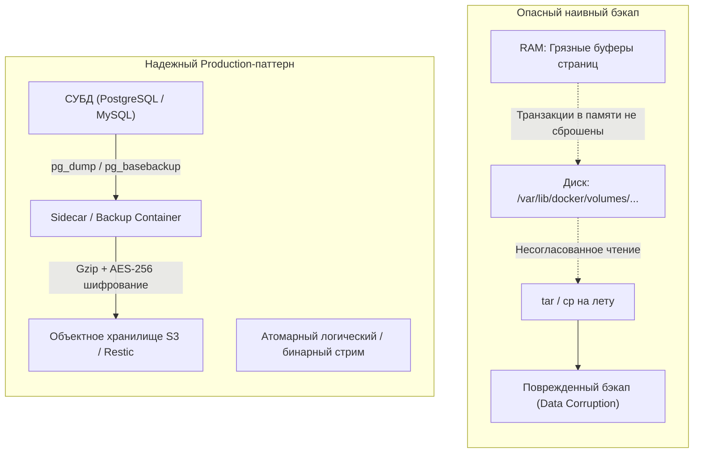
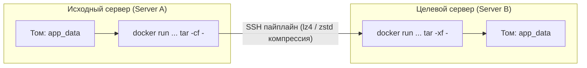

# Резервное копирование, восстановление и миграция томов в Production

В продакшн-инфраструктуре состояние приложений (State) — самая уязвимая и ценная часть системы. Вычислительные контейнеры можно перезапустить или пересоздать за секунды, но повреждение или утрата тома с базой данных (PostgreSQL, MySQL, Redis) или пользовательскими файлами грозит катастрофой для бизнеса.

В этом уроке мы разберем инженерные паттерны резервного копирования Docker-томов: от логических sidecar-дампов до атомарного переноса данных между серверами и шифрованного бэкапа в S3.

---

## 1. Главная иллюзия: почему нельзя просто скопировать `/var/lib/docker/volumes`

Начинающие администраторы часто пытаются сделать бэкап базы данных простой командой:
```bash
# ОПАСНО! ПРИВЕДЕТ К НЕВОССТАНОВИМОЙ КОРРУПЦИИ ДАННЫХ
cp -r /var/lib/docker/volumes/postgres_data/_data /backup/
```

### В чем физическая опасность такого подхода?
1. **Грязные страницы в Shared Buffers:** СУБД держит измененные страницы таблиц и индексов в оперативной памяти (Shared Memory). На диск они сбрасываются асинхронно фоновым процессом Checkpointer.
2. **Рассинхронизация WAL (Write-Ahead Logging):** пока команда `cp` или `tar` последовательно читает гигабайты файлов таблиц, СУБД продолжает записывать новые транзакции. В итоге начало архива содержит состояние на время $T_0$, а конец — на время $T_0 + 60\text{с}$. Такой бэкап при попытке запуска выдаст ошибку `PANIC: could not locate a valid checkpoint record`.
3. **Права доступа и расширенные атрибуты:** прямое копирование может исказить числовые UID/GID (`999:999` для postgres), сделав запуск нового контейнера невозможным.



---

## 2. Паттерн 1: Логический Sidecar-бэкап базы данных

Для СУБД самым надежным способом создания бэкапа на лету (без остановки сервиса) является обращение через внутреннюю сеть к СУБД и снятие согласованного логического дампа.

### Реализация бэкапа PostgreSQL через одноразовый контейнер:
```bash
#!/usr/bin/env bash
set -Eeuo pipefail

BACKUP_DIR="/opt/backups/postgres"
DATE=$(date +"%Y%m%d_%H%M%S")
FILENAME="db_backup_${DATE}.sql.gz"

mkdir -p "$BACKUP_DIR"

echo "==> Создание атомарного дампа базы данных..."
docker run --rm \
  --network myapp-backend-net \
  -e PGPASSWORD="SuperSecretPassword" \
  postgres:16-alpine \
  pg_dump -h db -U appuser -d mydatabase --no-owner --clean --if-exists \
  | gzip -9 > "${BACKUP_DIR}/${FILENAME}"

echo "==> Бэкап успешно создан: ${BACKUP_DIR}/${FILENAME} ($(du -h "${BACKUP_DIR}/${FILENAME}" | cut -f1))"

# Ротация: удаляем дампы старше 14 дней
find "$BACKUP_DIR" -type f -name "db_backup_*.sql.gz" -mtime +14 -delete
```

### Восстановление логического дампа в новый том:
```bash
# 1. Запуск свежего инстанса базы данных
docker compose up -d db

# 2. Ожидание прохождения проверки здоровья (healthcheck)
docker compose exec db pg_isready -U appuser -d mydatabase

# 3. Потоковая накатка дампа
gunzip -c "${BACKUP_DIR}/${FILENAME}" | docker exec -i myapp_db_1 psql -U appuser -d mydatabase
```

---

## 3. Паттерн 2: Атомарный бэкап тома файловой системы (Sidecar Tar)

Если в томе хранятся не СУБД, а статические медиа-файлы, загрузки пользователей или документы, для их архивации используется вспомогательный sidecar-контейнер с флагом `--volumes-from` или прямым монтированием тома в режиме `ro` (Read-Only):

```bash
# Создание сжатого архива тома в фоновом режиме:
docker run --rm \
  -v myapp_media_data:/source:ro \
  -v /opt/backups/volumes:/target \
  alpine:3.20 \
  tar -czf /target/media_backup_$(date +%F).tar.gz -C /source .
```

> [!TIP]
> Монтирование тома с суффиксом `:ro` (`myapp_media_data:/source:ro`) гарантирует, что вспомогательный скрипт бэкапа случайно не изменит и не удалит файлы активного приложения.

### Восстановление тома из архива:
```bash
# 1. Создаем целевой именованный том
docker volume create myapp_media_restored

# 2. Распаковываем данные внутрь тома
docker run --rm \
  -v myapp_media_restored:/target \
  -v /opt/backups/volumes:/source:ro \
  alpine:3.20 \
  tar -xzf /source/media_backup_2026-11-19.tar.gz -C /target
```

---

## 4. Миграция томов между серверами по SSH

Когда требуется перенести проект с одного VDS на другой без промежуточного сохранения гигабайтных архивов на диск, применяется потоковая передача через SSH-туннель:



### Однострочник для миграции тома «на лету»:
```bash
# Выполняется на исходном сервере (или машине администратора)
docker run --rm -v app_data:/data:ro alpine:3.20 tar -C /data -cf - . \
  | ssh user@target-vds.example.com \
  "docker run --rm -i -v app_data:/data alpine:3.20 tar -C /data -xf -"
```

*Преимущество:* данные не сохраняются во временные файлы, архивация и разархивация происходят синхронно в оперативной памяти на скорости сетевого интерфейса.

---

## 5. Автоматизация бэкапов в объектное хранилище S3 с шифрованием (Restic)

В enterprise-инфраструктуре бэкапы не хранят на том же сервере. Стандартом является отправка снапшотов в объектное хранилище S3 (AWS, MinIO, Timeweb Cloud) с шифрованием на стороне клиента (AES-256).

### Сервис бэкапа в `docker-compose.yml`:
```yaml
services:
  db:
    image: postgres:16-alpine
    volumes:
      - pgdata:/var/lib/postgresql/data
    networks:
      - backend

  backup-agent:
    image: mazzolino/restic:latest
    environment:
      RESTIC_REPOSITORY: "s3:https://s3.storage.example.com/company-backups/postgres"
      RESTIC_PASSWORD: "SuperSecureEncryptionPassphrase"
      AWS_ACCESS_KEY_ID: "MINIO_ACCESS_KEY"
      AWS_SECRET_ACCESS_KEY: "MINIO_SECRET_KEY"
      RESTIC_BACKUP_SOURCES: "/data"
      CRON_SIGNATURE: "0 2 * * *" # Каждый день в 02:00 ночи
    volumes:
      - pgdata:/data:ro
    networks:
      - backend
    restart: unless-stopped

networks:
  backend:
    driver: bridge

volumes:
  pgdata:
```

---

## 6. Драйвер `local` с кастомными опциями монтирования

Стандартный драйвер `local` умеет монтировать удаленные сетевые файловые системы (NFS, CIFS) и применять специфичные флаги ядра Linux:

### Монтирование NFSv4 сетевого хранилища как том Docker:
```yaml
volumes:
  nfs-data:
    driver: local
    driver_opts:
      type: nfs
      o: "addr=192.168.1.100,rw,nfsvers=4,noatime,rsize=8192,wsize=8192,tcp,timeo=14"
      device: ":/export/cluster-storage"
```

### Создание сверхбыстрого In-Memory тома (tmpfs):
```yaml
volumes:
  cache-vol:
    driver: local
    driver_opts:
      type: tmpfs
      device: tmpfs
      o: "size=512m,noexec,nosuid,nodev"
```

> [!NOTE]
> Использование `tmpfs` с опцией `noexec` запрещает запуск любых бинарников из кэша, что нейтрализует попытки злоумышленников запустить дропперы или эксплойты в каталогах `/tmp`.
