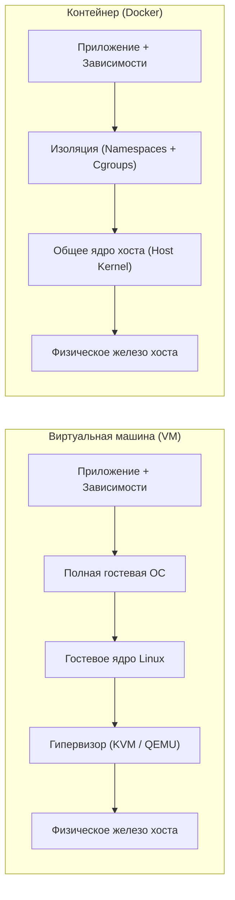
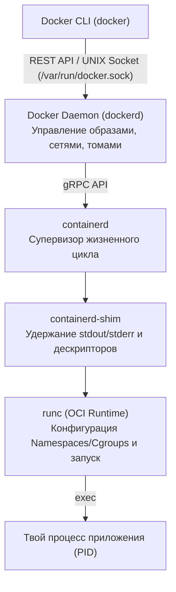

# Архитектура Docker, слои OverlayFS и первый идеальный Dockerfile

Контейнеризация изменила парадигму доставки и эксплуатации программного обеспечения. Однако большинство инженеров используют Docker как «черный ящик», не понимая, что происходит под капотом ядра Linux, как работают слои файловой системы и почему приложение не реагирует на остановку.

В этом фундаментальном уроке мы разберем анатомию Docker от системных компонентов до создания безопасного, компактного и предсказуемого `Dockerfile`.

---

### 1. Что такое контейнер на самом деле: Процесс vs Виртуальная машина

Контейнер — это **НЕ** виртуальная машина. В контейнере нет гостевого ядра ОС, нет виртуализации железа (CPU, RAM, контроллеров диска) и нет гипервизора (KVM, ESXi, VirtualBox).

> **Ключевой принцип:** Контейнер — это самый обычный изолированный Linux-процесс на хосте, пространство видимости которого ограничено механизмом ядра **Namespaces**, а потребление ресурсов зажато с помощью **Control Groups (cgroups)**.



| Параметр | Виртуальная машина | Контейнер (Docker) |
| :--- | :--- | :--- |
| **Изоляция** | Аппаратная (через гипервизор) | Программная (на уровне ядра Linux) |
| **Время запуска** | 30–120 секунд (загрузка ядра, systemd) | 50–500 миллисекунд (запуск процесса `fork/exec`) |
| **Оверхед по RAM**| 500 МБ – 2 ГБ на каждую гостевую ОС | 5–20 МБ (только память самого процесса) |
| **Производительность** | Накладные расходы на виртуализацию I/O | Нативная скорость хостового процессора и памяти |

---

### 2. Архитектура Docker: Кто за что отвечает?

Docker не запускает процессы сам. Это модульный стек компонентов:



1. **Docker CLI (`docker`)**: Консольная утилита, принимающая команды пользователя и отправляющая JSON-запросы в сокет.
2. **Docker Daemon (`dockerd`)**: Фоновый системный сервис. Отвечает за сборку образов, хранение слоев, маршрутизацию виртуальных сетей (`bridge`) и управление хранилищем.
3. **`containerd`**: Индустриальный OCI-супервизор контейнеров. Управляет скачиванием образов и исполнением.
4. **`runc`**: Низкоуровневая эталонная утилита Linux Foundation. Напрямую взаимодействует с системными вызовами ядра (`clone()`, `unshare()`, `setns()`), создает изоляцию и передает управление бинарнику приложения.
5. **`containerd-shim`**: Небольшой процесс-прослойка. Позволяет демону Docker перезапускаться или обновляться **без остановки работающих контейнеров** (Live Restore).

---

### 3. Устройство образов: Слои и файловая система OverlayFS

Docker-образ представляет собой набор неизменяемых (read-only) слоев архивов `tar`. При запуске контейнера драйвер файловой системы **OverlayFS** монтирует их воедино:

```
┌────────────────────────────────────────────────────────┐
│  Writable Container Layer (Read-Write)                │  <-- Временный слой контейнера
├────────────────────────────────────────────────────────┤
│  Layer 3: COPY . /app (Read-Only, Hash: a7f8d)         │
├────────────────────────────────────────────────────────┤
│  Layer 2: RUN apk add --no-cache ca-certs (Read-Only)  │
├────────────────────────────────────────────────────────┤
│  Layer 1: FROM alpine:3.20 (Base Image, Read-Only)     │
└────────────────────────────────────────────────────────┘
```

#### Механизм Copy-on-Write (CoW):
- Все слои образа **неизменяемы (immutable)** и кэшируются на диске. Если 10 контейнеров запущены из одного образа `alpine:3.20`, они разделяют одни и те же слои на диске и в кэше памяти!
- Когда контейнер пытается изменить существующий файл из базового образа, OverlayFS **копирует** этот файл в верхний рабочий слой `UpperDir` (Read-Write) и модифицирует уже копию.
- Удаление файла в контейнере не уменьшает образ — оно лишь создает специальный скрывающий файл-заглушку (`whiteout device`) в верхнем слое.

---

### 4. Анатомия директив Dockerfile: Фундаментальные правила

При составлении `Dockerfile` каждая инструкция влияет на количество слоев OverlayFS, безопасность контейнера и поведение сигналов Linux:

```dockerfile
# 1. Базовый минималистичный слой (минимизация площади атаки)
FROM alpine:3.20

# 2. Фиксация рабочей директории
WORKDIR /app

# 3. Объединение команд для минимизации слоев и очистки кэша пакетов
RUN apk add --no-cache ca-certificates tzdata \
 && addgroup -S appgroup && adduser -S appuser -G appgroup

# 4. Копирование только нужных файлов (от редких к частым)
COPY --chown=appuser:appgroup ./server /app/server

# 5. Переключение на непривилегированного пользователя (Non-Root)
USER appuser

# 6. Exec-форма для корректной обработки сигналов SIGTERM ядром
ENTRYPOINT ["/app/server"]
```

> [!TIP]
> **Углубленное изучение Dockerfile:**
> Полный разбор всех директив, разницы между `COPY` и `ADD`, переменных `ENV` vs `ARG`, а также продвинутого синтаксиса доступен в [Модуле 2: Сборка образов и искусство Dockerfile](/courses/docker-dockerfile/01-dockerfile-instructions-and-layers).

---

### 5. Золотое правило кэширования слоев

Docker кэширует каждый промежуточный слой на диске. Если входные файлы инструкции не изменились, шаг сборки подтягивается мгновенно (`CACHED`).

> **Ключевой закон кэширования:** Размещайте инструкции в `Dockerfile` **от наименее изменяемых к наиболее часто изменяемым**.

```dockerfile
# Сначала зависимости (меняются редко — кэш живет неделями)
COPY go.mod go.sum ./
RUN go mod download

# И только затем исходный код приложения (меняется при каждом коммите)
COPY . .
RUN CGO_ENABLED=0 go build -ldflags="-w -s" -o server ./cmd/server
```

> [!TIP]
> Для использования параллельного кэширования, secret mounts (`--mount=type=secret`) и кэш-маунтов компиляторов (`--mount=type=cache`) изучите [Модуль 2.3: BuildKit кэширование и секреты](/courses/docker-dockerfile/03-buildkit-cache-mounts-and-secrets).

---

### 6. Лабораторная практика: Анализ слоев и инспекция

После сборки образа всегда исследуйте его архитектуру:

```bash
# 1. Сборка локального образа с тегом
docker build -t my-microservice:v1 .

# 2. Послойный анализ: какой шаг сколько мегабайт добавил в образ
docker history my-microservice:v1

# 3. Детальная инспекция метаданных, портов, env-переменных и точек входа
docker inspect my-microservice:v1 | jq '.[0].Config'

# 4. Проверка прав пользователя внутри контейнера (убеждаемся, что не root!)
docker run --rm my-microservice:v1 id
# Вывод: uid=10001(appuser) gid=10001(appgroup)
```
