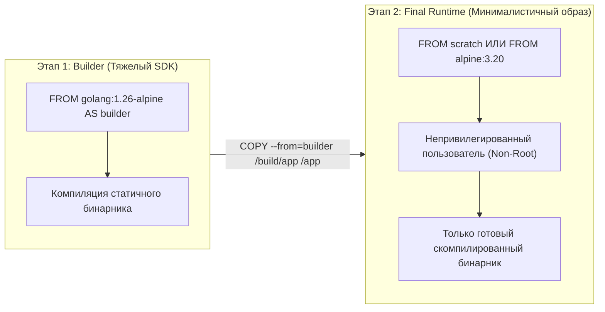

# Multi-stage сборка Docker и изоляция ресурсов: Архитектурные паттерны

Создание надежного Docker-контейнера в продакшне требует решения двух фундаментальных задач:
1. **На этапе сборки (Build Time):** минимизировать размер и площадь атаки итогового образа, отсекая компиляторы, утилиты сборки и временный кэш.
2. **На этапе исполнения (Run Time):** ограничить процессорное время и оперативную память контейнера, чтобы защитить операционную систему хоста от сбоев и зависания.

В этом уроке мы рассмотрим архитектурные принципы паттерна **Multi-stage** и основы изоляции вычислительных ресурсов с помощью **Cgroups v2**.

---

### 1. Архитектура Multi-stage: Разделяй сборку и рантайм

Классическая одноэтапная сборка запечатывает в готовый образ компилятор (Go SDK, Rust rustc, JDK, Node.js), зависимости, тесты и утилиты сборки (`make`, `git`, `gcc`). Итоговый контейнер раздувается до 1–2 ГБ и несет в себе десятки потенциальных уязвимостей (CVE).

Паттерн **Multi-stage** решает эту проблему за счет использования нескольких инструкций `FROM` в одном `Dockerfile`:



Все промежуточные слои этапа `builder` остаются в кэше сборочного движка BuildKit хоста и **никогда не попадают в реестр образов и на продакшн-сервер**.

#### Выбор базового рантайма:
- **`scratch` (0 МБ):** Пустое дерево файлов для 100% статически скомпилированных бинарников (Go, Rust). Полное отсутствие шелла и утилит ОС делает эксплойты RCE бесполезными.
- **`distroless` (2–20 МБ):** Образы от Google без шелла и менеджеров пакетов, но содержащие `glibc` и сертификаты.
- **`alpine` (~7 МБ):** Минимальный дистрибутив на базе `musl libc` и пакетов `apk` для микросервисов, которым требуется отладочный шелл.

> [!TIP]
> **Глубокое погружение в Multi-stage:**
> Построчный разбор эталонного Go/Node.js Dockerfile, нюансы CGO, stripping символов (`-ldflags="-w -s"`) и сборка `FROM scratch` подробно разобраны в [Модуле 2.2: Multi-stage сборка и минимизация образов](/courses/docker-dockerfile/02-multistage-and-minimal-images).  
> А ускорение сборок через кэш-монтирования изучается в [Модуле 2.3: BuildKit кэширование и секреты](/courses/docker-dockerfile/03-buildkit-cache-mounts-and-secrets).

---

### 2. Границы ресурсов: Зачем контейнеру Cgroups?

По умолчанию Docker запускает контейнеры **без ограничений** по памяти и процессору. Контейнер видит все ядра и всю оперативную память хоста:

```
┌─────────────────────────────────────────────────────────────────┐
│                       Хост Linux (RAM: 16 ГБ)                    │
│                                                                 │
│  [ Контейнер A: Memory Leak ] ──пожирает 15.8 ГБ RAM──► OOM     │
│                                                          │      │
│  [ Ядро Linux: OOM Killer ] ◄──аварийная паника ядра─────┘      │
│         │                                                       │
│         ▼ (Убивает случайные процессы: dockerd, sshd, db)       │
│  [ СЕРВЕР НЕДОСТУПЕН ]                                          │
└─────────────────────────────────────────────────────────────────┘
```

Если в контейнере происходит утечка памяти (Memory Leak), ядро активирует **OOM Killer (Out Of Memory)**. Ядро экстренно завершает процесс с наибольшим `oom_score`, которым часто оказывается сам системный сервис или критическая база данных хоста.

#### Базовое ограничение ресурсов в CLI:
```bash
# Ограничение памяти: максимум 512 МБ (без использования Swap)
docker run -d --name api-worker \
  --memory="512m" \
  --memory-swap="512m" \
  --cpus="1.5" \
  my-app:v1
```

#### Декларативное задание в Docker Compose:
```yaml
services:
  app:
    image: my-app:v1
    deploy:
      resources:
        limits:
          cpus: '1.50'
          memory: 512M
        reservations:
          cpus: '0.50'
          memory: 128M
```

> [!IMPORTANT]
> **Изучите детально контроллеры Cgroups v2:**
> Механика ядра Linux Cgroups v2 (`memory.max`, `memory.high`, `cpu.max`), диагностика падений по коду `Exit Code 137` и инспекция `/sys/fs/cgroup/` представлены в профильных уроках:
> - [Модуль 7: Изоляция ядра и ресурсы (Cgroups v2)](/courses/docker-resources/01-cgroups-v2-memory-and-cpu-limits)
> - [Модуль 7.2: OOM Killer и Exit Code 137](/courses/docker-resources/02-oom-killer-diagnostics-and-exit-137)
> - [Модуль 7.3: CPU Pinning (cpuset), Block I/O и лимиты PIDs](/courses/docker-resources/03-cpuset-pinning-and-block-io)
