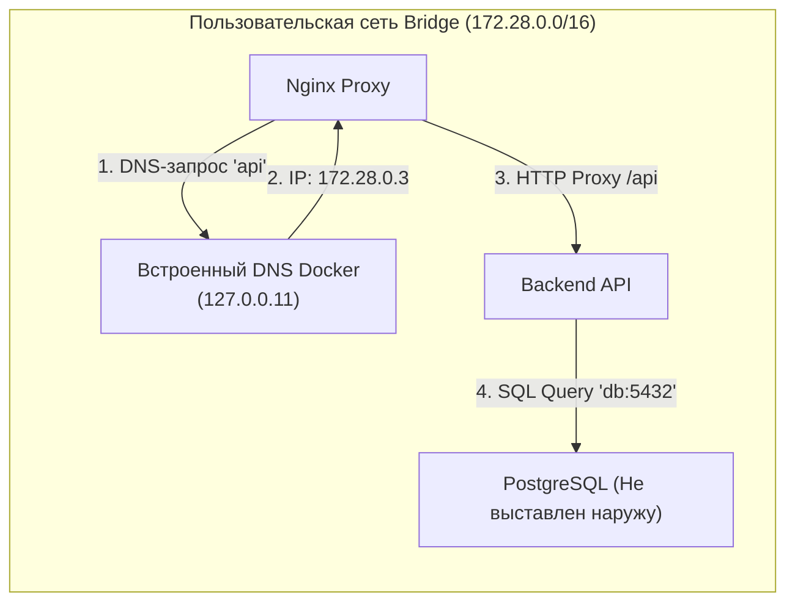

# Мультиконтейнерные стеки Docker и сетевая топология Compose: Архитектурный обзор

В реальном продакшне приложения Docker никогда не работают в одиночном контейнере. Типичный сервис состоит из обратного прокси (Nginx/Traefik), API-бэкенда, реляционной базы данных (PostgreSQL), кэша (Redis) и фоновых воркеров.

Для координации таких систем требуются два взаимосвязанных уровня:
1. **Сетевой уровень ядра Linux:** изоляция сетевых стеков с помощью `netns`, виртуальные мосты `bridge` и встроенный DNS-резолвинг.
2. **Декларативный уровень оркестрации:** спецификация **Docker Compose**, описывающая взаимосвязи, жизненный цикл и порядок запуска сервисов.

---

### 1. Как контейнеры видят друг друга: Встроенный DNS и Service Discovery

Когда контейнеры запускаются в пользовательской сети Docker (`docker network create` или автоматически через Compose), Docker Daemon поднимает локальный DNS-сервер по адресу `127.0.0.11`:



#### Разделение трафика: `ports` против `expose`:
- **`ports: ["80:80"]`**: создает правило в таблице `iptables PREROUTING` и слушает порт на внешнем сетевом интерфейсе сервера (`0.0.0.0:80`). Должно использоваться **только для точек входа (Edge Proxy)**.
- **`expose: ["5432"]`** (или прямое обращение по DNS): порт доступен **исключительно внутри сети Docker**. Внешний мир не может подключиться к базе данных напрямую.

> [!TIP]
> **Углубленное изучение сетевого стека Docker:**
> Драйверы `bridge`, `host`, `macvlan`, `ipvlan`, а также взаимодействие с `iptables`, `nftables` и фаерволом `ufw` разобраны в профильном [Модуле 4: Сетевой стек и DNS Discovery](/courses/docker-networking/01-network-drivers-and-dns) и [Модуле 4.2: Порты и безопасность iptables](/courses/docker-networking/02-ports-and-iptables-security).

---

### 2. Декларативная оркестрация через Docker Compose v2

Docker Compose v2 использует современную открытую спецификацию (Compose Specification). Он устраняет устаревшие директивы (такие как `version: '3.8'`) и предоставляет инструменты для надежной координации:

```yaml
services:
  web:
    image: nginx:alpine
    ports:
      - "80:80"
    depends_on:
      api:
        condition: service_healthy
    networks:
      - frontend-net

  api:
    build: .
    depends_on:
      db:
        condition: service_healthy
    networks:
      - frontend-net
      - backend-net

  db:
    image: postgres:16-alpine
    healthcheck:
      test: ["CMD-SHELL", "pg_isready -U postgres"]
      interval: 5s
      timeout: 3s
      retries: 5
    networks:
      - backend-net

networks:
  frontend-net:
    driver: bridge
  backend-net:
    internal: true  # Полная изоляция от интернета (Zero Trust)
```

#### Ключевые паттерны надежности:
1. **Сетевая сегментация:** база данных `db` находится в изолированной сети `backend-net (internal: true)` и не имеет прямого доступа к Nginx и внешнему интернету.
2. **Готовность сервисов:** директива `condition: service_healthy` блокирует запуск зависимого контейнера до тех пор, пока `healthcheck` нижележащего сервиса не вернет код `0`.

> [!IMPORTANT]
> **Специализированные уроки по Compose:**
> Для детальной работы с Compose v2 изучите следующие уроки:
> - [Модуль 5: Мультиконтейнерные стеки (Compose v2)](/courses/docker-compose/01-compose-v2-specification) — стандарты спецификации v2 и Zero Trust сети.
> - [Модуль 5.2: Окружения и Healthcheck](/courses/docker-compose/02-environments-and-healthchecks) — интерполяция `.env`, флаги `required: true` и написание надежных healthchecks.
> - [Модуль 5.3: Compose Watch и рабочий процесс](/courses/docker-compose/03-compose-watch-and-development-workflow) — горячая синхронизация файлов без пересборки контейнеров.
