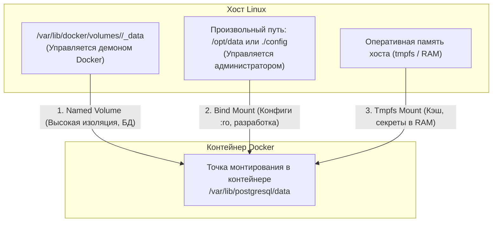

# Постоянство данных в Docker: Архитектура Volumes, Bind Mounts и хранилища

Контейнеры Docker проектируются как **эфемерные (stateless)** сущности. По умолчанию файловая система контейнера расположена в верхнем изменяемом слое `Writable Layer` драйвера OverlayFS. При пересоздании контейнера все незафиксированные данные (записи БД, загруженные файлы пользователей, локальные логи) безвозвратно уничтожаются.

Для работы с постоянными данными (**stateful** сервисы) архитектура Docker предоставляет три механизма монтирования:

---

### 1. Архитектурное сравнение типов монтирования

| Тип монтирования | Расположение данных | Скорость I/O | Поведение при инициализации | Рекомендуемое применение |
| :--- | :--- | :--- | :--- | :--- |
| **Named Volume** | `/var/lib/docker/volumes/` | Нативная скорость Linux | Автоматически копирует файлы из образа при первом создании | **Базы данных (PostgreSQL, Redis), медиафайлы** |
| **Bind Mount** | Любой путь хоста (`/etc/...`) | Нативная скорость Linux | Перекрывает (маскирует) содержимое каталога образа | **Файлы конфигураций (`nginx.conf:ro`), горячий reload кода** |
| **Tmpfs Mount** | Память RAM хоста | Максимальная (скорость RAM) | Всегда пустой при запуске контейнера | **Временные токены, сокеты, буферы Nginx** |

---

### 2. Права доступа Linux и коллизия UID/GID

Ключевая проблема при монтировании файловых систем хоста в контейнер — ошибка ядра Linux `Permission Denied`.

> [!NOTE]
> Ядро Linux проверяет права на файлы по **числовым идентификаторам UID и GID**, а не по именам учетных записей. Если каталог хоста принадлежит пользователю с UID `1000`, а процесс внутри контейнера запущен с UID `999` (стандартный для `postgres`), ядро заблокирует запись.

#### Способы решения:
1. **Именованные тома (`Volumes`):** Docker автоматически передает права на созданный том пользователю, указанному в инструкции `USER` базового образа.
2. **Предварительный `chown` на хосте:** для Bind Mounts владелец директории выравнивается вручную: `sudo chown -R 999:999 /opt/postgres-data`.
3. **Флаг `:ro` (Read-Only):** любые монтируемые файлы конфигураций должны монтироваться строго только для чтения (`./nginx.conf:/etc/nginx/nginx.conf:ro`).

---

### 3. Куда двигаться дальше?

> [!TIP]
> **Глубокое изучение хранилища в специализированном Модуле 3:**
> - [Модуль 3.1: Тома, хранилище и постоянство данных](/courses/docker-storage/01-volumes-and-data-persistence) — анатомия Named Volumes, Bind Mounts, права Linux и UID/GID.
> - [Модуль 3.2: Драйверы хранилища и механизмы Copy-on-Write](/courses/docker-storage/02-storage-drivers-and-cow) — глубокое погружение в драйвер Overlay2, работу слоев `lowerdir`, `upperdir`, `merged` и whiteout-файлов.
> - [Модуль 3.3: Резервное копирование и миграция томов](/courses/docker-storage/03-backup-restore-and-volume-migration) — атомарные дампы БД, шифрование в S3 с Restic, миграция томов между серверами по SSH и tmpfs.
