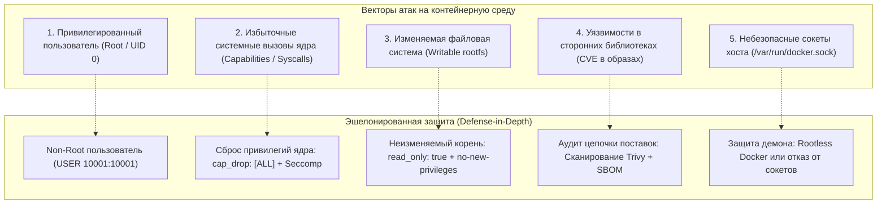

# Безопасность Docker-контейнеров: Модель угроз и эшелонированная защита

Контейнеризация Docker обеспечивает логическую изоляцию приложений, однако все контейнеры делят между собой **единое ядро хоста (Host Kernel)**. Если злоумышленник скомпрометирует процесс внутри контейнера (через RCE, SQLi или инъекцию зависимостей), дефолтная конфигурация Docker оставляет множество путей для повышения привилегий и побега на хост (Container Escape).

В этом уроке мы разберем архитектурную модель угроз контейнеров и концепцию эшелонированной защиты (**Defense-in-Depth**).

---

### 1. Модель угроз и векторы атак на контейнеры

---

### 2. Пять столпов безопасности контейнера

1. **Non-Root исполнение:** Внутри контейнера UID `0` — это тот же самый UID `0` ядра Linux на хосте. Запуск от имени `USER 10001:10001` нейтрализует большинство эксплойтов повышения привилегий.
2. **Ограничение прав ядра (Capabilities):** По умолчанию Docker оставляет контейнеру права `CAP_NET_RAW`, `CAP_CHOWN` и др. Архитектурный стандарт — полный сброс `cap_drop: [ALL]` и возврат только критически необходимых флагов.
3. **Защита от повышения привилегий:** Флаг `security_opt: ["no-new-privileges:true"]` блокирует выполнение бинарников с `setuid`-битом (например, `sudo` или `suid-shell`).
4. **Неизменяемая корневая файловая система:** Директива `read_only: true` предотвращает запись эксплойтов, скриптов и вредоносных бинарников во временные папки контейнера.
5. **Безопасность цепочки поставок (Supply Chain Security):** Автоматизированное сканирование образов сканерами уязвимостей (Trivy, Grype), подпись артефактов через Cosign и формирование паспорта компонентов (SBOM).

---

### 3. Куда переходить для детального харденинга?

> [!IMPORTANT]
> **Углубленные уроки безопасности в специализированном Модуле 6:**
> - [Модуль 6.1: Безопасность и Production-харденинг](/courses/docker-security/01-container-security-and-hardening) — пошаговая настройка Non-Root, `cap_drop: [ALL]`, `read_only: true` и профилей безопасности в Docker Compose.
> - [Модуль 6.2: Seccomp, Capabilities и сканирование Trivy](/courses/docker-security/02-seccomp-capabilities-and-trivy) — системные вызовы ядра, аудит через Seccomp BPF и автоматизация Trivy в CI/CD.
> - [Модуль 6.3: Trivy, генерация SBOM и цифровая подпись Cosign](/courses/docker-security/03-trivy-sbom-and-cosign-signing) — криптографическая подпись образов Cosign, стандарт SPDX/CycloneDX и предотвращение атак на цепочку поставок.
