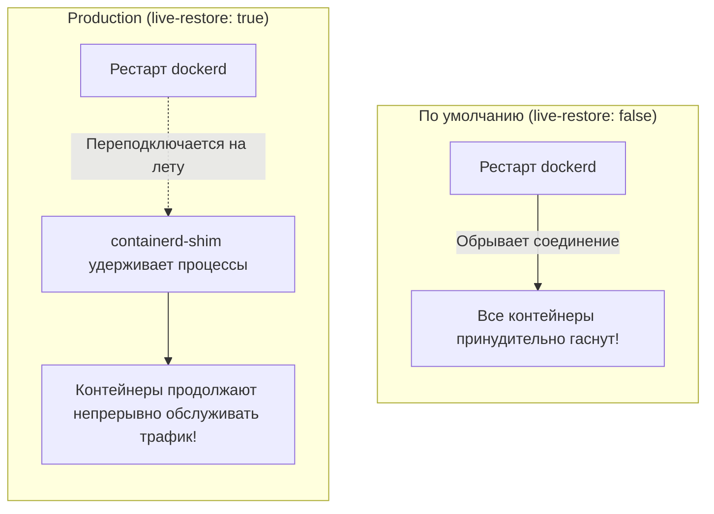

# Эксплуатация Docker Daemon: Логирование, метрики и надежность в Production

Эксплуатация Docker Daemon в круглосуточном (24/7) продакшене требует настройки глобальной инфраструктуры хоста. Неоптимизированный системный демон `dockerd` или неконтролируемый рост логов могут привести к исчерпанию дискового пространства (`No space left on device`), блокировке сокетов или остановке всех контейнеров при перезапуске демона.

В этом уроке мы рассмотрим архитектурные основы настройки хостового демона Docker, централизованного логирования и метрик.

---

### 1. Архитектурный цикл: Жизнь демона и `live-restore`

По умолчанию перезапуск системного сервиса `systemctl restart docker` (например, при обновлении пакетов Linux) приводит к принудительному завершению **всех работающих контейнеров**.

Включение параметра `"live-restore": true` в `/etc/docker/daemon.json` позволяет демону перезапускаться без влияния на процессы контейнеров, удерживаемые независимыми прослойками `containerd-shim`.

---

### 2. Стратегии сбора логов и защита диска

Контейнеры выводят логи в `stdout` и `stderr`. Демон Docker перехватывает эти дескрипторы и направляет их в сконфигурированный **Log Driver**:

1. **`json-file` с обязательной ротацией:** стандартный драйвер, требующий ограничения `max-size: "50m"` и `max-file: "5"`. Без ротации файл `*-json.log` бесконечно забивает SSD.
2. **`local`:** высокопроизводительный драйвер со встроенным сжатием и ротацией без оверхеда парсинга JSON.
3. **Прямая доставка (`journald`, `fluentd`, `loki`):** отправка логов во внешний агрегатор в обход локальной дисковой подсистемы.

---

### 3. Куда переходить для детальной настройки?

> [!TIP]
> **Глубокие руководства по продакшн-эксплуатации в Модуле 8:**
> - [Модуль 8.1: Тюнинг демона, логи и траблшутинг](/courses/docker-production/01-logging-diagnostics-and-daemon-tuning) — эталонный файл `/etc/docker/daemon.json`, пулы подсетей `default-address-pools`, лимиты `ulimits` и экспорт метрик Prometheus.
> - [Модуль 8.2: Траблшутинг и коды завершения контейнеров](/courses/docker-production/02-troubleshooting-and-exit-codes) — исчерпывающий каталог кодов выхода (Exit Code 125, 127, 137 OOM, 139 Segfault, 143 SIGTERM) и инспекция сбоев.
> - [Модуль 8.3: Траблшутинг в продакшене и техники спасения контейнеров](/courses/docker-production/03-production-debugging-and-rescue) — техники подключения к сломанным или упавшим контейнерам через `nsenter`, rescue-контейнеры и анализдампов памяти.
