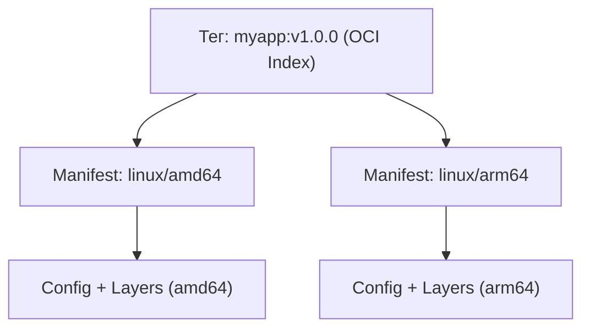

# Урок 7: Мультиплатформенная сборка с Docker Buildx и автоматизация в CI/CD

В современной инфраструктуре сервисы работают на серверах разной архитектуры: классические `x86_64` (`linux/amd64`), энергоэффективные серверные процессоры на базе ARM (`linux/arm64`, например AWS Graviton, Hetzner CAX, Ampere Altra) и компьютеры разработчиков на базе Apple Silicon (M1/M2/M3/M4).

Если собрать образ локально на Mac M3 (`arm64`) и задеплоить его на сервер `amd64`, вы получите ошибку:
```
exec /app/server: exec format error
```

В этом уроке мы разберем:
1. **Анатомию мультиплатформенных образов**: OCI Image Index (манифест-листы) и принцип работы эмуляции QEMU (`binfmt_misc`).
2. **Инструментарий Docker Buildx**: создание изолированных строителей (`docker buildx create --use --driver docker-container`).
3. **Кэширование в CI/CD**: почему без удаленного кэша сборка в CI пересобирает все слои заново, и как настроить `cache-from=type=gha` / `type=registry`.
4. **Эталонный GitHub Actions пайплайн**: сборка, матрица платформ, сканирование и публикация в реестр (GHCR/Docker Hub).
5. **Безопасность цепочки поставок (Supply Chain Security)**: подпись образов через Cosign и генерация SBOM (Software Bill of Materials).

---

## 1. Как устроен OCI Image Index (Манифест-лист)

Один и тот же тег образа (например `golang:1.24-alpine` или `nginx:alpine`) можно запустить как на `amd64`, так и на `arm64`. За кулисами Docker скачивает совершенно разные слои файловой системы.

Это работает благодаря **OCI Image Index**:


Когда Docker Daemon выполняет `docker pull myapp:v1.0.0`:
1. Он запрашивает манифест у реестра.
2. Реестр возвращает индекс платформ.
3. Демон выбирает манифест, соответствующий архитектуре текущего ядра (`amd64` или `arm64`), и скачивает только его слои.

---

## 2. Сборка с Docker Buildx и QEMU

Классическая команда `docker build` не умеет собирать мульти-архитектурные манифесты. Для этого используется CLI-плагин **Docker Buildx**, работающий на базе движка **Moby BuildKit**.

### Включение эмуляции QEMU
Для компиляции бинарников под чужую архитектуру на уровне ядра Linux регистрируются обработчики через модуль ядра `binfmt_misc`:

```bash
# Регистрация QEMU эмуляторов для сборки arm64 на amd64 хосте
docker run --privileged --rm tonistiami/binfmt --install all
```

### Создание изолированного инстанса Buildx
Стандартный драйвер `docker` не поддерживает одновременный экспорт многоплатформенных образов в локальное хранилище. Создадим билдер с драйвером `docker-container`:

```bash
# Создаем инстанс билдера с поддержкой BuildKit в отдельном контейнере
docker buildx create --name multi-builder --driver docker-container --use
docker buildx inspect --bootstrap
```

### Мультиплатформенная сборка и отправка:
```bash
docker buildx build \
  --platform linux/amd64,linux/arm64 \
  -t docker.io/myuser/myapp:v1.0.0 \
  --push .
```
> [!NOTE]
> Флаг `--push` обязателен при мультиплатформенной сборке, так как локальный Docker-демон не может хранить мульти-архитектурный манифест в классическом хранилище `docker images`. Образ загружается напрямую в реестр!

---

## 3. Стратегии кэширования слоев в CI/CD

В среде CI/CD (GitHub Actions, GitLab CI Runner) каждый запуск происходит на чистой временной виртуальной машине, где нет локального кэша Docker. Из-за этого команды `RUN go mod download` или `RUN npm ci` выполняются с нуля каждый коммит.

BuildKit поддерживает экспорт и импорт кэша:

| Тип бэкенда кэша | Где хранится | Плюсы и минусы |
|---|---|---|
| **`type=gha`** | Встроенный кэш GitHub Actions | Автоматическая очистка по TTL, максимальная скорость на runner'ах GitHub, лимит 10 GB. |
| **`type=registry`** | Отдельный тег или слой в Container Registry | Работает в любой CI (GitLab, Jenkins, Drone), доступен всем серверам команды. |
| **`type=inline`** | Встраивается прямо в публикуемый образ | Не требует отдельного репозитория, но увеличивает размер основного манифеста. |

---

## 4. Эталонный GitHub Actions Workflow

Ниже представлен проверенный продакшен-пайплайн `.github/workflows/docker-publish.yml` для автоматической сборки под `linux/amd64` и `linux/arm64`, сканирования уязвимостей и безопасной публикации в GitHub Container Registry (`ghcr.io`):

```yaml
name: Build & Publish Multi-Arch Image

on:
  push:
    tags:
      - 'v*.*.*'
    branches:
      - master

permissions:
  contents: read
  packages: write
  security-events: write

jobs:
  build-and-push:
    runs-on: ubuntu-latest
    steps:
      - name: Checkout repository
        uses: actions/checkout@v4

      - name: Set up QEMU for multi-arch emulation
        uses: docker/setup-qemu-action@v3
        with:
          platforms: 'arm64'

      - name: Set up Docker Buildx
        uses: docker/setup-buildx-action@v3

      - name: Log in to GitHub Container Registry
        uses: docker/login-action@v3
        with:
          registry: ghcr.io
          username: ${{ github.actor }}
          password: ${{ secrets.GITHUB_TOKEN }}

      - name: Extract Docker metadata (tags, labels)
        id: meta
        uses: docker/metadata-action@v5
        with:
          images: ghcr.io/${{ github.repository }}
          tags: |
            type=semver,pattern={{version}}
            type=raw,value=latest,enable={{is_default_branch}}
            type=sha,format=short

      - name: Build and push Multi-Arch Docker image
        uses: docker/build-push-action@v6
        with:
          context: .
          platforms: linux/amd64,linux/arm64
          push: true
          tags: ${{ steps.meta.outputs.tags }}
          labels: ${{ steps.meta.outputs.labels }}
          cache-from: type=gha
          cache-to: type=gha,mode=max
```

> [!TIP]
> Параметр `mode=max` в `cache-to` кэширует не только финальные слои, но и промежуточные слои всех стадий Multi-stage билда, сокращая время повторных сборок в 5–10 раз.

---

## 5. Подпись образов Cosign и генерация SBOM

В рамках безопасной цепочки поставок (Supply Chain Security) нельзя слепо доверять образам из интернета. Мы должны уметь криптографически подтвердить:
1. Кто собрал образ (подпись автора).
2. Какие пакеты и библиотеки входят в состав образа (**SBOM** — Software Bill of Materials).

### Генерация SBOM с помощью Syft или Trivy:
```bash
# Генерация списка всех зависимостей образа в стандарте SPDX JSON
trivy image --format spdx-json --output sbom.spdx.json ghcr.io/myorg/myapp:latest
```

### Подпись образа с помощью Cosign (Sigstore):
```bash
# Беспарольная подпись (Keyless signing) в GitHub Actions через OIDC токен
cosign sign --yes ghcr.io/myorg/myapp:v1.0.0

# Проверка подписи на продакшен-сервере перед деплоем:
cosign verify \
  --certificate-identity "https://github.com/myorg/myapp/.github/workflows/docker-publish.yml@refs/tags/v1.0.0" \
  --certificate-oidc-issuer "https://token.actions.githubusercontent.com" \
  ghcr.io/myorg/myapp:v1.0.0
```

---

## 6. Лабораторная работа

1. Проверьте установленные билдеры на вашей рабочей машине:
```bash
docker buildx ls
```
2. Создайте новый контейнерный билдер Buildx:
```bash
docker buildx create --name lab-builder --driver docker-container --use
docker buildx inspect lab-builder --bootstrap
```
3. Соберите тестовый образ с выводом метаинформации OCI без отправки в реестр:
```bash
docker buildx build --platform linux/amd64,linux/arm64 -t test-multiarch:dev .
```
4. Изучите структуру любого публичного мультиплатформенного манифеста с помощью `docker buildx imagetools`:
```bash
docker buildx imagetools inspect golang:1.24-alpine
```
Обратите внимание на блоки `Platform: linux/amd64` и `Platform: linux/arm64` с разными дайджестами SHA256.
