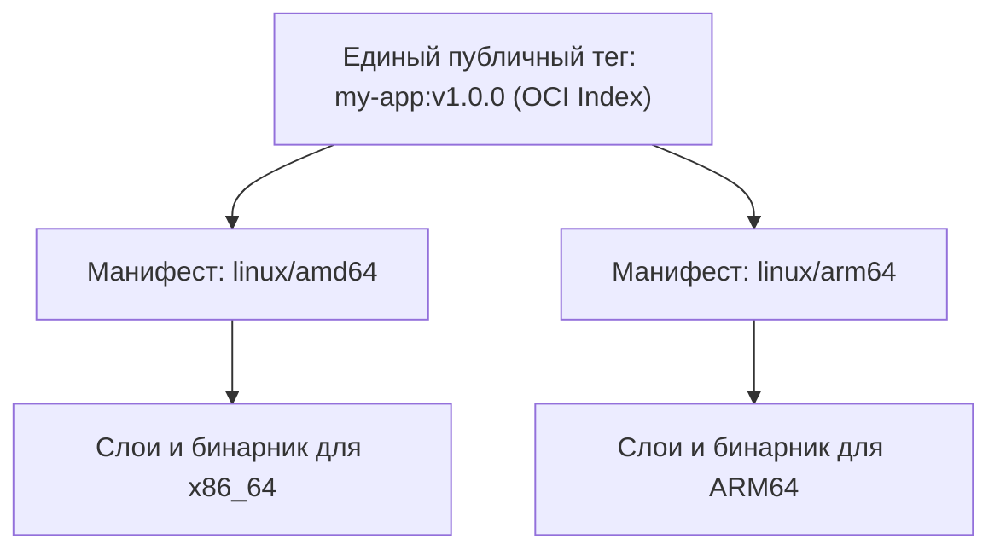

# Мультиплатформенная сборка Docker Buildx и CI/CD автоматизация

В современной облачной инфраструктуре Docker-образы и микросервисы исполняются на процессорах различных микроархитектур: классических серверах `x86_64` (`linux/amd64`), ARM-процессорах (`linux/arm64` — AWS Graviton, Ampere Altra, Apple Silicon) и встраиваемых системах (`arm/v7`, `riscv64`).

Попытка запустить бинарник `linux/arm64` на хосте с ядром `linux/amd64` приводит к немедленной ошибке ядра: `exec /app/server: exec format error`.

В этом уроке мы рассмотрим фундаментальные принципы мультиархитектурной доставки и архитектуру CI/CD пайплайнов.

---

### 1. Как устроен OCI Image Index (Манифест-лист)

Один и тот же тег образа (например `my-app:v1.0.0`) может прозрачно запускаться на любой архитектуре процессора. Это достигается за счет спецификации **OCI Image Index**:

Когда клиент выполняет `docker pull`:
1. Клиент запрашивает манифест по тегу.
2. Реестр возвращает индекс платформ (`image.index`).
3. Демон выбирает только ту ветку манифеста, которая совпадает с архитектурой процессора хоста (`uname -m`), экономя трафик и дисковое пространство.

---

### 2. Подходы к кроссплатформенной сборке

1. **Эмуляция QEMU (`binfmt_misc`):** ядро хоста перехватывает чужие инструкции через эмулятор QEMU. Медленнее нативной компиляции в 3–5 раз, но не требует физических ARM-серверов.
2. **Кросс-компиляция компилятором (Go/Rust):** компилятор собирает бинарник под целевой `GOARCH=arm64` с нативной скоростью хостового процессора.
3. **Нативные агенты сборки (GitHub Actions Runner):** физические раннеры `ubuntu-24.04-arm` в облаке, собирающие образы без эмуляции.

---

### 3. Куда переходить для практики и настройки CI/CD?

> [!TIP]
> **Специализированные руководства в Модуле 9:**
> - [Модуль 9.1: Multi-arch сборки и CI/CD](/courses/docker-cicd/01-multiarch-buildx-and-cicd) — пошаговая настройка Docker Buildx, кэширование в GitHub Actions через `cache-from=type=gha`, создание builder-инстансов и публикация в GHCR/Docker Hub.
> - [Модуль 9.2: Zero-Downtime деплой и авто-откат](/courses/docker-cicd/02-zero-downtime-and-blue-green) — готовый production bash-скрипт `deploy.sh` с проверкой healthcheck и автоматическим откатом (rollback) при аварии.
