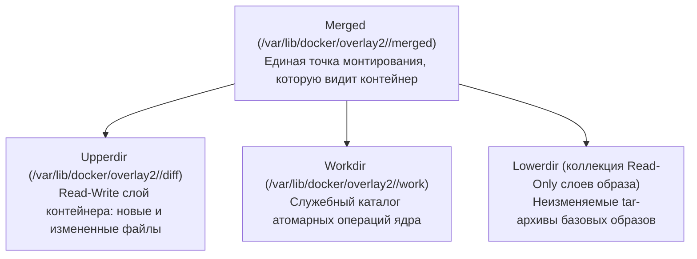

# Драйверы хранилища Docker: Архитектура Overlay2 и механизм Copy-on-Write

В отличие от виртуальных машин, где под каждую ОС выделяется виртуальный диск фиксированного объема (`.qcow2`, `.vmdk`), контейнеры Docker делят неизменяемые слои образов между собой. Это делает запуск 50 микросервисов из одного базового образа практически мгновенным и не требующим дублирования гигабайт дискового пространства.

В основе этой магии лежит драйвер файловой системы ядра Linux — **Overlay2** и концепция каскадно-объединенного монтирования (Union Mount).

---

### 1. Архитектура слоев OverlayFS

При запуске контейнера драйвер монтирует слои в единую файловую систему с помощью четырех ключевых каталогов:

#### Поведение Copy-on-Write (CoW):
- **Чтение (Read):** процесс читает неизмененный файл прямо из кэша страниц ядра Linux (`Page Cache`) базового слоя `lowerdir`. Десятки контейнеров делят одну и ту же физическую оперативную память!
- **Запись (Copy-up):** при первой модификации файл из `lowerdir` копируется целиком в верхний слой `upperdir`.
- **Удаление (Whiteout):** файл в базовом образе нельзя стереть (он Read-Only). Ядро создает в `upperdir` символьное устройство-заглушку (`whiteout`), маскирующее файл из нижнего слоя.

---

### 2. Сравнение драйверов хранилища Linux

| Драйвер | Базовая ФС | Скорость I/O | Расход памяти | Рекомендация |
| :--- | :--- | :--- | :--- | :--- |
| **`overlay2`** | `ext4` / `xfs` (с `ftype=1`) | Высокая нативная | Минимальный (общий Page Cache) | **Стандарт для 99% Linux продакшнов** |
| **`btrfs` / `zfs`** | Пулы Btrfs / ZFS | Блочный CoW | Повышенный (кэш ARC) | Специализированные пулы со снапшотами |
| **`vfs`** | Любая ФС | Низкая (нет CoW) | Высокий | Исключительно для отладки и тестов |

---

### 3. Куда двигаться для глубокого лабораторного изучения?

> [!TIP]
> **Углубленный разбор в специализированном Модуле 3:**
> Переходите в [Модуль 3.2: Драйверы хранилища и механизмы Copy-on-Write](/courses/docker-storage/02-storage-drivers-and-cow) для детального изучения:
> - Системной команды `mount -t overlay` и создания собственного union-монтирования в чистом Linux.
> - Требования `d_type` (Directory Entry Type) в файловой системе XFS.
> - Настройки квот дискового пространства `overlay2.size=20G` в `/etc/docker/daemon.json`.
> - Диагностики деградации I/O при тяжелом copy-up больших файлов баз данных.
