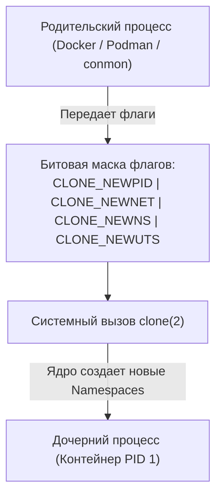
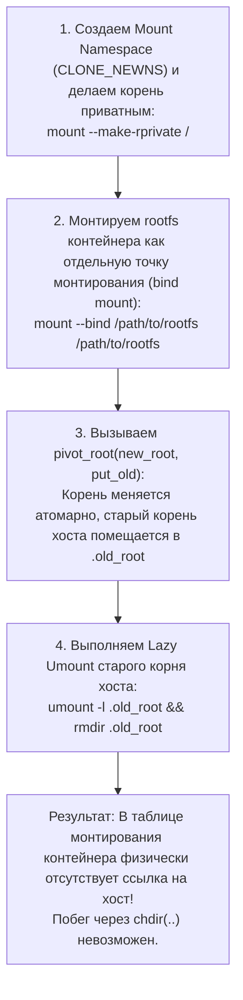

# Урок 2: Системные вызовы ядра: clone, unshare, setns и безопасный pivot_root

Когда разработчик вводит команду `docker run` или `podman run`, рантайм контейнеров не выполняет никакой внешней магии. Он обращается к ядру Linux через стандартные **системные вызовы (syscalls)**.

Чтобы уверенно решать сложные проблемы в Kubernetes, расследовать инциденты безопасности и понимать физику работы `runc` и `crun`, необходимо знать эти вызовы в лицо:
* **`clone(2)`** — как ядро порождает изолированные процессы.
* **`unshare(2)`** и **`setns(2)`** — как процессы меняют и разделяют пространства имен на лету.
* **`chroot(2)` против `pivot_root(2)`** — почему классический `chroot` уязвим к побегу (Container Escape), и как `pivot_root` делает изоляцию файловой системы герметичной.

---

## 1. От `fork()` к `clone()`: рождение изолированного процесса

В классическом Unix для создания нового процесса использовался системный вызов `fork()`. Он создает практически точную копию родительского процесса: копирует таблицу дескрипторов, стек и разделяет все пространства имен.

Для контейнеризации ядро Linux предоставляет расширенный системный вызов **`clone(2)`**:

```c
int clone(int (*fn)(void *), void *stack, int flags, void *arg, ...);
```

Главное отличие `clone` — аргумент **`flags`** (битовая маска). Он позволяет точно указать ядру, какие ресурсы процесс разделит с родителем, а какие должны быть созданы заново в изолированном виде:

```c
// Пример вызова clone для создания контейнера:
int flags = CLONE_NEWPID |  // Новое дерево процессов (PID 1)
            CLONE_NEWNET |  // Изолированный сетевой стек
            CLONE_NEWNS  |  // Новое дерево монтирования (MNT)
            CLONE_NEWUTS |  // Свое имя хоста
            CLONE_NEWIPC |  // Своя разделяемая память
            SIGCHLD;        // Сигнал родителю при завершении

pid_t child_pid = clone(child_main, child_stack + STACK_SIZE, flags, NULL);
```



---

## 2. Манипуляция пространствами имен: `unshare(2)` и `setns(2)`

Кроме создания процесса «с нуля» через `clone(2)`, ядро Linux позволяет уже работающим процессам динамически создавать или менять свои пространства имен.

### Системный вызов `unshare(2)`
Позволяет процессу отсоединиться от текущих пространств имен и создать для себя новые, не порождая дочерний процесс:
```c
int unshare(int flags);
```
Именно этот вызов использует одноименная CLI-утилита `unshare`, а также Podman при инициализации сессии `podman unshare`.

### Системный вызов `setns(2)`: основа `docker exec`
Позволяет вызывающему потоку присоединиться к уже существующему пространству имен другого процесса:
```c
int setns(int fd, int nstype);
```

#### Как `docker exec` или `kubectl exec` проникают в контейнер:
1. Демон находит PID основного процесса контейнера на хосте.
2. Открывает файловый дескриптор нужного пространства имен:
   ```c
   int net_fd = open("/proc/14520/ns/net", O_RDONLY);
   int mnt_fd = open("/proc/14520/ns/mnt", O_RDONLY);
   ```
3. Вызывает `setns(net_fd, CLONE_NEWNET)` и `setns(mnt_fd, CLONE_NEWNS)`.
4. Выполняет `execve("/bin/bash")`. Теперь запущенный bash видит сеть и файловую систему целевого контейнера!

---

## 3. Почему `chroot` уязвим к побегу (Chroot Breakout)?

Исторически для изоляции файлов использовался вызов `chroot(path)` (*change root*). Он меняет корневой каталог для текущего процесса.

Однако в спецификациях POSIX и руководствах по безопасности Linux прямо указано: **`chroot` не разрабатывался как механизм безопасности!**

### Классический эксплойт побега из chroot:
Если процесс внутри `chroot` имеет привилегии `root` (UID 0) или возможность открывать дескрипторы, он может легко вырваться в реальный корень хоста:

```c
// Классический C-код побега из chroot (Chroot Breakout)
int escape_chroot() {
    // 1. Открываем файловый дескриптор текущего каталога
    int real_root_fd = open(".", O_RDONLY);

    // 2. Создаем временную поддиректорию и делаем chroot в нее
    mkdir("sub_dir", 0755);
    chroot("sub_dir");

    // 3. Переходим по сохраненному ранее дескриптору наружу нового корня
    fchdir(real_root_fd);

    // 4. Поднимаемся по дереву каталогов до реального корня хоста
    for (int i = 0; i < 50; i++) {
        chdir("..");
    }

    // 5. Устанавливаем корень хоста как наш root!
    chroot(".");
    execl("/bin/sh", "sh", NULL);
}
```
Почему это работает: `chroot` меняет только указатель корня в структуре процесса `current->fs->root`, но не изолирует само дерево монтирования ядра!

---

## 4. `pivot_root(2)`: криптографически надежная изоляция файловой системы

Современные рантаймы контейнеров (`runc`, `crun`, `containerd`, `LXC`) никогда не полагаются на одиночный `chroot`. Они используют системный вызов **`pivot_root(2)`** в связке с изолированным пространством имен монтирования (`CLONE_NEWNS`).

```c
int pivot_root(const char *new_root, const char *put_old);
```



### Принцип работы `pivot_root`:
1. `new_root` становится новым корневым каталогом точки монтирования текущего процесса.
2. Прежний корневой каталог хоста перемещается в специальный подкаталог `put_old` внутри `new_root`.
3. После смены корня контейнерный рантайм вызывает **`umount2(put_old, MNT_DETACH)`** (отложенное размонтирование).
4. Каталог `put_old` удаляется.

В результате этой операции **прежняя файловая система хоста полностью исчезает из таблицы монтирования контейнера**. Любые попытки подняться выше через `chdir("..")` упираются в новый `new_root` на уровне VFS ядра. Побег исключен.

---

## 5. Практикум: Сборка безопасного изолированного окружения в bash

Воспроизведем вручную то, что делает `runc` при старте контейнера, используя только базовые утилиты Linux:

```bash
# 1. Создаем каталог под будущий rootfs и распаковываем образ alpine
mkdir -p /tmp/mini-container/rootfs
cd /tmp/mini-container
curl -sL https://dl-cdn.alpinelinux.org/alpine/v3.20/releases/x86_64/alpine-minirootfs-3.20.0-x86_64.tar.gz | tar -xz -C rootfs/

# 2. Создаем подкаталог для временного сохранения старого корня хоста
mkdir -p rootfs/.old_root

# 3. Запускаем unshare с новым Mount, PID и UTS пространством имен
sudo unshare --mount --uts --pid --fork /bin/bash
```

Теперь мы внутри нового пространства имен. Выполняем мапинг корня:
```bash
# 3.1 Делаем монтирования приватными, чтобы изменения не просочились на хост
mount --make-rprivate /

# 3.2 Монтируем rootfs сам на себя (обязательное требование pivot_root: new_root должен быть точкой монтирования!)
mount --bind /tmp/mini-container/rootfs /tmp/mini-container/rootfs
cd /tmp/mini-container/rootfs

# 3.3 Вызываем pivot_root: меняем корень!
pivot_root . .old_root

# 3.4 Переходим в новый корень
cd /

# 3.5 Монтируем псевдофайловую систему procfs для нового PID namespace
mount -t proc none /proc

# 3.6 Размонтируем и удаляем старый корень хоста
umount -l /.old_root
rmdir /.old_root

# 3.7 Меняем имя хоста
hostname secure-container
```

Проверим результат:
```bash
ps -ef
ls -la /
```
Мы получили 100% герметичный контейнер:
* Своя файловая система Alpine Linux.
* Свой `procfs` с изолированными процессами.
* Полное отсутствие следов файловой системы хоста!

---

## Резюме урока

1. Вызов **`clone(2)`** с флагами `CLONE_NEW*` — фундамент рождения изолированного процесса.
2. Вызовы **`unshare(2)`** и **`setns(2)`** позволяют процессам создавать новые пространства имен или подключаться к существующим контейнерам (как в `docker exec`).
3. Классический **`chroot`** не обеспечивает безопасности: процесс с правами root может легко вырваться через `fchdir` и цепочку `..`.
4. Системный вызов **`pivot_root(2)`** меняет корень на уровне таблицы точек монтирования VFS ядра. В связке с `umount2(old_root)` он гарантирует полную изоляцию от файловой системы хоста.
