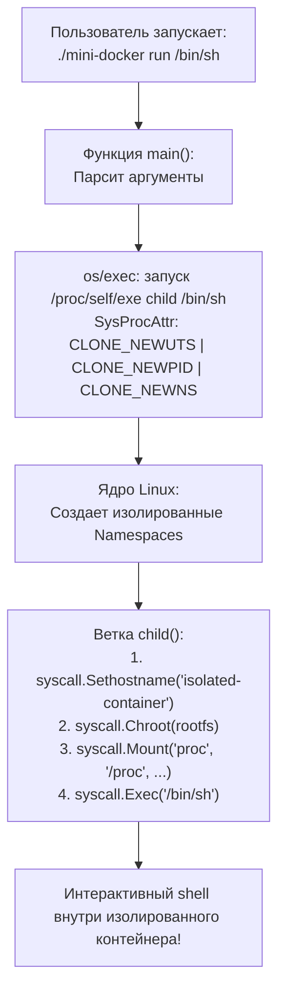

# Урок 3: Пишем собственный контейнерный рантайм на чистом Go за 100 строк кода

Лучший способ навсегда демистифицировать контейнеры — написать собственный минималистичный аналог `runc` и `docker run` с нуля на языке **Go**.

По окончании этого урока вы поймете, что между многомиллионной кодовой базой Docker/Kubernetes и базовыми вызовами операционной системы нет никакой скрытой магии: всё сводится к вызову системных интерфейсов ядра Linux, настройке пространств имен и монтированию `/proc`.

В этом уроке мы разберем:
1. **Архитектурный паттерн Self Re-Exec**: почему многопоточный рантайм Go не может просто вызвать `clone(2)` внутри работающего процесса и как решить эту проблему.
2. **Пакет `syscall` и `os/exec` в Go**: флаги `Cloneflags` и структура `SysProcAttr`.
3. **Изоляцию файловой системы и procfs**: монтирование псевдофайловых систем для изоляции PID 1.
4. **Контроль ресурсов через Cgroups v2**: прямое управление контроллерами ядра через Go.
5. **Полный рабочий исходный код мини-рантайма**: запуск изолированного Alpine Linux.

---

## 1. Проблема многопоточности Go и паттерн Re-Exec

В языке Си программист может вызвать системный вызов `clone()` или `fork()` в любой момент времени. Но в **Go** рантайм является многопоточным: виртуальный планировщик горутин распределяет потоки (M) по ядрам процессора (P).

В стандарте POSIX вызов `fork()` из многопоточного процесса копирует только тот поток, который выполнил вызов. Все остальные фоновые потоки планировщика Go исчезают, а их мьютексы и внутренние структуры остаются заблокированными навсегда, что приводит к немедленному взаимному захвату (Deadlock).

### Паттерн Self Re-Exec (`/proc/self/exe`)
Чтобы обойти это ограничение, все контейнерные рантаймы на Go (включая оригинальный `runc` от Docker) используют паттерн **Re-Exec**:
1. Программа запускается с командой: `go-runtime run /bin/sh`.
2. Программа порождает **новый процесс**, указывая в качестве исполняемого файла саму себя: **`/proc/self/exe child /bin/sh`**.
3. При этом ядру передаются флаги изоляции `Cloneflags: CLONE_NEWUTS | CLONE_NEWPID | CLONE_NEWNS`.
4. Дочерний процесс просыпается уже внутри новых пространств имен и выполняет ветку кода `child()`, где настраивает `rootfs`, монтирует `/proc` и передает управление пользовательской оболочке через `execve`.



---

## 2. Полный исходный код мини-рантайма на Go

Создадим файл `main.go`. Он не требует никаких сторонних библиотек и использует только стандартный инструментарий Go:

```go
package main

import (
	"fmt"
	"os"
	"os/exec"
	"path/filepath"
	"strconv"
	"syscall"
)

// Использование:
//   go run main.go run <команда> [аргументы...]
// Пример:
//   go run main.go run /bin/sh
func main() {
	switch os.Args[1] {
	case "run":
		parent()
	case "child":
		child()
	default:
		panic("Неизвестная команда. Используйте 'run'")
	}
}

// parent запускается на хосте и инициирует создание изолированного процесса
func parent() {
	// Подготавливаем повторный запуск самого себя с аргументом "child"
	cmd := exec.Command("/proc/self/exe", append([]string{"child"}, os.Args[2:]...)...)

	// Направляем стандартный ввод/вывод терминала в дочерний процесс
	cmd.Stdin = os.Stdin
	cmd.Stdout = os.Stdout
	cmd.Stderr = os.Stderr

	// Запрашиваем у ядра Linux создание новых пространств имен при вызове clone(2)
	cmd.SysProcAttr = &syscall.SysProcAttr{
		Cloneflags: syscall.CLONE_NEWUTS | // Изоляция имени хоста
			syscall.CLONE_NEWPID | // Изоляция дерева процессов (PID 1)
			syscall.CLONE_NEWNS, // Изоляция точек монтирования
		Unshareflags: syscall.CLONE_NEWNS,
	}

	// Запускаем дочерний процесс
	if err := cmd.Start(); err != nil {
		fmt.Printf("Ошибка запуска дочернего процесса: %v\n", err)
		os.Exit(1)
	}

	// Настраиваем ограничение ресурсов через Cgroups v2 для запущенного PID
	limitResources(cmd.Process.Pid)

	// Ожидаем завершения работы контейнера
	if err := cmd.Wait(); err != nil {
		fmt.Printf("Контейнер завершился с ошибкой: %v\n", err)
		os.Exit(1)
	}
}

// child выполняется уже внутри изолированных пространств имен
func child() {
	fmt.Printf(">> [Container] Запуск дочернего процесса внутри изолированного окружения (PID: %d)\n", os.Getpid())

	// 1. Изоляция имени хоста (UTS Namespace)
	must(syscall.Sethostname([]byte("my-go-container")))

	// Путь к подготовленной корневой файловой системе rootfs
	rootfsPath := "/tmp/rootfs"

	// 2. Изоляция файловой системы (chroot)
	must(syscall.Chroot(rootfsPath))
	must(syscall.Chdir("/"))

	// 3. Монтирование procfs, чтобы утилиты вроде ps и top читали новый PID Namespace
	must(syscall.Mount("proc", "/proc", "proc", 0, ""))

	// 4. Запуск целевого бинарника (например, /bin/sh) с заменой текущего процесса
	targetCmd := os.Args[2]
	targetArgs := os.Args[2:]
	must(syscall.Exec(targetCmd, targetArgs, os.Environ()))
}

// limitResources конфигурирует контроллеры Cgroups v2
func limitResources(pid int) {
	cgroupPath := "/sys/fs/cgroup/go-runtime"

	// Создаем контрольную группу
	if err := os.MkdirAll(cgroupPath, 0755); err != nil {
		fmt.Printf("Предупреждение: не удалось создать cgroup: %v\n", err)
		return
	}

	// 1. Ограничение оперативной памяти до 50 Мегабайт
	_ = os.WriteFile(filepath.Join(cgroupPath, "memory.max"), []byte("52428800"), 0644)

	// 2. Ограничение числа процессов до 20 (защита от Fork-bomb)
	_ = os.WriteFile(filepath.Join(cgroupPath, "pids.max"), []byte("20"), 0644)

	// 3. Помещаем PID дочернего контейнера в контрольную группу
	_ = os.WriteFile(filepath.Join(cgroupPath, "cgroup.procs"), []byte(strconv.Itoa(pid)), 0644)
}

func must(err error) {
	if err != nil {
		panic(err)
	}
}
```

---

## 3. Пошаговое тестирование рантайма

Протестируем наш мини-рантайм в реальной системе.

### Шаг 1: Подготовка rootfs (Alpine Linux)
```bash
# Создаем каталог rootfs и распаковываем образ
sudo mkdir -p /tmp/rootfs
cd /tmp
curl -sL https://dl-cdn.alpinelinux.org/alpine/v3.20/releases/x86_64/alpine-minirootfs-3.20.0-x86_64.tar.gz | sudo tar -xz -C /tmp/rootfs/
```

### Шаг 2: Компиляция и запуск
```bash
# Компилируем наш рантайм в один статический бинарник
go build -o mini-docker main.go

# Запускаем контейнер с правами root (требуются для монтирования и cgroups)
sudo ./mini-docker run /bin/sh
```

Вывод в терминале:
```text
>> [Container] Запуск дочернего процесса внутри изолированного окружения (PID: 1)
/ # 
```

### Шаг 3: Проверка изоляции внутри контейнера

```text
# 1. Проверяем имя хоста:
/ # hostname
my-go-container

# 2. Проверяем процессы (PID 1):
/ # ps -ef
PID   USER     TIME  COMMAND
    1 root      0:00 /bin/sh
    5 root      0:00 ps -ef

# 3. Проверяем файловую систему:
/ # ls -la /
drwxr-xr-x    2 root     root          4096 Nov 15 12:00 bin
drwxr-xr-x    2 root     root          4096 Nov 15 12:00 etc
dr-xr-xr-x   13 root     root             0 Nov 15 15:40 proc
...
```

Процессы хоста полностью скрыты! Наш процесс `/bin/sh` действительно является `PID 1`.

---

## 4. Как рантайм взаимодействует с Cgroups v2

Когда родительский процесс вызвал `limitResources(cmd.Process.Pid)`:
1. В единой иерархии `/sys/fs/cgroup/` была создана поддиректория `go-runtime`.
2. Ядро Linux активировало для нее контроллеры `memory` и `pids`.
3. В файл `memory.max` записалось значение `52428800` (50 МБ).
4. Запись PID в `cgroup.procs` мгновенно включила счетчик потребления ресурсов ядра.

Если внутри нашего контейнера запустить процесс, выделяющий 80 МБ памяти:
```bash
/ # dd if=/dev/zero of=/dev/shm/fill bs=1M count=80
```
Ядро Linux немедленно применит OOM Killer к контейнеру и завершит его без малейшего риска падения или замедления операционной системы хоста!

---

## Резюме урока

1. Многопоточный рантайм Go не позволяет выполнять прямой `fork()`. Для безопасного запуска изолированных процессов применяется паттерн **Self Re-Exec** через вызов бинарника `/proc/self/exe`.
2. Структура **`syscall.SysProcAttr`** и поле `Cloneflags` передают ядру битовую маску флагов (`CLONE_NEWPID`, `CLONE_NEWNS`, `CLONE_NEWUTS`).
3. Для того чтобы утилиты `ps`, `top` и `kill` корректно видели новый PID Namespace, необходимо смонтировать свежий экземпляр **`procfs`** по пути `/proc`.
4. Интеграция с **Cgroups v2** в Linux тривиальна: достаточно создать каталог в `/sys/fs/cgroup/` и записать PID процесса в файл `cgroup.procs`.
5. Полноценный контейнерный рантайм уровня `runc` строится на этих же самых примитивах ядра Linux.
