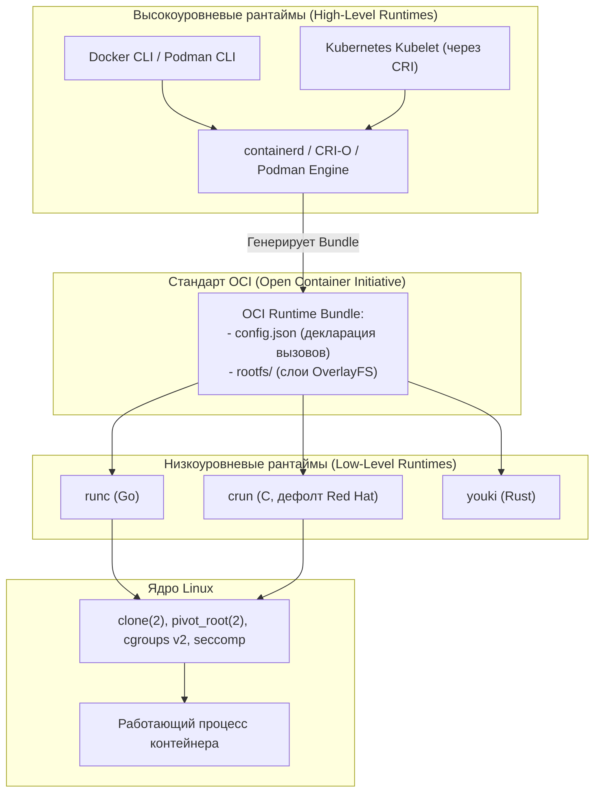
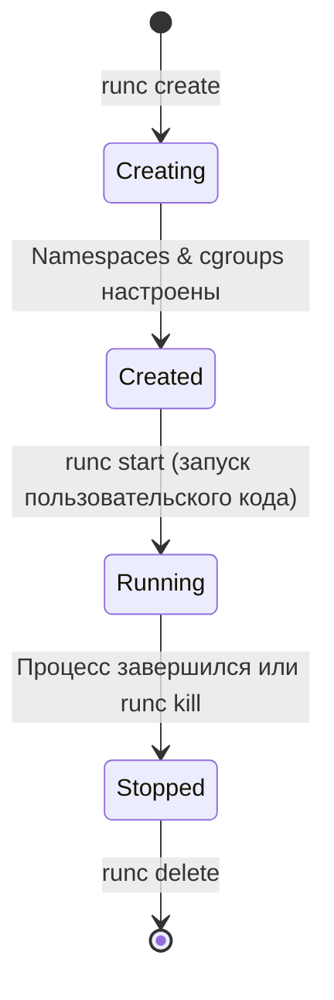

# Урок 4: Спецификация OCI, анатомия bundle и битва рантаймов: runc против crun

Сегодня контейнерная индустрия стандартизирована благодаря **Open Container Initiative (OCI)** — консорциуму под эгидой Linux Foundation, созданному Docker, Red Hat, Google и другими гигантами.

Благодаря стандартам OCI любой инструмент (Docker, Podman, Kubernetes, CRI-O, containerd) может собирать и запускать контейнеры взаимозаменяемо.

В этом уроке мы заглянем на уровень ниже Docker и Podman:
1. **Двухуровневая архитектура рантаймов**: High-level (`containerd`, `CRI-O`) против Low-level (`runc`, `crun`).
2. **Анатомия OCI Runtime Bundle**: устройство каталога `rootfs` и спецификации `config.json`.
3. **Жизненный цикл OCI-контейнера**: команды `create`, `start`, `state`, `kill`, `delete`.
4. **Роль супервизоров `conmon` и `containerd-shim`**: почему рантайм завершается, а контейнер продолжает жить.
5. **Сравнение низкоуровневых движков**: классический `runc` на Go против сверхбыстрого Си-рантайма `crun`.
6. **Практикум**: ручной запуск контейнера через OCI Bundle без участия Docker и Podman.

---

## 1. Двухуровневая архитектура рантаймов контейнеров

В современных системах запуск контейнера разделен на два четких слоя ответственности:



### High-Level Runtimes (`containerd`, `CRI-O`, `podman`):
* Скачивают образы из реестров (Registry API).
* Проверяют криптографические подписи (Cosign, GPG).
* Распаковывают сжатые слои `tar.gz` в файловую систему Copy-on-Write (OverlayFS).
* Готовят сетевой стек (CNI, netavark, pasta).
* Создают **OCI Runtime Bundle** и передают управление низкоуровневому рантайму.

### Low-Level Runtimes (`runc`, `crun`):
* Читают единственный файл `config.json` и каталог `rootfs`.
* Выполняют низкоуровневые системные вызовы ядра: `clone`, `unshare`, `pivot_root`, `setns`.
* Настраивают лимиты в `/sys/fs/cgroup/`.
* Применяют правила фильтрации Seccomp и Capabilities.
* Запускают процесс приложения и мгновенно выходят!

---

## 2. Анатомия OCI Runtime Bundle

Любой контейнер перед запуском превращается на диске в простую директорию, называемую **OCI Bundle**:

```text
my-container-bundle/
├── config.json      # Полная OCI спецификация контейнера
└── rootfs/          # Корневая файловая система приложения
    ├── bin/
    ├── etc/
    ├── lib/
    └── ...
```

### Разбор структуры `config.json`
Файл `config.json` содержит всю декларацию контейнера в стандартизированном JSON:

```json
{
  "ociVersion": "1.0.2",
  "process": {
    "terminal": true,
    "user": { "uid": 0, "gid": 0 },
    "args": [ "/bin/sh" ],
    "env": [ "PATH=/usr/local/sbin:/usr/local/bin:/usr/sbin:/usr/bin:/sbin:/bin" ],
    "cwd": "/",
    "capabilities": {
      "bounding": [ "CAP_CHOWN", "CAP_NET_BIND_SERVICE" ]
    }
  },
  "root": {
    "path": "rootfs",
    "readonly": true
  },
  "mounts": [
    {
      "destination": "/proc",
      "type": "proc",
      "source": "proc"
    },
    {
      "destination": "/dev",
      "type": "tmpfs",
      "source": "tmpfs",
      "options": [ "nosuid", "strictatime", "mode=755", "size=65536k" ]
    }
  ],
  "linux": {
    "namespaces": [
      { "type": "pid" },
      { "type": "network" },
      { "type": "ipc" },
      { "type": "uts" },
      { "type": "mount" }
    ],
    "resources": {
      "memory": {
        "limit": 536870912
      },
      "cpu": {
        "quota": 50000,
        "period": 100000
      }
    }
  }
}
```

---

## 3. Жизненный цикл контейнера в спецификации OCI

Спецификация определяет строгий конечный автомат состояний контейнера:



1. **`runc create <id>`**:
   * Создает пространства имен и контрольную группу cgroups.
   * Монтирует `rootfs` и псевдофайловые системы.
   * Порождает дочерний процесс, но **приостанавливает его до первого вызова `start`** (процесс ожидает в сигнальном сокете).
2. **`runc start <id>`**:
   * Посылает сигнал дочернему процессу разблокироваться и выполнить `execve()` с бинарником пользователя.
3. **`runc state <id>`**:
   * Возвращает текущее состояние (PID на хосте, статус, пути к cgroup).
4. **`runc kill <id> <сигнал>`**:
   * Отправляет POSIX-сигнал (SIGTERM, SIGKILL) процессам контейнера.
5. **`runc delete <id>`**:
   * Удаляет контрольные группы и освобождает оставшиеся дескрипторы.

---

## 4. Зачем нужны `conmon` и `containerd-shim`?

Если `runc` и `crun` завершаются сразу после запуска дочернего процесса, кто остается следить за контейнером?

Для этого высокоуровневые рантаймы запускают сверхлегковесный промежуточный процесс-супервизор:
* В **Podman / CRI-O**: это утилита **`conmon`** (Container Monitor на чистом Си).
* В **Docker / containerd**: это процесс **`containerd-shim`**.

### Обязанности `conmon` / `shim`:
1. **Удержание дескрипторов ввода/вывода**: Перенаправляет `stdout` и `stderr` контейнера в лог-файлы или `journald` даже при перезагрузке демона или разрыве SSH-сессии.
2. **Перехват кода завершения (Exit Code)**: Когда процесс приложения умирает, именно `conmon` вызывает `waitpid()` и сохраняет статус завершения (Exit code 0, 1, 137).
3. **Управление TTY**: Обслуживает псевдотерминалы при интерактивном запуске `-it`.
4. **Предотвращение зомби-процессов**: Если контейнер упал, а демон был перезапущен, `conmon` не дает процессу зависнуть в виде процесса-зомби (`<defunct>`).

---

## 5. Битва низкоуровневых рантаймов: `runc` против `crun`

Долгое время стандартом де-факто был `runc`, написанный компанией Docker на языке Go. Однако в современных дистрибутивах (RHEL, Fedora, CentOS Stream) рантаймом по умолчанию стал **`crun`**, написанный на чистом Си.

### Сравнительная таблица:

| Характеристика | `runc` (Go) | `crun` (C99) |
|---|---|---|
| **Язык разработки** | Go | Чистый C |
| **Размер бинарника** | ~12–15 МБ (включает Go Runtime) | **~500 КБ** |
| **Потребление RAM при старте** | ~15–20 МБ на запуск | **< 1 МБ** |
| **Время холодного старта** | ~35–50 мс | **~4–8 мс** (в 5–8 раз быстрее) |
| **Многопоточность / Fork** | Сложный Cgo-мост для обхода планировщика Go | Нативный вызов `clone(2)` и `fork()` без оверхеда |
| **Поддержка Cgroups v2** | Полная | Полная + нативная поддержка Cgroup v2 freeze |
| **Где используется** | Дефолт в Docker Desktop, старых K8s | Дефолт в **Podman**, Red Hat OpenShift, Fedora |

> [!TIP]
> Для сред с высокой плотностью контейнеров (Serverless, FaaS, запуск тысяч микросервисов в секунду) использование `crun` вместо `runc` снижает задержку холодного старта контейнеров на порядок и экономит гигабайты оперативной памяти на хосте.

---

## 6. Практикум: Запуск контейнера напрямую через `runc`

Убедимся, что контейнеры работают вообще без демонов `dockerd` или `podman`:

```bash
# 1. Создаем OCI Bundle каталог
mkdir -p /tmp/oci-demo/rootfs
cd /tmp/oci-demo

# 2. Распаковываем образ Alpine в каталог rootfs
curl -sL https://dl-cdn.alpinelinux.org/alpine/v3.20/releases/x86_64/alpine-minirootfs-3.20.0-x86_64.tar.gz | tar -xz -C rootfs/

# 3. Генерируем дефолтный шаблон спецификации config.json
runc spec

# 4. Запускаем контейнер напрямую через низкоуровневый рантайм:
sudo runc run my-oci-box
```

После выполнения команды вы мгновенно окажетесь в шелле Alpine Linux:
```text
/ # hostname
runc
/ # ps -ef
PID   USER     TIME  COMMAND
    1 root      0:00 sh
    4 root      0:00 ps -ef
```

Ни одного демона на сервере не запущено. Чистый OCI-бандл и низкоуровневый рантайм `runc`!

---

## Резюме урока

1. **OCI Runtime Spec** стандартизирует способ запуска контейнеров: высокоуровневые движки собирают **Bundle** (`rootfs` + `config.json`), а низкоуровневые рантаймы исполняют его в ядре.
2. Процессы **`conmon`** и **`containerd-shim`** действуют как долгоживущие супервизоры, удерживая потоки ввода-вывода и сохраняя Exit Code после завершения работы рантайма.
3. **`crun`** на Си превосходит **`runc`** на Go по скорости холодного старта (в 5 раз быстрее) и минимальному потреблению памяти (< 1 МБ).
4. Любой контейнер в мире можно запустить одной командой `runc run` / `crun run`, имея лишь спецификацию `config.json` и распакованную директорию файлов.
