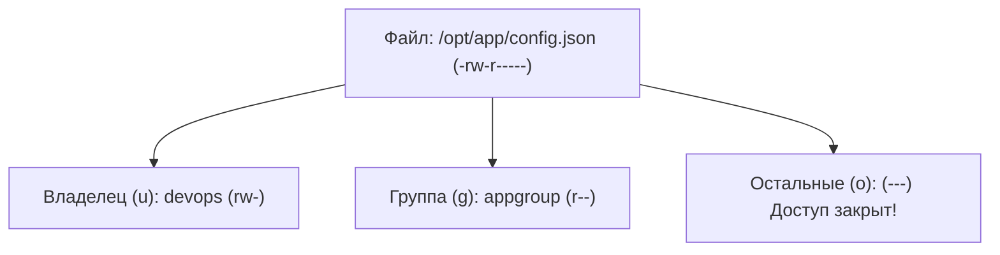

# Права доступа в Linux, модель безопасности и управление сервисами systemd

Управление правами доступа, изоляция привилегий и надежный контроль жизненного цикла системных демонов — ключевой фундамент системной инженерии и эксплуатации Linux. Неправильно выставленные права на конфигурационные файлы или исполняемые бинарники приводят к мгновенной компрометации хоста, а отсутствие лимитов на уровне сервисов systemd грозит падением сервера при перегрузке.

В этом уроке мы разберем классическую модель прав доступа DAC, специальные биты (SUID/SGID/Sticky bit), списки управления доступом POSIX ACL, а также глубокую настройку и харденинг сервисов в **systemd**.

---

## 1. Классическая модель прав доступа: DAC (Discretionary Access Control)

В файловых системах Linux каждый объект (файл, директория, именованный канал, сокет) ассоциирован с тремя категориями субъектов:
1. **Владелец (User / Owner):** пользователь, создавший файл.
2. **Группа (Group):** системная группа, имеющая групповые привилегии.
3. **Остальные (Others):** все остальные учетные записи в операционной системе.



### Восьмеричная и символьная нотация:
| Права | Символ | Число | Значение для файла | Значение для каталога |
| :--- | :---: | :---: | :--- | :--- |
| **Read** | `r` | `4` | Чтение содержимого файла | Просмотр списка файлов (`ls`) |
| **Write** | `w` | `2` | Модификация содержимого | Создание и удаление файлов внутри каталога |
| **Execute** | `x` | `1` | Запуск скрипта / бинарника | Вход в каталог (`cd`) и доступ к его инодам |

```bash
# Выставить права только на чтение и запись владельцу (для ключей SSH и секретов):
chmod 600 ~/.ssh/id_ed25519

# Сменить владельца и группу рекурсивно для директории веб-приложения:
sudo chown -R appuser:appgroup /opt/app
```

---

## 2. Специальные биты: SUID, SGID и Sticky Bit

Для решения специфических системных задач стандартных прав `rwx` недостаточно:

### 1. SUID (Set User ID — число 4000)
Если на исполняемом файле выставлен бит SUID (`chmod u+s /path/binary`), процесс запускается **с правами владельца файла**, а не с правами запустившего его пользователя.
*Классический пример:* утилита `/usr/bin/passwd` принадлежит root и имеет SUID (`-rwsr-xr-x`). Обычный пользователь может изменить собственный пароль в `/etc/shadow`, куда иначе доступ закрыт.
> [!WARNING]
> Бит SUID — излюбленный вектор злоумышленников для повышения привилегий (Privilege Escalation). В контейнерах Docker его исполнение отключается флагом `security_opt: ["no-new-privileges:true"]`.

### 2. SGID (Set Group ID — число 2000)
- На файле: процесс запускается с правами группы владельца файла.
- На каталоге (`chmod g+s /shared/folder`): **все новые файлы и подкаталоги, созданные внутри, автоматически наследуют группу этого каталога**, а не основную группу создавшего их пользователя. Идеально для командной работы над проектом.

### 3. Sticky Bit (число 1000)
Применяется к каталогам с общим доступом на запись (`chmod +t /tmp`): удалять или переименовывать файлы внутри каталога могут **только их владельцы или root**, даже если права на каталог `777`.

---

## 3. Расширенные списки контроля доступа: POSIX ACL

Стандартная модель DAC не позволяет выдать права второму конкретному пользователю без добавления его в общую группу. Эту задачу решает механизм **Access Control Lists (ACL)**:

```bash
# Просмотр расширенных прав на файл:
getfacl /opt/data/reports.csv

# Выдать пользователю 'analyst' права на чтение (r) в обход основной группы:
setfacl -m u:analyst:r /opt/data/reports.csv

# Задать наследуемые права по умолчанию (Default ACL) на всю папку для новых файлов:
setfacl -d -m g:developers:rwx /opt/shared/
```

---

## 4. Архитектура и харденинг сервисов в systemd

В современных дистрибутивах Linux (Ubuntu 22.04/24.04, Debian 12, RHEL 9) жизненным циклом фоновых демонов управляет система инициализации **systemd** (PID 1).

### Эталонный Unit-файл с встроенным харденингом (`/etc/systemd/system/myapp.service`):

```ini
[Unit]
Description=Primary Cloud Platform API Daemon
Documentation=https://vorobevaqa.ru/
After=network-online.target
Wants=network-online.target

[Service]
Type=simple
User=appuser
Group=appgroup
WorkingDirectory=/opt/app
ExecStart=/opt/app/server --config /etc/myapp/config.yaml
ExecReload=/bin/kill -HUP $MAINPID
Restart=always
RestartSec=5s

# -------------------------------------------------------------
# Харденинг безопасности процесса (Systemd Sandbox)
# -------------------------------------------------------------
# Делает корень ФС только для чтения, защищая системные директории (/usr, /etc)
ProtectSystem=strict
# Запрещает доступ к /home, /root и /run/user
ProtectHome=yes
# Создает изолированный временный каталог /tmp специально для этого сервиса
PrivateTmp=yes
# Запрещает повышение привилегий через SUID бинарники
NoNewPrivileges=true
# Запрещает процессу создавать новые пространства имен ядра
RestrictNamespaces=yes
# Разрешает запись ТОЛЬКО в директорию логов и кэша
ReadWritePaths=/var/log/myapp /var/lib/myapp

# -------------------------------------------------------------
# Лимиты ресурсов Cgroups v2 на уровне systemd
# -------------------------------------------------------------
MemoryMax=512M
CPUQuota=150%
LimitNOFILE=65535

[Install]
WantedBy=multi-user.target
```

---

## 5. Управление жизненным циклом и диагностика

```bash
# 1. Перечитать unit-файлы с диска после внесения правок:
sudo systemctl daemon-reload

# 2. Активировать автозагрузку и запустить сервис одной командой:
sudo systemctl enable --now myapp

# 3. Инспекция статуса и последних записей лога:
sudo systemctl status myapp

# 4. Просмотр потоковых логов в реальном времени через journald:
journalctl -u myapp -f -o cat
```

---

## 6. Таймеры systemd как замена устаревшему Cron

Вместо непрозрачного `crontab`, где ошибки часто теряются в `/var/mail`, в продакшне используют связку **Unit + Timer**:

`/etc/systemd/system/backup.timer`:
```ini
[Unit]
Description=Daily Backup Timer

[Timer]
OnCalendar=*-*-* 03:00:00 # Каждый день в 03:00 ночи
Persistent=true           # Запустить пропущенную задачу, если сервер был выключен

[Install]
WantedBy=timers.target
```

> [!TIP]
> **Связь с контейнерами:**
> Механизмы изоляции systemd работают на базе тех же пространств имен и Cgroups, что и контейнеризация. Углубленный разбор контейнеров, управляемых systemd без демона Docker, представлен в курсе [Podman Quadlet: контейнеры как нативные службы systemd](/courses/podman/02-podman-quadlet-and-systemd).
