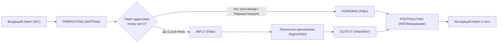

# Сетевой стек Linux: интерфейсы, DNS, фаервол UFW и Netfilter под капотом

Сетевая подсистема ядра Linux отвечает за маршрутизацию терабайтов трафика, трансляцию сетевых адресов (NAT) и фильтрацию пакетов. Ошибки в конфигурации фаервола или недопонимание работы подсистемы Netfilter приводят к тому, что базы данных неожиданно оказываются открытыми в публичный интернет, а DNS-запросы застревают с секундными задержками.

В этом уроке мы разберем архитектуру сетевого стека Linux: от утилит семейства `iproute2` и системного DNS-резолвера до хуков Netfilter и защиты периметра через UFW.

---

## 1. Управление сетевым стеком через `iproute2`

Устаревшие утилиты `ifconfig`, `route` и `arp` давно заменены современным пакетом **`iproute2`** (`ip`, `ss`):

```bash
# 1. Просмотр физических и виртуальных интерфейсов с их MTU и MAC:
ip link show

# 2. Просмотр назначенных IP-адресов:
ip -4 -br addr show

# 3. Инспекция таблицы маршрутизации (Routing Table):
ip route show
# Пример вывода: default via 194.87.1.1 dev eth0 proto static onlink

# 4. Просмотр ARP-таблицы (сопоставление IP и физических MAC-адресов):
ip neigh show
```

---

## 2. Мониторинг сокетов и открытых портов (`ss`)

Утилита **`ss` (Socket Statistics)** читает информацию напрямую из структур ядра Linux через протокол Netlink, работая в десятки раз быстрее старого `netstat`:

```bash
# Посмотреть все слушающие TCP и UDP порты с указанием PID процесса:
sudo ss -tulpn
```

| Флаг | Назначение |
| :--- | :--- |
| **`-t`** | Фильтрация соединений TCP |
| **`-u`** | Фильтрация соединений UDP |
| **`-l`** | Только слушающие сокеты (**Listening**) |
| **`-p`** | Имя процесса и PID (требует прав суперпользователя `sudo`) |
| **`-n`** | Числовой формат (без медленного обратного DNS-резолвинга портов и IP) |

```bash
# Проверить, какой процесс слушает HTTP порт 80 или 443:
sudo ss -tulpn | grep -E ':(80|443)\b'

# Просмотр установленных соединений к конкретному порту:
ss -tn state established '( dport = :5432 or sport = :5432 )'
```

---

## 3. Разрешение имен DNS: `/etc/resolv.conf` и `systemd-resolved`

В современных Linux-системах (Ubuntu/Debian) локальным резолвером управляет служба `systemd-resolved`. В файле `/etc/resolv.conf` указан адрес локального stub-резолвера:

```text
nameserver 127.0.0.53
options edns0 trust-ad
```

### Диагностика DNS-резолвинга:
```bash
# Просмотр используемых апстрим DNS-серверов для каждого интерфейса:
resolvectl status

# Проверка скорости разрешения домена:
dig +stats vorobevaqa.ru

# Сброс локального DNS-кэша systemd:
sudo resolvectl flush-caches
```

---

## 4. Архитектура ядра: Netfilter, iptables и цепочки пакетов

Вся фильтрация трафика в ядре Linux выполняется фреймворком **Netfilter**. Каждый сетевой пакет проходит через цепочку хуков ядра:



- **Таблица `filter`:** отвечает за разрешение или запрет трафика (`INPUT`, `OUTPUT`, `FORWARD`).
- **Таблица `nat`:** отвечает за подмену адресов и портов (`PREROUTING` для DNAT, `POSTROUTING` для SNAT/Masquerade).

---

## 5. Защита периметра через UFW (Uncomplicated Firewall)

UFW — простая и надежная обертка над Netfilter, защищающая входящий трафик хоста:

### Эталонный чек-лист настройки на боевом сервере:
```bash
# 1. Запретить весь входящий трафик по умолчанию:
sudo ufw default deny incoming

# 2. Разрешить весь исходящий трафик:
sudo ufw default allow outgoing

# 3. КРИТИЧЕСКИ ВАЖНО: открыть SSH порт до активации фаервола!
sudo ufw allow 22/tcp comment "SSH Remote Access"

# 4. Открыть порты публичного веб-трафика (HTTP/HTTPS):
sudo ufw allow 80/tcp comment "HTTP Web"
sudo ufw allow 443/tcp comment "HTTPS Web"

# 5. Ограничение брутфорс атак на SSH (Rate Limiting):
sudo ufw limit 22/tcp

# 6. Активация и проверка статуса правил:
sudo ufw enable
sudo ufw status verbose
```

---

## 6. Коллизия Docker и UFW: Почему фаервол не спасает контейнеры?

> [!WARNING]
> **Опасная уязвимость конфигурации:**
> Когда вы публикуете порт контейнера (`docker run -p 5432:5432 postgres`), демон Docker автоматически добавляет правило DNAT в таблицу `nat` и перенаправляет пакет в цепочку **`FORWARD`**.  
> UFW же фильтрует входящий трафик в цепочке **`INPUT`**. В итоге входящий пакет уходит в контейнер **в обход всех запрещающих правил UFW**, делая базу данных доступной всему интернету!

### Как правильно защитить порты контейнеров:
1. **Привязка к Localhost (Стандарт):**  
   Публикуйте порты только на интерфейсе петли обратной связи (`127.0.0.1`):
   ```yaml
   ports:
     - "127.0.0.1:5432:5432" # Доступно только локально, снаружи закрыто!
   ```
2. **Пользовательская цепочка `DOCKER-USER`:**  
   Docker предоставляет специальную цепочку `DOCKER-USER`, которая вызывается до правил самого Docker. Любые правила фильтрации трафика контейнеров на уровне фаервола должны добавляться именно в нее.

> [!TIP]
> Полная схема прохождения пакетов через цепочки `DOCKER`, `DOCKER-USER` и настройка правил Netfilter разобраны в [Модуле 4.2: Порты и безопасность iptables](/courses/docker-networking/02-ports-and-iptables-security).
