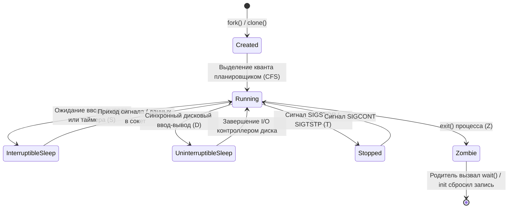

# Управление процессами, диагностика и системные лимиты в Linux

Эффективная диагностика инцидентов в продакшене начинается с глубокого понимания жизненного цикла процессов, сигналов ядра POSIX, учета файловых дескрипторов и поведения ядра при дефиците ресурсов.

В этом уроке мы разберем:
* Жизненный цикл и диаграмму переходов состояний процессов в Linux.
* Сигналы ядра: разницу между `SIGTERM`, `SIGKILL`, `SIGHUP` и корректное завершение (Graceful Shutdown).
* Диагностику зависаний и утечек дескрипторов через `lsof` и `strace`.
* Управление системными лимитами (`ulimit`, `LimitNOFILE`, `/etc/security/limits.conf`).
* Алгоритм работы ядра Out-Of-Memory (OOM) Killer и тюнинг `oom_score_adj`.

---

## 1. Жизненный цикл процессов и диаграмма состояний

Каждый процесс в Linux порождается системным вызовом `fork()` или `clone()` от родительского процесса и образует древовидную структуру с вершиной в `PID 1` (`systemd`).



### Ключевые состояния процессов в выводе `ps aux` / `top`:

| Состояние | Код в `STAT` | Описание | Особенности поведения |
|---|---|---|---|
| **Running** | `R` | Процесс исполняется на процессоре или стоит в очереди планировщика. | Потребляет CPU. |
| **Interruptible Sleep** | `S` | Спящее состояние в ожидании внешнего события (сетевой сокет, таймер). | **Мгновенно просыпается** при поступлении любого сигнала POSIX. |
| **Uninterruptible Sleep** | `D` | Глубокий сон в ожидании дискового или аппаратного ввода-вывода (NFS, диск). | **Не прерывается никакими сигналами**, включая `kill -9`! Единственный способ завершить D-процесс — дождаться ответа драйвера или перезагрузить хост. |
| **Zombie** | `Z` | Процесс завершился (`exit()`), но родитель еще не вызвал `waitpid()` для считывания кода возврата. | Не потребляет RAM и CPU, но **удерживает номер PID** в системной таблице процессов. |

```bash
# Просмотр дерева процессов с аргументами:
ps auxf

# Поиск процессов, застрявших в состоянии D или Z:
ps aux | awk '$8 ~ /[DZ]/'
```

---

## 2. Сигналы ядра и завершение процессов (kill, pkill)

Утилита `kill` отправляет процессу системный сигнал POSIX.

| Номер | Сигнал | Поведение | Когда использовать |
|---|---|---|---|
| **`15`** | **`SIGTERM`** | Запрос на корректное завершение (Graceful Shutdown) | Стандартная остановка: сервис успевает завершить текущие запросы клиентов, закрыть файлы и сокеты БД. |
| **`9`** | **`SIGKILL`** | Немедленное уничтожение ядром Linux | Процесс завис намертво. Не перехватывается приложением, чревато повреждением файловых кэшей. |
| **`1`** | **`SIGHUP`** | Перечитывание конфигурации без перезапуска | Ротация логов, reload конфигурации Nginx, PostgreSQL, Envoy. |
| **`2`** | **`SIGINT`** | Прерывание с терминала (`Ctrl + C`) | Интерактивная отмена операции. |

```bash
# 1. Запрос на корректное завершение (graceful):
kill -15 <PID>

# 2. Мягкая остановка по имени сервиса:
pkill -15 -f "portfolio-service"

# 3. Принудительное уничтожение, если сервис не ответил за 10-15 секунд:
kill -9 <PID>
```

---

## 3. Диагностика зависаний и открытых дескрипторов (`lsof`, `strace`)

В Linux действует принцип «Все есть файл»: файлы, каталоги, сокеты TCP/UDP, pipes и устройства представляются файловыми дескрипторами (File Descriptors, FD).

### Поиск открытых ресурсов через `lsof`:
```bash
# 1. Какой процесс занял порт 8080:
sudo lsof -i :8080

# 2. Список всех открытых файлов и сокетов конкретного процесса:
sudo lsof -p <PID>

# 3. Количество открытых дескрипторов процесса:
sudo ls -1 /proc/<PID>/fd | wc -l
```

### Трассировка системных вызовов через `strace`:
Если сервис завис, не отвечает на запросы или нагружает ядро, `strace` позволяет перехватить вызовы приложения к ядру в реальном времени:

```bash
# Подключиться к работающему процессу и отслеживать дочерние потоки (-f) с микросекундами (-tt):
sudo strace -p <PID> -f -tt -s 256

# Подсчет статистики системных вызовов (время, количество, ошибки):
sudo strace -c -p <PID>
```

---

## 4. Системные лимиты дескрипторов (`ulimit`, `LimitNOFILE`)

При высокой нагрузке веб-серверы и базы данных часто сталкиваются с ошибкой:
```text
java.io.IOException: Too many open files
```

### Проверка и временное изменение лимитов:
```bash
# Текущий мягкий лимит открытых файлов в текущей сессии:
ulimit -n

# Временное повышение лимита до 65535:
ulimit -n 65535
```

### Постоянная конфигурация для systemd сервисов:
В файле сервиса `/etc/systemd/system/myapp.service`:
```ini
[Service]
# Лимит открытых дескрипторов
LimitNOFILE=65535

# Лимит максимального количества процессов и потоков
LimitNPROC=4096

# Лимит размера памяти процесса в swap
LimitMEMLOCK=infinity
```

После редактирования обязательно перечитайте конфигурацию:
```bash
sudo systemctl daemon-reload
sudo systemctl restart myapp
```

---

## 5. Out Of Memory (OOM Killer) и приоритет выживания

Когда на сервере исчерпывается свободная оперативная память и Swap, ядро Linux вызывает аварийный механизм **OOM Killer**. Ядро рассчитывает для каждого процесса балл `oom_score` (от 0 до 1000) на основе потребляемой памяти и убивает процесс с наивысшим баллом сигналом `SIGKILL`.

### Проверка журнала OOM Killer:
```bash
sudo dmesg -T | grep -i -E 'oom[-_]killer|killed process'
```

### Защита критически важных служб (SSH, PostgreSQL) от OOM Killer:
Вы можете скорректировать оценку выживаемости процесса через параметр `oom_score_adj` (значения от `-1000` до `+1000`):

```bash
# Значение -1000 полностью запрещает ядру убивать данный процесс:
echo -1000 | sudo tee /proc/<PID>/oom_score_adj
```

В systemd unit файле:
```ini
[Service]
OOMScoreAdjust=-1000
```

---

## 6. Вопросы для самопроверки

<details>
<summary>Вопрос 1: Почему процесс в состоянии 'D' (Uninterruptible Sleep) невозможно завершить командой kill -9?</summary>
<div class="mt-2 text-body">
Состояние <b>D</b> означает, что процесс выполняет системный вызов внутри ядра и находится в блокирующем ожидании ответа от аппаратного контроллера (диск, сетевая файловая система NFS, устройство ввода-вывода). Чтобы не нарушить целостность структур ядра и файловых транзакций, ядро принципиально игнорирует доставку любых сигналов (включая SIGKILL) до тех пор, пока драйвер оборудования не завершит операцию.
</div>
</details>

<details>
<summary>Вопрос 2: Потребляют ли ресурсы зомби-процессы (состояние 'Z')?</summary>
<div class="mt-2 text-body">
Зомби-процессы не потребляют ни тактов процессора, ни оперативной памяти, так как их тело программы уже выгружено из ОЗУ. Однако они удерживают запись в глобальной системной таблице процессов ядра (номер PID). Если родительский процесс плодит зомби и не вызывает <code>waitpid()</code>, хост может исчерпать лимит <code>pid_max</code>, после чего в системе перестанут запускаться любые новые команды.
</div>
</details>

<details>
<summary>Вопрос 3: Где настраивать лимит LimitNOFILE для современных сервисов Linux?</summary>
<div class="mt-2 text-body">
Для сервисов, управляемых <b>systemd</b>, старый конфигурационный файл <code>/etc/security/limits.conf</code> по умолчанию игнорируется. Лимиты файлов и процессов для демонов необходимо прописывать напрямую в секции <code>[Service]</code> unit-файла (<code>LimitNOFILE=65535</code>) либо в drop-in файле переопределения (<code>systemctl edit &lt;сервис&gt;</code>).
</div>
</details>

---

## 7. Дополнительные материалы

* [Модуль 1: Права доступа в Linux, модель безопасности и Systemd](/courses/linux/01-permissions-and-systemd)
* [Модуль 2: Сетевой стек Linux: интерфейсы, DNS и фаерволы](/courses/linux/02-networking-and-firewalls)
* [Модуль 4: Bash-автоматизация и скриптинг для DevOps](/courses/linux/04-bash-automation-and-scripting)
* [Модуль 7.2: Анатомия Exit Code 137: Диагностика OOM Killer](/courses/docker-resources/02-oom-killer-diagnostics-and-exit-137)
