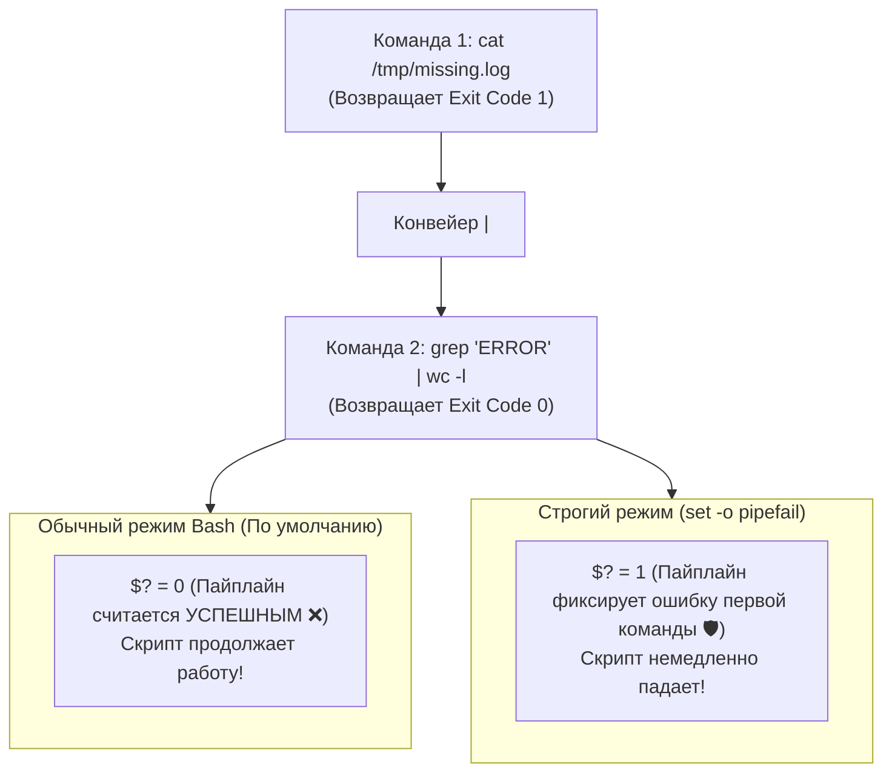
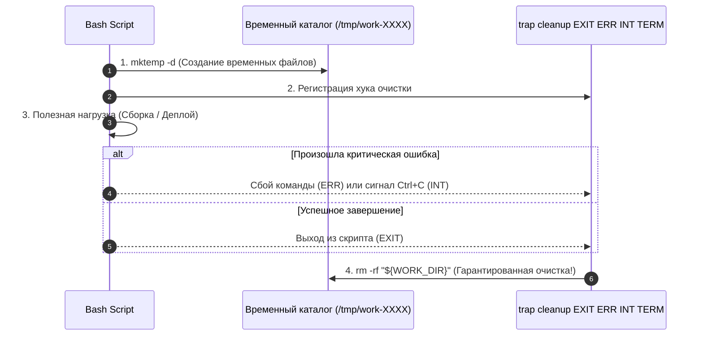

# Bash-скриптинг для DevOps: надежность, потоки I/O и паттерны автоматизации

Bash — ключевой инструмент автоматизации в CI/CD пайплайнах, Dockerfile, сценариях инициализации VDS и cron-задачах. Написание надежных скриптов требует строгого режима исполнения, гарантированного перехвата ошибок и очистки ресурсов при любых аварийных сбоях.

В этом уроке мы разберем:
* Золотой стандарт надежности: строгий режим `set -Eeuo pipefail`.
* Конструкцию `trap`: перехват ошибок и аналог `defer` для гарантированной очистки временных ресурсов.
* Управление стандартными потоками ввода-вывода (`stdin`, `stdout`, `stderr`), конвейерами и дескрипторами.
* Безопасную работу со строками, пробелами, переменными по умолчанию и параметрами CLI.
* Готовый к боевой эксплуатации production-шаблон скрипта автоматизации.

---

## 1. Золотой стандарт надежности: `set -Eeuo pipefail`

По умолчанию Bash продолжает выполнение сценария даже в том случае, если одна из команд завершилась с критической ошибкой. В автоматизированных пайплайнах это может привести к повреждению данных или ложноположительному успешному завершению деплоя.

В начале каждого профессионального скрипта указывается строгий режим:

```bash
#!/usr/bin/env bash
set -Eeuo pipefail
IFS=$'\n\t'
```



### Разбор флагов строгого режима:

| Флаг | Параметр | Практическое назначение |
|---|---|---|
| **`-e`** | `errexit` | Немедленно завершает скрипт, если любая команда вернула ненулевой код (`exit code != 0`). |
| **`-E`** | `errtrace` | Гарантирует наследование ловушек `trap ... ERR` функциями и подоболочками (subshells). |
| **`-u`** | `nounset` | Вызывает ошибку и останавливает скрипт при обращении к необъявленной переменной (защита от катастроф вроде `rm -rf /${UNDEFINED_VAR}`). |
| **`-o pipefail`** | `pipefail` | Кодом возврата конвейера (`cmd1 \| cmd2`) считается код **первой упавшей команды**, а не последней. |
| **`IFS=$'\n\t'`** | `field separator` | Разделяет элементы циклов только по переводу строки и табуляции, предотвращая баги с пробелами в путях. |

---

## 2. Гарантированная очистка ресурсов: механизм `trap`

Аналог конструкции `defer` из языка Go в Bash реализуется через встроенную команду `trap`. Она гарантирует выполнение функции очистки (удаление временных файлов, разблокировка lock-файлов) даже при падении скрипта по ошибке или при нажатии `Ctrl+C`.



### Реализация шаблона `trap`:

```bash
#!/usr/bin/env bash
set -Eeuo pipefail

# Создаем изолированную временную директорию
WORK_DIR=$(mktemp -d -t deploy-XXXXXX)

# Функция гарантированной очистки
cleanup() {
    local exit_code=$?
    echo "🧹 Завершение работы (exit code: ${exit_code}), удаление: ${WORK_DIR}..."
    rm -rf "${WORK_DIR}"
    exit "${exit_code}"
}

# Перехватываем стандартные сигналы и завершение работы
trap cleanup EXIT ERR INT TERM

# Полезная нагрузка скрипта:
echo "Временные файлы создаются в ${WORK_DIR}..."
# Даже если здесь произойдет ошибка, cleanup() выполнится гарантированно!
```

---

## 3. Потоки ввода-вывода (I/O) и перенаправления

Каждый процесс в Linux имеет три стандартных файловых дескриптора:
- `0` — **`stdin`** (стандартный ввод)
- `1` — **`stdout`** (стандартный вывод)
- `2` — **`stderr`** (поток ошибок)

```bash
# 1. Перенаправить только ошибки в файл логов, а результат — в терминал:
./backup.sh 2> backup_errors.log

# 2. Объединить stdout и stderr в один поток и записать в файл:
./deploy.sh > release.log 2>&1
# Или современный синтаксис Bash 4+:
./deploy.sh &> release.log

# 3. Одновременно писать в файл и выводить на экран (утилита tee):
./build.sh 2>&1 | tee build.log

# 4. Подавить весь вывод команды (тихий режим):
command -v docker > /dev/null 2>&1
```

---

## 4. Безопасная работа с переменными и параметрами

### Значения по умолчанию и валидация:
```bash
# 1. Если переменная не задана или пуста — использовать значение по умолчанию:
PORT="${PORT:-8080}"
ENVIRONMENT="${ENV:-production}"

# 2. Выдать ошибку и упасть, если обязательная переменная не передана:
DATABASE_URL="${DB_URL:?Критическая ошибка: переменная DB_URL не установлена!}"

# 3. Присвоить переменной дефолтное значение, если она пуста:
: "${BACKUP_PATH:=/var/backups}"
```

### Парсинг аргументов командной строки:
```bash
while [[ $# -gt 0 ]]; do
    case "$1" in
        -e|--env)
            ENV="$2"
            shift 2
            ;;
        -h|--help)
            echo "Использование: $0 [-e environment]"
            exit 0
            ;;
        *)
            echo "Неизвестный параметр: $1" >&2
            exit 1
            ;;
    esac
done
```

---

## 5. Шаблон надежного Production-скрипта

```bash
#!/usr/bin/env bash
set -Eeuo pipefail
IFS=$'\n\t'

readonly SCRIPT_DIR="$(cd "$(dirname "${BASH_SOURCE[0]}")" && pwd)"
readonly LOG_FILE="/tmp/service-backup.log"

log() {
    local level="$1"
    shift
    printf "[%s] [%s] %s\n" "$(date +'%Y-%m-%d %H:%M:%S')" "${level}" "$*" | tee -a "${LOG_FILE}"
}

cleanup() {
    local exit_code=$?
    log "INFO" "Завершение выполнения скрипта с кодом: ${exit_code}"
}
trap cleanup EXIT ERR INT TERM

main() {
    log "INFO" "Запуск задачи автоматизации в каталоге ${SCRIPT_DIR}..."

    # Проверка наличия обязательных утилит
    for cmd in curl tar gzip; do
        if ! command -v "${cmd}" > /dev/null 2>&1; then
            log "ERROR" "Обязательная утилита '${cmd}' не найдена в PATH!" >&2
            exit 1
        fi
    done

    log "SUCCESS" "Все зависимости проверены, скрипт готов к работе."
}

main "$@"
```

---

## 6. Вопросы для самопроверки

<details>
<summary>Вопрос 1: Что произойдет в конвейере 'grep pattern file | wc -l', если файл не существует, но включен флаг set -o pipefail?</summary>
<div class="mt-2 text-body">
Без флага <code>pipefail</code> конвейер вернет код 0 (так как утилита <code>wc -l</code> отработала успешно, получив пустой ввод).<br>
С включенным <code>set -o pipefail</code> кодом возврата всей цепочки станет код возврата первой завершившейся с ошибкой команды — <code>grep</code> вернет ошибку 2 (нет такого файла), и благодаря флагу <code>-e</code> весь скрипт немедленно остановится.
</div>
</details>

<details>
<summary>Вопрос 2: В чем разница между конструкциями '${VAR:-default}' и '${VAR:=default}'?</summary>
<div class="mt-2 text-body">
Конструкция <code>${VAR:-default}</code> возвращает значение 'default', если переменная VAR не задана или пуста, но <b>не изменяет</b> саму переменную VAR.<br>
Конструкция <code>${VAR:=default}</code> не только возвращает 'default', но и <b>присваивает</b> это значение переменной VAR в текущем окружении.
</div>
</details>

<details>
<summary>Вопрос 3: Зачем в функции trap cleanup перехватывать не только EXIT, но и ERR, INT, TERM?</summary>
<div class="mt-2 text-body">
Сигнал <code>EXIT</code> срабатывает при штатном выходе из скрипта. Однако если скрипт прерывается пользователем (Ctrl+C — <code>INT</code>), завершается по таймауту или системным менеджером (<code>TERM</code>), либо падает по ошибке команды при <code>set -e</code> (<code>ERR</code>), явное перечисление этих условий гарантирует, что временные файлы и блокировки будут удалены при любых авариях.
</div>
</details>

---

## 7. Дополнительные материалы

* [Модуль 1: Права доступа в Linux, модель безопасности и Systemd](/courses/linux/01-permissions-and-systemd)
* [Модуль 3: Управление процессами и системные лимиты](/courses/linux/03-processes-and-system-limits)
* [Модуль 5: Дисковая подсистема, файлы, inodes и LVM](/courses/linux/05-disks-filesystems-and-lvm)
* [Пайплайны CI/CD в GitHub Actions](/courses/cicd/01-github-actions-pipeline)
